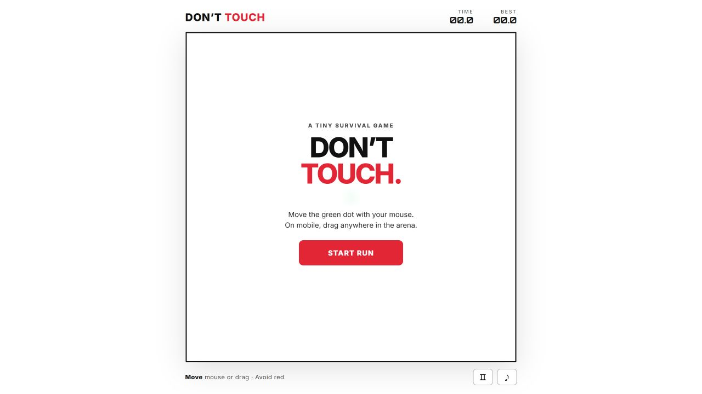
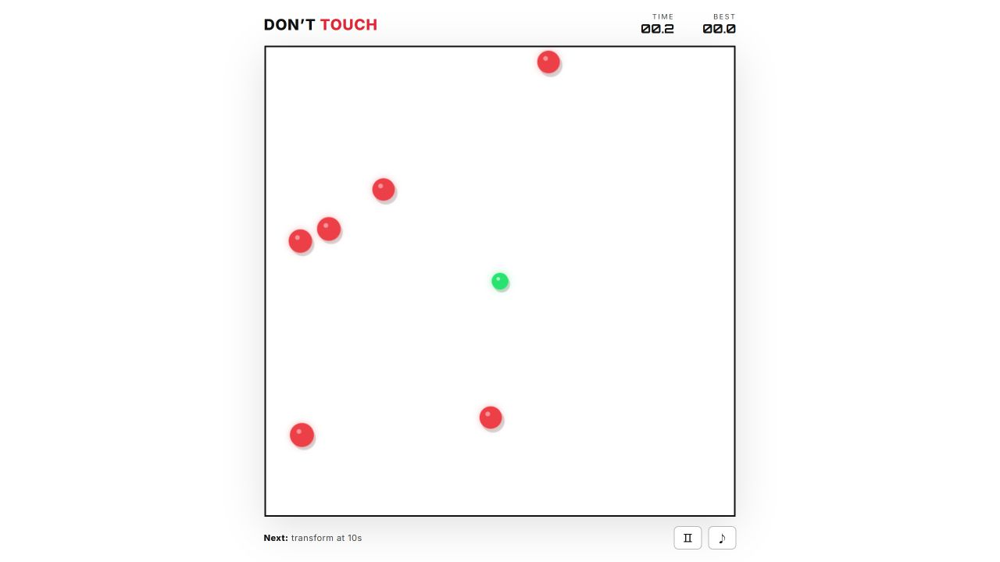
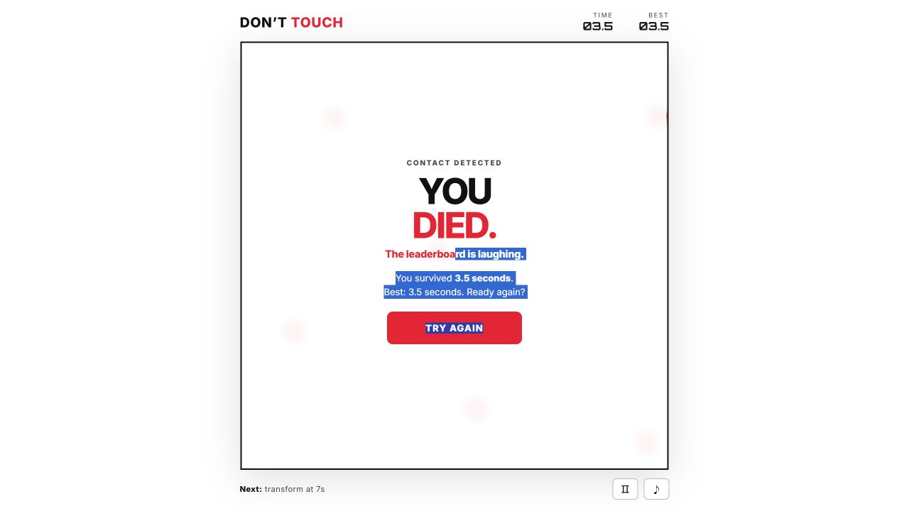

# DON’T TOUCH / Classic 游戏规格说明书

格式版本：V5.1

仅记录有依据的实现层事实；字段非必填。空白表示代码未披露或未登记，不代表不存在、不可玩或验收通过。

## 1. 基础事实

**维度定义**：游戏类型、操控体验和技术栈。

**内容说明**

- 游戏名称：DON’T TOUCH / Classic

**玩法类型**

动作 / 生存躲避

**操作方式**

鼠标在画布移动时原movePointer更新目标坐标；触控/拖动按原pointer捕获更新。START RUN或Enter/Space开局，TRY AGAIN或Enter/Space重开，P/Esc或暂停按钮切换暂停，音符切换静音。本次最终构建只实测开局与原碰撞结算；第5步已落在结算文本上，不声称移动/触控实际通过。

**视角与布局**

单屏俯视竞技场，顶部时间/BEST、中央原菜单/结算覆盖层，底部难度提示、暂停与静音。

**画面维度**

2D

**引擎**

原生浏览器Canvas2D，无游戏引擎依赖。

**程序语言**

JavaScript ES模块、HTML/CSS。

**结论字段**

- `game_summary` = 移动绿色圆点避开持续弹跳的红球，按生存秒数计分；碰撞死亡后查看本地最佳并继续挑战。

## 2. 资源类型

**维度定义**：内容元素类别及其引擎资源格式。

**内容说明**

**内容元素资源类型**

原Canvas程序绘制绿点、红球、拖尾、爆裂与闪屏；三份原MP3紧张音乐/碰撞/难度提示；原Inter和Orbitron字体、原favicon与图标图像。

**结论字段**

- `engine_asset_system` = 原Canvas2D逐帧绘制，Audio读取assets/audio同源MP3；字体用本地fonts.css。当前无外部框架、账号或CDN运行请求。

## 3. 核心挑战维度

**维度定义**：核心玩法所涉及的挑战类型及主次。

**内容说明**

**核心挑战内容**

随着红球数量与速度阶段性增加，连续调整绿点位置避免圆形碰撞，争取更长存活时间。

**结论字段**

- `core_challenge_type` = 操作执行

## 4. 操控方式

**维度定义**：输入方式、输入元素和操控构成。

**内容说明**

**操作方式**

鼠标在画布移动时原movePointer更新目标坐标；触控/拖动按原pointer捕获更新。START RUN或Enter/Space开局，TRY AGAIN或Enter/Space重开，P/Esc或暂停按钮切换暂停，音符切换静音。本次最终构建只实测开局与原碰撞结算；第5步已落在结算文本上，不声称移动/触控实际通过。

**操控构成要素**

画布pointermove、pointerdown/捕获，按钮及键盘快捷键。

## 5. 行为路径

**维度定义**：玩家在一次核心循环中重复执行的动作顺序。

**内容说明**

**核心玩法**

开局重置玩家与原随机障碍→指针目标带动绿点→红球在边界反弹并随时间升级→碰撞立即死亡→时间/BEST与原随机文案→重新挑战。

**结论字段**

- `core_loop` = 观察红球轨迹→移动绿点避开→时间增加/原难度阶段触发→继续生存或碰撞结算。

## 6. 游戏路径（关键节点 + 流失风险）

**维度定义**：从启动到结束的流程节点及已披露的风险。

**内容说明**

**游戏流程**

原标题→START RUN→生存局→YOU DIED与秒数/BEST→TRY AGAIN。本次实际到3.5秒原生死亡，未点击重开。

## 7. 成长路径

**维度定义**：玩家推进和变强的途径。

**内容说明**

**奖励与成长**

单局按时间触发障碍变形、加速及数量增加；跨局只有本地最佳秒数，不是有限关卡。

**结论字段**

- `progression_loop` = 挑战当前最佳→结算比较→再次挑战。

## 8. 核心闭环（目标-规则-反馈-激励）

**维度定义**：目标、规则、反馈、激励和下一目标。

**内容说明**

**目标规则反馈激励闭环**

目标：当前局避开所有红球并延长存活时间。规则：原玩家追随目标、边界限制、球体移动/反弹、圆形距离碰撞和时间难度阶段决定死亡，不增加无敌或降低速度。反馈：绿色拖尾、红球、计时/BEST、难度提示、碰撞爆裂/闪屏和YOU DIED/秒数/随机文案；最终构建实际3.5秒死亡与BEST3.5。激励：本地最高生存秒数；TRY AGAIN路径代码保留，本轮未点击。

## 9. 玩法规则

**维度定义**：核心循环、操作、胜负和结算规则。

**内容说明**

**目标、规则与结算数值**

玩家与红球圆形距离小于半径和即死亡。初始6球，10秒两球变形为四球；后续按原曲线加速/增加球数，最多14球并有速度上限。生存时间越长分数越高。

**已验证流程与未覆盖范围**

用户每款最多5步严格执行：第1步初始菜单，第2步首次开始遇powerUps声明缺失，修正本地闭包依赖选择对赋值变量的保留；第3步加载最终构建，第4步原START RUN，第5步拖动时已处原生3.5秒死亡结算，实际产生文字选中，不能冒充本次玩家移动验证。最终构建真实生成6个原红球并按原移动/碰撞更新，出现YOU DIED/生存3.5秒/BEST3.5；最终全启动至该结算20事件无截断、外联、HTTP失败或脚本异常，最终时间窗console空。早期失败网络与完整console全部留档，没有把旧错误隐藏为从未发生。原12函数语义SHA不变，4函数与相同Classic分支投影SHA一致，含update/draw、原移动/碰撞/难度/生成/帧循环；仅账号/在线赛季预检、云端提交、排行榜UI和遥测边界改变。原全部CSS文本、800画布、初始6障碍、速度倍率/14上限/难度阶段/碰撞半径/原随机死亡文案/本地最佳规则保留。Supabase/登录/在线榜单/支付/宿主代码真实移除，不拦截网络、不伪造账号或购买成功；原付费Power Mode不启用，当前交付为原免费Classic玩法。8份原字体、3音频及图标同源加载，资产HTTP/SHA核对。本轮未验证最终构建重开、成绩刷新恢复、实际移动响应、暂停/音量/听觉及10秒后难度阶段，五步已到不追加。正常原任务入库待人工验收，不批准不供货。

## 10. 数值配置

**维度定义**：影响玩法的生命、概率、时长、速度和经济等数值。

**内容说明**

**结论字段**

- `key_numbers` = 原800×800内部画布；玩家半径13×1.1=14.3，红球18×1.1=19.8。基础112、Classic起速112×1.72×1.2×1.04；速度上限为STARTING_SPEED×4.6，Classic球数上限14。10秒变形、20秒+25%/+2球、30秒+12%、40秒+10%/+1球、50秒+10%，60秒后按原每10秒阶段增长。玩家追随系数1-exp(-dt×18)，每帧dt上限0.033；均由原码保留。

## 11. 关卡配置

**维度定义**：关卡布局、目标、数量、递进和难度参数。

**内容说明**

**内容规模**

一个固定方形生存竞技场，原随机障碍生成/死亡短句和无限计时难度阶段；不声称存在固定关卡总数。付费Power Mode及在线赛季不在当前独立包范围。

**场景、关卡与难度设计**

原随机红球初始布局、位置安全距离搜索、边界弹跳、10秒变形和后续难度曲线；未替换为固定种子或删除危险球。

## 12. 系统设计

**维度定义**：功能系统及界面流程。

**内容说明**

**玩法系统与相互作用**

原玩家追随/指针输入、随机红球生成、速度/数量限制、变形、圆形碰撞、计时、拖尾与粒子、音频、暂停/静音、结算及原本地最佳。账号、排行榜、云端提交和支付依赖已拆除。

**界面流程与反馈**

原DON’T TOUCH菜单和Classic竞技场→原HUD→原YOU DIED/生存时间/BEST/TRY AGAIN。在线/账号/付费/关于联机入口实际删除，原CSS全文保持。死亡短句中的leaderboard玩笑仍是原随机文案，不提供排行榜功能。

**存档方式**

原localStorage键dontTouchBest保留，碰撞后按原best.toFixed(2)写入，HUD显示一位小数。本次最终运行BEST由0.0变3.5；未再次刷新，不能宣称新成绩跨刷新恢复已实测。当前局时间/红球位置不保存。

## 13. 主题化包装

**维度定义**：文字、叙事、命名及美术内容。

**内容说明**

**文字与美术内容**

原白底、黑红标题、红色START RUN、绿色玩家与红色障碍，保留原字体、边框及Canvas反馈。

**结论字段**

- `theme_position` = 极简颜色对比的短局生存挑战。

### 实际运行图解

图 1：最终构建原Classic菜单；免费开局，无账号/支付/在线榜单。

图 2：实际开局，6原红球、绿点、原计时与难度提示。

图 3：原生3.5秒死亡/BEST3.5；第5步拖动选中了结算文字，不作为移动通过证明。

## 14. 养成系统 + 经济系统

**维度定义**：成长要素和资源产出、消耗、回收机制。

**内容说明**

**养成与经济机制**

按实际生存秒数计分和本地最佳，无金币消费或充值。原付费Power Mode未解锁/未启用，不伪造订阅或每日授权。

**结论字段**

- `progression_loop` = 挑战当前最佳→结算比较→再次挑战。

## 15. 角色 / 单位设定

**维度定义**：角色单位的数量、属性、能力、定位和关系。

**内容说明**

**角色单位设定**

玩家绿点、原红球障碍及粒子，无角色养成或账号身份。

## 16. 商业化

**维度定义**：已实现的广告、内购、订阅、买断和付费点。

**内容说明**

**商业化实现**

移除Supabase、账号UI、在线排行榜/赛季授权/云端提交、真实支付与Power购买入口及宿主脚本；当前只保留原免费Classic模式。音频字节与加载保留，未作实际听觉结论。

**结论字段**

- `monetization` = 当前独立Classic包无广告、购买、真实支付或联网榜单。

### 事实依据与定位

当前main.js/source-preservation中12原函数及4原Classic投影、asset-preservation、最终network-final/console-final、早期失败记录与five-step-ledger；实际3.5秒原生结算截图。
