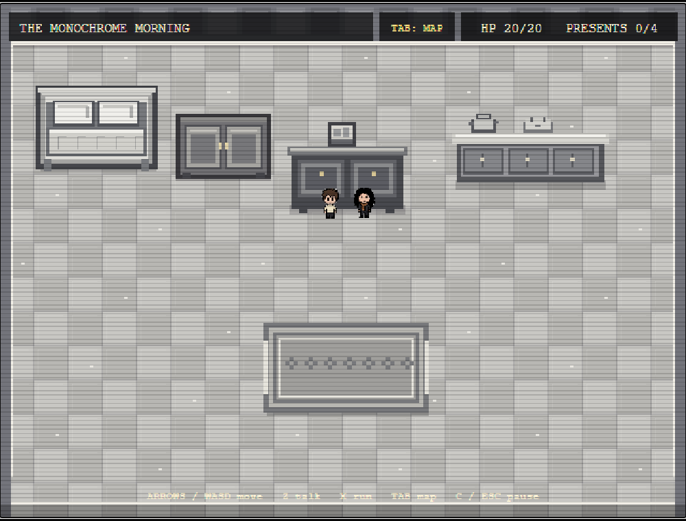
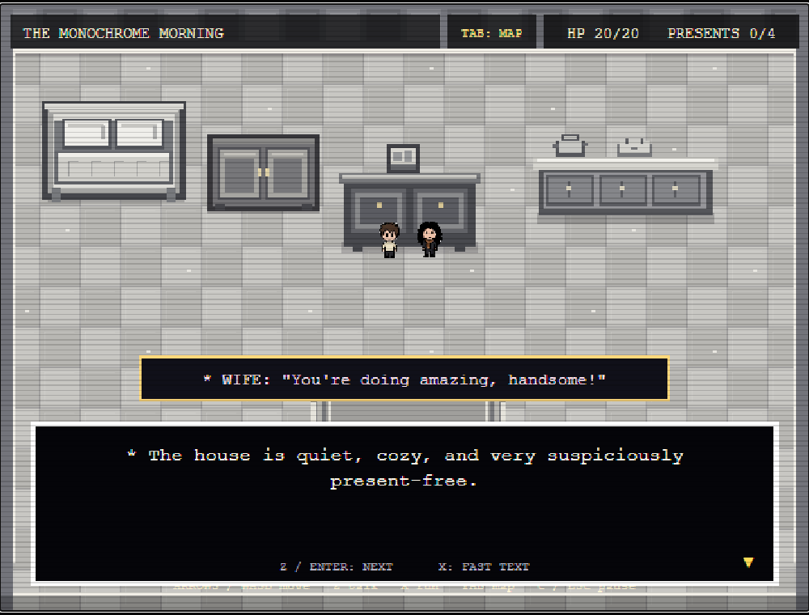
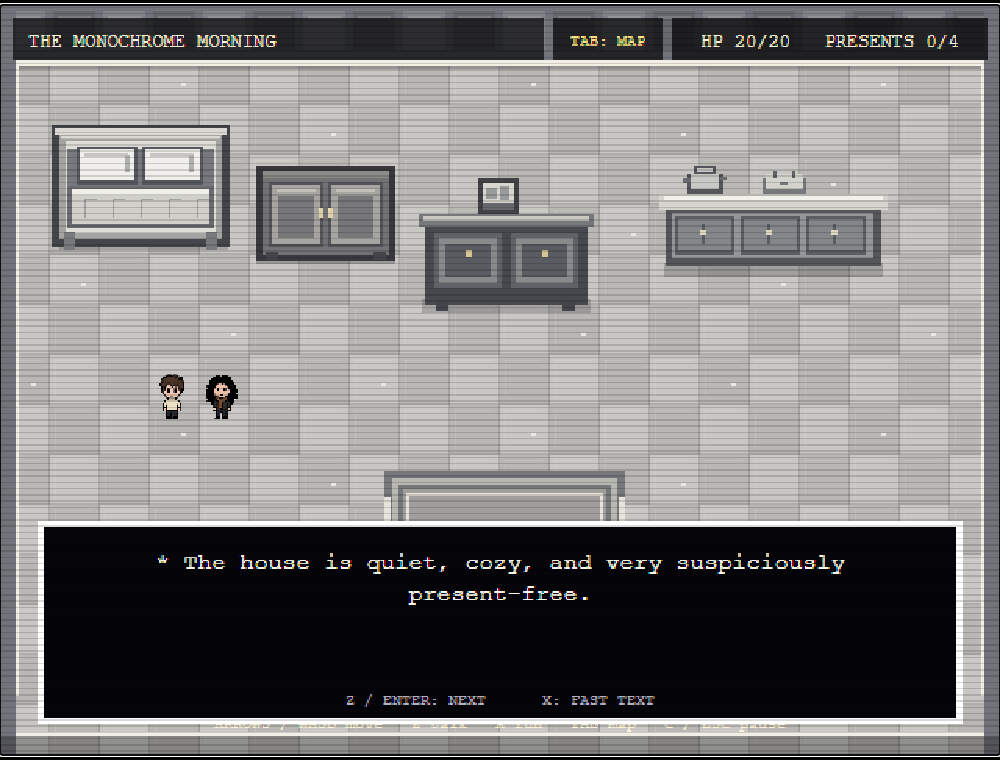
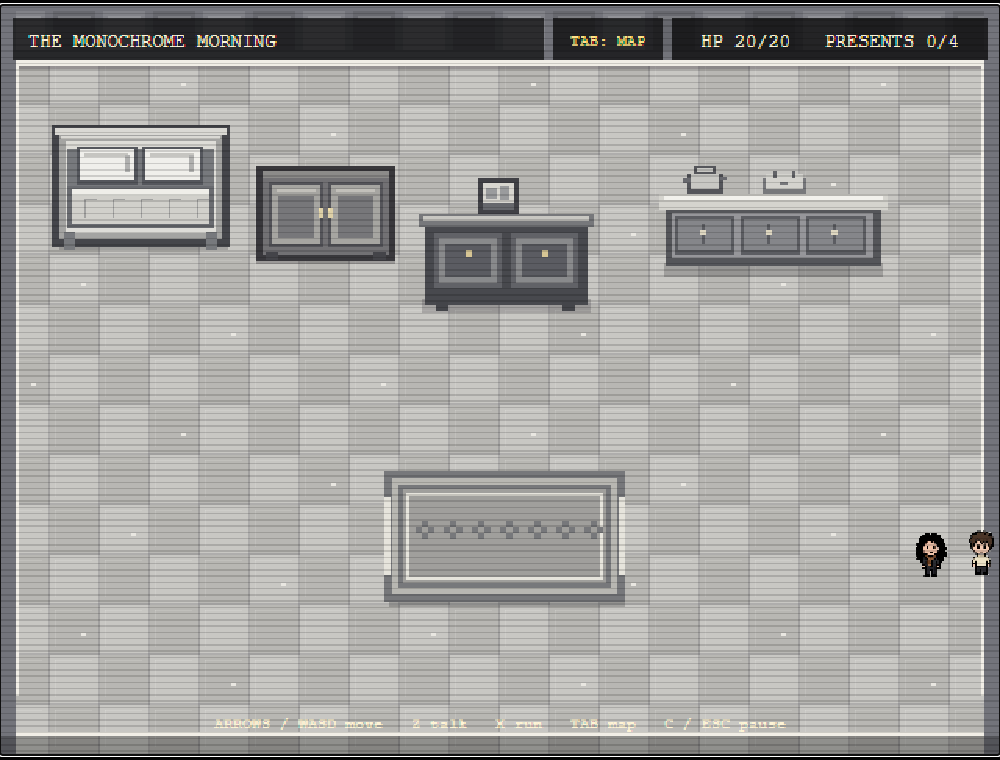
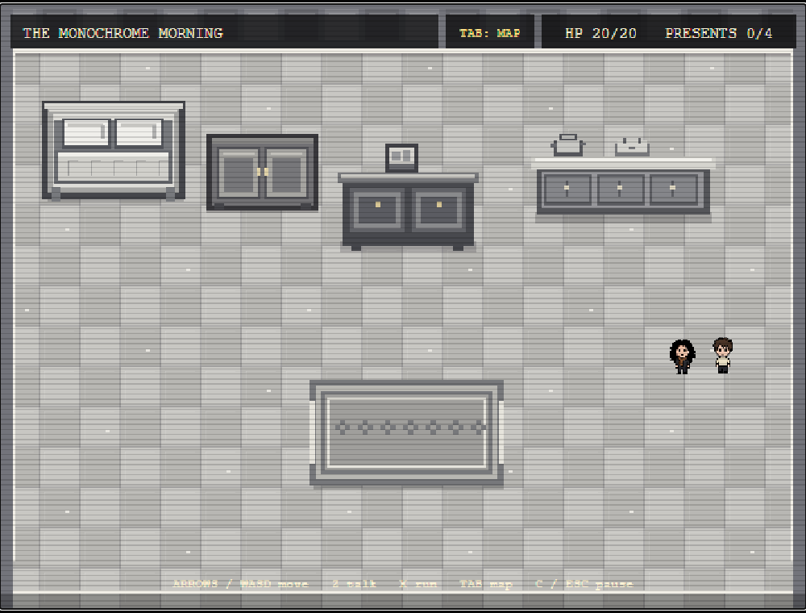
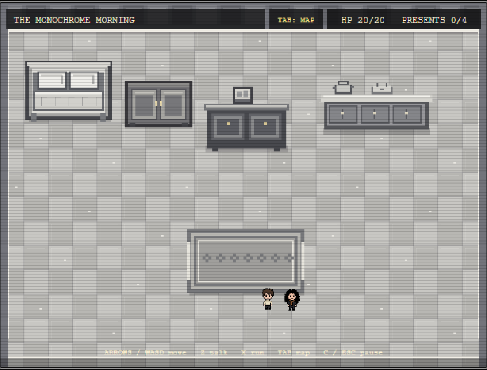
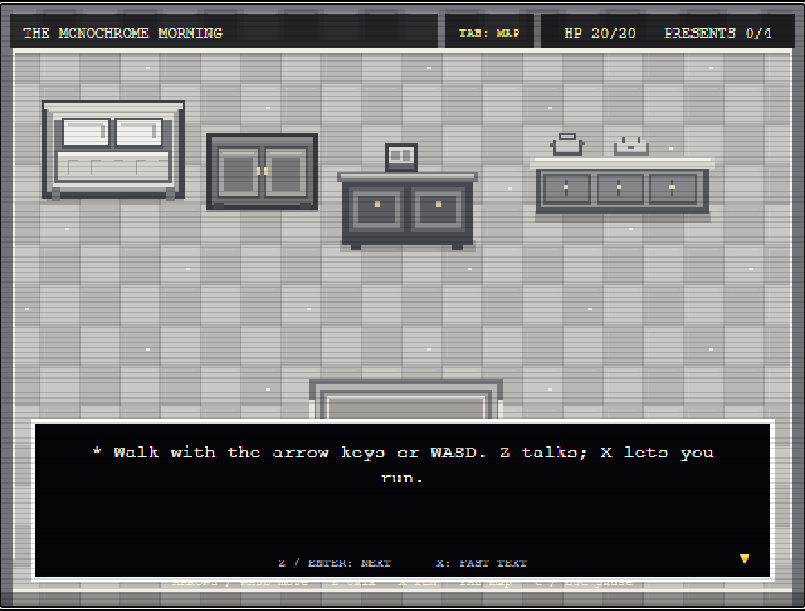

# Play BirthdayTale - Free Online Game | Rosebud 游戏规格说明书

## 玩法类型

像素风剧情冒险RPG

## 画面维度

2D

## 视角与布局

俯视角

## 核心玩法

在屋内探索、与NPC对话、寻找失踪的生日礼物

## 核心体验

黑白像素氛围下的叙事探索

## 操作方式

方向键/WASD → 移动 → 无对话时（实机验证）；Z → 对话/推进对话 → 有对话目标或文本时（实机验证）；X → 奔跑/快进文字 → 移动或文本显示时（界面提示）；Tab → 打开/关闭地图 → 探索时（实机验证）；Enter → 确认/开始 → 标题页与对话（实机验证）

## 游戏流程

开始：标题页按Z/Enter进入；操作：移动探索、与NPC对话推进剧情；结果：获取线索寻找礼物；继续：对话与探索循环推进

## 内容规模

已见区域：卧室/HOME与地图中LIVING ROOM；礼物目标4件；完整关卡数量未验证

## 奖励与成长

以收集礼物计数推进，教程对话引导基本操作

## 存档方式

教程阶段storage刷新前后均为空，未发现存档记录；后续保存点未验证

## 目标、规则与结算数值

目标：找回4件失踪的生日礼物（HUD显示PRESENTS 0/4）；HP 20/20，失败条件未验证

## 玩法系统与相互作用

对话系统（旁白与NPC对话逐字显示）、地图系统（Tab查看区域）、探索交互系统（家具调查触发旁白）；战斗系统未验证

## 界面流程与反馈

标题页（PRESS Z/ENTER）→ 开场旁白对话 → 屋内场景（HUD：HP、PRESENTS计数、Tab地图提示）→ 地图界面（区域标记）

## 场景、关卡与难度设计

未登记

## 已验证流程与未覆盖范围

实机验证：启动、标题进入、移动、对话、地图、reload重进；仅界面提示确认：X奔跑；未验证：礼物获取、后续场景、战斗与存档恢复

## 事实依据与定位

本轮截图step-50至step-129；runtime.json导航检查点startup/interaction/reload均passed

## 实际运行图解

图 1：实际操作记录 1。画面文字：无可提取文字；仅记录实际画面，不据此推断通关。

图 2：实际操作记录 12。画面文字：无可提取文字；仅记录实际画面，不据此推断通关。

图 3：实际操作记录 24。画面文字：无可提取文字；仅记录实际画面，不据此推断通关。

图 4：实际操作记录 35。画面文字：无可提取文字；仅记录实际画面，不据此推断通关。

图 5：实际操作记录 46。画面文字：无可提取文字；仅记录实际画面，不据此推断通关。

图 6：实际操作记录 57。画面文字：无可提取文字；仅记录实际画面，不据此推断通关。

图 7：实际操作记录 69。画面文字：无可提取文字；仅记录实际画面，不据此推断通关。

图 8：实际操作记录 80。画面文字：无可提取文字；仅记录实际画面，不据此推断通关。
