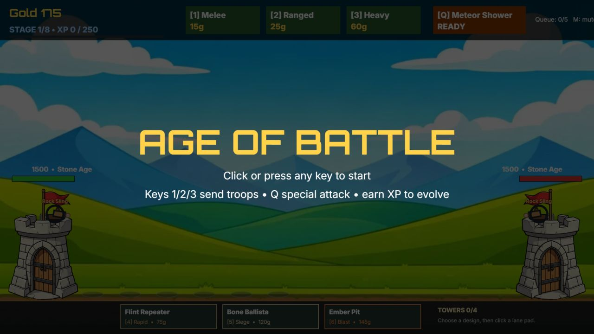
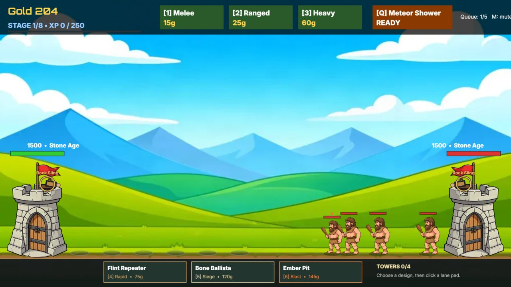
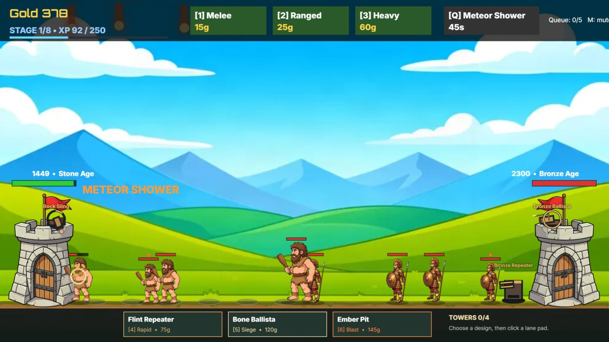

# Agefront / Age of Battle 游戏规格说明书

格式版本：V5.1

仅记录有依据的实现层事实；字段非必填。空白表示代码未披露或未登记，不代表不存在、不可玩或验收通过。

## 1. 基础事实

**维度定义**：游戏类型、操控体验和技术栈。

**内容说明**

- 游戏名称：Agefront / Age of Battle

**玩法类型**

策略 / 塔防

**操作方式**

点击画布或任意键开始；1/2/3训练近战/远程/重兵，Q时代技能，4/5/6选择当前时代塔设计后点击空建造位；时代升级卡用1/2/3或点击选择。M音量，原终局点击或R重开。此次五步只实测开始、1、Q与刷新，未实测建塔/升级卡/终局R。

**视角与布局**

固定横向战场，双方基地在两侧；顶部金币、时代/XP、兵种、技能和队列，下方塔设计与建造位。

**画面维度**

2D

**引擎**

浏览器原生Canvas2D；原版可编辑main.js。

**程序语言**

JavaScript、HTML/CSS。

**结论字段**

- `game_summary` = 训练近战、远程和重兵，配合基地火力、建塔与时代技能对抗原生AI，通过经验进化时代并争取消灭敌方基地。

## 2. 资源类型

**维度定义**：内容元素类别及其引擎资源格式。

**内容说明**

**内容元素资源类型**

原WebP背景、城堡、8时代单位、地面/光效等图像；原MP3音乐和战斗音效；23份原字体声明所用WOFF2。战斗单位、投射物、特效和HUD由Canvas绘制。

**结论字段**

- `engine_asset_system` = 原Image/Audio按assets相对路径载入，ctx绘制场景/单位/HUD；字体通过本地CSS加载，运行无外部资源请求。

## 3. 核心挑战维度

**维度定义**：核心玩法所涉及的挑战类型及主次。

**内容说明**

**核心挑战内容**

在被动收入和击杀收益约束下选择出兵、塔位与技能时机；对抗原AI自动出兵和进化，保护己方基地并摧毁敌方基地。

**结论字段**

- `core_challenge_type` = 策略规划 / 操作执行

## 4. 操控方式

**维度定义**：输入方式、输入元素和操控构成。

**内容说明**

**操作方式**

点击画布或任意键开始；1/2/3训练近战/远程/重兵，Q时代技能，4/5/6选择当前时代塔设计后点击空建造位；时代升级卡用1/2/3或点击选择。M音量，原终局点击或R重开。此次五步只实测开始、1、Q与刷新，未实测建塔/升级卡/终局R。

**操控构成要素**

键盘快捷键、画布点击、升级卡三选一、选择塔设计后点击原建造位。

## 5. 行为路径

**维度定义**：玩家在一次核心循环中重复执行的动作顺序。

**内容说明**

**核心玩法**

收入增长→消耗金币将兵种入训练队列→单位自动前进/索敌/攻击→击杀获取经验与经济→使用技能/塔防→达到经验阈值进化时代并选升级卡→基地生命决定胜负。

**结论字段**

- `core_loop` = 观察战线/资源→出兵或技能→原AI/物理交战→金币与经验变化→继续决策。

## 6. 游戏路径（关键节点 + 流失风险）

**维度定义**：从启动到结束的流程节点及已披露的风险。

**内容说明**

**游戏流程**

标题覆盖层→开始战斗→出兵/自动战斗/建塔/技能→时代进化与升级卡→某基地生命耗尽后原结果→点击或R重开。此次限五步验证核心操作与刷新，未观察胜负终局。

## 7. 成长路径

**维度定义**：玩家推进和变强的途径。

**内容说明**

**奖励与成长**

8时代按经验推进：石器、青铜、中世纪、文艺复兴、工业、现代、赛博、未来；时代影响单位/基地/技能/塔，进化时原升级卡三选一。无跨局持久成长。

**结论字段**

- `progression_loop` = 战斗经验→时代进化/升级卡→单位和防御增强→继续战斗。

## 8. 核心闭环（目标-规则-反馈-激励）

**维度定义**：目标、规则、反馈、激励和下一目标。

**内容说明**

**目标规则反馈激励闭环**

目标：短期组织训练队列抵挡敌军；中期积累经验进化并配置防御；单局目标摧毁敌方基地且保护己方。规则：按原金币消耗、队列容量、训练时长、射程/伤害/攻速、基地与塔火力判定战斗。反馈：金币、队列、XP/时代、血条、单位前进/投射物和技能特效、冷却数字；原终局覆盖层和重开代码保留但本次未触达。激励：收入/击杀收益、时代成长与升级卡；下一目标是持续出兵或进化。五步实测仅证明局内核心操作与重置，不宣称胜利或整局闭环已经试玩。

## 9. 玩法规则

**维度定义**：核心循环、操作、胜负和结算规则。

**内容说明**

**目标、规则与结算数值**

原双方基地初始1500生命，训练队列最多5项；近战/远程/重兵初始成本15/25/60金，时代与升级会改变成本或属性；Q技能按原冷却。胜负由原基地生命条件决定，不修改AI、伤害或自动判胜。

**已验证流程与未覆盖范围**

遵守用户每款最多5步：启动→点击开始→按1近战出兵→按Q陨石技能→刷新。实际出兵进入1/5训练队列，原单位生成并进入交战；Q显示METEOR SHOWER及45秒冷却，玩家基地1449、XP92/250；刷新恢复初始175金、Stage1/8、XP0/250、双方1500生命及技能READY。整份main.js与原包逐字节一致，不改8时代/兵种/AI/伤害/经济/升级/胜负和难度。退役Rosebud加载器/聊天/图生/进度与OGP及网络拦截包装；23份原字体声明本地化，修正扩展名CSS MIME。保留原8时代、三类兵、基地自动防御、各时代三塔、升级卡、技能、原UI和图像/音频。原玩法无localStorage调用，旧审计swarmHi说法错误已纠正；刷新是重置而非中局恢复。42条完整事件覆盖第2—5步及末次完整加载，无截断/外联/失败/脚本异常/console警告错误。未等待胜负、未验证本次后续时代/升级卡/建塔/重开或真实触控听觉；此前Stage8观察保留为历史，不冒充本次完成。正常沿原任务交付待人工验收，不批准不供货。

## 10. 数值配置

**维度定义**：影响玩法的生命、概率、时长、速度和经济等数值。

**内容说明**

**结论字段**

- `key_numbers` = 原画布1920×1080。初始175金、时代1、XP0/250；近战HP60/伤害12/射程40/速度70/冷却0.8，远程40/9/260/60/1.0，重兵180/28/50/45/1.3，受时代倍率及升级影响。原技能基础冷却45秒；队列上限5；玩家塔上限4、6个候选塔位。

## 11. 关卡配置

**维度定义**：关卡布局、目标、数量、递进和难度参数。

**内容说明**

**内容规模**

8时代，每时代三类兵种和三种塔设计，8个基地自动防御武器；原完整配置和资源保留，不将24项塔设计称24关。

**场景、关卡与难度设计**

一条横向战线和两侧基地，时代进化改变战斗属性；塔位为原六处可选位置，建塔仍受上限与金币约束。原AI双方升级与难度不变。

## 12. 系统设计

**维度定义**：功能系统及界面流程。

**内容说明**

**玩法系统与相互作用**

被动收入/击杀收益、训练队列、三类单位索敌与攻击、基地防御、玩家/AI塔、时代/经验/升级卡、技能冷却与特效、音量、标题和原胜负重开。

**界面流程与反馈**

原标题→战斗HUD→升级选择覆盖层→战斗→胜负覆盖层。实测主HUD、队列、Q技能冷却，刷新回标题。

**存档方式**

原main.js无localStorage/持久化调用；所有战斗状态在内存。刷新恢复175金、Stage1/8、XP0/250、双方1500生命与READY；不是中局恢复。未新增个人存档。

## 13. 主题化包装

**维度定义**：文字、叙事、命名及美术内容。

**内容说明**

**文字与美术内容**

从石器到未来的时代战场，保留原山地、城堡、时代单位贴图、色条与Canvas特效。游戏内标题AGE OF BATTLE，任务名Agefront。

**结论字段**

- `theme_position` = 时代进化战争与基地攻防。

### 实际运行图解

图 1：原版标题与初始175金、Stage1/8。

图 2：按1后训练队列1/5；金币在被动增长，不将截图差额冒充净扣费。

图 3：Q陨石技能、45秒冷却及原生交战；不是胜负终局。

## 14. 养成系统 + 经济系统

**维度定义**：成长要素和资源产出、消耗、回收机制。

**内容说明**

**养成与经济机制**

原金币被动增长并可从击杀获得，出兵与建塔消耗；经验用于时代进化。升级卡会改变折扣、队列、塔伤害或技能冷却等，保留原上限；没有充值、跨局钱包或云存档。

**结论字段**

- `progression_loop` = 战斗经验→时代进化/升级卡→单位和防御增强→继续战斗。

## 15. 角色 / 单位设定

**维度定义**：角色单位的数量、属性、能力、定位和关系。

**内容说明**

**角色单位设定**

玩家与原生AI双方基地、三类单位（近战/远程/重兵）、时代塔和技能投射物。时代单位图像和属性由原数组驱动；保留原完整阵容。

## 16. 商业化

**维度定义**：已实现的广告、内购、订阅、买断和付费点。

**内容说明**

**商业化实现**

当前独立交付退役Rosebud宿主工具，不加载广告/账号/排行榜/支付或网络对战。原音乐/音效保留，本轮只核对字节与加载，不作听觉结论。

**结论字段**

- `monetization` = 当前无真实广告或支付接口。

### 事实依据与定位

原main.js完整SHA、ERAS/UNIT_TYPES/TOWER_OPTIONS/DEFENSE_WEAPONS与技能/训练/战斗函数；source-preservation、asset-recovery、resource-http-verified、five-step-ledger和network-final。
