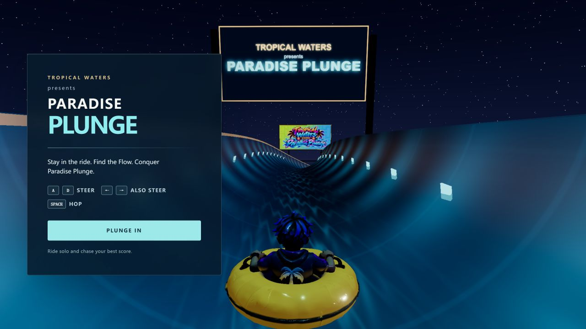
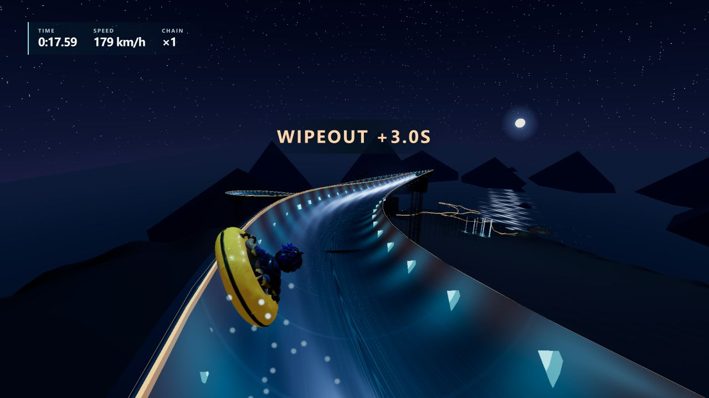

# Paradise Plunge 游戏规格说明书

格式版本：V5.1

仅记录有依据的实现层事实；字段非必填。空白表示代码未披露或未登记，不代表不存在、不可玩或验收通过。

## 1. 基础事实

**维度定义**：游戏类型、操控体验和技术栈。

**内容说明**

- 游戏名称：Paradise Plunge

**玩法类型**

体育 / 跑酷

**操作方式**

A/D或左右方向键持续转向，Space跳跃；点击Plunge in开始，原结算Run again代码保留。实际仅按5步上限验证A和Space输入及刷新，未操作终点Run again。原移动按钮仍保留，真实触屏未测。

**视角与布局**

第三人称尾随泳圈，弯道随角色朝向移动；左上Time/Speed/Chain，下方Now Riding赛段与WIPEOUT反馈。

**画面维度**

3D

**引擎**

Three.js 0.185.x、GLTFLoader与EffectComposer/UnrealBloom/OutputPass。

**程序语言**

JavaScript ES模块、HTML/CSS、Three GLSL材质；原内联模块提取为可编辑main.js。

**结论字段**

- `game_summary` = 乘泳圈沿高空水上滑梯下滑，通过转向和跳跃维持路线，终点入池后按时间与滑行表现计分。

## 2. 资源类型

**维度定义**：内容元素类别及其引擎资源格式。

**内容说明**

**内容元素资源类型**

场景、泳圈、角色与棕榈/支架等7份原GLB二进制模型；3张原WebP广告牌/品牌图；Three程序几何、GLSL水体/灯光、Canvas纹理、CSS界面；音效由原WebAudio程序合成。原资源字节保留。

**结论字段**

- `engine_asset_system` = 本地vendor/Three模块与assets/模型纹理；GLTFLoader读取原二进制，原分段曲线和几何生成赛道。未新增联网下载或占位模型。

## 3. 核心挑战维度

**维度定义**：核心玩法所涉及的挑战类型及主次。

**内容说明**

**核心挑战内容**

高速滑行时控制转向和起跳，沿原弯道、开口与分支保持在赛道内，失误后从检查点恢复并累计时间惩罚。

**结论字段**

- `core_challenge_type` = 操作执行

## 4. 操控方式

**维度定义**：输入方式、输入元素和操控构成。

**内容说明**

**操作方式**

A/D或左右方向键持续转向，Space跳跃；点击Plunge in开始，原结算Run again代码保留。实际仅按5步上限验证A和Space输入及刷新，未操作终点Run again。原移动按钮仍保留，真实触屏未测。

**操控构成要素**

左右键持续输入、Space跳跃、菜单点击；实测A600ms/Space160ms。

## 5. 行为路径

**维度定义**：玩家在一次核心循环中重复执行的动作顺序。

**内容说明**

**核心玩法**

点击开始→观察弯道和速度→左右转向或跳跃→沿赛道推进/触发WIPEOUT→检查点继续→终点入池后原统计结算。

**结论字段**

- `core_loop` = 观察路线→输入方向/跳跃→位置速度变化→判断赛道边界和检查点→继续滑行。

## 6. 游戏路径（关键节点 + 流失风险）

**维度定义**：从启动到结束的流程节点及已披露的风险。

**内容说明**

**游戏流程**

原菜单→Plunge in→十段连续赛道→终点泳池→统计面板→Run again。此次只实测前两赛段及WIPEOUT恢复，按5步上限停止，不宣称完整流程已实测。

## 7. 成长路径

**维度定义**：玩家推进和变强的途径。

**内容说明**

**奖励与成长**

本局累计时间、速度、连锁、浪峰/腾空/干净度等评价；未发现当前原玩法调用持久化存储，不能宣称最高分、成长解锁或新关卡存档。

## 8. 核心闭环（目标-规则-反馈-激励）

**维度定义**：目标、规则、反馈、激励和下一目标。

**内容说明**

**目标规则反馈激励闭环**

目标：沿赛道抵达终点泳池，取得更好的滑行表现。规则：原固定步长物理、转向、跳跃、碰撞和检查点处理不变；WIPEOUT加3秒，不直接结束整局。反馈：角色/泳圈位置和倾斜、尾随镜头、水花/光效、Time/Speed/Chain、赛段名、WIPEOUT大字。激励：源码存在时间/浪峰/腾空/连锁与落地区域的原计分，终点统计和Run again可作为下一目标；本轮未到达终点，奖励与结算不列为实测。刷新回菜单重新开始，不声称恢复未完成局。

## 9. 玩法规则

**维度定义**：核心循环、操作、胜负和结算规则。

**内容说明**

**目标、规则与结算数值**

从起点沿原连续赛道到终点泳池；冲出赛道或原碰撞条件触发WIPEOUT与检查点恢复，并加3秒。最终分数至少0；计分和原落地区域逻辑不改。没有新增自动成功或减少惩罚。

**已验证流程与未覆盖范围**

按用户最新上限仅验证5步：1启动原菜单，2点击Plunge in，3按A转向600ms，4按Space160ms，5刷新回菜单。实际由SUMMIT LAUNCH进入THE WALL，出现原WIPEOUT+3.0S，恢复后继续滑行；未到终点、未验证完整结算或Run again，不宣称通关。保留原lt物理/赛道/碰撞/计时/得分/难度、全部10赛段配置及原UI/模型/纹理；71个原函数或类语义SHA一致，原assets/vendor逐字节一致。退役实际SDK发现/绑定/上报/云发送器和整个Team网络类，原local-host假SDK包装移出运行包；不伪造房间、账号、广告或支付。保留原单人结果和重玩代码，不改变成功条件；当前原玩法未实际调用保存方法，刷新回菜单，不宣称记录或局面持久保存。完整74事件覆盖第2—5步及末次完整加载，无截断/外联/加载失败/脚本异常，console无警告错误。首屏加载发生在游标之前，不冒充完整全程；未验证后续赛段/终点/真触控/听觉。沿原任务正常交付待人工验收，不批准、不供货。

## 10. 数值配置

**维度定义**：影响玩法的生命、概率、时长、速度和经济等数值。

**内容说明**

**结论字段**

- `key_numbers` = 源码固定步长1/120秒；WIPEOUT+3秒。finalScore=max(0,round(score+landingBonus+max(0,420-time)*40+goodTime*15+crests*200+airtime*25-wipeouts*250))。flow=round(100*goodTime/max(1,time))；clean=round(max(0,100-wipeouts*7-damage*20))。均为原源码公式，非此次终点实测数值。

## 11. 关卡配置

**维度定义**：关卡布局、目标、数量、递进和难度参数。

**内容说明**

**内容规模**

10个连续赛段：SUMMIT LAUNCH、THE WALL、THE DROP、THE GLASS RUN、THE SPLIT、THE SURGE、THE GAP、THE SPIRAL、PARADISE FALLS、THE PARADISE PLUNGE。是同一连续滑道的分段，不称10个独立关卡；全部配置保留，实测前两段。

**场景、关卡与难度设计**

原分段曲线、宽度/倾斜、跳台、分支、开口与终点泳池；SPLIT和GAP原路线分支保留。未按操作能力缩短THE WALL或修改难度。

## 12. 系统设计

**维度定义**：功能系统及界面流程。

**内容说明**

**玩法系统与相互作用**

泳圈物理/输入、分段路线、碰撞与检查点、计时/评分、镜头/水花/程序音频、原菜单和结果UI、桌面/移动输入。真实组队传输与宿主功能已退役。

**界面流程与反馈**

菜单显示原标题/操作提示/Plunge in；开始后顶部Time/Speed/Chain和当前赛段；WIPEOUT显示+3秒并恢复；原结果面板代码有时间与各项评价、Run again。刷新回菜单。

**存档方式**

当前原玩法中没有ne.saveState调用；原local-host中通用localStorage桥并不构成游戏实际保存。此次已退役该SDK桥，未新增存档。实测刷新回菜单；不声称保留成绩或局面。

## 13. 主题化包装

**维度定义**：文字、叙事、命名及美术内容。

**内容说明**

**文字与美术内容**

Tropical Waters夜间海岛高空滑道、棕榈/礁石/度假村、霓虹灯、水体和黄色泳圈，保留原角色、广告牌纹理和英文UI。

**结论字段**

- `theme_position` = 热带水上滑梯运动。

### 实际运行图解

图 1：第1步原菜单、角色泳圈与滑道。

图 2：第3步A转向后THE WALL，实际WIPEOUT+3.0S；不是通关。

图 3：第5步刷新回菜单；不代表持久成绩或局面恢复。

## 14. 养成系统 + 经济系统

**维度定义**：成长要素和资源产出、消耗、回收机制。

**内容说明**

**养成与经济机制**

未发现商店、货币或养成消耗链；本局计分属于表现评价，不能当作可消费货币。

## 15. 角色 / 单位设定

**维度定义**：角色单位的数量、属性、能力、定位和关系。

**内容说明**

**角色单位设定**

一个单人泳圈骑手，原角色/泳圈模型及外观材质保留；其他模型为场景装饰与支撑物。原Team网络参与者和远端影子已退役。

## 16. 商业化

**维度定义**：已实现的广告、内购、订阅、买断和付费点。

**内容说明**

**商业化实现**

当前版本不加载真实广告/支付SDK，不上报成绩、云存档或组队消息。原场景里的品牌/广告牌纹理仍保留为静态美术，不代表网络广告。未接入供货。

**结论字段**

- `monetization` = 本交付无真实广告或支付请求。

### 事实依据与定位

main.js原lt物理类/赛段ss与Ot/原UI jt及统计方法；source-preservation.json记录71语义SHA和vendor字节；resource-http-verified.json；network-final.json；screenshots/revision-01..05。
