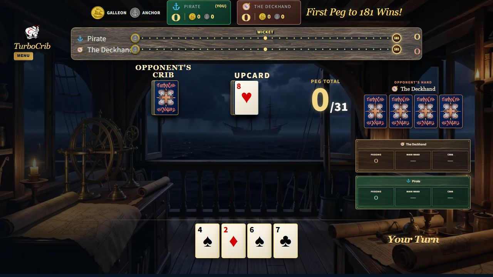
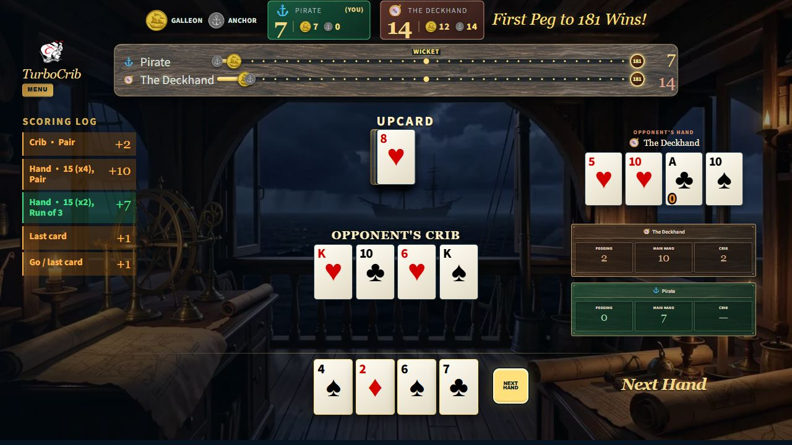
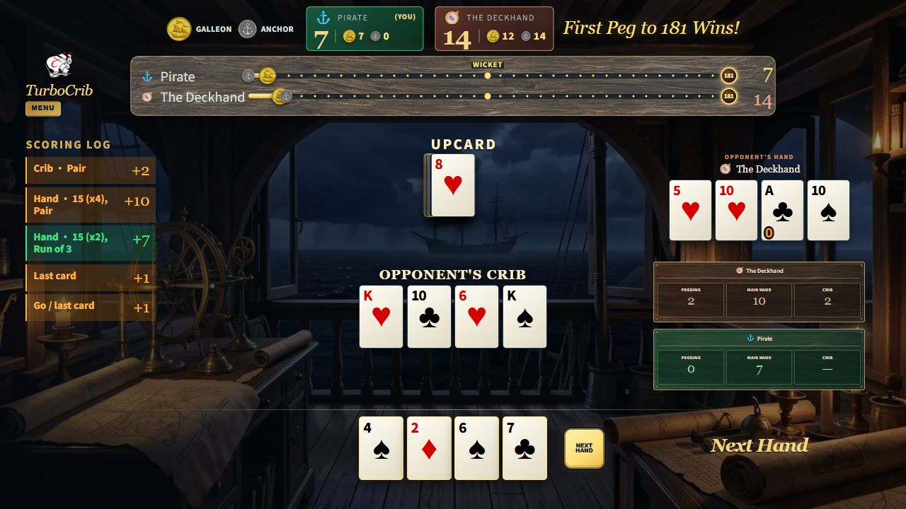

# TurboCrib 游戏规格说明书

格式版本：V5.1

仅记录有依据的实现层事实；字段非必填。空白表示代码未披露或未登记，不代表不存在、不可玩或验收通过。

## 1. 基础事实

**维度定义**：游戏类型、操控体验和技术栈。

**内容说明**

- 游戏名称：TurboCrib

**玩法类型**

纸牌 / Cribbage变体 / 电脑对局

**操作方式**

鼠标选择原卡牌、弃牌、CALL GO、COUNT HAND、菜单与返回游戏；输入本地显示名。触控未验证。

**视角与布局**

原固定桌面牌桌、双方轨道与手牌区域。

**画面维度**

2D

**引擎**

原DOM界面与JavaScript模块，原Phaser本地依赖保留。

**程序语言**

JavaScript ES模块、HTML/CSS。

**结论字段**

- `game_summary` = 选择航海主题的CPU对手，切牌决定发牌方，六张手牌弃二进入crib，通过原逐张pegging与手牌/crib计分推进双标记轨道。

## 2. 资源类型

**维度定义**：内容元素类别及其引擎资源格式。

**内容说明**

**内容元素资源类型**

原牌背/船舶/海洋背景/标记PNG与WebP/JPG、原MP3、规则与胜利展示模块。

**结论字段**

- `engine_asset_system` = 相对路径本地assets与Phaser依赖，四份同源原资产补齐，工程GET/SHA逐项核对。

## 3. 核心挑战维度

**维度定义**：核心玩法所涉及的挑战类型及主次。

**内容说明**

**核心挑战内容**

按原点值与31上限轮流出牌，无法出牌调用原GO，使用原手牌组合与crib计分。原特殊A/Joker数值选择规则保持。

**结论字段**

- `core_challenge_type` = 手牌组合 / 弃牌策略 / 逐张计分决策

## 4. 操控方式

**维度定义**：输入方式、输入元素和操控构成。

**内容说明**

**操作方式**

鼠标选择原卡牌、弃牌、CALL GO、COUNT HAND、菜单与返回游戏；输入本地显示名。触控未验证。

**操控构成要素**

原级别/CPU难度/模式选择、六选二弃牌、四张pegging、过牌、计分和下一手按钮。在线模式明确禁用。

## 5. 行为路径

**维度定义**：玩家在一次核心循环中重复执行的动作顺序。

**内容说明**

**核心玩法**

原Level1/Deckhand，切牌平局重切→六张弃二→7/6/2与GO→4→COUNT HAND，真实玩家7分/电脑14分。

**结论字段**

- `core_loop` = 切牌发牌→弃二入crib→双方轮流pegging→手牌和crib计分→下一手→原目标胜利；本轮只实测首手与恢复。

## 6. 游戏路径（关键节点 + 流失风险）

**维度定义**：从启动到结束的流程节点及已披露的风险。

**内容说明**

**游戏流程**

首手完成进入Next Hand，未开始第二手，未证明完整181目标比赛。

## 7. 成长路径

**维度定义**：玩家推进和变强的途径。

**内容说明**

**奖励与成长**

原Level1/Level2、Deckhand/Midshipman/Admiral、Training、双标记轨道和Joker扩展保留；仅Level1/Deckhand首手实测。

**结论字段**

- `progression_loop` = 原逐手累积分数与双标记推进目标；实际只玩家7/电脑14。

## 8. 核心闭环（目标-规则-反馈-激励）

**维度定义**：目标、规则、反馈、激励和下一目标。

**内容说明**

**目标规则反馈激励闭环**

同一首手弃牌/轮流出牌/过牌/双方计分成立；刷新后原返回入口恢复同牌局与分数。

## 9. 玩法规则

**维度定义**：核心循环、操作、胜负和结算规则。

**内容说明**

**目标、规则与结算数值**

原cribbage-logic.js SHA3378ef1443639f05438e3946420cc93b607fe56cc13a560ae47ce64280c14c8f不变，无改点值/概率/发牌/得分/目标。

**已验证流程与未覆盖范围**

保留TurboCrib原DOM/JavaScript与Phaser资源、875原类方法中841指纹不变，34处实际云认证/档案/房间/排行及其入口边界变更；joinRoom实际实现退役，另有明确不可用提示方法。cribbage-logic、背景音乐、ID及胜利展示四原模块字节不变。原CPU/Training与设备存档保留，不伪造在线账号、房间或排行榜。四份缺失原图/音效从同一原构建HTTPS200/SHA补齐。五关键验证项16次实际机械输入，另一次AX定位输入前失败留证：本地Pirate→原切牌平局重切→六张弃二→首手四张原生出牌及CALL GO→Count Hand原生玩家+7，电脑2pegging+10hand+2crib=14→真实刷新ReturnToGame恢复同一7/14与原牌。原Level1目标181与双Joker规则不变；没有第二手、全局胜利或RNG/分数/时钟注入。103完整网络事件无外联、无HTTP错误、无运行异常，控制台零错误零警告；一条原背景音乐已HTTP200后浏览器取消ERR_ABORTED留证，未宣称听觉通过。UI后仅修正误导的多人页脚文字，不改玩法。未验证Training/其他难度/Level2/Joker特殊规则/全部胜利/触控/听觉/云账号。准备时远端人工暂停；用户随后明确“仅接续TurboCrib”，仅授权本款沿原任务正常入库待验收，其他暂停保持。

## 10. 数值配置

**维度定义**：影响玩法的生命、概率、时长、速度和经济等数值。

**内容说明**

**结论字段**

- `key_numbers` = 实测Level1目标181，标准2Jokers；本手玩家4♠/2♦/6♠/7♣，upcard8♥，手牌15(x2)+run3=7；电脑pegging2+hand10+crib2=14。

## 11. 关卡配置

**维度定义**：关卡布局、目标、数量、递进和难度参数。

**内容说明**

**内容规模**

原航海牌桌、双方标记、CPU难度、Training、原音效与胜利界面。胜利/特殊规则不作本轮通过声明。

**场景、关卡与难度设计**

保留原连续牌局与级别选择，未改造为短关或简化卡牌玩法。

## 12. 系统设计

**维度定义**：功能系统及界面流程。

**内容说明**

**玩法系统与相互作用**

原发牌/弃牌/pegging/GO/手牌与crib计分、CPU决策、本地存档、音频与胜利展示；真实云认证/房间/排行/定位/私聊退役。

**界面流程与反馈**

原设置→PLAY→Cut平局重切→弃二→轮流出牌→COUNT HAND→Next Hand→刷新设置→RETURN TO GAME恢复。

**存档方式**

原设备存档真实恢复首手7/14、牌面和Next Hand；无云端或跨设备承诺。

## 13. 主题化包装

**维度定义**：文字、叙事、命名及美术内容。

**内容说明**

**文字与美术内容**

原航海船舱、暗海背景、金色轨道和木质计分面板，使用原素材。

**结论字段**

- `theme_position` = 海盗航海主题的策略纸牌。

### 实际运行图解

图 1：原首手弃牌后进入实际CPU对局。

图 2：原首手结算，玩家7分/电脑14分。

图 3：真实刷新返回同一原牌局和计分。

## 14. 养成系统 + 经济系统

**维度定义**：成长要素和资源产出、消耗、回收机制。

**内容说明**

**养成与经济机制**

原比赛分数与轨道，不新增货币、付费或资源注入。

**结论字段**

- `progression_loop` = 原逐手累积分数与双标记推进目标；实际只玩家7/电脑14。

## 15. 角色 / 单位设定

**维度定义**：角色单位的数量、属性、能力、定位和关系。

**内容说明**

**角色单位设定**

本地Pirate对原CPU Deckhand；CPU不是远端玩家。

## 16. 商业化

**维度定义**：已实现的广告、内购、订阅、买断和付费点。

**内容说明**

**商业化实现**

移除实际Supabase provider/协议与宿主脚本，在线入口禁用并明确说明。

**结论字段**

- `monetization` = 未新增广告/支付；原联网账号与对局服务退役，不伪造服务成功。

### 事实依据与定位

5关键项16输入台账、103完整网络事件、原首手与恢复DOM、真实截图、源指纹及材料SHA。
