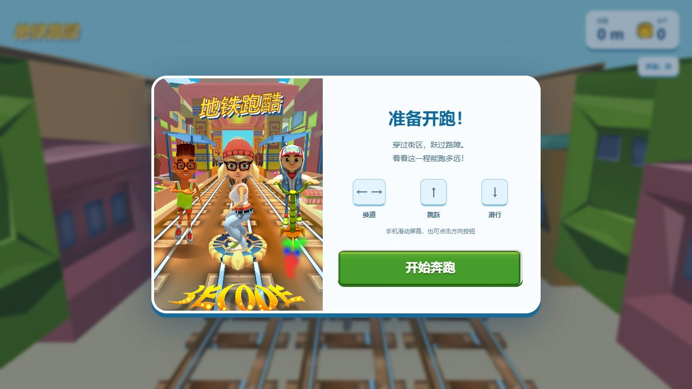
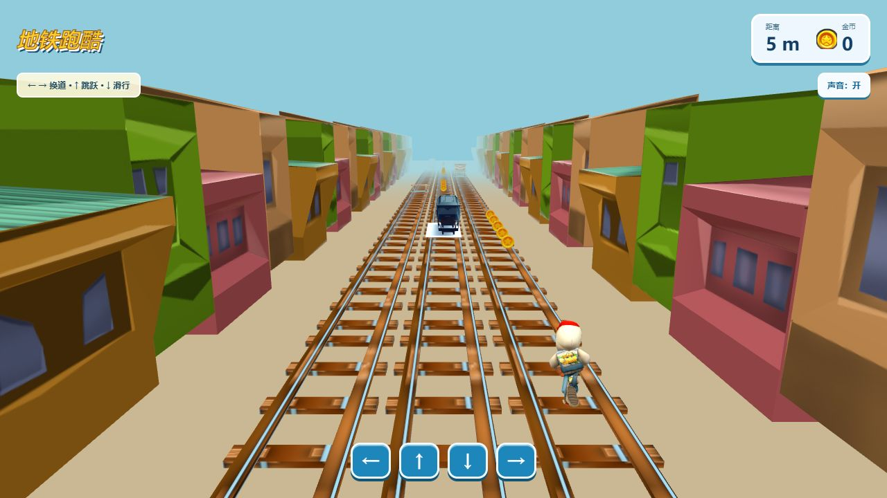
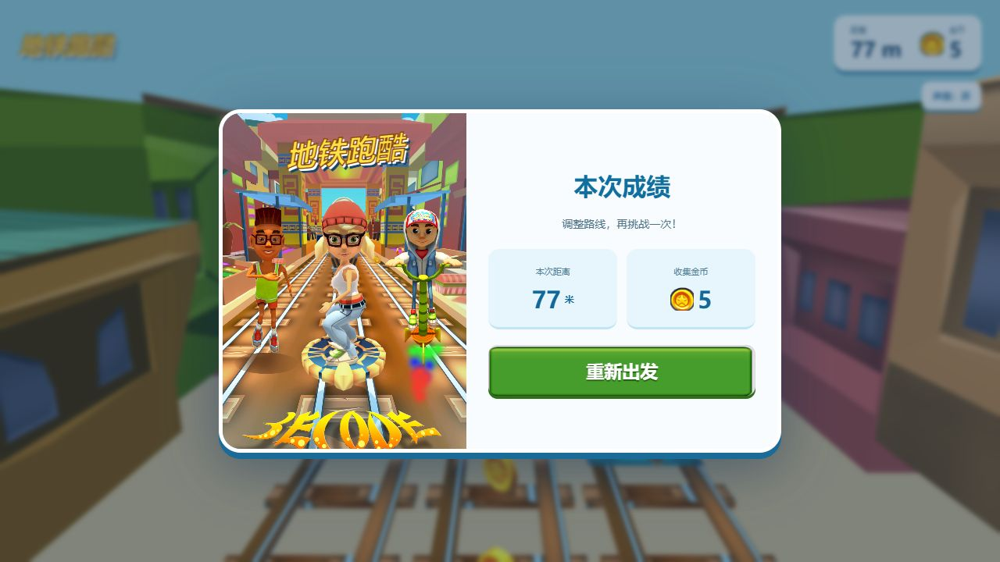

# 地铁跑酷 游戏规格说明书

格式版本：V5.1

仅记录有依据的实现层事实；字段非必填。空白表示代码未披露或未登记，不代表不存在、不可玩或验收通过。

## 1. 基础事实

**维度定义**：游戏类型、操控体验和技术栈。

**内容说明**

- 游戏名称：地铁跑酷

**玩法类型**

三车道无尽跑酷

**操作方式**

←/A向左，→/D向右，↑/W/Space跳跃，↓/S滑行；运行按钮/方向按钮与画布滑动。Enter可从就绪或结算开局。本轮真实点击开始/重开、运行中Right；首次Right在已死亡状态，未记成功。

**视角与布局**

固定第三人称后方透视摄像机，跟随主角的前方轨道视野。

**画面维度**

3D

**引擎**

Three.js单机学习适配，非完整原Unity工程；使用原提取资源。

**程序语言**

JavaScript ES模块、HTML/CSS

**结论字段**

- `game_summary` = 控制原Jake角色在三条轨道上奔跑，换道收集金币并躲避列车/路障，碰撞后结算距离与金币，可重新出发。

## 2. 资源类型

**维度定义**：内容元素类别及其引擎资源格式。

**内容说明**

**内容元素资源类型**

原提取Jake蒙皮网格/骨架、run/jump/roll剪辑、金币/列车/高低栏/建筑/轨道网格与贴图、原M4A背景音乐/撞击音、原UI图集/封面。

**结论字段**

- `engine_asset_system` = 本地Three模块、JSON网格/骨架/剪辑和贴图、HTMLAudio；资源路径/摘要随包。

## 3. 核心挑战维度

**维度定义**：核心玩法所涉及的挑战类型及主次。

**内容说明**

**核心挑战内容**

根据列车/高低栏与金币所在车道选择路线；跳过低栏或滑过高栏，列车碰撞不可跳过。

**结论字段**

- `core_challenge_type` = 路线选择 / 障碍躲避 / 时机判断

## 4. 操控方式

**维度定义**：输入方式、输入元素和操控构成。

**内容说明**

**操作方式**

←/A向左，→/D向右，↑/W/Space跳跃，↓/S滑行；运行按钮/方向按钮与画布滑动。Enter可从就绪或结算开局。本轮真实点击开始/重开、运行中Right；首次Right在已死亡状态，未记成功。

**操控构成要素**

开始/重新出发按钮、键盘、四个触屏方向按钮与画布指针滑动；本轮仅桌面键盘/按钮。

## 5. 行为路径

**维度定义**：玩家在一次核心循环中重复执行的动作顺序。

**内容说明**

**核心玩法**

开始→自动前进与速度增长→三车道换道/跳跃/滑行→同车道金币和障碍判定→碰撞结算→重新出发。

**结论字段**

- `core_loop` = 观察前方车道→作出方向/高度动作→金币与距离反馈→下一排障碍，碰撞即结束。

## 6. 游戏路径（关键节点 + 流失风险）

**维度定义**：从启动到结束的流程节点及已披露的风险。

**内容说明**

**游戏流程**

本轮首局25米自然结束；点重开后实际右移，自动拾取5币，77米自然碰撞，再次显示真实终态。

## 7. 成长路径

**维度定义**：玩家推进和变强的途径。

**内容说明**

**奖励与成长**

无尽距离增长与速度上限，不含原版城市/角色商城/任务/赛季等完整Unity系统。

**结论字段**

- `progression_loop` = 每局独立距离/金币与障碍模式递增，结束可重开；无跨局养成。

## 8. 核心闭环（目标-规则-反馈-激励）

**维度定义**：目标、规则、反馈、激励和下一目标。

**内容说明**

**目标规则反馈激励闭环**

启动、自动奔跑、运行中换道、5币拾取、25米与77米自然碰撞结算及中间重开已实测；未测跳跃/滑行/触控/本轮刷新。

## 9. 玩法规则

**维度定义**：核心循环、操作、胜负和结算规则。

**内容说明**

**目标、规则与结算数值**

车道限定-1/0/1；金币同车道且jumpY<1.8时拾取；低栏jumpY<1失败，高栏未滑行失败，列车碰撞失败。按既有有限模式产出障碍，不改变难度或碰撞半径。

**已验证流程与未覆盖范围**

现有原任务的Three.js单机学习适配，不宣称完整原Unity地铁跑酷。保留现有game.js全文SHA bac84e962026107e6caaf61698f519cf2ae8eb61155bedb54901795771d8fb14、原提取Jake网格/骨架/跑跳滚动画、列车/金币/低高栏/街区/轨道/音频和规则；只补data favicon与当次交付报告。严格5步：1启动菜单；2点开始，真实奔跑至自然25米/0币碰撞终态；3Right在该终态发送，不记换道通过；4点重新出发，距离清零后2米；5运行中Right，角色真实到右车道，随后自然收集5币，77米碰撞结算。没有第6步/刷新，不注入状态、不降低难度。59条完整网络事件无截断/外联/HTTP失败/脚本异常、console空；音频重开时49800.34返回206后浏览器canceled ERR_ABORTED，完整保留并绑定同URL此前200与资源GET/SHA，不记缺失资源，也不宣称零取消。三车道、速度min(25,10+distance/250)、金币与分数、碰撞/重开保持；本版无持久存档或账号/排行/联机/广告/支付。跳跃/滑行/声音切换/触控/长局未在本轮验证。首次按真实依赖0→1完成五类清单，沿原版本/检查点正常入库待验收，不批准、不供货。

## 10. 数值配置

**维度定义**：影响玩法的生命、概率、时长、速度和经济等数值。

**内容说明**

**结论字段**

- `key_numbers` = 车道间隔2.7；速度min(25,10+distance/250)，重力22、跳跃初速9，滑行0.85秒；内部score=floor(distance)+coins×10，玩家HUD显示距离与金币；实测25米0币、77米5币。

## 11. 关卡配置

**维度定义**：关卡布局、目标、数量、递进和难度参数。

**内容说明**

**内容规模**

既有程序无尽场景与6项堵道轮换、4项障碍类型轮换组合，不编造固定总关数；本轮短局仅部分模式。

**场景、关卡与难度设计**

三道轨道、循环街区与障碍/金币排，列车/低栏/高栏按模式分布；原资源和生成参数保留。

## 12. 系统设计

**维度定义**：功能系统及界面流程。

**内容说明**

**玩法系统与相互作用**

Three渲染/雾效/灯光、蒙皮骨架动画、三道输入与平滑移动、跳跃/滑行、障碍生成/回收与碰撞、金币/距离/计分、音频、菜单/结算/重开。

**界面流程与反馈**

原现有中文开始菜单/原封面→距离/金币/声音HUD与四方向按钮→本次成绩（距离/金币）→重新出发→真实初始局。

**存档方式**

本版无localStorage或云端存档；每局开始清空距离/金币/障碍，重开实测恢复中央并重新跑动。本轮未刷新，不冒充持久化通过。

## 13. 主题化包装

**维度定义**：文字、叙事、命名及美术内容。

**内容说明**

**文字与美术内容**

沿用现有低多边形彩色街区、三轨道、原Jake与模型纹理，原封面/图集及骨骼动画。

**结论字段**

- `theme_position` = 明亮城市街区跑酷。

### 实际运行图解

图 1：实际开始菜单与原封面，载入全部运行资源后按钮就绪。

图 2：第五步Right时确在运行中，角色真实移向右道。

图 3：不追加输入的自然77米/5币碰撞结算；不是注入分数。

## 14. 养成系统 + 经济系统

**维度定义**：成长要素和资源产出、消耗、回收机制。

**内容说明**

**养成与经济机制**

金币为本局计数与内部分数加成，不含商店/充值/可兑现金奖品；无新增交易。

**结论字段**

- `progression_loop` = 每局独立距离/金币与障碍模式递增，结束可重开；无跨局养成。

## 15. 角色 / 单位设定

**维度定义**：角色单位的数量、属性、能力、定位和关系。

**内容说明**

**角色单位设定**

单人Jake原提取模型，现有适配没有在线对手或伪造真人。

## 16. 商业化

**维度定义**：已实现的广告、内购、订阅、买断和付费点。

**内容说明**

**商业化实现**

只作原任务现有单机适配的交付报告修复，不能称完整原作所有服务已还原。

**结论字段**

- `monetization` = 本版账号、排行、联机、广告、支付原本不存在；无SDK或网络业务请求。

### 事实依据与定位

game.js与38既有运行文件原字节，59条完整CDP事件、console空、五步真实画面、资产GET/SHA和本次依赖清单。
