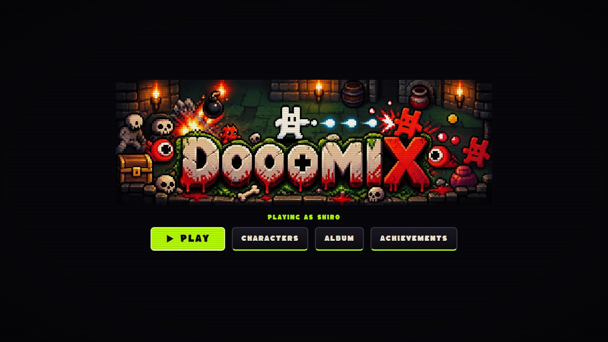
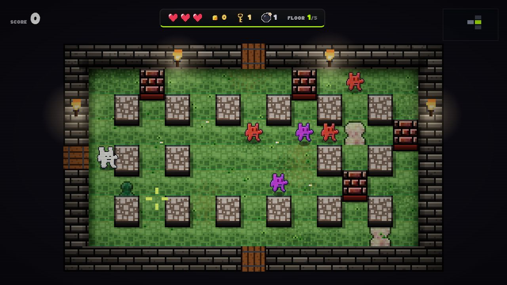
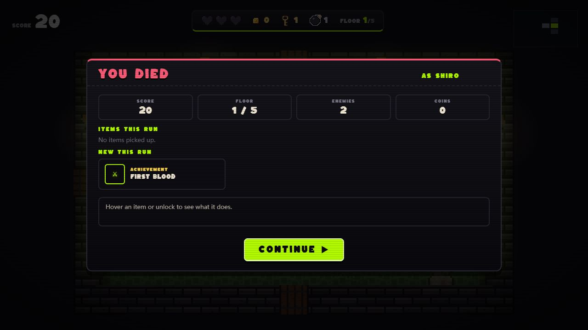

# DOOOMIX 游戏规格说明书

格式版本：V5.1

仅记录有依据的实现层事实；字段非必填。空白表示代码未披露或未登记，不代表不存在、不可玩或验收通过。

## 1. 基础事实

**维度定义**：游戏类型、操控体验和技术栈。

**内容说明**

- 游戏名称：DOOOMIX

**玩法类型**

地牢房间射击 / 随机探索

**操作方式**

WASD/方向键移动，原鼠标瞄准/原射击，Space炸弹和Escape暂停。本轮Right通行有效；Up发在结算后未验证，瞄准/炸弹未测。

**视角与布局**

原俯视正交房间，像素角色/敌人和砖墙/草地/灯火，小地图显示房间位置。

**画面维度**

混合

**引擎**

原Three0.185.1与@remix-gg/three0.17，本地正交场景/像素精灵/程序房间；原引擎不升级。

**程序语言**

JavaScript ES模块、HTML/CSS

**结论字段**

- `game_summary` = 控制原Shiro角色探索生成的地牢房间，移动、鼠标瞄准与原射击、炸弹、敌人/掉落和道具系统推进楼层，血量耗尽出现原本局统计。

## 2. 资源类型

**维度定义**：内容元素类别及其引擎资源格式。

**内容说明**

**内容元素资源类型**

原WebP图集/DOOOMIX标志、2背景音乐、12音效与程序材质/几何/像素HUD；16原文件按精确URL保存。

**结论字段**

- `engine_asset_system` = 原Three纹理图集/精灵/正交房间，原Canvas文字/本地字体和音频系统；18导入闭合，16素材HTTP/SHA。

## 3. 核心挑战维度

**维度定义**：核心玩法所涉及的挑战类型及主次。

**内容说明**

**核心挑战内容**

穿过原房门寻找路线，躲避红紫敌人和弹幕，按原资源/道具与射击规则战斗，不改攻击、HP、掉落、难度或房间生成。

**结论字段**

- `core_challenge_type` = 位置与弹幕规避 / 房间探索 / 资源管理

## 4. 操控方式

**维度定义**：输入方式、输入元素和操控构成。

**内容说明**

**操作方式**

WASD/方向键移动，原鼠标瞄准/原射击，Space炸弹和Escape暂停。本轮Right通行有效；Up发在结算后未验证，瞄准/炸弹未测。

**操控构成要素**

原Play/Characters/Album/Achievements、画布键盘/鼠标、原Continue统计按钮；本地结果的重玩按钮本轮未点。

## 5. 行为路径

**维度定义**：玩家在一次核心循环中重复执行的动作顺序。

**内容说明**

**核心玩法**

原Play→起点房→方向移动穿门→战斗/敌人/掉落和计分→血量耗尽统计或推进楼层→原Continue→本地结果。

**结论字段**

- `core_loop` = 看房间/小地图与敌人→移动和原射击→血量/敌人/积分/掉落反馈→通路或本局结束。

## 6. 游戏路径（关键节点 + 流失风险）

**维度定义**：从启动到结束的流程节点及已披露的风险。

**内容说明**

**游戏流程**

原菜单→Play首层起点→Right穿右门进入战斗房→原自然20分/2敌人/FirstBlood/YOU DIED→Continue→本地20分结果；未再玩或刷新。

## 7. 成长路径

**维度定义**：玩家推进和变强的途径。

**内容说明**

**奖励与成长**

原5主楼层及之后Extra显示/路径、角色、道具图鉴、成就和best数据保留；本轮仅Floor1局部与FirstBlood。

**结论字段**

- `progression_loop` = 原房间战斗/掉落/金币与道具→楼层/角色/图鉴/成就数据→原存储；未完成完整楼层或验证刷新恢复。

## 8. 核心闭环（目标-规则-反馈-激励）

**维度定义**：目标、规则、反馈、激励和下一目标。

**内容说明**

**目标规则反馈激励闭环**

已实测原房间通行、战斗房敌人/自动战斗、20分/2敌人/FirstBlood死亡统计及Continue接收原20分本地结果；不把Up当击杀或把本局失败当通关。

## 9. 玩法规则

**维度定义**：核心循环、操作、胜负和结算规则。

**内容说明**

**目标、规则与结算数值**

原初始HP3/钥匙1/炸弹1、原速度/碰撞/敌人/子弹/金币/道具/房间生成/楼层、计分与角色锁定均未改。

**已验证流程与未覆盖范围**

本轮按最多5个关键验证项控制，完整保留6次实际机械输入：初次启动/PLAY/Right2000ms/Up250ms/Continue，补修后仅追加一次启动复验Logo；没有重复整轮试玩或偷偷清空历史。原首层实际Right穿门到红紫敌人战斗房，原自动战斗自然20分/ENEMIES2/COINS0/FirstBlood/YOU DIED；Up发生在已死亡状态，不记纵向移动或输入致击杀。Continue原Ps保存best并把真实20分送到本地结果。旧58事件包含1次原Logo外联，原样留在network-gameplay-initial，不冒称该旧构建净运行。唯一补修为内嵌HTML原Logo精确同字节本地映射，逆替换并CRLF→LF恢复此前实际试玩主码SHA66ceca0c21785602afde07646d0031c066e27b7b41dc7849c1ee70422eb9b574，413原函数/61引擎函数与规则未改；当前主码SHA62f61c3844b5cf11c13381e58fb8dde083926069aea2055cae6bb89ce1b74714。定向复验原菜单/标志，最终56事件完整无截断/外联/HTTP失败/脚本异常，console无错误警告；不把这次启动称为重新完成整条战斗路径。16原图集/标志/音乐/音效精确HTTPS200/SHA，原SDK等待/桥/默认账号/contract提供者真实退役，LocalSession只存原数据与接收原分数，不假冒SDK、真人、广告或支付。完整楼层/游戏、炸弹/瞄准/纵移、角色道具购买、重玩、存档刷新恢复、触控/听觉未验证；原任务正常待验收，不自动批准、不供货。

## 10. 数值配置

**维度定义**：影响玩法的生命、概率、时长、速度和经济等数值。

**内容说明**

**结论字段**

- `key_numbers` = 源码Ee=5主楼层，之后原Extra路径保留；实测Floor1/5、初始HP3/钥匙1/炸弹1，终态20分/ENEMIES2/COINS0、FirstBlood。未知字段不填0，以上0为实际本局值。

## 11. 关卡配置

**维度定义**：关卡布局、目标、数量、递进和难度参数。

**内容说明**

**内容规模**

原主楼层/Extra、随机房间、起点/战斗等房型、红紫敌人、角色和道具数据保留；本轮只两个房间路径，不编造完整通关数量。

**场景、关卡与难度设计**

原地牢房门连通与小地图、房内砖块/障碍/敌人/草地/灯火，原路线/房间生成规则保持。

## 12. 系统设计

**维度定义**：功能系统及界面流程。

**内容说明**

**玩法系统与相互作用**

原移动/鼠标瞄准/射击/炸弹、房间与楼层生成、敌人AI/伤害/HP、金币/钥匙/道具/角色、图鉴/成就、原stats/Continue/best、像素图集/音频/小地图。

**界面流程与反馈**

原标志与Play菜单→Floor1起点的WASD/AIM/SPACE提示→右门进战斗房→原YOU DIED统计/FirstBlood→原Continue→实际本地20分结果。

**存档方式**

原Li load/store和原saveData、best/图鉴/成就接内部实际localStorage；第5步Continue走原Ps保存best流程，无异常。未刷新核对，持久化恢复仍未验证。

## 13. 主题化包装

**维度定义**：文字、叙事、命名及美术内容。

**内容说明**

**文字与美术内容**

原像素草地地牢、白色Shiro、红紫敌人、砖墙/火炬/木门、荧绿黑色菜单和原DOOOMIX标志。

**结论字段**

- `theme_position` = 复古像素地牢射击探索。

### 实际运行图解

图 1：当前最终构建定向复验：原Logo真实本地渲染，不再外联。

图 2：Right穿门到原战斗房，原角色/红紫敌人/房门与小地图。

图 3：原自然YOU DIED：20分、2敌人、0金币与FirstBlood成就。

## 14. 养成系统 + 经济系统

**维度定义**：成长要素和资源产出、消耗、回收机制。

**内容说明**

**养成与经济机制**

原金币、钥匙、炸弹、局内道具与永久收集规则保留；不注入资源或解锁付费/角色。

**结论字段**

- `progression_loop` = 原房间战斗/掉落/金币与道具→楼层/角色/图鉴/成就数据→原存储；未完成完整楼层或验证刷新恢复。

## 15. 角色 / 单位设定

**维度定义**：角色单位的数量、属性、能力、定位和关系。

**内容说明**

**角色单位设定**

本轮原Shiro与原红紫敌人；其他角色按原解锁条件保留，不冒称在线身份。

## 16. 商业化

**维度定义**：已实现的广告、内购、订阅、买断和付费点。

**内容说明**

**商业化实现**

ie等待/se桥、默认身份及SDK-contract提供模块退役；内部仅冻结零安全区、真实state存储和实际分数结果/重玩事件，无SDK全局假对象。

**结论字段**

- `monetization` = 实际外部SDK/账号/联机/排行/支付提供者退役，保留原本地游戏经济与解锁。

### 事实依据与定位

旧58事件/原战斗统计截图与最终56事件严格分开；单Logo scalar逆替换+换行规范化恢复旧试玩SHA，413原函数/61引擎函数未改。5个关键项、6次机械动作完整登记。
