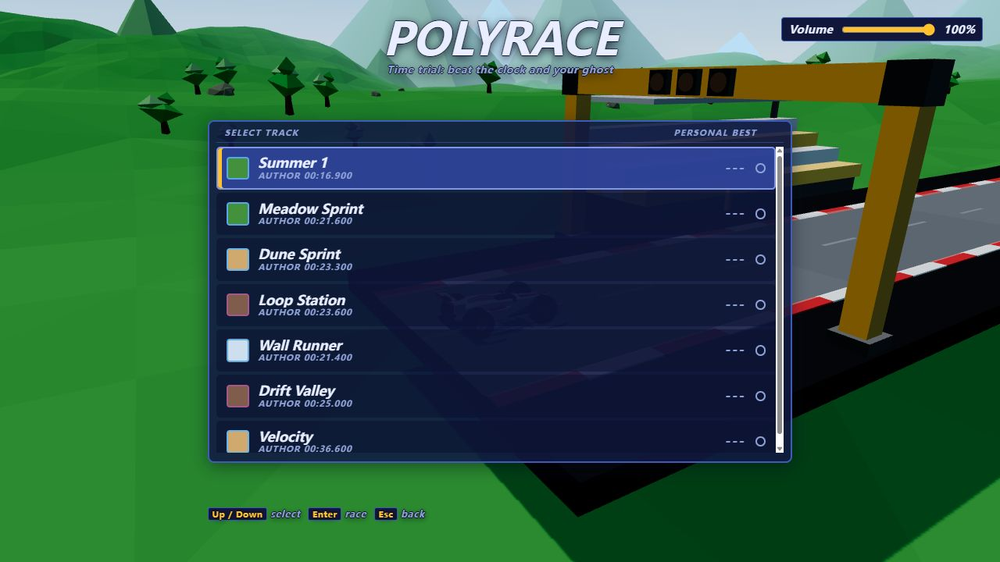
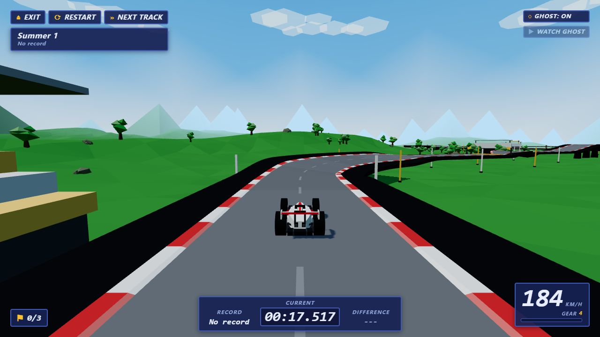
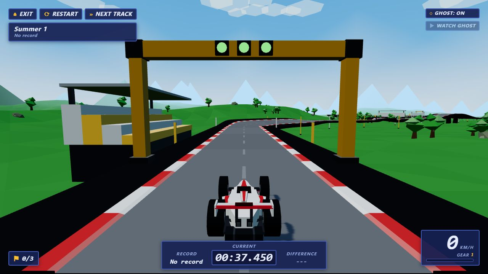

# PolyRace 游戏规格说明书

格式版本：V5.1

仅记录有依据的实现层事实；字段非必填。空白表示代码未披露或未登记，不代表不存在、不可玩或验收通过。

## 1. 基础事实

**维度定义**：游戏类型、操控体验和技术栈。

**内容说明**

- 游戏名称：PolyRace

**玩法类型**

竞速 / 时间挑战

**操作方式**

W/↑加速，S/↓刹车/倒车，A/D或←/→转向，Space漂移/手刹，R/Enter回检查点，T/Backspace重开，Esc菜单，C摄像机，G幽灵，V观看幽灵，N下一赛道。本次实测菜单点Summer1、Up加速、R重生和刷新；其余操作为原码确认，未额外试玩。

**视角与布局**

第三人称追尾，原chase/far/hood摄像机模式；左上赛道/记录与退出/重开/下一赛道，底部计时/差距/检查点、右下速度/档位，右上幽灵。

**画面维度**

3D

**引擎**

原生Three.js与原@remix-gg/three运行组件；SDK宿主部分已拆成明确本地Canvas生命周期。

**程序语言**

JavaScript ES模块、HTML/CSS、原着色器。

**结论字段**

- `game_summary` = 从七条固定手工赛道选择一条，驾驶原低多边形赛车通过检查点到终点，挑战作者时间和个人最佳，并保留原幽灵记录。

## 2. 资源类型

**维度定义**：内容元素类别及其引擎资源格式。

**内容说明**

**内容元素资源类型**

原程序生成的赛车、赛道路面、路肩、桥/环/环境树木山地、粒子和幽灵几何；14份原WAV引擎/轮胎/风/加速/检查点/倒计时/出发/碰撞/落地/重生/完赛/记录/点击/选择；原Three与运行组件。

**结论字段**

- `engine_asset_system` = 按原赛道pieces构建frames/几何和物理表面，Three Mesh/实例化网格渲染，原音频通过同源URL读取。运行库含通用GLTF加载器，不代表本款有已恢复GLTF赛车资源；实际车/赛道是程序网格。

## 3. 核心挑战维度

**维度定义**：核心玩法所涉及的挑战类型及主次。

**内容说明**

**核心挑战内容**

在转弯、路肩、坡道、跳跃和环形/墙面赛道中控制车速与路线，按顺序通过检查点以争取较短用时。

**结论字段**

- `core_challenge_type` = 操作执行 / 策略规划

## 4. 操控方式

**维度定义**：输入方式、输入元素和操控构成。

**内容说明**

**操作方式**

W/↑加速，S/↓刹车/倒车，A/D或←/→转向，Space漂移/手刹，R/Enter回检查点，T/Backspace重开，Esc菜单，C摄像机，G幽灵，V观看幽灵，N下一赛道。本次实测菜单点Summer1、Up加速、R重生和刷新；其余操作为原码确认，未额外试玩。

**操控构成要素**

原键盘按住/按下事件、菜单/结果按钮、原手柄输入；本次只实测Up/R。

## 5. 行为路径

**维度定义**：玩家在一次核心循环中重复执行的动作顺序。

**内容说明**

**核心玩法**

选赛道→原倒计时→加速/转向/漂移驾驶→通过检查点与失误重生→终点计时/奖牌/PB/幽灵记录→原重试或下一赛道。

**结论字段**

- `core_loop` = 观察路线/速度→油门、制动、转向→原物理更新和计时→检查点/坠落重生→继续驾驶。

## 6. 游戏路径（关键节点 + 流失风险）

**维度定义**：从启动到结束的流程节点及已披露的风险。

**内容说明**

**游戏流程**

七赛道原菜单→开始倒计时→单人计时赛→原FINISH/奖牌/分段/Retry/Next/Menu。此次只到实际加速/R重生和刷新，未触发完赛结果。

## 7. 成长路径

**维度定义**：玩家推进和变强的途径。

**内容说明**

**奖励与成长**

七条固定赛道直接可选；本地PB、奖牌、完赛次数、幽灵和累计距离由原规则记录；原成就判定转为本地事实，无远端排行成长。

**结论字段**

- `progression_loop` = 完成赛道并取得PB/奖牌→使用原幽灵比较走线→再次挑战或换赛道；本次未生成新PB。

## 8. 核心闭环（目标-规则-反馈-激励）

**维度定义**：目标、规则、反馈、激励和下一目标。

**内容说明**

**目标规则反馈激励闭环**

目标：当前赛道依次通过检查点后完成全程，争取作者/金银铜时间。规则：原油门、加速、抓地、转向、漂移、环面最低速度、落地/掉落/检查点和重生决定行驶，R不会伪造终点或最佳成绩。反馈：赛车位置/路面运动、速度与档位、当前时间、检查点、差距与原结果UI。实测约182–184KM/H/GEAR4、R回起点0KM/H/GEAR1且时间继续；未称为完整完赛闭环。激励：原PB/奖牌/幽灵与八项成就判定；未虚构解锁。

## 9. 玩法规则

**维度定义**：核心循环、操作、胜负和结算规则。

**内容说明**

**目标、规则与结算数值**

单人计时按原检查点顺序，失误可回检查点，重开新局另行计时；过终点按原作者/金银铜阈值给奖牌。原抓地、漂移、坠落重生与路面/加速带规则保持。

**已验证流程与未覆盖范围**

用户每款最多5步：七赛道菜单→进入Summer1→Up持续1.6秒→R原检查点重生→刷新。实际HUD/画面从0km/h起步，经原加速达约182–184KM/H/GEAR4；R回起点0km/h/GEAR1、时间37.450继续，检查点0/3；刷新回七赛道菜单，均No record/---，未伪造PB。191原函数/类及G/O/Ne/Da/fe/Re六组配置语义SHA保留，含Wa原车辆物理、mi/Io原成绩与幽灵读写；所有七条赛道、原转向/漂移/加速/检查点/落地/重生/奖牌阈值/难度不改。真正退役SDK发现/宿主发送器、房间传输/大厅、在线榜单采集与菜单/终点榜单；不安装SDK全局、不假冒账户/房间。实际本地Canvas生命周期替代宿主绑定，原本地记录/统计/音量键保留；原8项成就判定保留并读写明确的本地事实，不回填远端解锁成功。14原WAV与原运行库同源，43文件中仅3个provider/import边界文件变化，其余40原字节一致；车/赛道/环境由原程序网格生成，纠正旧文档GLTF车模型说法。176完整网络事件覆盖初始加载、驾驶/重生和完整刷新，无截断/外联/HTTP失败/脚本异常；两条原Three阴影模式兼容警告原样保留，底层已自动回退PCFShadowMap，非零警告。未实测完赛/奖牌/PB或幽灵写入回放、其余六赛道驾驶、手柄/触控、实际听觉、转向/漂移或新音量存档；五步结束不加测。正常原任务入库待人工验收，不批准不供货。

## 10. 数值配置

**维度定义**：影响玩法的生命、概率、时长、速度和经济等数值。

**内容说明**

**结论字段**

- `key_numbers` = 原fixedStep默认1/60；重力30、车身高度0.62、topSpeed62、boostSpeed88、reverse16、accel46、brake62、coastDrag3.2、普通抓地13.5、路肩7.2、手刹2.6。起步倒计时2.1秒；HUD速度倍率5.4、6档；幽灵采样30Hz、最长300秒。Summer1原3检查点，作者00:16.900；仅实测加速到约182–184km/h/4档，不把topSpeed62当km/h。

## 11. 关卡配置

**维度定义**：关卡布局、目标、数量、递进和难度参数。

**内容说明**

**内容规模**

七条固定赛道：Summer1、MeadowSprint、DuneSprint、LoopStation、WallRunner、DriftValley、Velocity；各有原作者/金银铜时间。单场比赛与幽灵数据不是新增关卡。

**场景、关卡与难度设计**

原pieces/frames描述直道、转弯、加速带、坡道、缺口、环面与墙跑等，七套配置完整保留。当前测试仅Summer1起步区和首检查点前驾驶。

## 12. 系统设计

**维度定义**：功能系统及界面流程。

**内容说明**

**玩法系统与相互作用**

原车辆物理、路面定位、检查点/计时、重生/重开、速度档位、摄像机、粒子/轮痕、音频、菜单/结果、PB/奖牌/幽灵、原本地统计、八项成就条件。移除房间联机/大厅和在线榜单，不以假房间维持游戏。

**界面流程与反馈**

原七赛道菜单/音量→点Summer1→3灯倒计时→原计时赛HUD→原终点结果（本次未触达）或刷新回菜单。Race Friends与Leaderboards按钮及在线终点榜单实际删除；原单人HUD/Retry/Next/Menu保留。

**存档方式**

原polyrace-velocity/records/v1保存PB/奖牌/幽灵与完赛次数，polyrace-velocity/stats/v1存累计距离；原音量键保留。原八项成就条件读写明确的local-achievements/v1本地集合，不假冒远端成就。刷新实际回七赛道菜单/全部No record，未完成赛道，不能声称新PB/新幽灵跨刷新已实测。

## 13. 主题化包装

**维度定义**：文字、叙事、命名及美术内容。

**内容说明**

**文字与美术内容**

原低多边形草地山丘、道路红白路肩、赛车、彩色菜单和黄色原起跑门；保留原程序几何与风格。

**结论字段**

- `theme_position` = 街机赛车单人时间挑战。

### 实际运行图解

图 1：原七赛道与作者成绩；多人和榜单入口已退役。

图 2：Up实际加速、原场景位移与约182–184KM/H/4档。

图 3：R回原起点检查点，0KM/H/1档、计时37.450继续；不是完赛。

## 14. 养成系统 + 经济系统

**维度定义**：成长要素和资源产出、消耗、回收机制。

**内容说明**

**养成与经济机制**

原成绩按时间和奖牌计算本地会话分数，无真实货币或付费车辆；不新增购车/奖励数值。

**结论字段**

- `progression_loop` = 完成赛道并取得PB/奖牌→使用原幽灵比较走线→再次挑战或换赛道；本次未生成新PB。

## 15. 角色 / 单位设定

**维度定义**：角色单位的数量、属性、能力、定位和关系。

**内容说明**

**角色单位设定**

玩家赛车、原幽灵回放车、路面/检查点/加速带与环境物体；联机远端车辆传输已退役，单人主体不替换。

## 16. 商业化

**维度定义**：已实现的广告、内购、订阅、买断和付费点。

**内容说明**

**商业化实现**

SDK账号、房间和在线榜单真正退役；不提供广告/充值或购买。保留原14音频及音量，未作听觉/手柄/触控结论。

**结论字段**

- `monetization` = 当前独立单人计时赛无广告、支付或在线榜单。

### 事实依据与定位

当前main.js/source-preservation：191原函数/类与G/O/Ne/Da/fe/Re配置SHA，mi/Io和Wa；asset-preservation、完整176事件、原兼容警告、five-step-ledger与驾驶/R截图。
