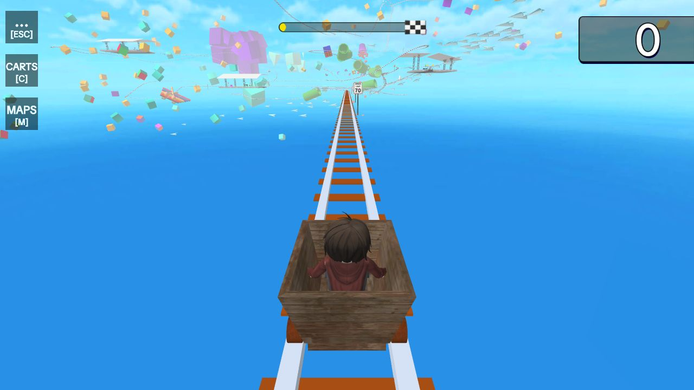
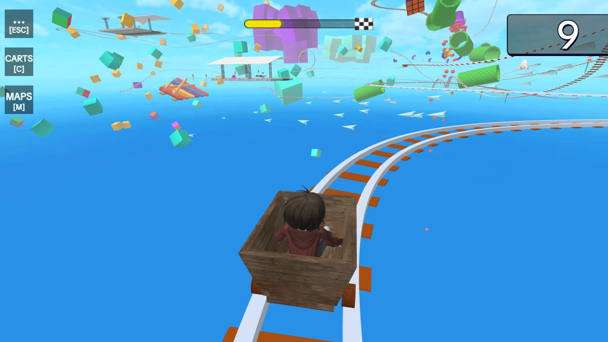
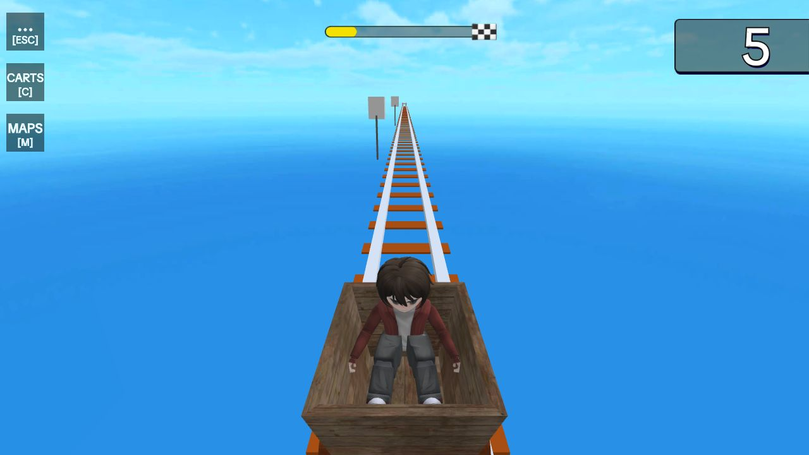

# Rail in the Air 游戏规格说明书

格式版本：V5.1

仅记录有依据的实现层事实；字段非必填。空白表示代码未披露或未登记，不代表不存在、不可玩或验收通过。

## 1. 基础事实

**维度定义**：游戏类型、操控体验和技术栈。

**内容说明**

- 游戏名称：Rail in the Air

**玩法类型**

空中轨道矿车驾驶 / 速度控制

**操作方式**

↑加速、↓制动；原HUD显示Esc菜单、C矿车、M地图。已实际Up2200ms、Down1600ms与刷新复位；其余键/菜单/跳车未在本轮操作。

**视角与布局**

第三人称跟随矿车与原人物，随轨道弯曲/坡度调整视野。

**画面维度**

3D

**引擎**

PlayCanvas2.19.7，实际最终canvas data-engine已核对；原合并编译ES模块。

**程序语言**

JavaScript ES模块、HTML/CSS；编译后可修改代码，未恢复原作者TypeScript工程。

**结论字段**

- `game_summary` = 驾驶原木制矿车沿空中高低起伏轨道前进，控制加速与刹车，通过弯道和原障碍，按地图及检查点推进。

## 2. 资源类型

**维度定义**：内容元素类别及其引擎资源格式。

**内容说明**

**内容元素资源类型**

45GLB场景/角色/矿车/道具模型，18WebP与16PNG图标/图集、7JPG（含天空盒）、10KTX2材质、2MP3音频、5JSON字体/配置、原ES模块与HTML/CSS。

**结论字段**

- `engine_asset_system` = PlayCanvas本地资产加载、GLB容器/贴图与KTX2、字体图集、场景实例/轨道构件；45GLB外部引用闭合，真实资源GET/SHA。

## 3. 核心挑战维度

**维度定义**：核心玩法所涉及的挑战类型及主次。

**内容说明**

**核心挑战内容**

根据前方弯道、坡道与原移动障碍调整速度，维持矿车沿轨道行进并推进地图进度；不改变物理或障碍周期。

**结论字段**

- `core_challenge_type` = 速度控制 / 障碍时机 / 轨道行进

## 4. 操控方式

**维度定义**：输入方式、输入元素和操控构成。

**内容说明**

**操作方式**

↑加速、↓制动；原HUD显示Esc菜单、C矿车、M地图。已实际Up2200ms、Down1600ms与刷新复位；其余键/菜单/跳车未在本轮操作。

**操控构成要素**

画布键盘、原左侧Esc/C/M菜单按钮及矿车视角；真实触控、地图/矿车选择和奖励确认未测。

## 5. 行为路径

**维度定义**：玩家在一次核心循环中重复执行的动作顺序。

**内容说明**

**核心玩法**

进入原初始轨道→Up加速→原矿车/人物随轨道移动→Down减速并观察弯道→进度与速度HUD反馈，原菜单/地图/矿车系统保留。

**结论字段**

- `core_loop` = 观察轨道/障碍→加速或制动→矿车位置/速度/地图进度变化→继续前进。

## 6. 游戏路径（关键节点 + 流失风险）

**维度定义**：从启动到结束的流程节点及已披露的风险。

**内容说明**

**游戏流程**

原加速与制动保存画面速度9/5、轨道朝向和进度条变化，原刷新回起点速度0。此次只复验缺图修复后的启动，不伪称新一轮地图通关。

## 7. 成长路径

**维度定义**：玩家推进和变强的途径。

**内容说明**

**奖励与成长**

原地图、检查点、矿车外观与本地数据保留；本轮未达终点或领取检查点奖励，总图/皮肤数未知留空。

**结论字段**

- `progression_loop` = 沿原轨道推进→检查点/地图阶段→后续地图与矿车数据；仅有限短段实测。

## 8. 核心闭环（目标-规则-反馈-激励）

**维度定义**：目标、规则、反馈、激励和下一目标。

**内容说明**

**目标规则反馈激励闭环**

原启动、矿车加速前进、制动和轨道位置变化、刷新复位已实测；最终主码与该实测完全同SHA，仅补原缺图并净启动复验。不是整图通关。

## 9. 玩法规则

**维度定义**：核心循环、操作、胜负和结算规则。

**内容说明**

**目标、规则与结算数值**

原加速/制动/速度反馈、轨道跟随/碰撞、障碍时钟与检查点规则保持。未降低难度或自动越过障碍，不注入进度/货币/奖励。

**已验证流程与未覆盖范围**

保留原PlayCanvas2.19.7矿车/轨道/人物/原生物理、障碍时钟、地图/检查点/进度/经济/存储与美术，7767处原函数语义保持（含引擎与业务，不称7767全是业务函数）。真实SDK/GA/Colyseus/WebSocket、远端房间/同步/重试、角色/矿车外发函数及两处系统登记退役；本地真实生命周期/障碍时钟、可选本地领取确认/取消保留，不伪造SDK、账号、广告完成、远端玩家或支付。本轮最多5个关键项，共6次机械输入均留档：原首次启动失败、去除两处外发系统登记后重载、Up2200ms加速、Down1600ms制动、刷新复位、补原图后仅一次净启动复验。原保存截图分别实际显示速度9和5，旧笔记28/13不是同一截图时点，不将其当当前画面数值。轨道位置/方向与进度条确实变化，原刷新回初始矿车速度0；未完成地图终点/检查点奖励/死亡复活或购买。旧215事件的icon_e.webp六次404和原console错误保留；其后只补精确原3942字节256x256图片，SHA7c1a23735f9eb3be503f2ab16bf2316737457573d1a30de8805afd788e69275a，主码始终db85fee2a23cf59c585395c0897fb28ba4bfd1e8f247631136d182661205dc6d不变。当前只复验启动项：205完整事件无截断/外联/HTTP失败/脚本异常，缺图在真实浏览器返回200，console无错误警告，DOM实际data-engine为PlayCanvas2.19.7。45GLB本地闭合，原其余资产逐项HTTP/SHA；旧6个${e}模板误当字面量的工程403/404记录原样保留，不冒称6份真实图缺失。整张地图/全部地图、其他矿车、可选奖励/取消、解锁、死亡复活、暂停/触控/听觉、检查点与购买后持久化均未验证。原任务正常待验收，不批准、不供货。

## 10. 数值配置

**维度定义**：影响玩法的生命、概率、时长、速度和经济等数值。

**内容说明**

**结论字段**

- `key_numbers` = 保存截图速度9与5，原刷新和当前最终启动均速度0；HUD按原velocity.length取整显示（无单位声明）。原主码7767处函数语义保持，资源45GLB/2MP3/10KTX2，缺图3942字节256×256。

## 11. 关卡配置

**维度定义**：关卡布局、目标、数量、递进和难度参数。

**内容说明**

**内容规模**

空中连续轨道、坡道/弯道/移动与旋转障碍、原人物木制矿车、天空/海面、地图/矿车菜单和进度HUD；全部地图/矿车数量未知，不编造关卡完成数。

**场景、关卡与难度设计**

原高低起伏的细轨、枕木与护轨、转弯与多类障碍组合，进度条指向终点；未重建或缩短原路线。

## 12. 系统设计

**维度定义**：功能系统及界面流程。

**内容说明**

**玩法系统与相互作用**

PlayCanvas渲染、原实体/组件调度、矿车与轨道物理、人物/矿车模型、障碍时钟、速度/阶段进度HUD、地图/检查点/解锁、本地存储、输入与音频。

**界面流程与反馈**

原初始木制矿车→速度/进度HUD与Esc/C/M入口→Up/Down驾驶及弯道→原刷新回起点；终点/复活/商店与可选领取路径未测。

**存档方式**

原本地地图、检查点、矿车/经济存储保留；实际刷新复位证明初始化可重复，但没有本轮检查点/购买写入与恢复证据，不把起点0当进度持久化通过。

## 13. 主题化包装

**维度定义**：文字、叙事、命名及美术内容。

**内容说明**

**文字与美术内容**

原鲜亮低多边形空中轨道、木制矿车与深发红衣人物、漂浮彩色障碍、蓝色天空/海面和黑白终点进度条。

**结论字段**

- `theme_position` = 轻松彩色空中矿车障碍驾驶。

### 实际运行图解

图 1：最终净启动原图资源齐备，真实PlayCanvas2.19.7画布，初始速度0。

图 2：原真实Up后轨道行进；此保存画面速度9，不把另一时点笔记28套到此帧。

图 3：原真实Down后制动画面速度5与轨道朝向变化；未声称整图完成。

## 14. 养成系统 + 经济系统

**维度定义**：成长要素和资源产出、消耗、回收机制。

**内容说明**

**养成与经济机制**

保留原地图/矿车与本地奖励解锁规则；可选本地奖励明确确认/取消，不冒称看广告成功；未购买或验证价格/奖励结算。

**结论字段**

- `progression_loop` = 沿原轨道推进→检查点/地图阶段→后续地图与矿车数据；仅有限短段实测。

## 15. 角色 / 单位设定

**维度定义**：角色单位的数量、属性、能力、定位和关系。

**内容说明**

**角色单位设定**

原单人矿车与原角色；远端玩家/房间/同步发送真实退役，不伪造真人对手。

## 16. 商业化

**维度定义**：已实现的广告、内购、订阅、买断和付费点。

**内容说明**

**商业化实现**

独立本地生命周期和可选确认不是SDK对象，取消不发奖。原SDK/Colyseus/WebSocket及外发系统登记退役；本轮无可选领取动作，不宣称其UI通过。

**结论字段**

- `monetization` = 原外部SDK广告/联机/遥测真实移除，保留普通游戏内经济；未发现需要保留的真实货币支付。

### 事实依据与定位

源码保持7767函数/主码SHA固定、旧真实加速/制动/复位截图与完整失败网络、精确缺图回源200/SHA、当前205事件净启动和PlayCanvas DOM引擎标记。
