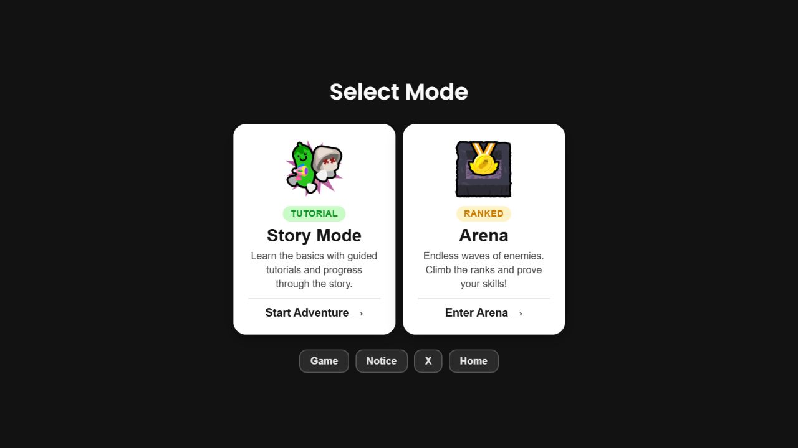
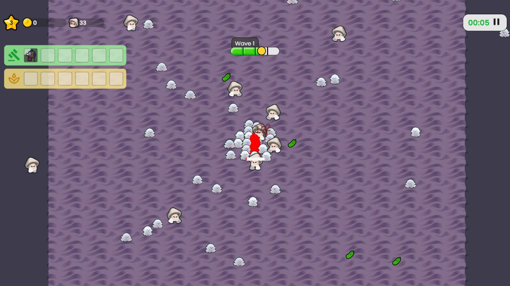
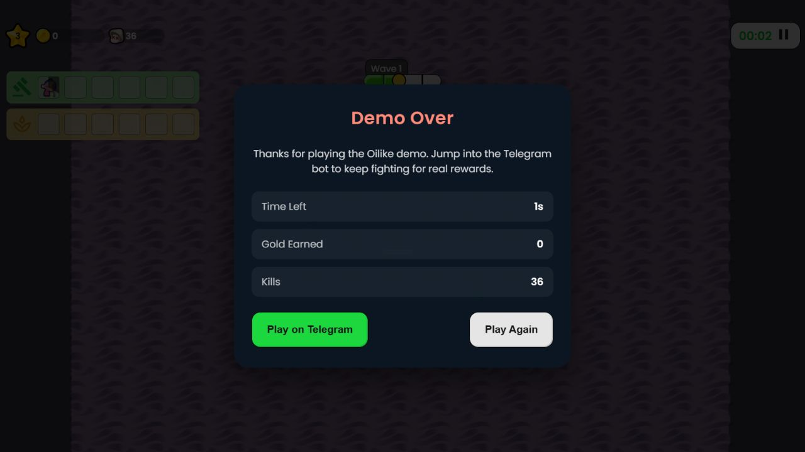

# Oilike（作者原生浏览器Demo） 游戏规格说明书

格式版本：V5.1

仅记录有依据的实现层事实；字段非必填。空白表示代码未披露或未登记，不代表不存在、不可玩或验收通过。

## 1. 基础事实

**维度定义**：游戏类型、操控体验和技术栈。

**内容说明**

- 游戏名称：Oilike（作者原生浏览器Demo）

**玩法类型**

动作 / Roguelike生存

**操作方式**

作者页说明WASD/触屏摇杆；本轮实际点击模式卡与刷新，手动移动和触屏未实测。

**视角与布局**

俯视战场，顶部等级/金币/击杀与计时，左侧武器和被动槽，中上方波次进度。

**画面维度**

2D

**引擎**

Phaser，React/Vite界面；原生浏览器Demo。

**程序语言**

JavaScript、HTML/CSS。

**结论字段**

- `game_summary` = 蔬果角色自动攻击蘑菇敌人，通过击杀和经验成长；作者公开Demo包括Story教程和Arena波次。

## 2. 资源类型

**维度定义**：内容元素类别及其引擎资源格式。

**内容说明**

**内容元素资源类型**

原生PNG图集、地图Tiled JSON、MP3、Lottie JSON、TTF、JavaScript与CSS；所有已取得资源原字节保留。

**结论字段**

- `engine_asset_system` = Phaser原生预载器、Tiled地图、spritesheet、浏览器音频；React覆盖层。

## 3. 核心挑战维度

**维度定义**：核心玩法所涉及的挑战类型及主次。

**内容说明**

**核心挑战内容**

原生敌群靠近并接触伤害，角色自动攻击，击杀获取经验；最终实际自然死亡结算36击杀/3级。

**结论字段**

- `core_challenge_type` = 生存对抗 / 波次成长

## 4. 操控方式

**维度定义**：输入方式、输入元素和操控构成。

**内容说明**

**操作方式**

作者页说明WASD/触屏摇杆；本轮实际点击模式卡与刷新，手动移动和触屏未实测。

**操控构成要素**

模式按钮、WASD/屏幕摇杆、原生升级/暂停覆盖层；本轮仅实测菜单模式输入。

## 5. 行为路径

**维度定义**：玩家在一次核心循环中重复执行的动作顺序。

**内容说明**

**核心玩法**

作者模式选择→原生战场→自动攻击/击杀/经验升级→死亡→原生Demo结算。

**结论字段**

- `core_loop` = 实测Arena开局→原自动武器杀敌→等级升到3→敌人接触伤害致死→Demo Over显示36击杀。

## 6. 游戏路径（关键节点 + 流失风险）

**维度定义**：从启动到结束的流程节点及已披露的风险。

**内容说明**

**游戏流程**

原菜单保留Story/Arena，Arena开局到死亡结算已实测。Play Again和Telegram链接可见，未点击；不宣称重玩或正式版进度通过。

## 7. 成长路径

**维度定义**：玩家推进和变强的途径。

**内容说明**

**奖励与成长**

原有武器/被动/升级/波次与Stage配置保留。Demo Arena的初始加成由作者原代码给定，不是本次发放。

**结论字段**

- `progression_loop` = 本轮观察经验/等级随自动战斗变化；卡片选择、长期解锁与后期波次尚未实测。

## 8. 核心闭环（目标-规则-反馈-激励）

**维度定义**：目标、规则、反馈、激励和下一目标。

**内容说明**

**目标规则反馈激励闭环**

目标：在敌群中生存。规则：自动武器、原敌群/伤害/经验和死亡条件保留。反馈：角色受伤、击杀计数、等级、计时、波次与死亡覆盖层。激励：原生经验等级增长；本轮最终3级36击杀，金币0，未虚构奖励。失败后重玩入口可见但未操作。

## 9. 玩法规则

**维度定义**：核心循环、操作、胜负和结算规则。

**内容说明**

**目标、规则与结算数值**

Story使用stage1/normal和tutorial；Arena使用stageRank/normal、bronze及作者Demo预设。数值、伤害和波次不修改；不绕过认证或服务器结算。

**已验证流程与未覆盖范围**

原作者Oilike公开浏览器Demo完整构建，原页Run game公开精确路径取得；原HTML开发机/52哈希一致。保留作者原有Story和Arena入口及全部原生玩法函数，仅退役Google统计与itch容器脚本、金币图路径纠正、删除程序绘制辣椒池多余贴图预载、仙人掌193x288单图帧元数据修正。没有新造Telegram登录、服务器奖励或付费结果；原作者demo-session/demo-token和本地Demo结算保持。严格5次UI尝试（含一次无匹配、未发送输入）：启动、失败选择器、进入Arena、修订后刷新、最终进入Arena。最终原生自动攻击实际36击杀/3级/死亡Demo Over，金币0，重玩按钮可见。498条未截断最终事件、无外联/HTTP错误/异常/console警告错误。首轮34击杀结算、仙人掌警告和网络截断保留为中间证据，不冒充最终通过。未实测手动移动、Story教程、升级卡、跨局存档/刷新恢复、Play Again按钮、后期波次和Telegram正式版；Demo本身不包含正式版后台进度和奖励，不能宣称完整Telegram版已转换。原未开放stage0开发测试图缺两张原图，未提供替代素材，不影响作者公开stage1/Arena入口。

## 10. 数值配置

**维度定义**：影响玩法的生命、概率、时长、速度和经济等数值。

**内容说明**

**结论字段**

- `key_numbers` = 最终实测36击杀、3级、金币0、Wave1；死亡结算Time Left1s。193个原始入口/脚本/资源文件；具体正式版总关卡不在本次Demo范围。

## 11. 关卡配置

**维度定义**：关卡布局、目标、数量、递进和难度参数。

**内容说明**

**内容规模**

完整作者浏览器Demo代码，Story/Arena均保留。代码包含其他Stage配置，但作者公开入口只暴露stage1和stageRank；不扩大为正式Telegram版已完成。

**场景、关卡与难度设计**

原stage1与stageRank地图及引用图块均已取得；stage2-5地图与已声明图块保留。stage0开发测试图两张原站404，未开放入口且未填假资源。

## 12. 系统设计

**维度定义**：功能系统及界面流程。

**内容说明**

**玩法系统与相互作用**

Phaser战斗、自动武器、原敌群、地图、经验成长、原生升级卡、Demo本地结算、React HUD、音频加载。未验证完整后期/全部模式。

**界面流程与反馈**

实际模式菜单→Arena加载→原生战场→Demo Over；刷新回原模式菜单。Story、暂停、升级卡和Play Again未实测。

**存档方式**

Demo由作者每次Date.now生成会话并重置阶段，正式版用户/奖励通过后台；本轮没有验证存档恢复，不声称离线替代正式账号或持续进度。

## 13. 主题化包装

**维度定义**：文字、叙事、命名及美术内容。

**内容说明**

**文字与美术内容**

原蔬果角色、蘑菇/幽灵敌群、紫色岩地地图、原武器/被动图标与粒子表现保留。

### 实际运行图解

图 1：最终修订原生Story/Arena菜单；两个作者模式均保留。

图 2：中间修订实际Arena自动战斗，33击杀/3级；仙人掌帧元数据尚未修正，图示只证明原生战斗。

图 3：最终修订实际36击杀/3级后原生Demo Over；金币0，Play Again可见但未点击。

## 14. 养成系统 + 经济系统

**维度定义**：成长要素和资源产出、消耗、回收机制。

**内容说明**

**养成与经济机制**

本轮原生金币0；Demo无真实服务器奖励。正式版金币/奖章/钻石后台没有模拟或伪造。

**结论字段**

- `progression_loop` = 本轮观察经验/等级随自动战斗变化；卡片选择、长期解锁与后期波次尚未实测。

## 15. 角色 / 单位设定

**维度定义**：角色单位的数量、属性、能力、定位和关系。

**内容说明**

**角色单位设定**

实际默认oi蔬果角色与原生敌群；其他角色配置保留但未实际选择。

## 16. 商业化

**维度定义**：已实现的广告、内购、订阅、买断和付费点。

**内容说明**

**商业化实现**

作者Demo分支跳过广告/后台结算，Telegram链接保留为用户自愿外链但本轮未打开；不验证正式支付/广告或奖励。

### 事实依据与定位

SOURCE_PRESERVATION.json；原作者公开构建；native-function-preservation.json；498条最终完整事件；原生结算截图。
