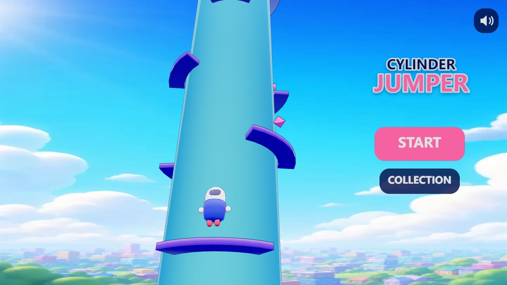
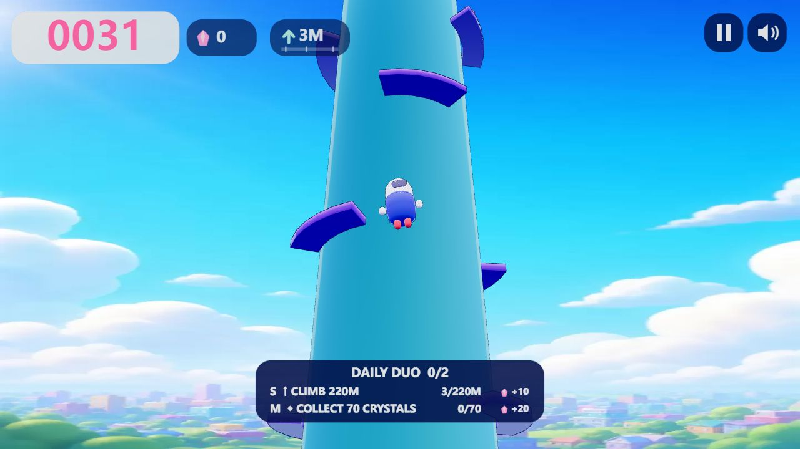
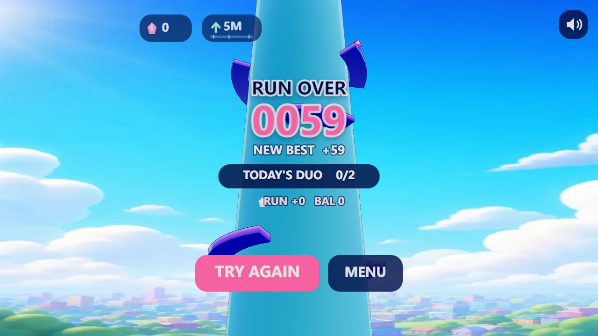

# Cylinder Jumper 游戏规格说明书

格式版本：V5.1

仅记录有依据的实现层事实；字段非必填。空白表示代码未披露或未登记，不代表不存在、不可玩或验收通过。

## 1. 基础事实

**维度定义**：游戏类型、操控体验和技术栈。

**内容说明**

- 游戏名称：Cylinder Jumper

**玩法类型**

单指平台跳跃 / 圆柱攀登

**操作方式**

原菜单START/COLLECTION；横向拖拽旋转，角色原自动跳跃；原Pause/音量、TryAgain/Menu按钮。本轮只点Start、一次拖拽、TryAgain和刷新。

**视角与布局**

原第三人称固定跟随圆柱，背景按高度/区域渐变；角色跳跃高度与塔体旋转可见。

**画面维度**

3D

**引擎**

原内嵌Three/WebGL与原圆柱跳跃引擎，完整单文件ES模块；内部LocalRunSession接真实本机存档。

**程序语言**

JavaScript ES模块、HTML/CSS

**结论字段**

- `game_summary` = 角色在圆柱平台上自动跳跃，玩家横向拖拽旋转塔体并对齐落点，攀升获取高度/分数并收集晶体，失足自然结束。

## 2. 资源类型

**维度定义**：内容元素类别及其引擎资源格式。

**内容说明**

**内容元素资源类型**

原程序圆柱/平台/角色/晶体/UI与4区域背景WebP、1音乐；5份精确原资源HTTP/SHA。

**结论字段**

- `engine_asset_system` = 原WebGL/Three网格、原背景按区域懒加载和原音频系统；运行资源全部同源，其他区域材料有独立GET/SHA不冒充试玩。

## 3. 核心挑战维度

**维度定义**：核心玩法所涉及的挑战类型及主次。

**内容说明**

**核心挑战内容**

根据平台分布旋转圆柱对齐落点，避开危险并连续攀登；不修改原速度、碰撞、平台随机、保底或高度分数。

**结论字段**

- `core_challenge_type` = 空间判断 / 时机控制

## 4. 操控方式

**维度定义**：输入方式、输入元素和操控构成。

**内容说明**

**操作方式**

原菜单START/COLLECTION；横向拖拽旋转，角色原自动跳跃；原Pause/音量、TryAgain/Menu按钮。本轮只点Start、一次拖拽、TryAgain和刷新。

**操控构成要素**

原游戏画布指针拖拽/原菜单命中与触摸事件；本轮电脑鼠标，触控设备未测。

## 5. 行为路径

**维度定义**：玩家在一次核心循环中重复执行的动作顺序。

**内容说明**

**核心玩法**

原准备→拖拽转塔/自动跳跃→接平台/攀高/收集→失足自然结束→原分数/最高分/每日反馈→重玩。

**结论字段**

- `core_loop` = 看下个平台位置→横向旋转→原自动跳跃/落点碰撞→高度和分数反馈→失足结算。

## 6. 游戏路径（关键节点 + 流失风险）

**维度定义**：从启动到结束的流程节点及已披露的风险。

**内容说明**

**游戏流程**

START→一次拖拽→原31分3m→自然RUNOVER59分5m/NEWBEST→TRYAGAIN原准备→刷新原菜单。

## 7. 成长路径

**维度定义**：玩家推进和变强的途径。

**内容说明**

**奖励与成长**

原高度/最高分、晶体、每日双目标和外观收藏；原付费内容保持不可购买，不赠送原付费权益。

**结论字段**

- `progression_loop` = 原真实局结果→原saveData/本机存档→原每日目标/晶体/外观系统；本轮仅0晶体结算，消费和刷新最高分未验证。

## 8. 核心闭环（目标-规则-反馈-激励）

**维度定义**：目标、规则、反馈、激励和下一目标。

**内容说明**

**目标规则反馈激励闭环**

原拖拽输入→自动跳跃→3m/31分→自然失足→RUNOVER59分5m→原TryAgain→刷新菜单，原失败终态与重玩闭合已见。

## 9. 玩法规则

**维度定义**：核心循环、操作、胜负和结算规则。

**内容说明**

**目标、规则与结算数值**

原生成平台/自动跳跃、碰撞与掉落、最高高度和分数、晶体/每日目标及外观价格原样保持；仅外部宿主/付费/联网提供者退役。

**已验证流程与未覆盖范围**

严格5步：原菜单启动；点击原START，经过原过渡进入准备；一次连续横向拖拽490,554→800,554实际旋转并开跳，原HUD出现31分/3m；之后仅观察原自动跳跃自然RUN OVER，实际59分/5m、NEW BEST+59，晶体RUN+0/BAL0和每日0/2；第4步原TRY AGAIN进入原准备场景；第5步刷新回原菜单。保留原153个类、1978个方法、848个函数声明语义及原自动跳跃/塔生成/碰撞/高度分/晶体/每日目标/外观价格；P_体验构造器仅移除测试bridge instanceof和真实联机协调器创建，其他原方法不改。原测试购买桥R1、联机I1和实际SDK I_提供者移除，真正内部LocalRunSession保存原saveData，不注册全局SDK、账号、假购买或解锁；付费外观/续命不可用，原晶体购买规则保持。原4背景和音乐5项通过现有Windows用户代理精确HTTPS200/SHA补齐，未替换素材/未重发采集；运行时按原区域懒加载。18完整事件含首次及刷新，无外联/HTTP失败/异常/console警告。原最高分59结算已实测；刷新只证菜单恢复，存档读取诊断不受工具支持且未换通道，最高分刷新持久化不称通过。未验证其他区域、道具/晶体消费、付费/联机、长局高层、音量/暂停或移动触控。原任务正常入库待验收，不批准不供货。

## 10. 数值配置

**维度定义**：影响玩法的生命、概率、时长、速度和经济等数值。

**内容说明**

**结论字段**

- `key_numbers` = 实测31分/3m，原最终59分/5m、NEWBEST+59、RUN+0/BAL0、每日0/2；原目标CLIMB220M奖励+10、COLLECT70CRYSTALS奖励+20在HUD可见，未完成目标或发奖。

## 11. 关卡配置

**维度定义**：关卡布局、目标、数量、递进和难度参数。

**内容说明**

**内容规模**

原圆柱生成规则和4区域背景（城市/夕阳/星空/太空），原平台/道具/收藏与每日内容保留；不是固定关卡通关作。

**场景、关卡与难度设计**

原圆柱周向平台与高度路线持续生成，拖拽改变落点对齐，原种子/配置和物理不改。

## 12. 系统设计

**维度定义**：功能系统及界面流程。

**内容说明**

**玩法系统与相互作用**

原塔生成/跳跃物理/碰撞/高度分/晶体/每日目标、外观与本地数据、程序角色/材质/粒子、背景/音频、原HUD与结算/重玩。

**界面流程与反馈**

原标题与Start/Collection→原准备→拖拽后高度/分数HUD→RunOver59/NewBest/晶体与每日数据→TryAgain准备→刷新菜单。

**存档方式**

内部LocalRunSession实际localStorage保存原saveData和runId幂等结算，key含原作品ID；本轮未能在刷新后直接核对最高分，保存实现与持久化实证分开。

## 13. 主题化包装

**维度定义**：文字、叙事、命名及美术内容。

**内容说明**

**文字与美术内容**

原蓝天城市背景、青色圆柱、紫色平台、粉白小角色与原粉色Start/结算按钮；原美术不换。

**结论字段**

- `theme_position` = 明快科幻圆柱塔攀登。

### 实际运行图解

图 1：原城市背景、圆柱角色与Start/Collection菜单。

图 2：一次原横拖后，实际自动跳跃31分/3米。

图 3：原自然失足终态：59分、5米、NewBest与原TryAgain/Menu。

## 14. 养成系统 + 经济系统

**维度定义**：成长要素和资源产出、消耗、回收机制。

**内容说明**

**养成与经济机制**

原晶体、每日任务与外观价格保留；本轮RUN+0/BAL0，未注入货币；平台bits付费不可用。

**结论字段**

- `progression_loop` = 原真实局结果→原saveData/本机存档→原每日目标/晶体/外观系统；本轮仅0晶体结算，消费和刷新最高分未验证。

## 15. 角色 / 单位设定

**维度定义**：角色单位的数量、属性、能力、定位和关系。

**内容说明**

**角色单位设定**

原本地自动跳跃角色和程序环境，无假联机对手。

## 16. 商业化

**维度定义**：已实现的广告、内购、订阅、买断和付费点。

**内容说明**

**商业化实现**

移出R1测试成功购买桥/I1实时房间类/I_真实SDK桥，内部本地状态方法返回明确不可购买，原晶体购买路径和价格不改。

**结论字段**

- `monetization` = 实际SDK/联机协调器和测试购买实现移除；原付费外观/续命不可用，不伪造支付。

### 事实依据与定位

153原类/1978方法/848函数声明、P_构造器限定差异、5原材料HTTPS/SHA、18完整事件/无错误与5步实机截图；存档诊断不支持的范围单列。
