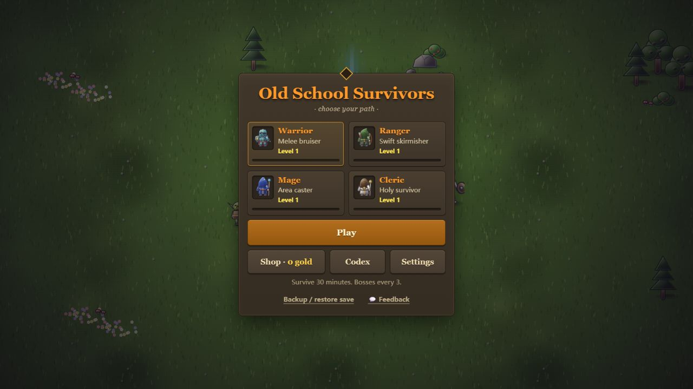
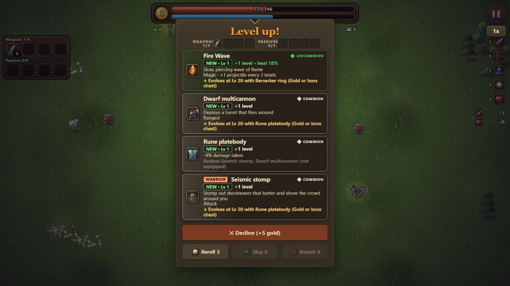
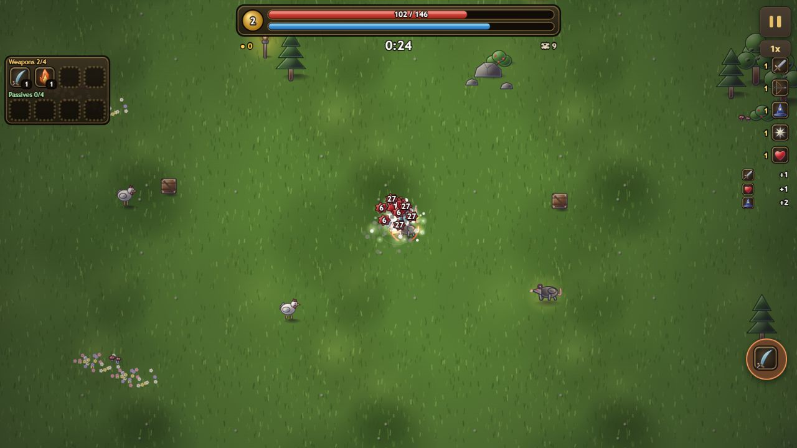

# Old School Survivors 游戏规格说明书

格式版本：V5.1

仅记录有依据的实现层事实；字段非必填。空白表示代码未披露或未登记，不代表不存在、不可玩或验收通过。

## 1. 基础事实

**维度定义**：游戏类型、操控体验和技术栈。

**内容说明**

- 游戏名称：Old School Survivors

**玩法类型**

动作 / 自动射击生存

**操作方式**

原作者说明和源码支持WASD/方向键移动，Space/E职业技能、Esc/P暂停；本轮实测原生菜单按钮、开局和升级卡点击，移动/快捷键未实测。

**视角与布局**

俯视战场；生命/经验/计时位于顶部，武器与被动栏位于侧方，升级覆盖层列出卡片。

**画面维度**

2D

**引擎**

原生Canvas2D、HTML/CSS。

**程序语言**

JavaScript。

**结论字段**

- `game_summary` = 操控原生职业在敌群中生存，自动武器击杀获取经验并选择升级。

## 2. 资源类型

**维度定义**：内容元素类别及其引擎资源格式。

**内容说明**

**内容元素资源类型**

单HTML包含原生Canvas绘图、内联样式、SVG/data素材及程序生成内容，无外部游戏资源下载。

**结论字段**

- `engine_asset_system` = 原生Web/Canvas2D，原游戏内联源码及数据保留。

## 3. 核心挑战维度

**维度定义**：核心玩法所涉及的挑战类型及主次。

**内容说明**

**核心挑战内容**

敌人持续生成，原职业自动攻击，获得经验后选择武器/被动升级；本轮观察到受伤、击杀、升级与恢复生命。

**结论字段**

- `core_challenge_type` = 生存对抗 / 成长选择

## 4. 操控方式

**维度定义**：输入方式、输入元素和操控构成。

**内容说明**

**操作方式**

原作者说明和源码支持WASD/方向键移动，Space/E职业技能、Esc/P暂停；本轮实测原生菜单按钮、开局和升级卡点击，移动/快捷键未实测。

**操控构成要素**

原生DOM按钮和升级卡；源码另有键盘/触屏控制。

## 5. 行为路径

**维度定义**：玩家在一次核心循环中重复执行的动作顺序。

**内容说明**

**核心玩法**

原生职业开局→自动攻击敌人→获取经验→升级卡选择→武器/生命变化→继续战斗。

**结论字段**

- `core_loop` = 实际观察：5击杀/累计XP16升2级→选择Fire Wave→scim1+fire1，77生命恢复到102→继续自然战斗13击杀/3级。

## 6. 游戏路径（关键节点 + 流失风险）

**维度定义**：从启动到结束的流程节点及已披露的风险。

**内容说明**

**游戏流程**

菜单→职业详情→Start run→战场→升级选择→战场；源码保留原终局与再次开局，未实测30分钟完整流程。

## 7. 成长路径

**维度定义**：玩家推进和变强的途径。

**内容说明**

**奖励与成长**

原生职业/技能/装备/难度成长逻辑完整保留。此次只实测Warrior从1级到3级和一次新武器升级。

**结论字段**

- `progression_loop` = 击杀积累经验→升级选择→战斗能力增长；原技能持久化存在，刷新恢复未实测。

## 8. 核心闭环（目标-规则-反馈-激励）

**维度定义**：目标、规则、反馈、激励和下一目标。

**内容说明**

**目标规则反馈激励闭环**

目标：在原敌群中生存并成长。规则：原伤害/生成/经验阈值与随机卡片不变。反馈：击杀数、经验条、生命、等级、卡片与武器栏变化。激励：真实赚取的经验与Fire Wave武器、卡片恢复生命；下一目标为持续生存与后续升级。本轮只证明首段核心循环，不宣称终局完成。

## 9. 玩法规则

**维度定义**：核心循环、操作、胜负和结算规则。

**内容说明**

**目标、规则与结算数值**

原菜单说明生存30分钟、首领每3分钟；完整原规则保留。本轮无数值或难度修改，未实际等到首领/终局。

**已验证流程与未覆盖范围**

原作者公开Run game声明的v61单HTML构建，开发机/52下载原字节SHA一致；只退役末尾87字节itch.io容器脚本，原生内联玩法、图形、数值、难度、职业、解锁、本地存档及完整30分钟规则不改。严格5步：启动、确认首次更新提示、Play、Start run、选择真实赚取的Fire Wave升级卡。Warrior自然自动攻击5击杀/累计XP16升2级，实际点击卡后武器scim1+fire1且生命77恢复到102，继续自然战斗13击杀/累计XP34升3级，原技能本地存储107字节。没有调用调试写接口、改分数或伪造奖励。151条未截断完整事件无外联、HTTP错误、请求失败或页面异常，console警告错误0。只验证首段击杀→经验→升级选择→奖励应用→继续战斗；未实测移动、刷新继续、完整30分钟终局、Danger梯度/后期及其他职业，不声称整局胜利或全内容试玩。保留原完整可编辑游戏并沿原任务待人工验收，不批准不供货。

## 10. 数值配置

**维度定义**：影响玩法的生命、概率、时长、速度和经济等数值。

**内容说明**

**结论字段**

- `key_numbers` = 原生开局Warrior146生命；5击杀/16累计XP后2级、升级前77生命，Fire Wave卡显示恢复18%，实际升至102；后续13击杀、34累计XP、3级。

## 11. 关卡配置

**维度定义**：关卡布局、目标、数量、递进和难度参数。

**内容说明**

**内容规模**

完整v61原生职业、武器、被动与难度代码保留，具体内容总量尚未逐项枚举核验。

**场景、关卡与难度设计**

原生生存战场与时间推进配置保留，没有新造关卡、简化轮次或截短计时。

## 12. 系统设计

**维度定义**：功能系统及界面流程。

**内容说明**

**玩法系统与相互作用**

自动攻击、敌群生成、经验升级、随机升级卡、职业详情、技能/装备、原生暂停与本地存储；后期与其他系统只作代码保留说明。

**界面流程与反馈**

首次原生更新说明→四职业菜单→Warrior详情→Start run→战场HUD→升级卡→继续战斗，均本轮实际看到。

**存档方式**

源码使用oss前缀localStorage；实际看到oss_skills107字节、oss_meta183字节。未手动调用保存、未改存储；本轮没有游戏刷新/继续测试，不声称中局恢复已通过。

## 13. 主题化包装

**维度定义**：文字、叙事、命名及美术内容。

**内容说明**

**文字与美术内容**

保留原生奇幻职业、怪物、草地/树林、斩击和火焰效果。

### 实际运行图解

图 1：真实原生四职业菜单，首次更新提示已正常确认。

图 2：自然击杀获取经验后原生升级选择界面，生命77/146。

图 3：实际选择Fire Wave后武器2/4，生命102/146并继续击杀。

## 14. 养成系统 + 经济系统

**维度定义**：成长要素和资源产出、消耗、回收机制。

**内容说明**

**养成与经济机制**

原金币、经验、技能与商店规则保留；本轮金币0，未购买或解锁，不伪造获得金币。

**结论字段**

- `progression_loop` = 击杀积累经验→升级选择→战斗能力增长；原技能持久化存在，刷新恢复未实测。

## 15. 角色 / 单位设定

**维度定义**：角色单位的数量、属性、能力、定位和关系。

**内容说明**

**角色单位设定**

实际Warrior、其Rune scimitar及赚取的Fire Wave；其他Ranger/Mage/Cleric菜单可见，未开局测试。

## 16. 商业化

**维度定义**：已实现的广告、内购、订阅、买断和付费点。

**内容说明**

**商业化实现**

无真实支付/广告SDK、联网房间或排行榜调用；原源码Premium明确为本地DEMO标记，无支付网络，不宣称购买验证。

### 事实依据与定位

index.html；SOURCE_PRESERVATION.json；evidence/direct-repair/network-final.json、native-earned-state.json；screenshots真实运行图。
