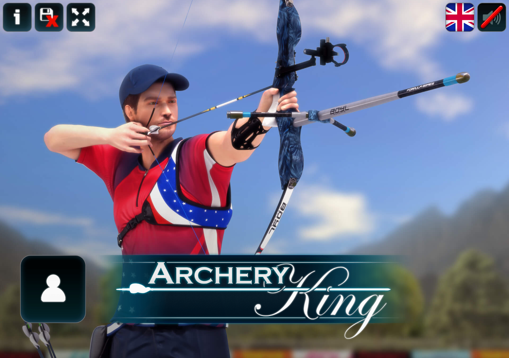
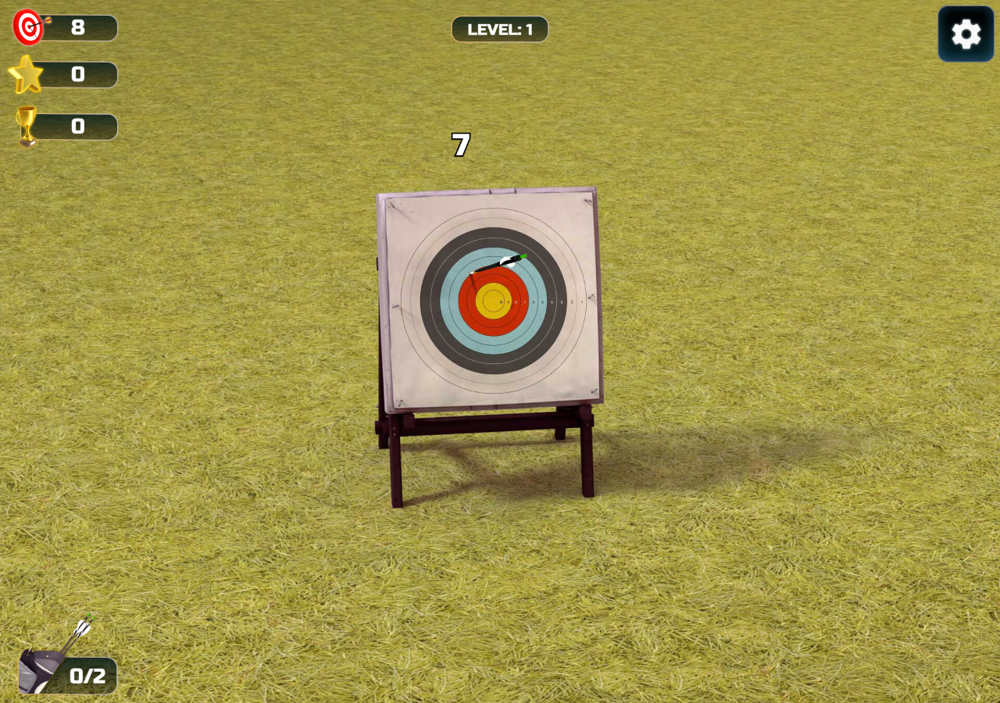
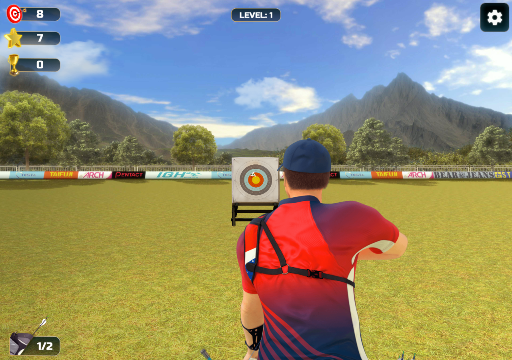

# Archery King 游戏规格说明书

格式版本：V5.1

仅记录有依据的实现层事实；内容字段非必填，未知留空，不代表不存在或已经验证。

## 1. 基础事实

**维度定义**：让读者第一眼知道“这是什么类型、什么操控体验的游戏”，以及它的技术栈。

**内容说明**

Archery King / 射箭之王。MSN原生身份9n5gkc4t7lzz，Code This Lab公开原构建v28；JavaScript/HTML/CSS，CreateJS Canvas2D、Howler。二维背景与弓箭手帧动画。本轮实际5步见验证附记。

## 2. 资源类型

**维度定义**：游戏中游戏内容元素的资源类型是什么——即在哪个引擎运行下的资源格式。

**内容说明**

PNG/JPG角色帧、草地/靶面背景和按钮，MP3音频与Russo One WOFF/WOFF2字体；原JavaScript内嵌24关配置。204项声明资源保留原URL和SHA，190图片解码通过。

## 3. 核心挑战维度

**维度定义**：游戏核心玩法主要挑战 / 满足人的什么。

**内容说明**

按住开始瞄准，在原抖动与风偏下拖动调整方向，松手射箭；有限箭数内达到本关最低分。实际首箭命中7分，未验证后续难度。

## 4. 操控方式

**维度定义**：操控本身的复杂度 + 需要玩家判断的时机 / 策略复杂度。

**内容说明**

实际使用浏览器原生触摸事件触发CreateJS输入：按下约1.1秒、从(650,440)拖至(655,445)并释放。原帮助说明为鼠标左键按住、拖动瞄准、释放射箭；触摸路径实际生效，未注入游戏函数或状态。

## 5. 行为路径

**维度定义**：玩家一局里重复做什么。

**内容说明**

本轮：首页选择单人→24关选择界面中的第1关→原帮助弹窗→关闭帮助→一次瞄准放箭→靶面7分及HUD已用箭1/2。

## 6. 游戏路径（关键节点 + 流失风险）

**维度定义**：从开始到结束的流程 + 每个关键节点的潜在流失风险点。

**内容说明**

代码路径：本地菜单→按原存档选关→帮助/弓箭场景→有限次射击→按最低分与星级阈值结算→重开/下一关；本轮只到首箭反馈，未实测结算和流失风险。

## 7. 成长路径

**维度定义**：玩家如何推进变强。

**内容说明**

保留原24关顺序及本地最高分/解锁；新存档实测仅第1关解锁，未篡改存档或批量解锁。

## 8. 核心闭环（目标-规则-反馈-激励）

**维度定义**：游戏是否具备“明确目标 → 明确规则 → 达成反馈 → 奖励激励 → 下一目标”的完整闭环。

**内容说明**

目标：本关箭数内达到最低分。规则：按住准备、拖动调整、松手射箭，按靶面环值计分。反馈：箭落靶动画、7分浮字、分数0→7、已用箭0/2→1/2。激励/下一目标：原星级阈值与下一关解锁代码保留；本轮未完成这一整关。

## 9. 玩法规则

**维度定义**：核心循环、玩法规则、目标与进度。

**内容说明**

原TARGET_SCORE=[10,9,8,7,6,5,4,3,2,1,0]；原命中距离分类、靶心坐标、风偏、箭数、抖动、星级及输赢判断保留。第1关2箭，最低8分，三档星级阈值[8,14,18]，风速min0/max0；本轮首箭7分仍未达到通关阈值。

## 10. 数值配置

**维度定义**：影响玩法的关键数值。

**内容说明**

源码数值：AIMING_TIME800、ARROW_SPEED200、AIM_SENSITIVITY0.007；10个TARGET_DISTANCES位置配置[20,37,52,69,87,105,122,142,161,180]；7语言。第1关aim_tremble distance6/time9000。数值来自原代码，不冒充实测耗时。

## 11. 关卡配置

**维度定义**：关卡结构、递进规律、难度曲线。

**内容说明**

LEVELS为24份实际原关卡记录，每关wind、arrows、stars、aim_tremble均原样保留于evidence/archery-native-facts.json。只试玩第1关一次放箭；完整配置不等于24关通关。

## 12. 系统设计

**维度定义**：功能系统清单、UI 流程。

**内容说明**

保留原单人选关、弓箭手/靶面、瞄准与风偏、箭数、分数、星级、帮助、音量、清档及本地进度。删除房间/登录/邀请/PlayerIO、在线统计、上传/通知、推荐/广告、奖励按钮与额外箭奖励方法；没有伪造SDK或广告成功。

## 13. 主题化包装

**维度定义**：游戏的题材 / 世界观包装。

**内容说明**

原写实弓箭运动员、草地射箭场、山地背景、彩环箭靶、英文帮助与图标资源；只使用原包素材和实际运行截图。

## 14. 养成系统 + 经济系统

**维度定义**：玩家如何成长、经济如何循环。

**内容说明**

原游戏按关卡最高分与星级解锁记录本地进度。本版不含联网排名、付费货币、购买或广告换箭；未新增经济数值，也未实测进度刷新。

## 15. 角色 / 单位设定

**维度定义**：有哪些角色/单位、各自定位（玩法层面）。

**内容说明**

弓箭手为原70帧player_0至69的准备/瞄准/放箭动画；操作对象是弓箭方向，箭与靶面由原CArrow/CTarget及命中距离逻辑处理；没有新增角色能力或联网对手替身。

## 16. 商业化

**维度定义**：靠什么变现。

**内容说明**

单机修订去除外部平台脚本、广告推荐/成绩上传、登录房间、广告奖励入口及奖励加箭，不把奖励当免费领取。原本地计分与解锁不依赖服务端；未发现保留的真实支付接口。

图 1：原首页，联网按钮已退役

图 2：原选关与初始解锁，仅第1关可选

图 3：首箭原靶面实际7分

图 4：原HUD分数7，已用箭1/2；未通关
