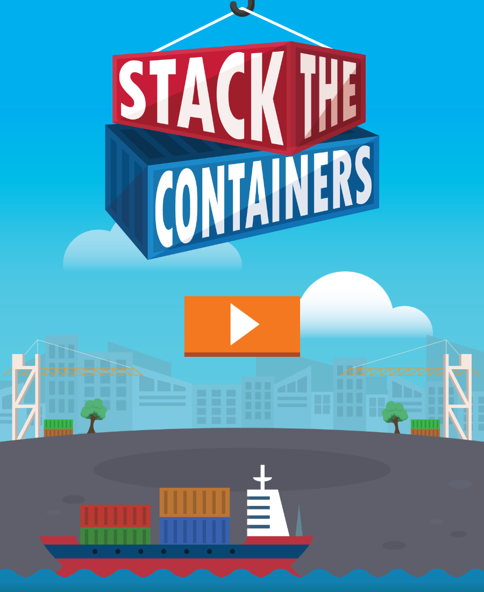
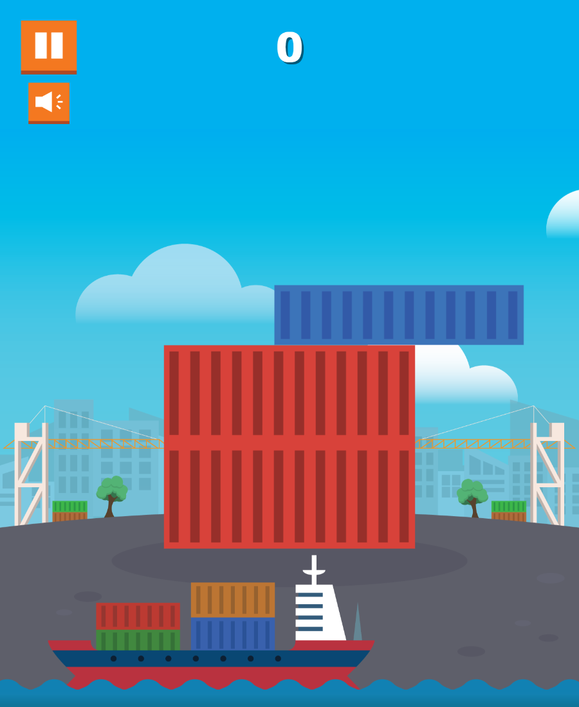
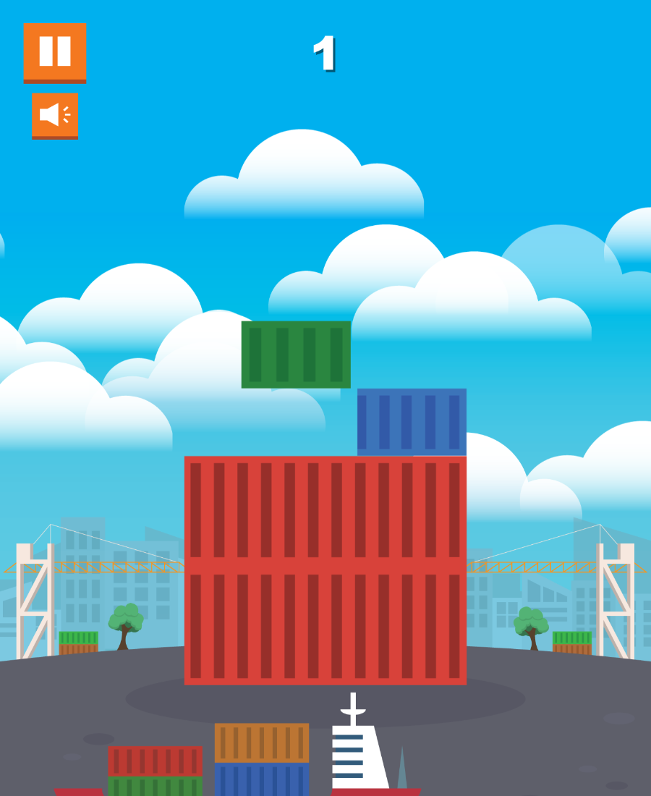

# Stack The Containers 游戏规格说明书

格式版本：V5.1

仅记录有依据的实现层事实；内容字段非必填，未知留空，不代表不存在或已经验证。

## 1. 基础事实

**维度定义**：让读者第一眼知道“这是什么类型、什么操控体验的游戏”，以及它的技术栈。

**内容说明**

MSN9pk2c9cd597r，原Stack The Containers v5，ImpactJS/JavaScript/Canvas2D，原2D港口竖向堆箱。桌面鼠标点击实测，实际900×1100显示、内部1400×1711.111，实体手机未测。

## 2. 资源类型

**维度定义**：游戏中游戏内容元素的资源类型是什么——即在哪个引擎运行下的资源格式。

**内容说明**

保留原PNG/JPG箱体、吊钩/港口/船只/按钮/云和场景、原CSS及引擎。动态声明的blacklives/lemonmilk两字体各woff2/woff/ttf和原19OGG+city1.mp3共20音频由原站精确补齐，独立浏览器解码成功。游戏正文HUD源码使用Arial；不能因此说无原字体依赖。

## 3. 核心挑战维度

**维度定义**：游戏核心玩法主要挑战 / 满足人的什么。

**内容说明**

观察横向移动的集装箱，选时机点击令其与下层重叠。超出的部分按原几何裁切，保留宽度成为下一层约束；主要考验点击时机与可视对齐。

## 4. 操控方式

**维度定义**：操控本身的复杂度 + 需要玩家判断的时机 / 策略复杂度。

**内容说明**

鼠标点击原Play开始；在场景非暂停/声音按钮区域单击落箱。Pause和音量按钮保留，分享按钮及命中区域删除。本轮仅点击Play与场景一次，未测试暂停/声音按钮。

## 5. 行为路径

**维度定义**：玩家一局里重复做什么。

**内容说明**

原菜单→普通点Play→原箱体左右移动→普通场景点击→原裁切与得分1、下一箱出现。只有这些可见节点得到实际操作证据。

## 6. 游戏路径（关键节点 + 流失风险）

**维度定义**：从开始到结束的流程 + 每个关键节点的潜在流失风险点。

**内容说明**

玩家在菜单进入堆箱场景；每次堆叠成功继续下一箱。未重叠或箱宽过小时走原失败与结果分支，广告复活入口删除；失败/结果本轮未实测，流失风险未知。

## 7. 成长路径

**维度定义**：玩家如何推进变强。

**内容说明**

原程序持续生成箱体、递增层数，按交叠缩小可用宽度；每10层原检查点逻辑保留。无本轮验证的固定总关数或通关终点。

## 8. 核心闭环（目标-规则-反馈-激励）

**维度定义**：游戏是否具备“明确目标 → 明确规则 → 达成反馈 → 奖励激励 → 下一目标”的完整闭环。

**内容说明**

目标是叠得更高；观察横移→点击→原交叠计算→裁去越界部分/得分→原摄像机上移并生成下箱→在更窄的支撑区继续。本轮实际首层加1分、剩余235，未测试更高层。

## 9. 玩法规则

**维度定义**：核心循环、玩法规则、目标与进度。

**内容说明**

原detectCollison按当前左右边界与支撑区判断；完全贴合或部分重叠均按原分支加1，部分重叠裁去越界部分；无重叠原gameover。原ItemStack.cutPanel、碰撞、生成及结果方法AST完全相同。原失败询问取消行为showResult=true/showAsk=false用于删除广告复活后的正常结果，不新增奖励。

## 10. 数值配置

**维度定义**：影响玩法的关键数值。

**内容说明**

代码：初始可用宽603；箱宽≤15后原失败条件，每10层检查点。实际：起分0、点击后1；越界裁切368，剩余235，下一箱移动中。没有测量输入延迟或帧率。

## 11. 关卡配置

**维度定义**：关卡结构、递进规律、难度曲线。

**内容说明**

原Home与Stack场景描述、箱体6色/宽档、随机配色与运行时生成保留；不换随机数、不预设命中。没有服务端关卡。源码规则不等于所有层数已验证。

## 12. 系统设计

**维度定义**：功能系统清单、UI 流程。

**内容说明**

原Impact引擎、Pointer、HomeControl/StackControl/ItemStack、裁切碎片、云/摄像机、原SoundHandler与IoManager保留。210实体/main方法156AST相同、41服务方法删除、13方法为服务调用/广告入口/分享命中区退役。在线Microsoft/API/CPMStar、广告/激励复活、分享/更多游戏/外链覆盖层及迁移fetchData退役，不新增假SDK。

## 13. 主题化包装

**维度定义**：游戏的题材 / 世界观包装。

**内容说明**

保留原港口、吊钩、船只、集装箱/云背景和橙色菜单按钮；首层蓝箱裁切、绿色新箱、白色分数1实际可见。不使用替代占位素材。

## 14. 养成系统 + 经济系统

**维度定义**：玩家如何成长、经济如何循环。

**内容说明**

沿用本地IoManager存储声音/音乐与原记录，未验证跨刷新保存。层数/分数保持原判定，不自动发放广告奖励、复活、金币或免费权益。

## 15. 角色 / 单位设定

**维度定义**：有哪些角色/单位、各自定位（玩法层面）。

**内容说明**

玩家操纵的是原彩色集装箱，没有在线玩家、房间、账号或角色身份模拟。原随机箱体选择保持，绿色/蓝色本轮可见。

## 16. 商业化

**维度定义**：靠什么变现。

**内容说明**

原间屏、激励广告与复活、在线报分/分享/外链推广的提供方、调用方和按钮退役，原无广告失败结果保持；未新增支付。独立静态HTTP运行，本轮所有请求均本地，离线边界见证据。

图 1：原菜单与Play

图 2：原横移箱与初始分数0

图 3：一次普通点击后得分1、裁切箱与下一箱
