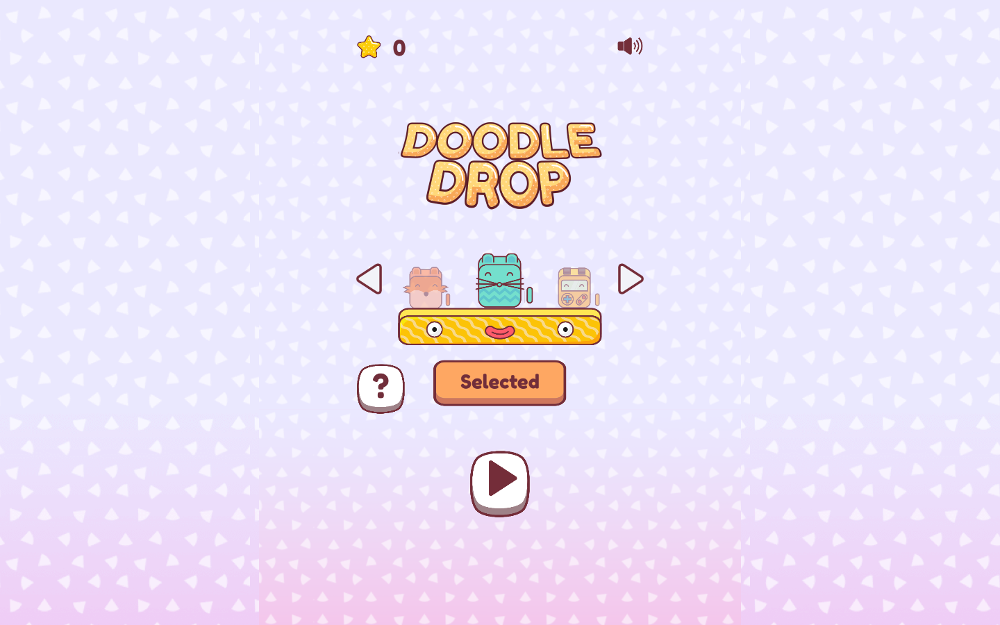
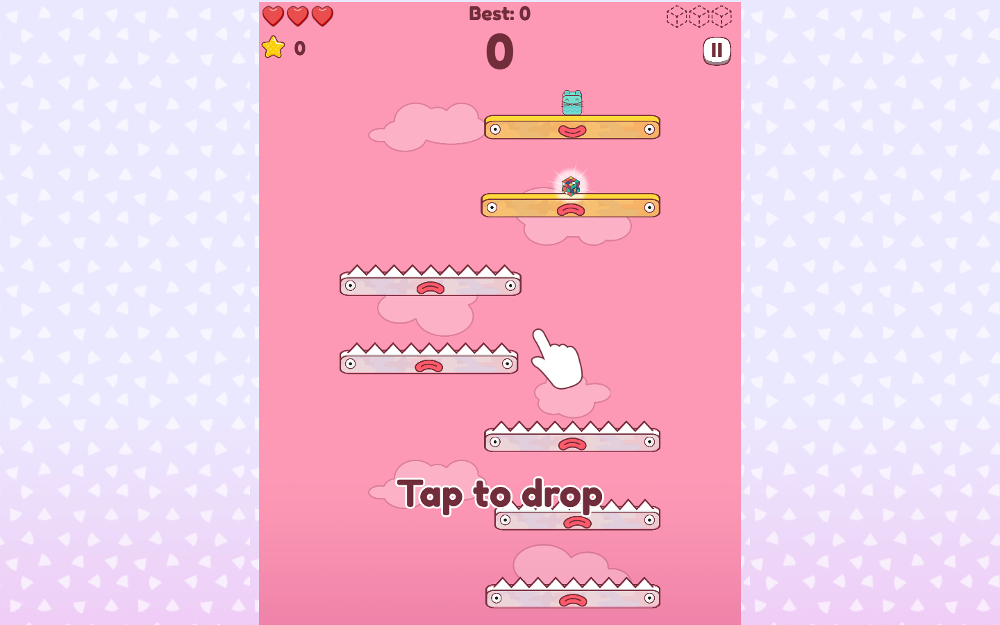
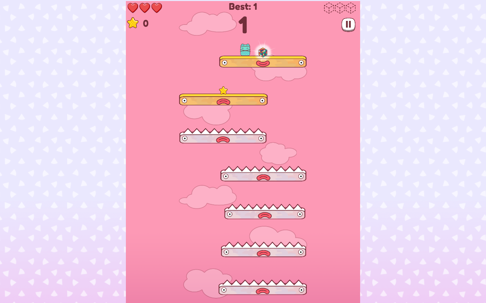
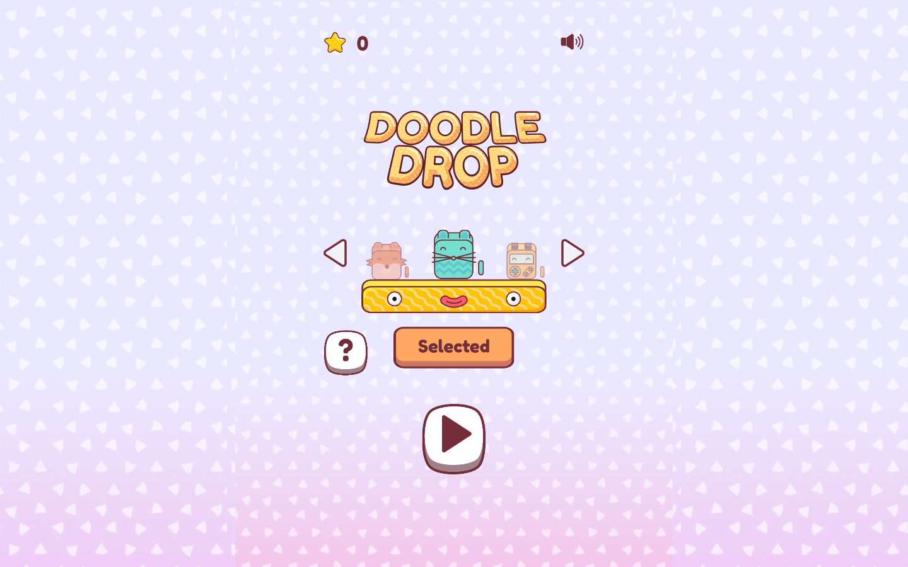

# Doodle Drop / 涂鸦落层 游戏规格说明书

格式版本：V5.1

仅记录有依据的实现层事实；内容字段非必填，未知留空，不代表不存在或已经验证。

## 1. 基础事实

**维度定义**：让读者第一眼知道“这是什么类型、什么操控体验的游戏”，以及它的技术栈。

**内容说明**

Doodle Drop；MSN原生9nmj2s1n0x52，Hammerplay v8。Phaser3.55.2、Parcel JavaScript发布源码，2D竖屏下落平台时机玩法。远端52机器1440×900实际鼠标操作。

## 2. 资源类型

**维度定义**：游戏中游戏内容元素的资源类型是什么——即在哪个引擎运行下的资源格式。

**内容说明**

85运行文件7310456字节，83份原字节；原PNG图集及Unity YAML .png.meta、hand.json帧、WOFF2字体、MP3/WAV音频和原JS/CSS。两份原Audio/DM-CGS-21.mp3与DM-CGS-22.mp3实际为合法RIFF/WAVE，按原路径与字节保留，不转码。完整原资源归档和SHA随包。

## 3. 核心挑战维度

**维度定义**：游戏核心玩法主要挑战 / 满足人的什么。

**内容说明**

观察水平移动的承托平台与下方安全平台，在合适时机点击移除当前承托，使角色落到下一层并避开尖刺、激光和弹体，继续向下得分。实测成功落首层和得1分，不以普通平台/下落主题判定与自由落体操控、重力换边或旋转塔环同玩法。

## 4. 操控方式

**维度定义**：操控本身的复杂度 + 需要玩家判断的时机 / 策略复杂度。

**内容说明**

鼠标普通点击Play开始；对局中点击触发原removePlatform，停止当前平台运动并释放角色。菜单音量、说明、皮肤左右选择与Equip按钮源码保留，未逐项操作；触屏未实测。

## 5. 行为路径

**维度定义**：玩家一局里重复做什么。

**内容说明**

累计5次真实输入：v1首次加载菜单，发现原HTML声明导致CSP元标签位置错误；修正入口后v2第2步载入菜单，第3步普通点击Play，第4步普通点击释放承托平台，角色落到下一平台、Score和Best均0→1、原Tap to drop教学自动消失；第5步刷新，随后仅被动观察原菜单恢复。v1和v2预算累计，不重置额度。

## 6. 游戏路径（关键节点 + 流失风险）

**维度定义**：从开始到结束的流程 + 每个关键节点的潜在流失风险点。

**内容说明**

原加载与菜单→Play→原Tutorial手势提示→点击移除承托平台→落到下一移动平台、得分→继续释放/落层；原生命损失、复活和最终普通Retry路径源码保留，未实测终局。

## 7. 成长路径

**维度定义**：玩家如何推进变强。

**内容说明**

原hammerplay_doodledrop_highscore/stars/meta三类localStorage键及读写方法保留，皮肤状态与普通星星购买规则保持。本轮显示Score/Best1，未经历原结算，不能宣称最高分已跨刷新持久化。

## 8. 核心闭环（目标-规则-反馈-激励）

**维度定义**：游戏是否具备“明确目标 → 明确规则 → 达成反馈 → 奖励激励 → 下一目标”的完整闭环。

**内容说明**

目标：安全下落到下一承托层。规则：移除当前平台后原物理让角色下落，接触下一平台/障碍由原碰撞处理。反馈：位置/镜头跟随、平台变化、计分与生命UI；实测首落Score/Best0→1。激励：继续得分与原星星/皮肤，后者仅源码确认。下一目标：观察下一移动平台择机下落。

## 9. 玩法规则

**维度定义**：核心循环、玩法规则、目标与进度。

**内容说明**

原NormalMode.removePlatform停止当前平台Tween、设置原平台行为并释放角色；首平台操作自动关闭Tutorial。原障碍/激光/弹体、spring/ice等强化与随机平台生成保持；3命耗尽后的广告额外复活退役，保留普通重试。

## 10. 数值配置

**维度定义**：影响玩法的关键数值。

**内容说明**

源码：初始3命、星星0、10皮肤槽；初始选中皮肤cost0，其余按500/1000/1500分组。NormalMode platformAmount9、platformStep262.5、min/maxPlatformSpeed1.7、min/maxPlatformSize0.8/0.9；GAME_DROP_SPEED4000、RUSH_MODE_DROP_SPEED12000、RUSH_MODE_TIME5200为原代码常量，未推断单位或全流程平衡。实测首落1分、3颗红心。

## 11. 关卡配置

**维度定义**：关卡结构、递进规律、难度曲线。

**内容说明**

原NormalMode与RushMode及完整Gameplay生成/障碍/强化逻辑保留；NormalMode是原按深度生成的平台序列，不冒充固定关卡表或9个关卡。只试玩首个平台落层；未宣称全部随机内容或Rush入口实测。

## 12. 系统设计

**维度定义**：功能系统清单、UI 流程。

**内容说明**

原Phaser场景Game/MainMenu/NormalMode/RushMode/Tutorial/UI、平台与角色物理/碰撞、镜头/计分/生命、强化、音频、皮肤/货币和本地存档。真实删除MSStartSDK、域迁移iframe脚本及调用、广告/奖励复活/榜单上报/社交分享/联赛提供者和消费者，原本地存档管理类改名LocalProgress并保留原localStorage读写方法。3条命原自动复活保留，耗尽后直接走原普通重试结果；不增加广告奖励、假SDK、假服务器或假玩家。原引擎、物理/碰撞/生成器/随机数/时间/教程和普通皮肤货币规则保持。

## 13. 主题化包装

**维度定义**：游戏的题材 / 世界观包装。

**内容说明**

原卡通文具/掌机造型角色，黄色表情承托板与尖刺板，粉色渐变背景/云层、粗描边字体、星星/红心/暂停与Tap to drop手势提示，完整原图片和界面保持。

## 14. 养成系统 + 经济系统

**维度定义**：玩家如何成长、经济如何循环。

**内容说明**

原10款角色皮肤按meta.status/cost和stars判断购买/装备；默认第一款选中，其余价格500、1000、1500。普通星星收集和本地消费保留；不提供广告75星或额外复活。实际皮肤购买、拾取与收益结算未试玩。

## 15. 角色 / 单位设定

**维度定义**：有哪些角色/单位、各自定位（玩法层面）。

**内容说明**

原可选择10款皮肤，Character_1/Characters_2/Characters_3及10张死亡图完整保留。移动承托、尖刺承托、激光、弹体、普通星星/魔方与强化保留；本轮只实际触发一次安全平台落层。

## 16. 商业化

**维度定义**：靠什么变现。

**内容说明**

真实删除MSStartSDK、域迁移iframe脚本及调用、广告/奖励复活/榜单上报/社交分享/联赛提供者和消费者，原本地存档管理类改名LocalProgress并保留原localStorage读写方法。3条命原自动复活保留，耗尽后直接走原普通重试结果；不增加广告奖励、假SDK、假服务器或假玩家。原引擎、物理/碰撞/生成器/随机数/时间/教程和普通皮肤货币规则保持。 只验证首个平台释放/落层计分及刷新回菜单；没有验证连续高分、星星或魔方拾取、死亡/三命耗尽/重试、Rush模式、全部随机平台障碍、皮肤购买、存档结算持久性及真实触屏或声音。Best1是当局显示，不宣称已结算保存。修正版172请求/172响应均同源200，0外联/失败/脚本错误；14条警告为Canvas2D读回性能和手势前音频限制。v1的1条CSP错误保留，不混称修复前也零错误。

图 1：修正版原菜单

图 2：原首落平台和Tap to drop提示

图 3：普通点击后落到下一平台，Score/Best1，原教学消失

图 4：累计第5步刷新后被动观察回到原菜单
