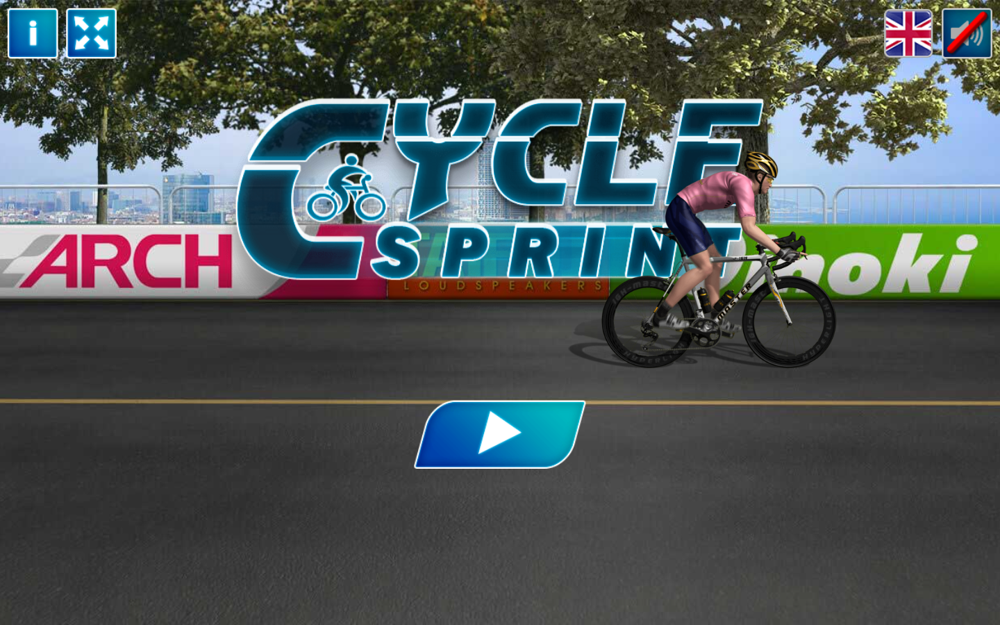
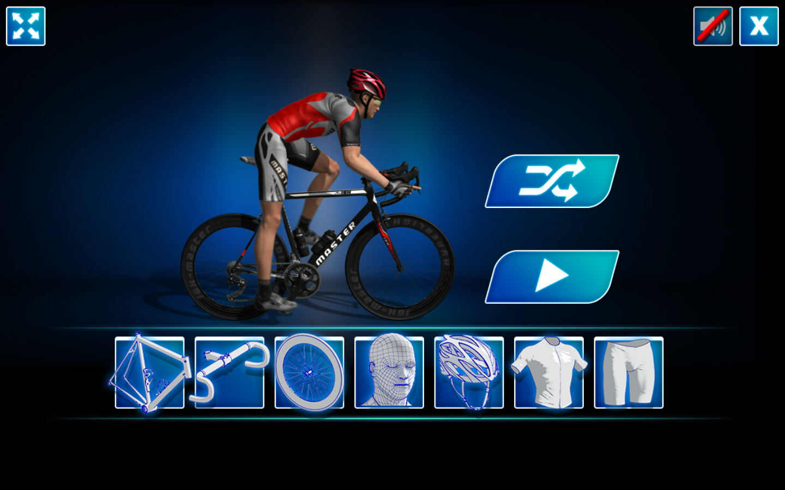
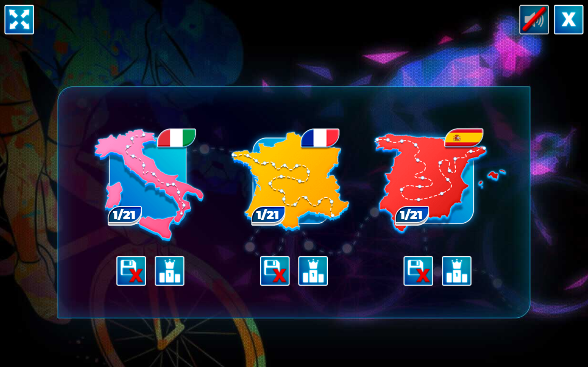
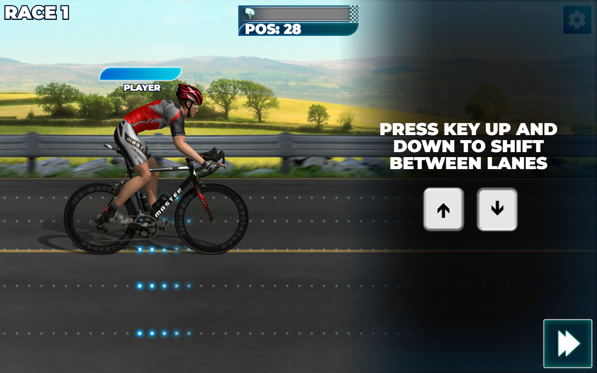
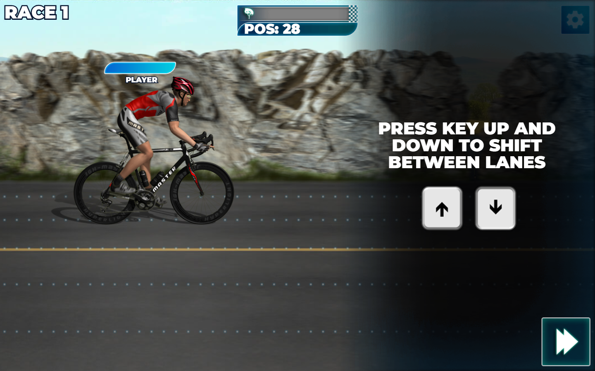

# Cycle Sprint / 自行车冲刺 游戏规格说明书

格式版本：V5.1

仅记录有依据的实现层事实；内容字段非必填，未知留空，不代表不存在或已经验证。

## 1. 基础事实

**维度定义**：让读者第一眼知道“这是什么类型、什么操控体验的游戏”，以及它的技术栈。

**内容说明**

Cycle Sprint / 自行车冲刺；MSN原生9mvq9gxf024k、CodeThisLab公开v7；CreateJS/EaselJS/TweenJS、Howler，JavaScript/HTML/CSS。横向2D单人骑行竞赛，远端52桌面1440×900实际运行，手机未实测。

## 2. 资源类型

**维度定义**：游戏中游戏内容元素的资源类型是什么——即在哪个引擎运行下的资源格式。

**内容说明**

141运行文件，其中139份保持原字节；含原PNG/JPG骑手部件与精灵表、道路/背景/菜单/教程、六个MP3和Montserrat字体WOFF/WOFF2、七语言CLang和原引擎。133项声明资源下载均HTTP200且SHA核对，全部原部件类型和精灵表范围已展开。

## 3. 核心挑战维度

**维度定义**：游戏核心玩法主要挑战 / 满足人的什么。

**内容说明**

在多车道公路上调整车道、控制体力与冲刺，超过本地对手争取赛段排名和赛事累计积分。实测原教程内骑手正常响应上键并完成换道；正式比赛胜负未实测。

## 4. 操控方式

**维度定义**：操控本身的复杂度 + 需要玩家判断的时机 / 策略复杂度。

**内容说明**

源码CController：上/下方向键切换车道，空格按住冲刺、松开结束；鼠标操作菜单、自定义、国家选择、暂停与原教程下一步。实测只按上方向键，未实测下键、空格、手机控件或教程翻页。

## 5. 行为路径

**维度定义**：玩家一局里重复做什么。

**内容说明**

累计5次实际输入：原入口、原Play、首次自定义确认、意大利赛事、普通上方向键120ms。原骑手x400保持，y497→446、缩放0.77→0.67，原道路与踏车动画持续；原互动教程未跳过。

## 6. 游戏路径（关键节点 + 流失风险）

**维度定义**：从开始到结束的流程 + 每个关键节点的潜在流失风险点。

**内容说明**

原标题Play→首次自定义确认→国家赛事选择→首赛原三页互动教程→倒计时→普通比赛与结算。实测止于首教程的一次真实换道，不伪称教程完成、比赛开始或过关。

## 7. 成长路径

**维度定义**：玩家如何推进变强。

**内容说明**

原三国各21赛段，按赛段存储本地进度、积分和赛事名次。原自定义服装/车架/车把/轮组/肤色/头盔眼镜资源和选择保留；本轮接受原默认配件，未更换或刷新核对。

## 8. 核心闭环（目标-规则-反馈-激励）

**维度定义**：游戏是否具备“明确目标 → 明确规则 → 达成反馈 → 奖励激励 → 下一目标”的完整闭环。

**内容说明**

源码循环为换道选择线路与对手距离→收集体力→适时冲刺→到达终点与本地名次积分→继续赛段/赛事。实测证据覆盖原菜单进入、原教程运动和普通上键换道，未覆盖结算部分。

## 9. 玩法规则

**维度定义**：核心循环、玩法规则、目标与进度。

**内容说明**

CGame、CController、CCyclist、道路/背景、体力、雷达、原对手与原教程逻辑保持原字节；14项关键函数中13项最终仍逐字节相同，CTournamentSelection仅本地积分读取调用标识符变更，逆替换完全相同。未改随机、碰撞、速度、体力、得分、难度、关卡或存档。

## 10. 数值配置

**维度定义**：影响玩法的关键数值。

**内容说明**

原5条车道：y404/446/497/562/647，对应缩放0.60/0.67/0.77/0.87/1；实测第三条→第二条。源码正常背景速度22、冲刺28、体力补充22、体力上限100、出发倒计时4000ms。前15名积分50/35/25/18/14/12/10/8/7/6/5/4/3/2/1；这些为源码事实，不当作已验证结算。

## 11. 关卡配置

**维度定义**：关卡结构、递进规律、难度曲线。

**内容说明**

完整原LEVEL_INFOS共63条，意大利/法国/西班牙各21。首意大利赛段max_dist_opponent10000、bg_index6、spawn_stamina_time6000、hill=false；完整原63配置区间另附，未只保留首关。实测只打开意大利首赛教程。

## 12. 系统设计

**维度定义**：功能系统清单、UI 流程。

**内容说明**

原CreateJS舞台、精灵表、帧循环/补间、骑手分部件渲染、背景/道路、原本地对手/排序、雷达、体力、教程、localStorage赛事积分与自定义保持。实际MSStart宿主脚本/启动等待、通知安排、分数上报监听、广告监听与显示调用、更多游戏与外链点击退役。不提供SDK对象、登录身份、广告完成/奖励或服务端回包。原本地赛事积分榜属于单人赛事排名，原localStorage读写和本地对手保留。 实玩修订v1；交付修订v2仅把原本地localStorage积分读取函数及唯一调用从getLeaderboard改名readLocalTournamentStandings，其余字节相同，精确逆替换和语法检查通过。原函数体、声明与调用锚点归档；v2未另行加载，不能宣称v2新增运行路径已测。

## 13. 主题化包装

**维度定义**：游戏的题材 / 世界观包装。

**内容说明**

原公路自行车运动主题，七个部位类别及阴影、车架/车把/车轮/肤色/头盔眼镜/上衣/短裤鞋子资源，三国地图与竞赛背景、原高对比蓝色按钮和教程手势/按键。实拍英语原界面，不替换原美术。

## 14. 养成系统 + 经济系统

**维度定义**：玩家如何成长、经济如何循环。

**内容说明**

原赛段积分、赛事累计分、最高赛段和本地部件选择为进展，不新增金币或付费经济。原leaderboard保留的是本地赛事积分数据，没有联网排名。存档代码保留，但刷新恢复未知。

## 15. 角色 / 单位设定

**维度定义**：有哪些角色/单位、各自定位（玩法层面）。

**内容说明**

原玩家骑手及本地对手，分部件精灵动画、透视大小和车道排序保留；实测画面显示POS28。对手数量/完成名次不按该界面数字推断已验证，未注入对手或替代AI。

## 16. 商业化

**维度定义**：靠什么变现。

**内容说明**

实际MSStart宿主脚本/启动等待、通知安排、分数上报监听、广告监听与显示调用、更多游戏与外链点击退役。不提供SDK对象、登录身份、广告完成/奖励或服务端回包。原本地赛事积分榜属于单人赛事排名，原localStorage读写和本地对手保留。 仅验证原首赛互动教程内的一次换道。完整正式比赛、冲刺、体力收集、比赛结算、63赛段、其他国家、其他语言、重开和刷新存档未实测；未执行第六次输入。 实玩修订v1；交付修订v2仅把原本地localStorage积分读取函数及唯一调用从getLeaderboard改名readLocalTournamentStandings，其余字节相同，精确逆替换和语法检查通过。原函数体、声明与调用锚点归档；v2未另行加载，不能宣称v2新增运行路径已测。

图 1：原菜单与原自行车渲染

图 2：首次骑手与部件自定义

图 3：原意大利/法国/西班牙各21赛段菜单

图 4：原意大利首赛互动教程，换道前y497

图 5：普通上键后的原骑手换道，y446/透视缩放0.67
