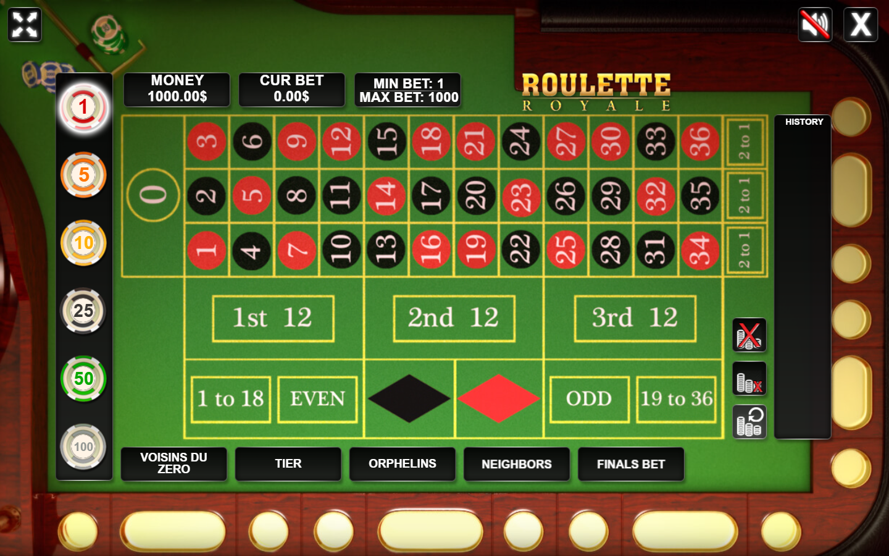
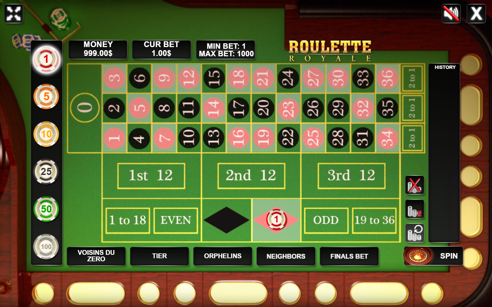
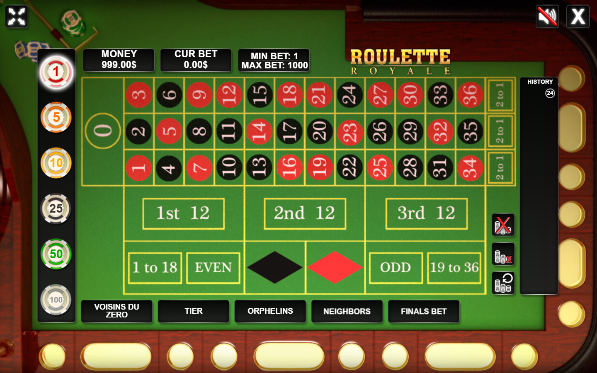
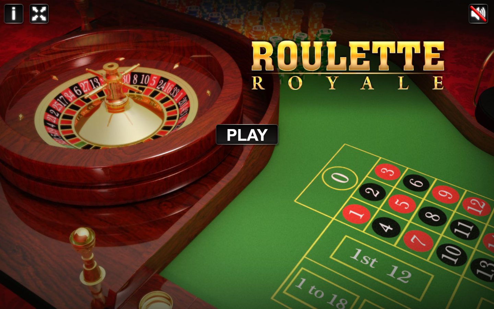

# Roulette Royale / 皇家轮盘 游戏规格说明书

格式版本：V5.1

仅记录有依据的实现层事实；内容字段非必填，未知留空，不代表不存在或已经验证。

## 1. 基础事实

**维度定义**：让读者第一眼知道“这是什么类型、什么操控体验的游戏”，以及它的技术栈。

**内容说明**

Roulette Royale / 皇家轮盘；MSN原生9pmdqv93xn3r，CodeThisLab公开v9。HTML/JavaScript/CSS、原CreateJS/EaselJS/TweenJS/Howler；1280×768逻辑画布，实测1440×900视口。画面是预渲染立体轮盘素材与2D Canvas合成，不声称真实3D模型或物理引擎。

## 2. 资源类型

**维度定义**：游戏中游戏内容元素的资源类型是什么——即在哪个引擎运行下的资源格式。

**内容说明**

281原上游文件，280运行文件，277原文件字节一致。原轮盘数字100帧及遮罩100帧、6筹码图、牌桌/下注热区/高亮/历史/按钮/字体、6MP3保持。3文件限定适配：入口、main业务服务边界、未被原Howler玩法调用的SoundJS WebAudio探测模块；原vendor其余字节和许可证保持。

## 3. 核心挑战维度

**维度定义**：游戏核心玩法主要挑战 / 满足人的什么。

**内容说明**

在轮盘盘面选择单号或组合/外围区下注，旋转后按原结果与赔付规则结算，控制虚拟筹码消耗。区别于Jacks五张牌换牌、Blackjack21点与TexasHoldem公共牌。真实本轮默认1筹码押红，结果黑24，原输局余额999。

## 4. 操控方式

**维度定义**：操控本身的复杂度 + 需要玩家判断的时机 / 策略复杂度。

**内容说明**

鼠标点PLAY、默认筹码、可见数字/红黑等下注区、SPIN；原左右下注热区/邻号/尾号/清上注/清全注/重押、声音/退出/全屏保留。此次仅默认1押红和SPIN，最后实际浏览器刷新；不调用onSpin/_generateWinLoss或钱包方法。

## 5. 行为路径

**维度定义**：玩家一局里重复做什么。

**内容说明**

累计5次真实输入：精确离线入口→原PLAY→原默认1筹码押红色外围区→原SPIN并按原时钟等待自然结算→实际刷新。下注后MONEY1000→999、CUR BET0→1，轮盘自然开出黑色24，红色下注落败，原历史出现24/黑圈，CUR BET归0、余额999，原roulette_royale_user_money写999。刷新回原菜单，原CMain读取存档后TOTAL_MONEY为999。没有写RNG、结果、筹码、时间或调用业务处理方法；没有第6次输入。只验证1轮自然输局和本地刷新，其他下注档、组合、赢局/支付、重押、全屏/音频听感未实测，未截取轮盘中间帧。

## 6. 游戏路径（关键节点 + 流失风险）

**维度定义**：从开始到结束的流程 + 每个关键节点的潜在流失风险点。

**内容说明**

原标题→PLAY→1280×768轮盘下注桌→默认1筹码押红，18个红色数字区原高亮→SPIN→原自然黑24结果与历史黑圈→原下注归0/余额999/本地保存→刷新回原标题并读取999。原界面5张截图均已打开检查。

## 7. 成长路径

**维度定义**：玩家如何推进变强。

**内容说明**

单桌连续轮盘，没有编号地图关卡或角色升级。原roulette_royale_user_money存余额，本轮真实写999且刷新读取999；界面局内历史最多原19行，本次只观察首条24，不承诺跨刷新保存历史。

## 8. 核心闭环（目标-规则-反馈-激励）

**维度定义**：游戏是否具备“明确目标 → 明确规则 → 达成反馈 → 奖励激励 → 下一目标”的完整闭环。

**内容说明**

原选择筹码/下注区→合法下注扣余额并显示CUR BET→SPIN→原生成结果和轮盘结束→原CSeat.showWin与界面刷新/本地余额保存→原重置下注表等待下一轮。此次完整一轮输局，未追加第2轮或用广告补筹码。

## 9. 玩法规则

**维度定义**：核心循环、玩法规则、目标与进度。

**内容说明**

349原生方法规范AST一致、101核心方法逐项一致；CRouletteSettings/CSeat/CTableController/CWheelAnim/CFinalBetPanel/CNeighborsPanel/CHistory等69整函数字节保持。4个CGame方法仅删除服务通知，独立比较证明其余状态/结算一致。原Math.random与WIN_OCCURRENCE=-1选择代码保持，不据此声称均匀或公平概率。

## 10. 数值配置

**维度定义**：影响玩法的关键数值。

**内容说明**

盘面0–36；原初始1000虚拟筹码，筹码值[1,5,10,25,50,100]；MIN BET1/MAX BET1000；原历史19行，轮盘数字100帧/遮罩100帧。实际押红1，1000→999，开黑24，返还0，余额999，刷新仍999。$仅原虚拟标记，没有现金交易。

## 11. 关卡配置

**维度定义**：关卡结构、递进规律、难度曲线。

**内容说明**

单一轮盘桌，无固定关卡表。原单号/相邻/街/列/12区/红黑/奇偶/高低等热区及邻号/尾号组合保留；本轮仅红色外围1筹码。源码原所有组合表/赔付表保持，不声称全部下注配置和赢局都逐项试玩。

## 12. 系统设计

**维度定义**：功能系统清单、UI 流程。

**内容说明**

原下注热区/高亮、筹码堆叠、原胜负选择及赔付、200张原预渲染轮盘帧、局内历史、本地余额、声音/全屏/退出与规则配置保持。入口改DOM就绪直达原startGame/CMain，去除真实SDK门禁和服务工作线程注册，未提供假API或假身份。

## 13. 主题化包装

**维度定义**：游戏的题材 / 世界观包装。

**内容说明**

原红木轮盘与绿色台呢、金色ROULETTE ROYALE标识、0–36红黑绿数字、左侧6筹码、顶部余额/下注、右侧HISTORY和SPIN。按钮/筹码/牌桌和结果截图均原素材，未重画或替换成占位页。

## 14. 养成系统 + 经济系统

**维度定义**：玩家如何成长、经济如何循环。

**内容说明**

虚拟余额用于下注、原赔付规则结算并本地保存；本轮红色下注输1，并非测试脚本扣分或人为设置结果。真实SDK初始化/通知/广告/外链/上传和更多游戏UI/图标预加载消费者退役；广告补1000的按钮、说明、applyReward/resetReward及唯一授权写钱入口物理移除，不伪造成功或新增补充。原初始1000虚拟筹码保持；资金耗尽时保留原Exit，不承诺有免费补充。

## 15. 角色 / 单位设定

**维度定义**：有哪些角色/单位、各自定位（玩法层面）。

**内容说明**

原0–36数字下注区域、红黑外围、奇偶/高低/12区/列/分注/邻号/尾号热区，6面额筹码、轮盘、球、历史圆标、SPIN与原控制。没有在线玩家或真人庄家，轮盘视觉为原CreateJS帧动画，本次没有额外玩法输入。

## 16. 商业化

**维度定义**：靠什么变现。

**内容说明**

真实SDK初始化/通知/广告/外链/上传和更多游戏UI/图标预加载消费者退役；广告补1000的按钮、说明、applyReward/resetReward及唯一授权写钱入口物理移除，不伪造成功或新增补充。原初始1000虚拟筹码保持；资金耗尽时保留原Exit，不承诺有免费补充。远端52实际Chromium；544请求/544响应全部同源HTTP200，无外联/失败请求/脚本异常；保留15条原Canvas2D读回性能warning，不称零warning。浏览器91848实际BROWSER_EXIT0；开发环境没有执行原游戏或SDK。

图 1：原皇家轮盘菜单

图 2：原1000余额/默认1筹码下注桌

图 3：真实押红1筹码，余额999/下注1

图 4：自然黑24，红注落败/本地存999

图 5：实际刷新回原菜单，原程序读回999
