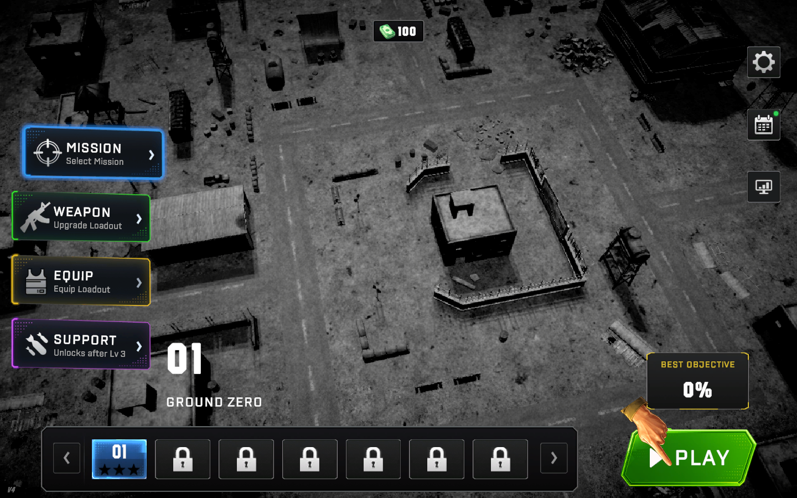
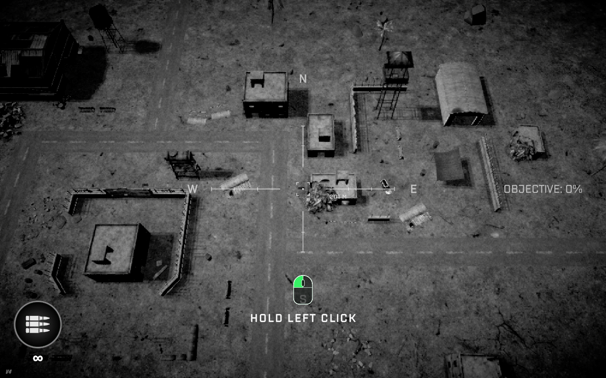
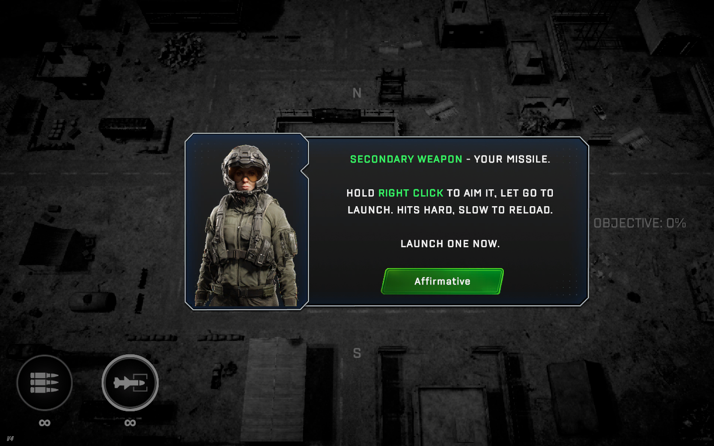

# Gunship: Angel of Death / 炮艇死亡天使 游戏规格说明书

格式版本：V5.1

仅记录有依据的实现层事实；内容字段非必填，未知留空，不代表不存在或已经验证。

## 1. 基础事实

**维度定义**：让读者第一眼知道“这是什么类型、什么操控体验的游戏”，以及它的技术栈。

**内容说明**

Gunship: Angel of Death；MSN原生9nvh11mzqtwq、Hammerplay v4。Unity WebGL/IL2CPP发布构建、C#编译WASM与JavaScript引擎胶水，3D地面战场/空中炮艇俯视瞄准镜。52机器1440×900真实浏览器鼠标实测。

## 2. 资源类型

**维度定义**：游戏中游戏内容元素的资源类型是什么——即在哪个引擎运行下的资源格式。

**内容说明**

完整UnityWebData1.0原Build.data38199669字节保持，含data.unity3d、两份sharedassets、resources、元数据39及默认资源。14运行文件73541855字节，11份原字节；原WASM34791230字节，113966定义函数，仅7函数实际服务调用/广告策略点修改，113959其余函数体保持。包含原地形、建筑、单位、材质、网格、纹理、字体、音频与UI。

## 3. 核心挑战维度

**维度定义**：游戏核心玩法主要挑战 / 满足人的什么。

**内容说明**

在原空中炮艇观察/瞄准地面战场，以主炮持续开火及导弹控制攻击地面目标，配合原任务目标系统与支援功能。实测只涵盖原主炮武器检查；目标防守/护送与任务完整胜负仅有原类/资源依据，未实机通关。

## 4. 操控方式

**维度定义**：操控本身的复杂度 + 需要玩家判断的时机 / 策略复杂度。

**内容说明**

鼠标移动瞄准；按住左键主炮持续开火。原说明中右键按住瞄准导弹、松开发射，导弹重装较慢；该分支未操作。原菜单按钮普通鼠标点击。

## 5. 行为路径

**维度定义**：玩家一局里重复做什么。

**内容说明**

累计5次真实界面输入：载入原主菜单、PLAY、欢迎对话Affirmative、主炮说明Affirmative、瞄准地面724,451按住左键2500ms并松开。第5步后原主炮“PUT 10 ROUNDS DOWNRANGE”教学自动推进到SECONDARY WEAPON导弹说明，原主炮发射门槛实际达成。未调用Unity业务方法、改时间、RNG、存档、武器或教程状态。

## 6. 游戏路径（关键节点 + 流失风险）

**维度定义**：从开始到结束的流程 + 每个关键节点的潜在流失风险点。

**内容说明**

原新档菜单→选择可见GROUND ZERO任务01的PLAY→欢迎与主炮说明→主炮实际开火→原导弹教学说明。后续导弹、支援和任务结算/解锁路径未追加试玩。

## 7. 成长路径

**维度定义**：玩家如何推进变强。

**内容说明**

原SaveManager、MissionProgress、MissionBest、WeaponLevel、SupportLevelEntry与TutorialState保留，以PlayerPrefs/WebGL本地存档。实机多次记录Game saved successfully using PlayerPrefs；未重载核对持久性。

## 8. 核心闭环（目标-规则-反馈-激励）

**维度定义**：游戏是否具备“明确目标 → 明确规则 → 达成反馈 → 奖励激励 → 下一目标”的完整闭环。

**内容说明**

移动炮艇瞄准镜→按住主炮/原导弹控制发射→原弹体/命中与地面目标反馈→原任务目标进度/结算→原任务与装备升级入口。实机只证明主炮教学要求达成后自动推进，未把这次教学当作任务获胜或经济结算。

## 9. 玩法规则

**维度定义**：核心循环、玩法规则、目标与进度。

**内容说明**

原TutorialManager/TutorialGate、Weapon、MissileGun/MissileBullet、MissionDefinition/MissionCatalog、SupportService与原地面战场逻辑保留。普通操作遵循原教学门槛和解锁，未跳过教学/刷奖励/改伤害。

## 10. 数值配置

**维度定义**：影响玩法的关键数值。

**内容说明**

真实菜单初始货币100，任务01 GROUND ZERO，支援入口显示Lv3解锁。主炮原说明要求10发，真实持续按住2500ms后自动进入导弹说明。累计5输入；13同源200请求、2条中止事件；59原警告。全任务总数及所有伤害/费用数值未确认，留空。

## 11. 关卡配置

**维度定义**：关卡结构、递进规律、难度曲线。

**内容说明**

原完整Build.data和MissionCatalog/MissionDefinition全量保留，不裁成教程单场景。主菜单多任务卡片可见，01 GROUND ZERO进入；配置总关数未可靠解码，不以NavMesh或场景对象数冒充关卡数。

## 12. 系统设计

**维度定义**：功能系统清单、UI 流程。

**内容说明**

原Unity/IL2CPP、武器和弹体、炮艇瞄准与热成像表现、任务卡片与目标进度、支援/装备菜单、PlayerPrefs本地持久化。删除原MSStart脚本、云读写/广告/静音上报的4个JS提供者与6个实际WASM外部调用消费者，保留原DOM画布focus。GameManager原SetAdsEnabled调用改用false，沿原关闭广告分支撤销相应奖励入口；不伪造SDK、登录、网络回包、云存档、广告完成或奖励。WASM必要ABI仅保留会抛错的退役陷阱，完整调用/间接表审计证明相应消费者已移除。原SaveManager本地PlayerPrefs、原6秒云等待截止与失败后本地回退逻辑均未修改，实际原日志确认自然回退。

## 13. 主题化包装

**维度定义**：游戏的题材 / 世界观包装。

**内容说明**

保留原灰阶热成像地面战场、道路/军用建筑/防御工事、方向刻度、距离瞄准镜、主炮/导弹图标、军人教程头像和绿色Affirmative按钮。

## 14. 养成系统 + 经济系统

**维度定义**：玩家如何成长、经济如何循环。

**内容说明**

原货币、WeaponUpgradeService/WeaponUpgradeTable、装备和SupportCatalog/SupportLevel保留；菜单初始100为原默认值，不手工注入。购买/升级/普通任务收益未实测；原广告奖励入口关闭，不兑换奖励。

## 15. 角色 / 单位设定

**维度定义**：有哪些角色/单位、各自定位（玩法层面）。

**内容说明**

原炮艇主炮/导弹、地面敌方与SupportTank相关类和素材保留；未声称所有单位行为都已实机覆盖。教学实测为主炮武器检查。

## 16. 商业化

**维度定义**：靠什么变现。

**内容说明**

删除原MSStart脚本、云读写/广告/静音上报的4个JS提供者与6个实际WASM外部调用消费者，保留原DOM画布focus。GameManager原SetAdsEnabled调用改用false，沿原关闭广告分支撤销相应奖励入口；不伪造SDK、登录、网络回包、云存档、广告完成或奖励。WASM必要ABI仅保留会抛错的退役陷阱，完整调用/间接表审计证明相应消费者已移除。原SaveManager本地PlayerPrefs、原6秒云等待截止与失败后本地回退逻辑均未修改，实际原日志确认自然回退。 仅验证原新档菜单→任务01 GROUND ZERO→主炮教学的瞄准/持续开火与原生推进。导弹右键、支援、后续目标/关卡胜负/结算/升级购买/跨会话刷新未验证，未声称整段教程或任务通关。5次额度用尽后关闭浏览器，没有第6次操作。13请求/13响应均同源200，0外联/HTTP错误/脚本异常；framework与wasm另各有一条ERR_ABORTED事件，原始记录保留，不宣称零失败事件。这两文件均已独立HTTP逐字节复核且原引擎/主炮实际运行，未观察到对应缺资源故障；中止事件具体原因未确认。59条原生警告完整保留，含不支持的渲染后处理shader、手势前音频限制、HUD拆层、RenderTexture和负缩放BoxCollider警告；不能声称所有图形/音效/碰撞均无问题。

图 1：原完整任务菜单与GROUND ZERO入口

图 2：确认主炮说明后原地面瞄准场景

图 3：真实主炮持续开火后原生推进到导弹教学，导弹未操作
