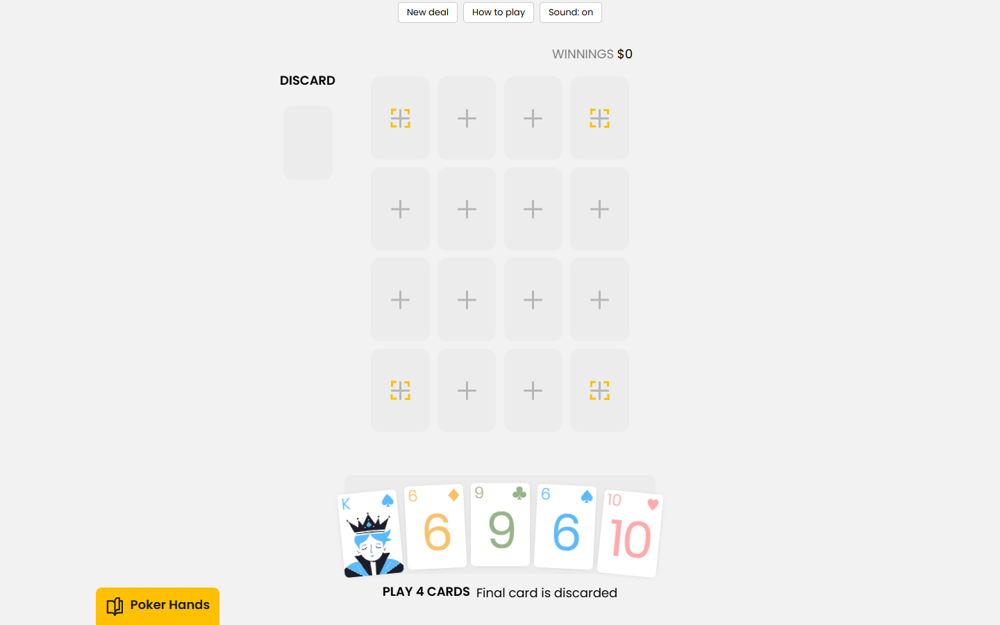
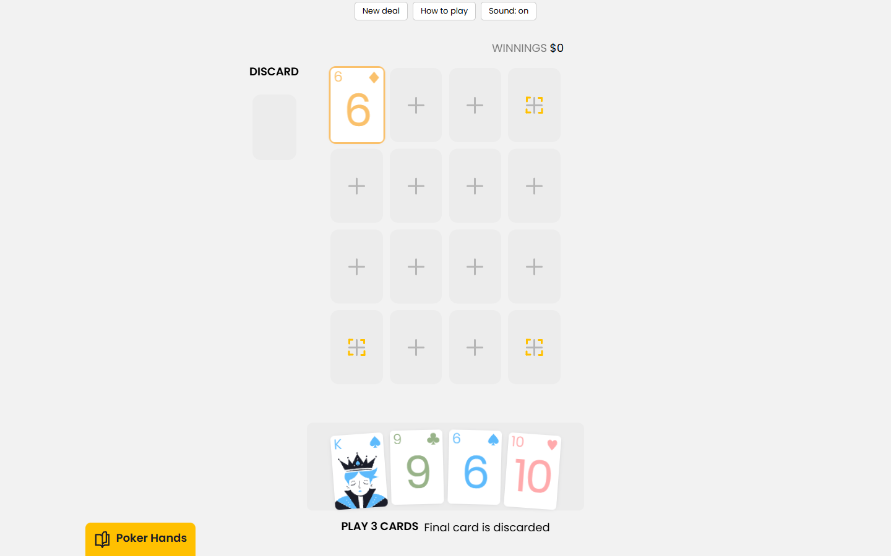
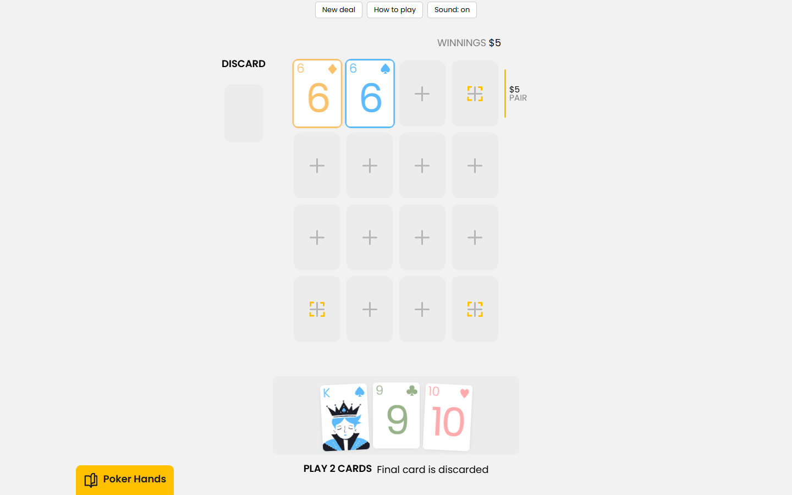
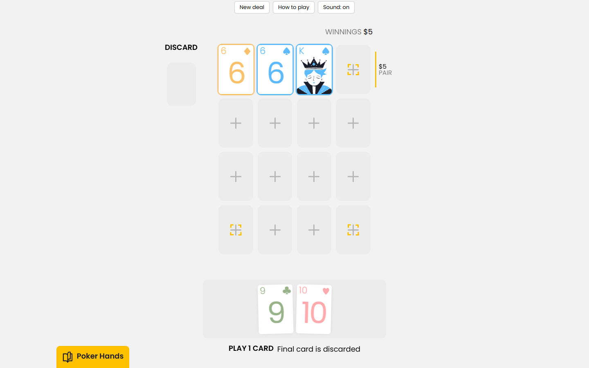
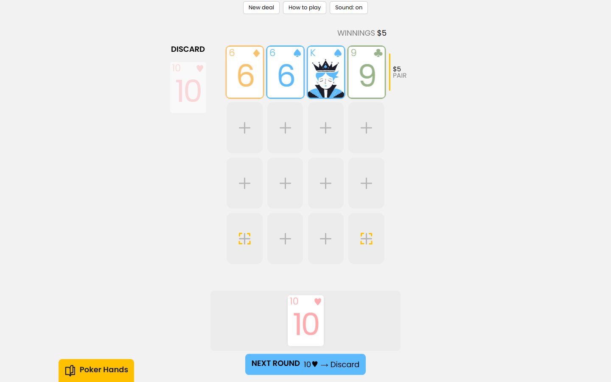

# Pile-Up Poker / 堆叠扑克 游戏规格说明书

格式版本：V5.1

仅记录有依据的实现层事实；内容字段非必填，未知留空，不代表不存在或已经验证。

## 1. 基础事实

**维度定义**：让读者第一眼知道“这是什么类型、什么操控体验的游戏”，以及它的技术栈。

**内容说明**

Pile-Up Poker / 堆叠扑克；MSN原生9ndf03k5r2kr、Puzzmo公开v2。HTML/JavaScript、React19.2.7、Redux Toolkit、Framer Motion、Howler，2D SVG/DOM牌面。1440×900远端实际视口，原4×4默认牌阵。

## 2. 资源类型

**维度定义**：游戏中游戏内容元素的资源类型是什么——即在哪个引擎运行下的资源格式。

**内容说明**

48个原始静态文件，46运行文件/44原字节保持，改动仅入口与原游戏JS服务边界；原7份Poppins/Zodiak字体、33份原MP3、原CSS、instructions.json与原说明GIF。MSN宿主JS与msn-package.json保留原档但不进入运行包。

## 3. 核心挑战维度

**维度定义**：游戏核心玩法主要挑战 / 满足人的什么。

**内容说明**

每轮从5张明牌选4张放入牌阵，余1张弃牌；同时经营每行、每列、四角和弃牌堆的扑克牌型，以组合得分和牌型数量倍率提高总分。不是押注换牌扑克、德州扑克AI或接龙。

## 4. 操控方式

**维度定义**：操控本身的复杂度 + 需要玩家判断的时机 / 策略复杂度。

**内容说明**

原鼠标/触摸拖动当前明牌到空格，原NEXT ROUND确认余牌进入弃牌并推进；原Poker Hands规则表与赔付列表保留。改编提供真实本地New deal、How to play原规则/GIF、Howler Sound开关；这三项本轮没有点击。

## 5. 行为路径

**维度定义**：玩家一局里重复做什么。

**内容说明**

累计5次真实玩家输入：首载原生牌局→拖方块6至第一行第一格→拖黑桃6至第二格→拖黑桃K至第三格→拖梅花9至第四格。第3步起原PAIR/得分$5，第5步原下一轮10♥→Discard按钮出现；原生round仍0、弃牌数0、完成false，没有点击下一轮。五张原截图已打开核对，5份原生状态与真实鼠标轨迹保留。未修改牌堆、随机种子、分数、时间或存档，未调用业务handler。

## 6. 游戏路径（关键节点 + 流失风险）

**维度定义**：从开始到结束的流程 + 每个关键节点的潜在流失风险点。

**内容说明**

原随机默认牌局显示5张明牌和16空格→连续4次真实拖放→第一行6♦6♠K♠9♣，原对子$5→余10♥及下一轮弃牌按钮。未验证下一轮弃牌、整局结算、刷新恢复、新牌局、说明弹窗、声音开关和幻想模式。原DOM包含未显示的Game Complete及背面牌文本，不能作为可见完成或操作依据；本次仅按已打开截图与原生face-up visibleDraw选择当前明牌。真实完成标志始终false，不把第一行得分冒称整局胜利。

## 7. 成长路径

**维度定义**：玩家如何推进变强。

**内容说明**

原4×4/5×5牌阵与Fantasy条件代码保留，实际本轮只原默认4×4；本地gamelab-pile-up-poker-native-v1保存原Hs输入串、实际经过时间和声音偏好，第5步已观察到真实存储记录，但没有刷新复验。

## 8. 核心闭环（目标-规则-反馈-激励）

**维度定义**：游戏是否具备“明确目标 → 明确规则 → 达成反馈 → 奖励激励 → 下一目标”的完整闭环。

**内容说明**

原拖牌输入→原reducer更新牌阵/可用明牌→原行列牌型选择器即时重算→原PAIR高亮与得分更新→放满4张后显示NEXT ROUND。到按钮出现的真实子循环已验证，未执行整轮弃牌与下一次发牌。

## 9. 玩法规则

**维度定义**：核心循环、玩法规则、目标与进度。

**内容说明**

18个受保护原生绑定规范AST保持、1862个顶层绑定保持；原Sf核心reducer规范AST保持，原oc/ac/ec/tc/Hs/Xs/Ks/sc/Cf/cs/ps/ms/hs/gs/Fs/Js/$s及发牌、牌阵、手牌计算、本地输入编解码保留。服务入口gc/cf/Sf外层/eN/BN修改，不以保留数量冒称全部代码未改。

## 10. 数值配置

**维度定义**：影响玩法的关键数值。

**内容说明**

本轮4×4=16格，每轮5明牌选4弃1；原行4+列4+四角共9手，另算弃牌。原规则四角双倍、弃牌三倍、有效牌型数作为总倍率；实际已证明一组对子$5/牌型数1，未证明其他赔付和全局结算。

## 11. 关卡配置

**维度定义**：关卡结构、递进规律、难度曲线。

**内容说明**

原连续牌局和布局配置，不是固定关卡列表。原默认无服务器puzzle时沿原ac→Math.random/Xs生成牌堆，未指定seed；原4/5布局与幻想牌阵规则代码保留。本轮round0，未核对其他模式。

## 12. 系统设计

**维度定义**：功能系统清单、UI 流程。

**内容说明**

原React组件渲染牌阵/SVG牌面，Redux维护原牌堆/手牌/回合，原选择器计算行列/四角/弃牌分，Framer Motion驱动原拖牌/牌面动画，Howler播放33条同源音效。原MSN宿主、Puzzmo鉴权/每日题/GraphQL/提交/bonus/外站跳转及宿主触觉消费者退役，不加载宿主JS或msn-package.json；不伪造SDK、PuzzleStateDTO、用户/令牌/服务器响应。原ac(state,undefined)本就调用原Math.random→Xs生成本地牌堆，沿原Hs/tc真实输入串保存/恢复逻辑；不指定随机种子或牌序。33处真实Howler音频URL改为同源原MP3。

## 13. 主题化包装

**维度定义**：游戏的题材 / 世界观包装。

**内容说明**

原浅灰牌阵、彩色花色和数字、K人像、黄色Poker Hands、PAIR黄线与WINNINGS；实际原牌面与原字体保持，不改占位牌面。五张实拍覆盖空阵、落牌、得分和下一轮按钮。

## 14. 养成系统 + 经济系统

**维度定义**：玩家如何成长、经济如何循环。

**内容说明**

WINNINGS为本地扑克牌型积分显示，未新增真钱下注、支付、奖励广告或在线经济。原牌型赔付/四角与弃牌倍数/手数倍率代码保留；实际对子$5不是现金收益。

## 15. 角色 / 单位设定

**维度定义**：有哪些角色/单位、各自定位（玩法层面）。

**内容说明**

原扑克牌四花色/A与数字/JQK人像、空格十字、四角框、弃牌预览、扑克手型说明。当前可见6♦6♠K♠9♣与10♥按实际拖放形成，未读取或指定尚未翻开的牌来决定操作。

## 16. 商业化

**维度定义**：靠什么变现。

**内容说明**

原MSN宿主、Puzzmo鉴权/每日题/GraphQL/提交/bonus/外站跳转及宿主触觉消费者退役，不加载宿主JS或msn-package.json；不伪造SDK、PuzzleStateDTO、用户/令牌/服务器响应。原ac(state,undefined)本就调用原Math.random→Xs生成本地牌堆，沿原Hs/tc真实输入串保存/恢复逻辑；不指定随机种子或牌序。33处真实Howler音频URL改为同源原MP3。 远端52实际Chromium观察41个同源请求/41响应均HTTP200，外联/失败/脚本错误0，10条原Howler音频自动播放warning保留；46个运行文件另逐项HTTP和SHA通过。自有浏览器实际退出0，原closed日志5步且Node30396已不存在。 未验证下一轮弃牌、整局结算、刷新恢复、新牌局、说明弹窗、声音开关和幻想模式。原DOM包含未显示的Game Complete及背面牌文本，不能作为可见完成或操作依据；本次仅按已打开截图与原生face-up visibleDraw选择当前明牌。真实完成标志始终false，不把第一行得分冒称整局胜利。

图 1：原生4×4空牌阵与5张真实明牌

图 2：方块6真实拖入左上格

图 3：黑桃6真实拖入第二格，原PAIR计分$5

图 4：黑桃K真实拖入第三格

图 5：梅花9真实拖入第四格，原下一轮弃10♥按钮出现，尚未点击
