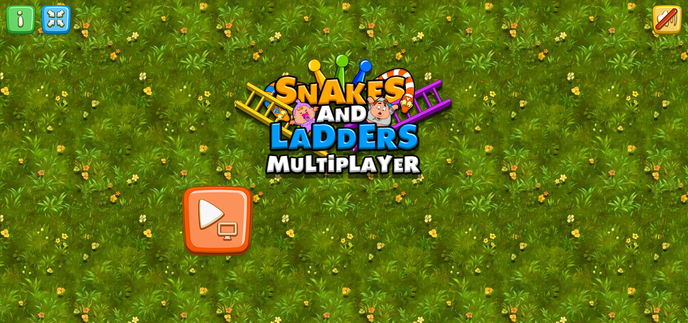
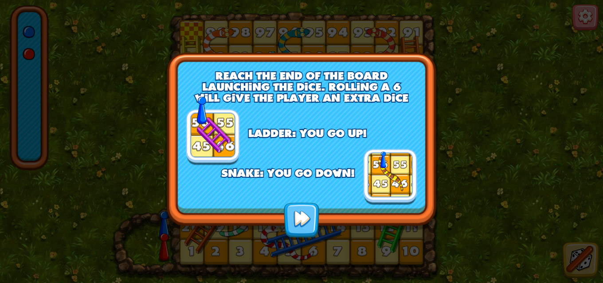
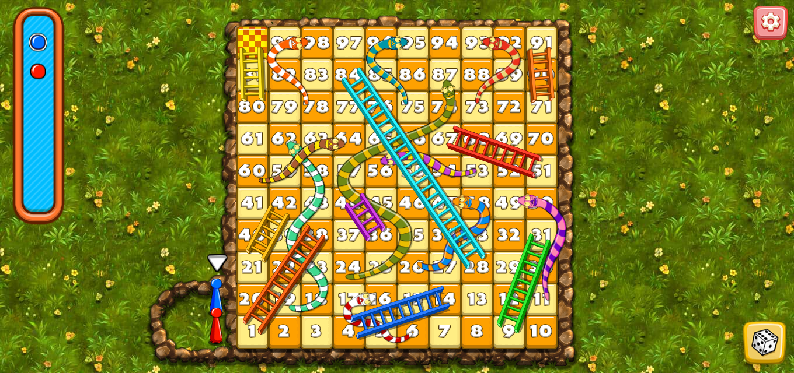
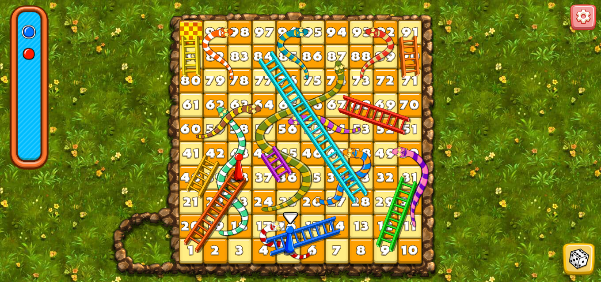

# Snakes and Ladders 游戏规格说明书

格式版本：V5.1

仅记录有依据的实现层事实；内容字段非必填，未知留空，不代表不存在或已经验证。

## 1. 基础事实

**维度定义**：让读者第一眼知道“这是什么类型、什么操控体验的游戏”，以及它的技术栈。

**内容说明**

Snakes and Ladders，MSN身份9n9xf62dpf3h，Code This Lab公开原生v2；改编snakes-offline-v1。JavaScript/HTML/CSS、CreateJS Canvas2D、Howler，2D俯视棋盘，本地CPU或同设备对局。

## 2. 资源类型

**维度定义**：游戏中游戏内容元素的资源类型是什么——即在哪个引擎运行下的资源格式。

**内容说明**

原PNG棋盘/蛇/梯/骰子/棋子/按钮和动画图集、JPG背景、MP3音效与音乐、walibi原WOFF2/WOFF字体。103个源码声明运行素材和8个原CSS/字体/JS依赖逐字节SHA保留；113基础运行文件。没有替换成占位图或新玩法。

## 3. 核心挑战维度

**维度定义**：游戏核心玩法主要挑战 / 满足人的什么。

**内容说明**

通过原随机骰子在100格棋盘竞速，利用梯子上升、避开蛇下降，并按精确点数到终点；运气型回合竞赛。实测玩家和CPU各完成首轮移动，不宣称完整胜负。

## 4. 操控方式

**维度定义**：操控本身的复杂度 + 需要玩家判断的时机 / 策略复杂度。

**内容说明**

鼠标点击原START、Local、棋盘模式、对手、人数、颜色、说明跳过和骰子；原CreateJS触控代码保留。只实测鼠标；未实测手机、声音/设置/全屏/重开按钮。

## 5. 行为路径

**维度定义**：玩家一局里重复做什么。

**内容说明**

原预载START→仅本地菜单入口→蛇棋→人对CPU→2人→蓝色→原规则说明→跳过→点骰子→原棋子前进与CPU自动响应→回到玩家回合。

## 6. 游戏路径（关键节点 + 流失风险）

**维度定义**：从开始到结束的流程 + 每个关键节点的潜在流失风险点。

**内容说明**

原菜单和四段配置、帮助、游戏棋盘、回合标记和骰子可见。菜单原联机按钮已删除，保留原原画上的Multiplayer文字，含义为本地多人能力，不提供网络匹配。没有以假连接替代原房间。

## 7. 成长路径

**维度定义**：玩家如何推进变强。

**内容说明**

原蛇棋与滑梯两种板型、2～6名棋子、CPU或同设备轮流的配置保留；不是闯关合集。本次只进入蛇棋、2名、人对CPU配置，其余配置没有试玩。

## 8. 核心闭环（目标-规则-反馈-激励）

**维度定义**：游戏是否具备“明确目标 → 明确规则 → 达成反馈 → 奖励激励 → 下一目标”的完整闭环。

**内容说明**

目标到100格→点击原骰子→原随机1～6→按格移动/触发蛇梯→原回合和再掷提示→CPU或下一玩家→继续前进。实际观察蓝色从0到5、红色CPU从0到38，回到蓝色；未走到胜负结算。

## 9. 玩法规则

**维度定义**：核心循环、玩法规则、目标与进度。

**内容说明**

原PERFECT_SCORE=true，超过100按剩余步数回退；掷6额外掷骰，蛇/滑梯下降、梯上升，原棋子占位和回合动画保留。181个原生核心方法中175个AST相同、6个只删平台事件/广告；没有更改骰点、CPU、棋盘图、结算或奖励。

## 10. 数值配置

**维度定义**：影响玩法的关键数值。

**内容说明**

源码：100格、1～6骰点、2种板型、2～6人、6色；9个梯起点[1,4,9,21,28,36,51,71,80]、10个下降起点[16,47,49,56,62,64,87,93,95,98]。实测2人、蛇棋mode0、人机mode1、玩家turn0，结束位置[5,38]。本次快照diceResult/playerDiceLaunch是原中间状态，未把它们当作两次初始骰点。

## 11. 关卡配置

**维度定义**：关卡结构、递进规律、难度曲线。

**内容说明**

原BOARD_SQUARES位置表、梯/障碍起点及移动映射、贝塞尔路径和图集均本地内置，无每日关卡或服务器棋盘配置。不同板型原配置保留，未新增关卡。

## 12. 系统设计

**维度定义**：功能系统清单、UI 流程。

**内容说明**

保留CreateJS场景/原加载器/Howler/原screenfull、棋盘/骰子/CPU与本地统计。移除PlayerIO SDK、网络管理和消息转发、房间GUI、多人网络/假在线Bot场景及原实例、广告/报分/遥测调用，启动直接等待原字体后创建原CMain；getLang调用改为实际浏览器语言。未定义假SDK、身份或广告成功回调。

## 13. 主题化包装

**维度定义**：游戏的题材 / 世界观包装。

**内容说明**

原卡通森林草地、橙蓝弹窗、蛇与彩梯、六色棋子、walibi粗体、原掷骰和移动动画；原素材SHA保持，未重绘或替换原UI。

## 14. 养成系统 + 经济系统

**维度定义**：玩家如何成长、经济如何循环。

**内容说明**

原localStorage保存snakesandladders_gamesplayed/gameswon统计，原存储代码保留；本轮两项均null，没有进行结算或刷新测试。没有现金购买或新货币；原广告被移除，不赠送额外骰点或胜利。

## 15. 角色 / 单位设定

**维度定义**：有哪些角色/单位、各自定位（玩法层面）。

**内容说明**

2～6个原六色棋子；本次蓝色玩家与红色CPU。CPU为原CGameSingle人机分支，不是伪造在线玩家；同设备多名真人模式源码保留，未实测。

## 16. 商业化

**维度定义**：靠什么变现。

**内容说明**

去除广告模块/事件、平台分数和通知、外链点击、在线房间/匹配/邀请、远程脚本与服务工作线程注册入口。原Credits归属文字保留，外部跳转监听器移除。离线静态HTTP运行，不连接业务服务端。完整98请求、98响应全部HTTP200，197条网络/主框架导航事件完整保留；0外部请求、0失败、0脚本异常。保留1条Canvas2D willReadFrequently性能警告，不是资源或游戏运行错误。

图 1：原菜单仅保留本地入口，原图上的Multiplayer归属文字保持

图 2：原蛇梯规则说明，未替代原帮助

图 3：原双人对CPU棋盘，双方起点0

图 4：一次真实掷骰后蓝色5格、CPU红色38格，轮到玩家
