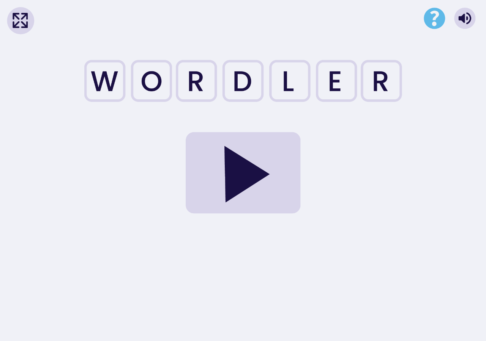
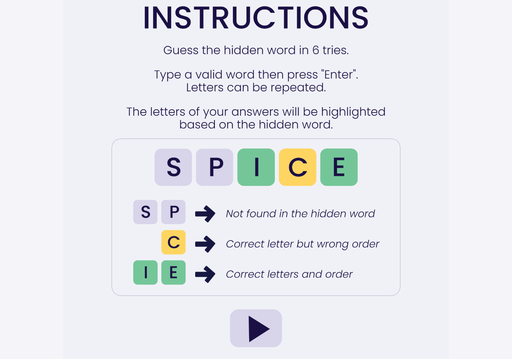
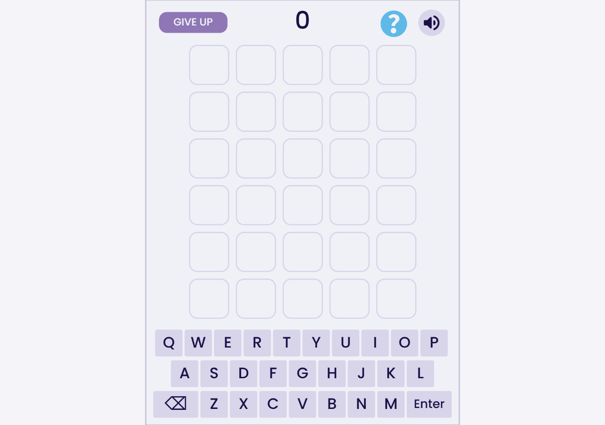
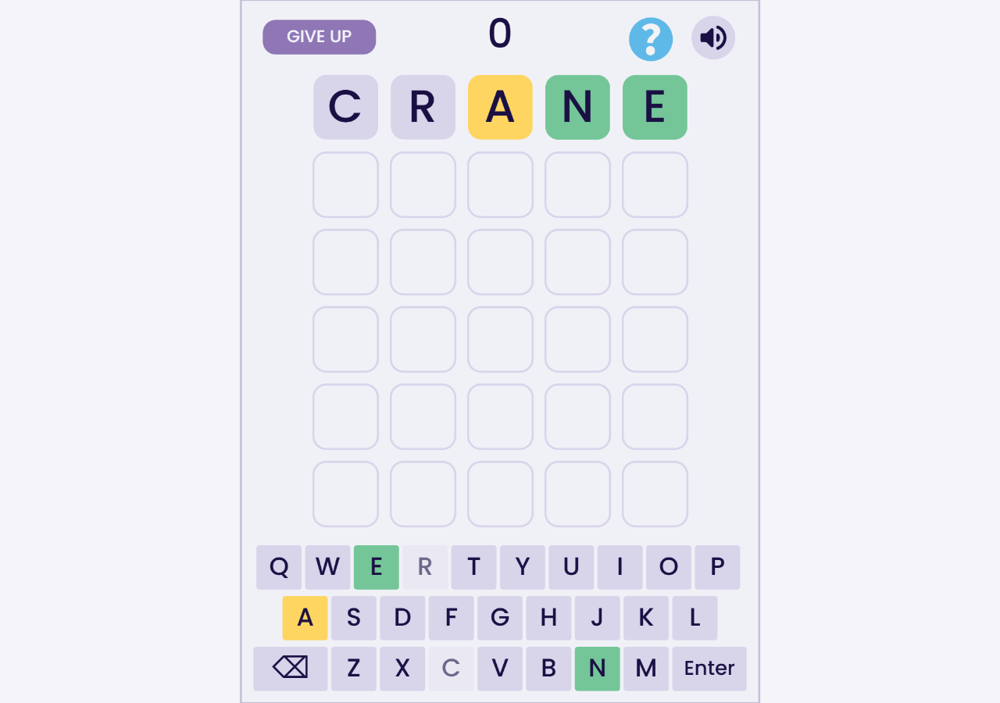

# Wordler 游戏规格说明书

格式版本：V5.1

仅记录有依据的实现层事实；内容字段非必填，未知留空，不代表不存在或已经验证。

## 1. 基础事实

**维度定义**：让读者第一眼知道“这是什么类型、什么操控体验的游戏”，以及它的技术栈。

**内容说明**

Wordler，MSN身份9p8d5mdf3g17，MarketJS公开构建v3，改编wordler-offline-v2。JavaScript/HTML/CSS，原ImpactJS Canvas2D和Howler/Jukebox；离线随机五字母猜词。

## 2. 资源类型

**维度定义**：游戏中游戏内容元素的资源类型是什么——即在哪个引擎运行下的资源格式。

**内容说明**

原字母格、紫色按钮、原屏幕QWERTY键盘、说明图、标题、翻牌/打字音效、Poppins三字重与原Logo字体；35PNG在开发环境完整解码。原运行基础72文件保留SHA，含已补齐三个Logo字体。

## 3. 核心挑战维度

**维度定义**：游戏核心玩法主要挑战 / 满足人的什么。

**内容说明**

在六次机会内输入合法的五字母整词，利用字母存在和位置的逐格颜色反馈推断隐藏词。只实测一次CRANE有效提交及反馈，不读取本局隐藏词或人为安排答案。

## 4. 操控方式

**维度定义**：操控本身的复杂度 + 需要玩家判断的时机 / 策略复杂度。

**内容说明**

原实体键盘A–Z、Enter、Backspace/Delete、原屏幕QWERTY按钮和鼠标入口。本轮真实鼠标Play/Continue后，实体键盘按C/R/A/N/E/Enter，未用脚本填字段或调用游戏函数。

## 5. 行为路径

**维度定义**：玩家一局里重复做什么。

**内容说明**

原Wordler菜单→Play→原首次Instructions→Continue→原六行五列空格与键盘→输入CRANE并Enter→原翻牌与灰/黄/绿反馈→第二行等待下一次输入。

## 6. 游戏路径（关键节点 + 流失风险）

**维度定义**：从开始到结束的流程 + 每个关键节点的潜在流失风险点。

**内容说明**

实际显示原全屏/说明/声音按钮、Play、首次说明、Give Up、分数、六行五列、原QWERTY与Enter；只操作Play、说明Continue与一次猜词。联网分享、广告续次入口退役。

## 7. 成长路径

**维度定义**：玩家如何推进变强。

**内容说明**

原随机题库池不重复取词，耗尽后恢复原池；494个目标词与12448个合法词项源码确认并逐字AST一致。没有固定关卡总数，本轮未推进到下一词或验证池耗尽。

## 8. 核心闭环（目标-规则-反馈-激励）

**维度定义**：游戏是否具备“明确目标 → 明确规则 → 达成反馈 → 奖励激励 → 下一目标”的完整闭环。

**内容说明**

观察当前猜词表和键盘→构造一个五字母合法词→原词库检查→原匹配与翻牌反馈→利用反馈继续推断。实测首行CRANE、A黄/N与E绿、第二行可输入，分数仍0；未完成胜负闭环。

## 9. 玩法规则

**维度定义**：核心循环、玩法规则、目标与进度。

**内容说明**

原maxWordLength5、maxTry6、字母可重复；先确认相同位置，再匹配剩余字母。原游戏实体158个方法AST相同；19个有范围的差异只删除分享、在线报分和广告续次/调用及原结算直接路径。核心checkAnswer、选词随机数、原词库、输入、逐格反馈和本地分数算法未改。

## 10. 数值配置

**维度定义**：影响玩法的关键数值。

**内容说明**

五字母、六次机会、494目标词、12448合法词项。原猜中基础分5+(maxTry-currentRow-1)，六次对应10到5分，源码确认未实测；本次猜词后currentRow1/currentColumn0/score0/gameEndedfalse。

## 11. 关卡配置

**维度定义**：关卡结构、递进规律、难度曲线。

**内容说明**

原内置目标词及合法词表，没有外部每日词服务或固定关卡表。原Math.random取隐藏词、从池移除与耗尽重置保留；未写入或读取隐藏答案来指导操作。

## 12. 系统设计

**维度定义**：功能系统清单、UI 流程。

**内容说明**

保留原Impact实体、键盘、输入检查、字母框/翻牌/颜色、说明弹窗、音效、原本地分数和存储。删除Microsoft Start/CPMStar/GA、旧MJS广告提供模块、API实例、在线报分、分享按钮及广告加一轮功能；本地失败直接显示原Game Over/重开/菜单，没有伪造奖励。

## 13. 主题化包装

**维度定义**：游戏的题材 / 世界观包装。

**内容说明**

原淡紫底、深紫字、原Wordler标题、灰色空格/不包含、黄色包含、绿色位置正确、原扁平按钮和Poppins字体，未用占位图或新UI替代。

## 14. 养成系统 + 经济系统

**维度定义**：玩家如何成长、经济如何循环。

**内容说明**

原sessionData保存声音、音乐和最高分，设备存储代码保留，本轮未刷新或验证高分保存。没有现金购买或货币；删除广告额外轮次，不赠送额外次数。

## 15. 角色 / 单位设定

**维度定义**：有哪些角色/单位、各自定位（玩法层面）。

**内容说明**

玩家单人猜词；无可选战斗角色、AI对手、房间或在线身份。题目来自原本地词库随机池。

## 16. 商业化

**维度定义**：靠什么变现。

**内容说明**

删除SDK/广告/遥测、在线报分、分享与外部更多游戏实际调用和UI；原广告加一轮路径整体退役，固定六次保留。原部署白名单保留并追加本项目127及GameLab管理/试玩域名；匹配逻辑未替换，未伪造宿主或服务端身份。原JJ警告声明经有限字面量解码展开，保留原警告函数，没有执行动态源码。

图 1：原Wordler菜单；原Logo字体遗漏已在交付补齐，日志保留

图 2：原首次说明和灰黄绿规则

图 3：原六行五列和屏幕键盘

图 4：原生CRANE提交反馈：A黄、N/E绿，第二行等待输入
