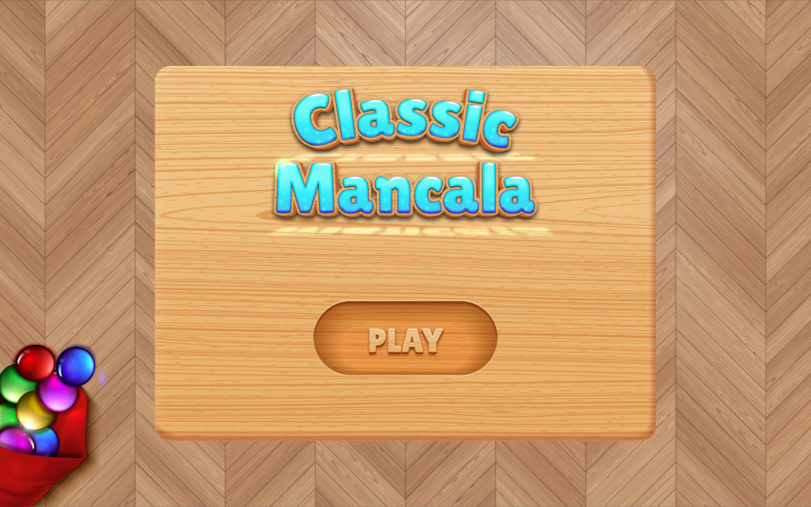
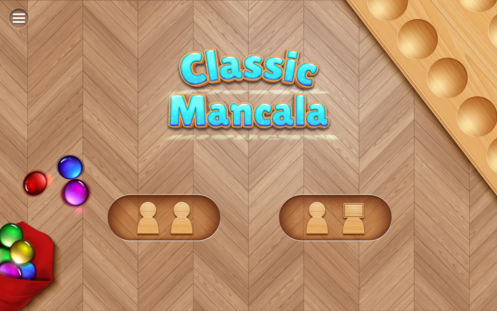
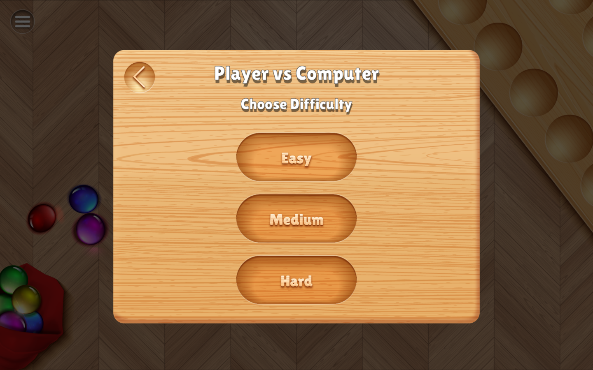
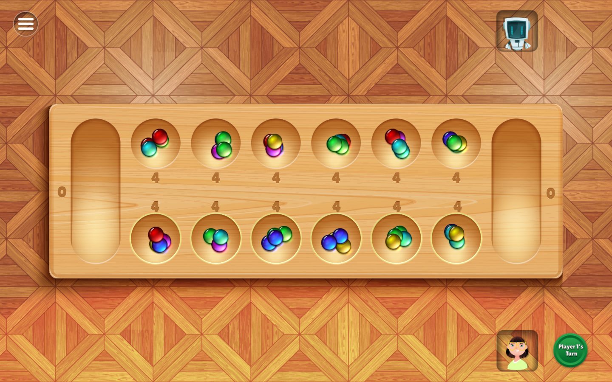
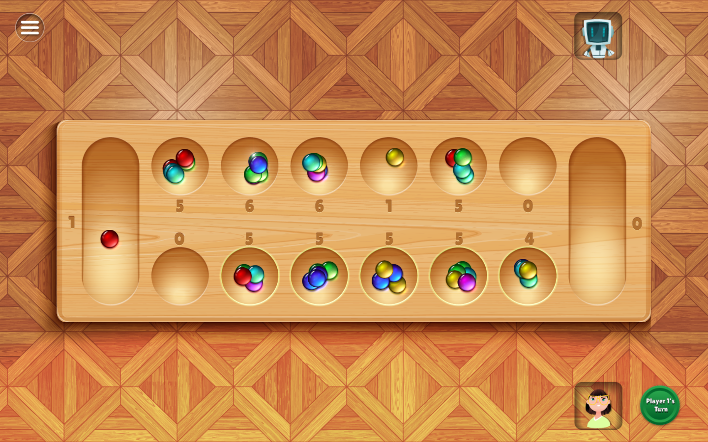

# Classic Mancala 游戏规格说明书

格式版本：V5.1

仅记录有依据的实现层事实；内容字段非必填，未知留空，不代表不存在或已经验证。

## 1. 基础事实

**维度定义**：让读者第一眼知道“这是什么类型、什么操控体验的游戏”，以及它的技术栈。

**内容说明**

Classic Mancala，MSN原生项目9n88xcbppjjg/v1，Pikoya；Construct3导出的HTML/JavaScript/JSON/Canvas运行源码。原项目1.0.3.0、逻辑画面1920×1080，实测桌面浏览器1440×900；原useWorker:false保持，不改变引擎模式。手机未测。

## 2. 资源类型

**维度定义**：游戏中游戏内容元素的资源类型是什么——即在哪个引擎运行下的资源格式。

**内容说明**

79份原运行文件已按下载回执逐字节核对，修订保留75份原字节，修改入口、data.json、objRefTable和scriptsInEvents共4份。原木纹棋盘、彩色玻璃石、机器人/玩家、按钮、字体、6份WebM Opus音频保留；53项图像/字体/图标、6音频和2任务worker实际取得。原错误512X512 (1).png链接真实404，仅删除该声明，保留原有效图标，不伪造替图。

## 3. 核心挑战维度

**维度定义**：游戏核心玩法主要挑战 / 满足人的什么。

**内容说明**

从己方六个坑选择有石的一坑，逐坑播撒石子，争取把更多石子放入己仓。原本地CPU逻辑与额外回合、对坑吃子和收尾规则保留；本轮实际观察一次玩家播撒和CPU回应。

## 4. 操控方式

**维度定义**：操控本身的复杂度 + 需要玩家判断的时机 / 策略复杂度。

**内容说明**

鼠标通过原Play、Player vs Computer、Medium进入对局，点击底排最左坑。5次输入严格为1次导航加4次单击，每次单击为真实鼠标move/down/up；未调用任何落子、AI、结算业务方法，未写游戏状态或存储。

## 5. 行为路径

**维度定义**：玩家一局里重复做什么。

**内容说明**

木纹标题Play→原双人/人机菜单→原Easy/Medium/Hard难度弹窗→Medium原14坑棋盘→选择底排左坑→原播撒动画→CPU连续回应→原绿色Player 1 Turn指示，交还玩家。

## 6. 游戏路径（关键节点 + 流失风险）

**维度定义**：从开始到结束的流程 + 每个关键节点的潜在流失风险点。

**内容说明**

累计5次真实输入：导航原入口→点击Play→选择Player vs Computer→选择Medium→点击底排最左方可见合法坑（367,560）。随后仅只读观察原动画和CPU，无第6次游戏输入。初始12坑各4石、两仓0；玩家0号坑4→0，1至4号坑各4→5。原CPU自动连走两次（含原落入己仓的额外回合），最终7号坑0、8至12号坑为5/1/6/6/5，CPU仓13为1，玩家仓6仍0，总石数48不变，画面交回玩家。截图001至005已打开核对，其中005是同一第5步后动画稳定的只读截图；原第5步进行中截图另存证据。未验证整局胜负、吃子、刷新、其余难度、本地双人、手机或声音听感。

## 7. 成长路径

**维度定义**：玩家如何推进变强。

**内容说明**

原对局、返回菜单、普通重开与本地规则帮助保留；首次进入没有写入存储键，刷新及教程完成存档未实测。没有新增账号、服务器进度或关卡解锁，也未用预置存档跳过菜单。

## 8. 核心闭环（目标-规则-反馈-激励）

**维度定义**：游戏是否具备“明确目标 → 明确规则 → 达成反馈 → 奖励激励 → 下一目标”的完整闭环。

**内容说明**

选己方非空坑→原Board.playerChoseMove和Move计算播撒/吃子/额外回合→原事件表播放移石与数字变化→原换手或继续→本地CPU原算法选坑→原终局检查和剩余石收集。实测只有首次玩家/CPU往返，未运行终局。

## 9. 玩法规则

**维度定义**：核心循环、玩法规则、目标与进度。

**内容说明**

Board整段源码SHA256为9b223debc09ff323001f296f27bfdf4c6190d88abf57ac65725200c8103cad4c，与原包完全一致；Move、Player、Marble三个模块原字节保留。所有布局、对象定义及其他事件表不变；普通落子、AI、捕获和终局事件自身负载逐项核对。广告奖励撤销不改成免费奖励，原非广告条件下的撤销仍按原IsAdsAllowed反条件与原Board方法执行。

## 10. 数值配置

**维度定义**：影响玩法的关键数值。

**内容说明**

原每方6坑、每坑4石、每方24石、含2仓共14坑、总48石。实测初始两仓0，首轮后CPU仓1、玩家仓0，总48；玩家底排为0/5/5/5/5/4，CPU顶排从左到右5/6/6/1/5/0。Board源码ENOUGH_POINTS_TO_WIN25和DEPTH6存在，原移动端setDepth改4的逻辑保留；这些源码常量不代表已验证全部终局或难度。

## 11. 关卡配置

**维度定义**：关卡结构、递进规律、难度曲线。

**内容说明**

原独立Mancala对局，无预设关卡序列。原本机双人、人机以及Easy/Medium/Hard三档菜单保留，仅实际选择Medium；未宣称另两档、本地双人或完整胜负测试通过。

## 12. 系统设计

**维度定义**：功能系统清单、UI 流程。

**内容说明**

移除入口MSStart SDK、7个SDK函数体和1个奖励专用撤销回调，参考表8个未使用槽位置null保持其余原索引，不提供可调用SDK替身。data.json整个广告事件组、Reward_ES和相应include退役；普通插屏调用改为销毁广告绑定撤销按钮，奖励图标使用原销毁动作在对局初始化清除。原引擎和本地工作线程、棋盘类/AI/石子类保持。

## 13. 主题化包装

**维度定义**：游戏的题材 / 世界观包装。

**内容说明**

原木纹地板、木制双排棋盘、彩色玻璃石、机器人CPU头像、玩家头像、原英文菜单和双方回合指示保留；实际画面显示数字、落子后空坑及CPU仓石。没有生成替代核心素材。

## 14. 养成系统 + 经济系统

**维度定义**：玩家如何成长、经济如何循环。

**内容说明**

仓中石数为原胜负统计，不新增金币、支付、成长或奖励。原广告撤销入口退役，不发送广告成功、免费撤销或伪造奖励；本地原非广告分支不改变其资格条件。

## 15. 角色 / 单位设定

**维度定义**：有哪些角色/单位、各自定位（玩法层面）。

**内容说明**

原玩家与机器人CPU、12个小坑和2个计分仓、48枚彩色石、原难度菜单、设置/规则/普通重开保留。装饰头像不代表网络身份。

## 16. 商业化

**维度定义**：靠什么变现。

**内容说明**

原MSStart平台探测、安装提示、奖励广告/插屏加载展示及调用物理退役；本包未发现在线房间、排行榜提交或付费调用。原PVP是同一设备双人，不是服务器联机。最终76次实测请求全部同源；未将请求拦截器当成源码退役证明。

图 1：原Classic Mancala标题

图 2：原本机双人与人机菜单

图 3：原CPU难度选择

图 4：原初始14坑48石

图 5：同一第5步后只读观察：原CPU回应后交回玩家
