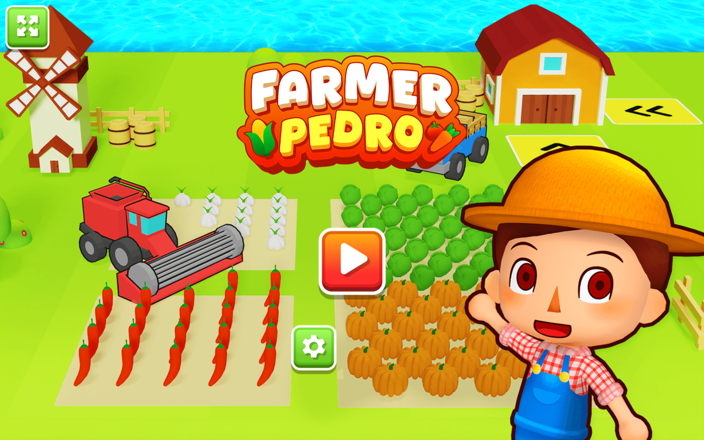
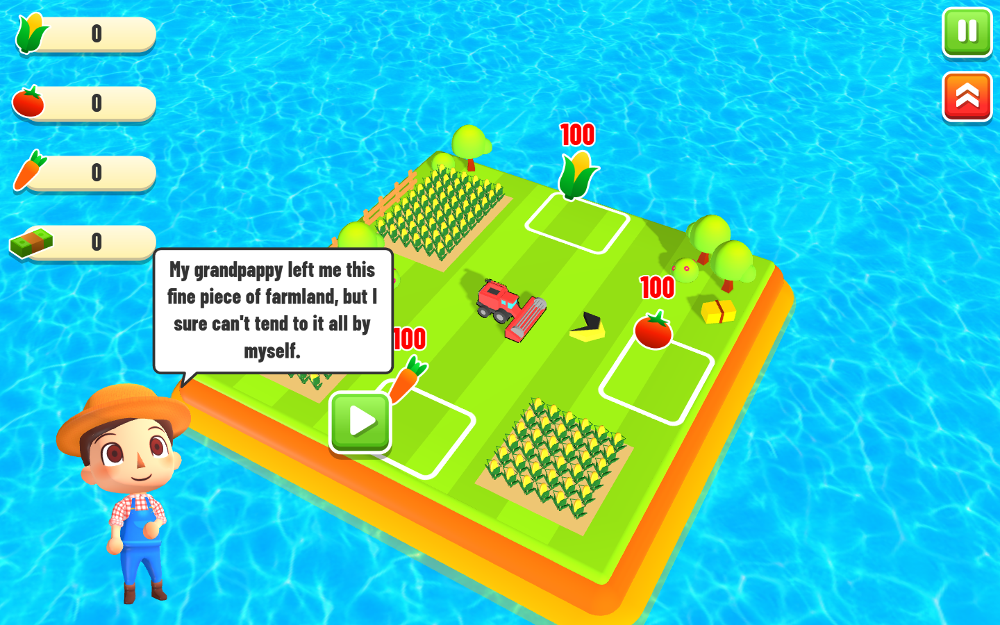
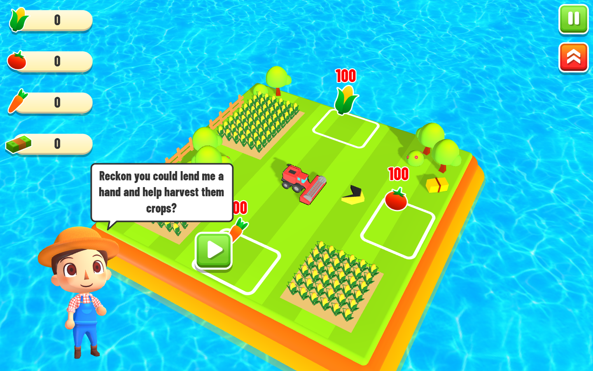
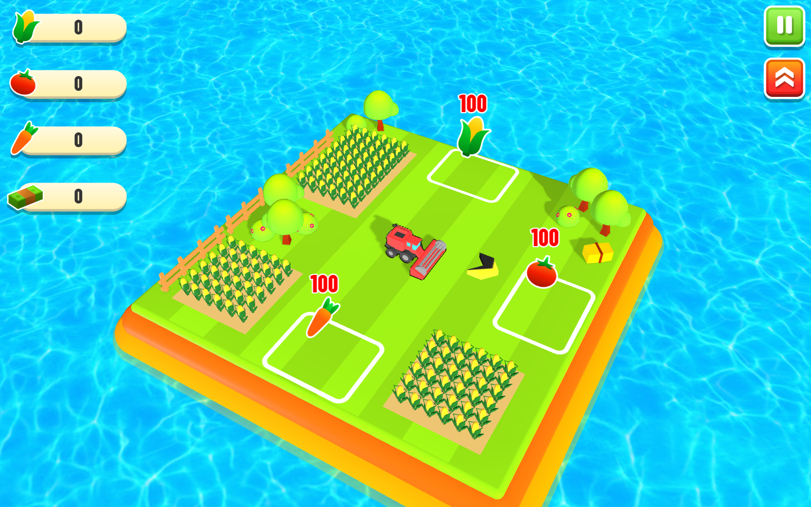
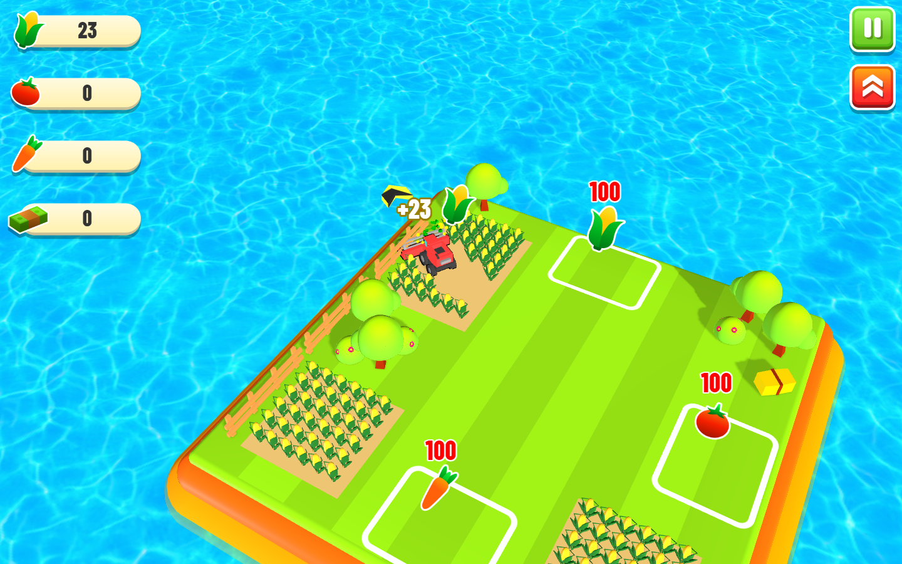

# Farmer Pedro 游戏规格说明书

格式版本：V5.1

仅记录有依据的实现层事实；内容字段非必填，未知留空，不代表不存在或已经验证。

## 1. 基础事实

**维度定义**：让读者第一眼知道“这是什么类型、什么操控体验的游戏”，以及它的技术栈。

**内容说明**

MSN9mx1rqzs1gnz/v3，Farmer Pedro；内部MJS-Farmer-Pedro-microsoft，游戏1.1.68/框架2.0.0。ImpactJS二维HUD叠加原Babylon.js三维场景，JavaScript/HTML/CSS、原Howler和Draco。桌面1440×900实测，内部2304×1440；手机未测。

## 2. 资源类型

**维度定义**：游戏中游戏内容元素的资源类型是什么——即在哪个引擎运行下的资源格式。

**内容说明**

原121静态资源原字节/SHA保留，含112基础声明路径、原scene.babylon、island.glb及farmer/farmer.glb、3张场景材质贴图和3个真实Draco解码文件。两GLB内嵌贴图/缓冲无外部URI，必需KHR_draco_mesh_compression，实际本地WASM与worker加载成功。原字体WOFF/TTF、作物/农田/收割机/农夫/厂房/桥/海水与UI保留。
v2新增原生主线程解码兼容检查：几何/动画摘要与4-worker模式精确一致，未重玩完整游戏。

## 3. 核心挑战维度

**维度定义**：游戏核心玩法主要挑战 / 满足人的什么。

**内容说明**

驾驶原收割机穿过农田收割作物，将收获投入原工厂与扩地/升级循环。真实一次普通摇杆拖动收割23株玉米，资源HUD0→23；出售、加工与扩张仅源码核对，未操作。

## 4. 操控方式

**维度定义**：操控本身的复杂度 + 需要玩家判断的时机 / 策略复杂度。

**内容说明**

原鼠标点击Play、两次叙述者继续；在水面空白区按住鼠标向可见玉米田方向拖动，原全屏虚拟摇杆接管移动，保持2500ms后释放。没有直接调用移动/收割/奖励/保存函数或写存档。原方向键/缩放/暂停/普通升级源码保留，本轮未额外操作。

## 5. 行为路径

**维度定义**：玩家一局里重复做什么。

**内容说明**

彩色原菜单→原3D海岛与三片玉米田→原农夫两段对话→普通点击继续自然收起原对话→一次摇杆移动→原收割机转向、镜头跟随、田内23株消失并显示+23/资源23。

## 6. 游戏路径（关键节点 + 流失风险）

**维度定义**：从开始到结束的流程 + 每个关键节点的潜在流失风险点。

**内容说明**

累计5检查点/5输入：原入口菜单→Play→原叙述者第一段继续→第二段继续→一次连续鼠标虚拟摇杆拖动（16个move、保持2500ms、一次down/up）。原收割机由x0/z59移至x15.803/z49.574；首块玉米由54降31，HUD及原本地资源corn0→23，出现原+23反馈；现金仍0，番茄/胡萝卜0，未解锁其他地块。已查看原菜单、两段对话、农田及收割后截图。未验证售卖、工厂加工、升级、扩地、通关、刷新存档、全部5阶段/15作物或手机。
验证边界：测试站HTTP响应CSP未显式允许worker-src，独立自编Blob-worker检查实际被拦截。v2只将原Babylon.DracoCompression.DefaultNumWorkers初始化e.GetDefaultNumWorkers()改成0，选择原引擎主线程WASM路径，未修改解码算法/模型/玩法/存档/时间或任何业务函数。在相同线上策略下，独立自编NullEngine资源检查成功解码两个实际GLB，108+4个网格的几何/索引/全部顶点属性/动画摘要与原4-worker模式一致；分别6/6和9/9本地请求全200、控制台错误为空。该检查没有加载Impact/游戏/HUD/SDK，不是v2完整游戏重玩。原v1累计5输入的菜单/两段教程/移动/收割23株证据保持，未追加游戏操作；原v1策略不兼容事实保留，不称其已在线上实玩。

## 7. 成长路径

**维度定义**：玩家如何推进变强。

**内容说明**

原5组作物阶段、地块/桥价签解锁与本地升级保留；初始第1阶段仅Map3开放，cash/corn/tomato/carrot全0。实测仍Map3/第1阶段，只将玉米增至23，没有买地或免费跳关。

## 8. 核心闭环（目标-规则-反馈-激励）

**维度定义**：游戏是否具备“明确目标 → 明确规则 → 达成反馈 → 奖励激励 → 下一目标”的完整闭环。

**内容说明**

移动与切割判定→原作物实例移除/粒子与数量增长→按原容量收集→原工厂加工/售卖→按原费用解锁桥与地块/提升机器→新农田继续。真实只覆盖移动与23次原收割反馈；后半段保留源逻辑，未冒充完成交易。

## 9. 玩法规则

**维度定义**：核心循环、玩法规则、目标与进度。

**内容说明**

收割机位置/转向/碰撞、刀头长宽/距离判定、作物实例与再生、背包上限、工厂处理/商店收入、地块原价格和升级倍率全部保持。重点13原模块函数体精确字节一致，全109模块中86个保留原函数体。广告送作物/广告免费升级/模拟广告成功弹窗及分享物理退役，不伪造SDK/身份/奖励。

## 10. 数值配置

**维度定义**：影响玩法的关键数值。

**内容说明**

实测corn0→23、首块54→31（其余36/36未动），收割机(x,z)由(0,59)至(15.803,49.574)，cash/tomato/carrot仍0。源码初始容量150；机器速度原-0.3，倍率1.03，原移动保持其符号约定；容量倍率1.1、尺寸1.15、作物品质1.1、工厂效率1.12。首批升级500/1000/500/500/500，费用倍率1.5；未购买。

## 11. 关卡配置

**维度定义**：关卡结构、递进规律、难度曲线。

**内容说明**

原5组阶段，依次为玉米/番茄/胡萝卜，土豆/卷心菜/茄子，蘑菇/大蒜/黄瓜，洋葱/辣椒/西兰花，莴苣/甜椒/南瓜；原海岛Map1…Map7按原价签开放。实际仅第1阶段Map3三片玉米田，收割首片23株，未通关或进入其他地图。

## 12. 系统设计

**维度定义**：功能系统清单、UI 流程。

**内容说明**

64处精确范围改动，10个Microsoft/API/分享/外链/广告赠送/模拟广告模块及调用依赖退役。普通升级保留原足额扣cash→levelUp路径，删除整段广告免付分支。只移除Impact类实现前的独立发行域about:blank跳转变量对及唯一调用，保留外围原类实现；原Howler/Babylon不替换。3个Draco原URL映射本地真实文件，算法字节未改；原迁移fetchData脚本退役。浏览器进程已实际exit0。
测试站HTTP响应CSP未显式允许worker-src，独立自编Blob-worker检查实际被拦截。v2只将原Babylon.DracoCompression.DefaultNumWorkers初始化e.GetDefaultNumWorkers()改成0，选择原引擎主线程WASM路径，未修改解码算法/模型/玩法/存档/时间或任何业务函数。在相同线上策略下，独立自编NullEngine资源检查成功解码两个实际GLB，108+4个网格的几何/索引/全部顶点属性/动画摘要与原4-worker模式一致；分别6/6和9/9本地请求全200、控制台错误为空。该检查没有加载Impact/游戏/HUD/SDK，不是v2完整游戏重玩。原v1累计5输入的菜单/两段教程/移动/收割23株证据保持，未追加游戏操作；原v1策略不兼容事实保留，不称其已在线上实玩。

## 13. 主题化包装

**维度定义**：游戏的题材 / 世界观包装。

**内容说明**

原卡通海岛农场，明亮海水、绿色草地、黄色玉米、红色收割机、绿树木栅、原农夫3D说话模型、价格牌、厂房与水面，原2D菜单/资源HUD/暂停升级按钮。实际截图可见模型与原材质，未以自制几何/占位资源替代。

## 14. 养成系统 + 经济系统

**维度定义**：玩家如何成长、经济如何循环。

**内容说明**

原现金、三类阶段资源、各项升级、桥/地块价签与工厂处理时间保留。源码玉米/番茄/胡萝卜再生时间5/9/12秒，离田后原低存量自动再生逻辑保留，未专门计时复验；工厂初始处理3秒。当前只获玉米23、现金0，没有售卖/加工入账或领取广告资源。

## 15. 角色 / 单位设定

**维度定义**：有哪些角色/单位、各自定位（玩法层面）。

**内容说明**

原农夫、收割机/旋转刀头、作物实例、树/篱笆/桥/厂房/价签及水面；实际首关3D农夫/机具/玉米与原说话对话可见。完整15作物和所有表情/工厂动画未逐项实测。

## 16. 商业化

**维度定义**：靠什么变现。

**内容说明**

原平台SDK、分享/更多游戏/品牌外链、平台报分、广告赠作物与免费升级、模拟奖励广告成功弹窗完整退役。普通本地升级仍需原现金成本。无服务端替身、伪造身份、广告奖励或付费解锁；所有本轮实际请求同源。

图 1：原菜单，正常完整加载

图 2：原首段农夫对话与3D海岛

图 3：原第二段教程对话

图 4：原教程结束、玉米0/田54株

图 5：正常拖动后原玉米23/田31株/+23反馈
