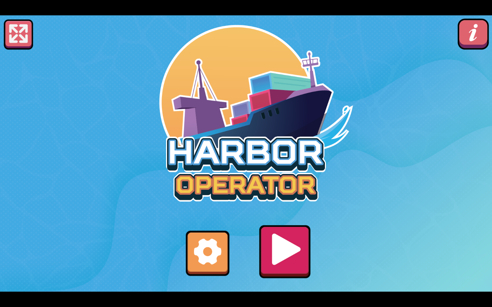
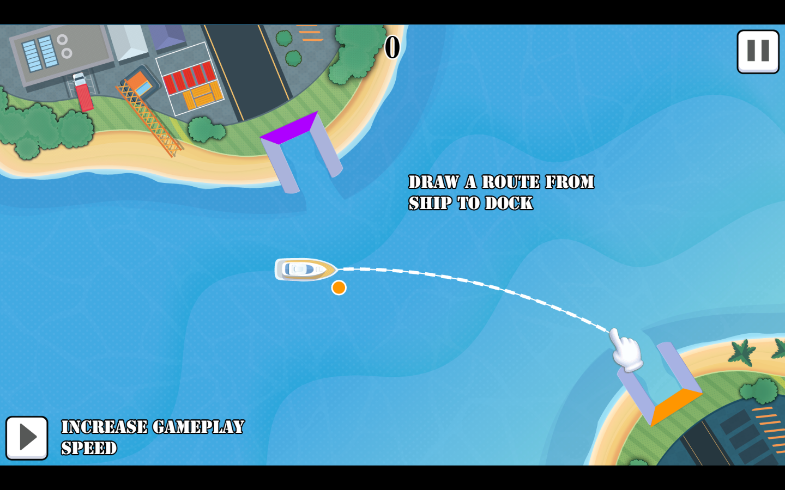
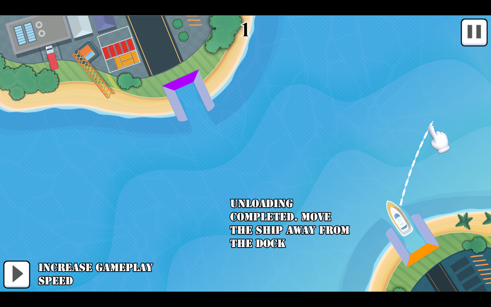
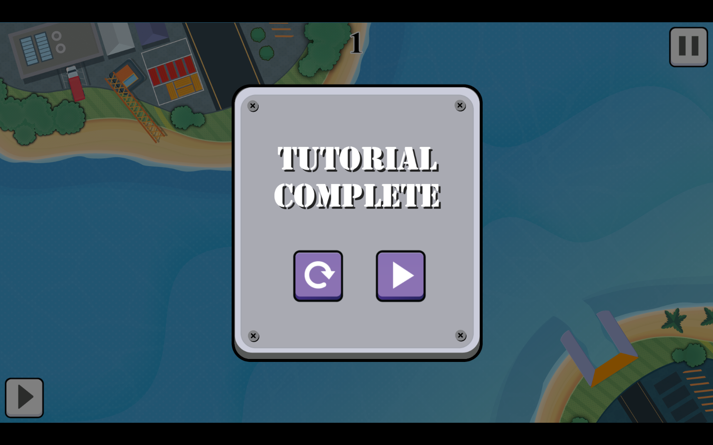

# Harbor Operator / 港口调度 游戏规格说明书

格式版本：V5.1

仅记录有依据的实现层事实；内容字段非必填，未知留空，不代表不存在或已经验证。

## 1. 基础事实

**维度定义**：让读者第一眼知道“这是什么类型、什么操控体验的游戏”，以及它的技术栈。

**内容说明**

Harbor Operator / 港口调度；MSN原生9pbd0qpb8kwz、MarketJS公开v7。原ImpactJS/JavaScript/HTML/CSS，2D俯视Canvas，远端桌面1440×900中原1920×1080画布按比例显示，手机未实测。

## 2. 资源类型

**维度定义**：游戏中游戏内容元素的资源类型是什么——即在哪个引擎运行下的资源格式。

**内容说明**

158运行文件，156份除game.js/index.html外原字节保持：136PNG、13MP3、Stencil字体TTF/WOFF/WOFF2、1GIF、1JPG及原CSS/manifest。原海洋、岛屿、船舶、泊位、按钮、地图预览、警告、教程手势和音效保持。完整原始161文件另含采集元数据。

## 3. 核心挑战维度

**维度定义**：游戏核心玩法主要挑战 / 满足人的什么。

**内容说明**

为动态船舶规划连续航线，将对应类型货船引导至匹配泊位，卸货后再次规划离港路线；普通模式须避免相撞、岸线及泊位调度冲突。实测原单船教程完成靠泊与离港两次航线。

## 4. 操控方式

**维度定义**：操控本身的复杂度 + 需要玩家判断的时机 / 策略复杂度。

**内容说明**

鼠标或触摸从船体按下、连续拖动绘制轨迹、松开后原船体沿线航行；匹配泊位自动捕捉，卸货完成后从船再画离港航线。原暂停、速度、菜单及地图按钮保留。本轮只按Play及两次连续拖动，不直接调用业务方法。

## 5. 行为路径

**维度定义**：玩家一局里重复做什么。

**内容说明**

累计5次真实输入：v2首次入口资源缺失计1；v3入口计2，原Play计3，普通连续拖线从船到匹配泊位计4，卸货后普通连续拖线离港计5。原0→1分，船实际靠泊、完成卸货、离开地图，出现原TUTORIAL COMPLETE。额外只读观察不产生输入。

## 6. 游戏路径（关键节点 + 流失风险）

**维度定义**：从开始到结束的流程 + 每个关键节点的潜在流失风险点。

**内容说明**

原菜单→Play→首次本地教学：原船到港提示→手工画线并沿线行驶→靠泊卸货加1分→原离港提示→再次画线→船离开地图→教程完成弹窗。后续地图选择与普通多船挑战源码存在，本轮未进入；未对流失风险作推断。

## 7. 成长路径

**维度定义**：玩家如何推进变强。

**内容说明**

源码含地图选择、原本地最高分和解锁阈值；原unlockScores五项0/20/40/60/80，另有20份地图配置。两者不混称20张均有独立已确认阈值。原教学初始化自行保存tutorial=false，未人为注入或刷新验证。

## 8. 核心闭环（目标-规则-反馈-激励）

**维度定义**：游戏是否具备“明确目标 → 明确规则 → 达成反馈 → 奖励激励 → 下一目标”的完整闭环。

**内容说明**

目标为安全完成船舶调度；按类型把船引到泊位，原路径/航行/泊位反馈可见，卸货加分后再送船离港释放泊位，普通模式继续接纳新船。实测这一核心闭环在原教程完成，得分1与原完成反馈真实出现。

## 9. 玩法规则

**维度定义**：核心循环、玩法规则、目标与进度。

**内容说明**

原30个受保护模块（含20地图、Ship/Dock/Island/Typhoon/Pointer/Tutorial）原字节保留；114个模块体恢复，最终112体仍与上游逐字节相同。泊位类型匹配、轨迹碰岸检查、原运动/转向/卸货/离港、随机船型和计时保持。原教程的特殊碰撞重置不冒充普通规则实测。

## 10. 数值配置

**维度定义**：影响玩法的关键数值。

**内容说明**

源码普通控制初分0、初速率1，首船前计时1.5秒，首船后间隔12秒；分数25时间隔8秒/速率1.1，分数50时间隔6秒/速率1.2。4个船舶tier索引0..3。原Dock捕捉距离80世界单位，靠泊到点距离小于5时加1；本轮仅实测1船、0→1分和完成反馈，不验证高分难度。

## 11. 关卡配置

**维度定义**：关卡结构、递进规律、难度曲线。

**内容说明**

20份原地图配置及资源全部保留：amsterdam, anchor-point, antwerp, bremerhaven, coastal-cove, felixstowe, gothenburg, grotrie-port, hamburg, havre, helsinki, marseille, oslo, port-city, river-docks, rostock, rotterdam, shanghai, st-helens, wilhelmshaven。本轮实际运行coastal-cove原教程及其两个泊位；普通地图、台风、多船挑战均未遍历，不把配置数量当已试玩关卡数。

## 12. 系统设计

**维度定义**：功能系统清单、UI 流程。

**内容说明**

原Impact模块、Canvas渲染/输入/计时/实体、SAT碰撞、岛岸几何、泊位占用/卸货、船舶轨迹/转向/警告、原菜单/地图选择/本地存储保持。浏览器隔离上下文并阻止外联，158份运行资源自包含；未改RNG、计时、分数、存档或关卡。MSStart/ApiHandler、广告提供者与广告复活弹窗/消费回调、分数上报、分享/更多游戏/外站点击层/游戏中心入口退役；普通结束分支与本地分数、地图、存储保留。只在已下载单机副本退役客户端域名空白跳转，不改变上游登录或授权，不提供SDK、身份、服务端响应、免费复活或奖励替身。

## 13. 主题化包装

**维度定义**：游戏的题材 / 世界观包装。

**内容说明**

原海港航运主题：蓝色海面、岛岸、仓库/集装箱/起重机、不同船型与颜色泊位；Stencil标题字、原白色航线/手势教学、暂停/速度/原完成面板。英语原界面及原贴图实拍。

## 14. 养成系统 + 经济系统

**维度定义**：玩家如何成长、经济如何循环。

**内容说明**

原本地分数与地图解锁为进展，原最高分和tutorial/map存储代码保留；未确认金币、升级购买或付费经济，不新增货币。原教程保存由原代码完成，刷新持久性未实测。

## 15. 角色 / 单位设定

**维度定义**：有哪些角色/单位、各自定位（玩法层面）。

**内容说明**

原四种船舶tier及匹配泊位类型、岛屿、台风和警告实体源码/资源保留。实测tier0/type1单船及type1、type2两个泊位；船沿玩家画线自动运动，不存在联网玩家或服务端AI替身。

## 16. 商业化

**维度定义**：靠什么变现。

**内容说明**

MSStart/ApiHandler、广告提供者与广告复活弹窗/消费回调、分数上报、分享/更多游戏/外站点击层/游戏中心入口退役；普通结束分支与本地分数、地图、存储保留。只在已下载单机副本退役客户端域名空白跳转，不改变上游登录或授权，不提供SDK、身份、服务端响应、免费复活或奖励替身。 无新增充值、支付、联网榜单或远程业务。实测为原生交互教程：EntityTutorialShip继承原EntityShip，保留原教程的碰撞重置与特殊规则。不能由教程推断普通多船碰撞、失败、地图解锁或20张地图已经运行通过。未操作完成弹窗、普通地图、加速、设置、刷新；无第六次输入，存档刷新恢复未知。

图 1：修订v3原菜单，16份原字体/音频补齐；累计第2次输入

图 2：原Play进入原交互教程，单船、两个泊位、原画线提示与0分

图 3：连续画线引航后真实靠泊卸货，原得分1和离港提示

图 4：连续离港航线后船离开原地图，原TUTORIAL COMPLETE弹窗
