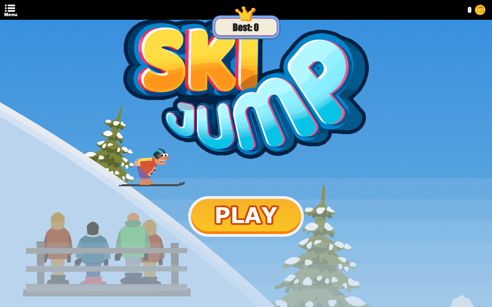
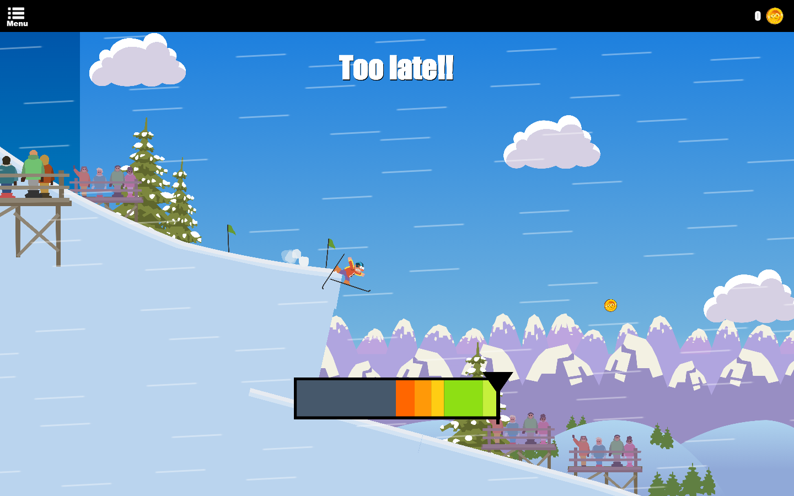
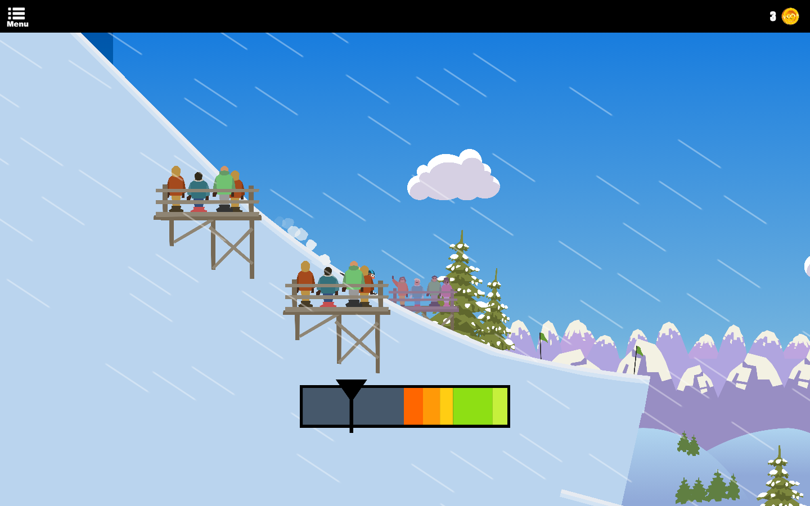

# Ski Jump FRVR 游戏规格说明书

格式版本：V5.1

仅记录有依据的实现层事实；内容字段非必填，未知留空，不代表不存在或已经验证。

## 1. 基础事实

**维度定义**：让读者第一眼知道“这是什么类型、什么操控体验的游戏”，以及它的技术栈。

**内容说明**

Ski Jump FRVR，MSN原生项目9n45cgs9pp39，官方frvr.com/play/skijump页面公开声明的skijump.frvr.com iframe原包。原版本2.0.4/build261019292，JavaScript自有XS Canvas/WebGL引擎。实测在同步环境远端52的1440×900 Chromium，开发机仅静态AST分析与打包。

## 2. 资源类型

**维度定义**：游戏中游戏内容元素的资源类型是什么——即在哪个引擎运行下的资源格式。

**内容说明**

34份上游文件逐项SHA核对；归档另有2份本地采集元数据，不冒充上游。移除2份真实SDK，32份运行文件中30份原字节保留。125份原SVG负载、23个原MP3路径/字节以及原PNG标题图标保留。v2只将原图集入口切换到原__importPOG直接SVG路径，素材未重新绘制或替换。

## 3. 核心挑战维度

**维度定义**：游戏核心玩法主要挑战 / 满足人的什么。

**内容说明**

沿雪坡滑行，在坡沿附近按时起跳，飞行中控制角度并落地，争取距离和金币。已实际确认开始、滑行/镜头跟随、错过时机后的Too late跌落、原失败奖励与自动重置；成功起跳落地未实测。

## 4. 操控方式

**维度定义**：操控本身的复杂度 + 需要玩家判断的时机 / 策略复杂度。

**内容说明**

原PLAY鼠标按下开始；场景原透明主命中区的down触发原tryTakeOff或滑行制动；左右屏幕按钮和原方向键/A/D控制旋转，Space原等效主操作，原Boost/Float/Rocket按钮保留。此次只真实点击两次PLAY并刷新，没有调用业务handler、写角色状态、修改随机数或时间。

## 5. 行为路径

**维度定义**：玩家一局里重复做什么。

**内容说明**

v2完整开始画面→点击PLAY→原雪坡/观众/树木/角色和镜头运动→原Too late!跌落反馈→原自动回开始界面、金币3→再PLAY观察原SKJ_INRUN/起跳时机条→自然再次跌落→刷新回开始界面、金币6。

## 6. 游戏路径（关键节点 + 流失风险）

**维度定义**：从开始到结束的流程 + 每个关键节点的潜在流失风险点。

**内容说明**

累计5次真实输入：v1入口出现原图集绘制兼容失败（原截图保留）；v2入口沿原直接SVG备用绘图路径显示完整原场景；点击PLAY开始，未及时起跳，原Too late/falloff跌落并自动重置；再次点击PLAY，原SKJ_INRUN滑行和计时条正常；最后真实刷新，原跌落规则累计金币6和初始装备持久化。起跳点击的自动守卫因当时x7170未到原允许区间8100而没有发送，不能算起跳成功。成功起跳/落地、旋转操作、道具使用、商店购买和手机未验证，不得宣称通过。

## 7. 成长路径

**维度定义**：玩家如何推进变强。

**内容说明**

真实localStorage保留numCoins、bestScore、lastScore、numJumps、当前雪板、拥有槽位、道具数、提示状态、历史成绩与原本地元数据。实测金币0→3→6，刷新仍6；numJumps仍0，因为原计数只在实际tryTakeOff时增加。初始Boost1/Float1来自原ca()新手逻辑，未新增广告代偿。

## 8. 核心闭环（目标-规则-反馈-激励）

**维度定义**：游戏是否具备“明确目标 → 明确规则 → 达成反馈 → 奖励激励 → 下一目标”的完整闭环。

**内容说明**

开始滑行→选择起跳时机→空中角度/原可用道具→落地距离/失误跌落→原奖励/重置→下次尝试。此次验证了失误分支、原每次跌落3金币和刷新恢复，未验证成功落地分支与距离结算。

## 9. 玩法规则

**维度定义**：核心循环、玩法规则、目标与进度。

**内容说明**

原gravity6.1、jumpBeforeX10500、jumpRange2400、rampEnd10620、jumpFalloffExp2保留；x小于8100时按原规则提示Wait for the edge，错过坡沿触发原Too late。起跳力度按原距离函数计算，垂直速度-15-28*r。441个原生玩法函数AST一致；没有缩短坡道、放宽时机、改RNG、假落地或改成绩。

## 10. 数值配置

**维度定义**：影响玩法的关键数值。

**内容说明**

源码5款雪板价格0/60/450/1600/4500，原8项商品表另含Boost200、Float350、Rocket49；拥有数组保留10个兼容槽位，不把槽位数误写成10款雪板。原跌落3金币；成功跳跃奖励公式10+round(距离/3)源码保留但未实测。实际最终金币6、bestScore0、numJumps0、基础雪板拥有，其余商品未购买。

## 11. 关卡配置

**维度定义**：关卡结构、递进规律、难度曲线。

**内容说明**

保留原B场景布局、X地形点和原地形插值、坡沿、终点装饰与金币生成；这是原重复跳台挑战和成长商品，未擅自裁成若干关。原完整布局字符串/Config保留，未额外展开全地形、雪板性能、落地或道具效果验证。

## 12. 系统设计

**维度定义**：功能系统清单、UI 流程。

**内容说明**

物理移除真实FRVR SDK/channel文件、广告与内购提供者、Get Coins入口、额外广告转盘、云存档/身份/线上排行榜及调用者。原本地SaveData十个类型校验/规范化函数AST一致，真实浏览器localStorage承接实际读写，无FRVR/Monetization/LegacySave/OSDK替身。

## 13. 主题化包装

**维度定义**：游戏的题材 / 世界观包装。

**内容说明**

原卡通滑雪者、橙色服装/头盔、雪坡、雪松、山云、看台观众、风线、标题、PLAY、计时色条和金币显示。v1图集兼容失败已用v2原直接SVG备用路径修复；四张最终截图已实际打开核对。

## 14. 养成系统 + 经济系统

**维度定义**：玩家如何成长、经济如何循环。

**内容说明**

原滑行/落地或跌落获得金币，按原价格购买雪板与道具；基础雪板默认拥有，原新手ca()逻辑给Boost1/Float1。原失败3金币实测两次，金币6刷新恢复；广告、付费、额外广告转盘入口删除，不用免费奖品、金币或解锁冒充广告/支付完成。

## 15. 角色 / 单位设定

**维度定义**：有哪些角色/单位、各自定位（玩法层面）。

**内容说明**

原滑雪者及服装皮肤、雪板5款、Boost/Float/Rocket三类道具、观众、树木、山云、金币、地形与原粒子/ghost结构保留。原在线排行玩家旗帜、昵称头部与远程排行面板移除，不伪造网络对手或身份。

## 16. 商业化

**维度定义**：靠什么变现。

**内容说明**

广告、内购、在线分数上传、云数据、身份/社交、远程配置及其实际入口/回调已退役。只保留同源静态GET与真实本地保存；最终53次请求均同源，未依赖拦截器替代源码退役。原5款金币雪板和3道具的单机价格/资格保持。

图 1：原场景与PLAY入口

图 2：原Too late跌落反馈

图 3：再次开始的滑行和时机条

图 4：刷新后金币6和原开始画面
