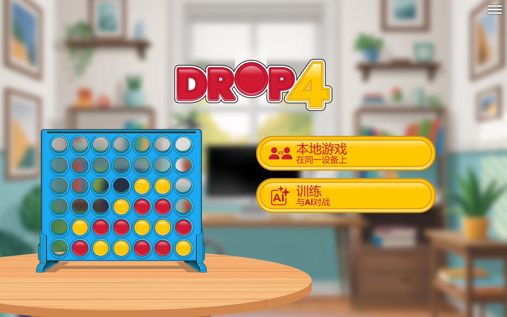
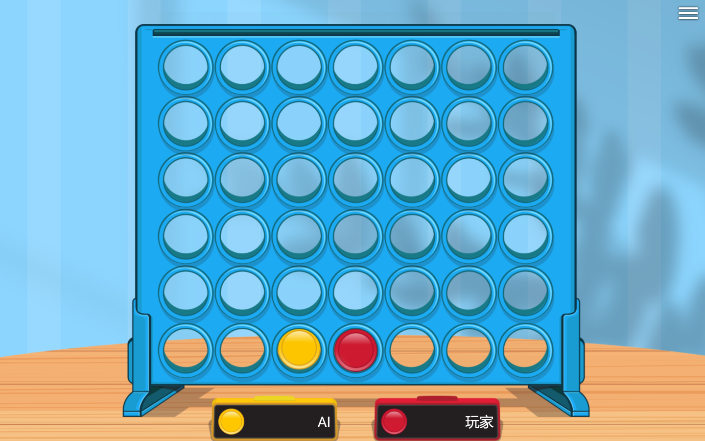
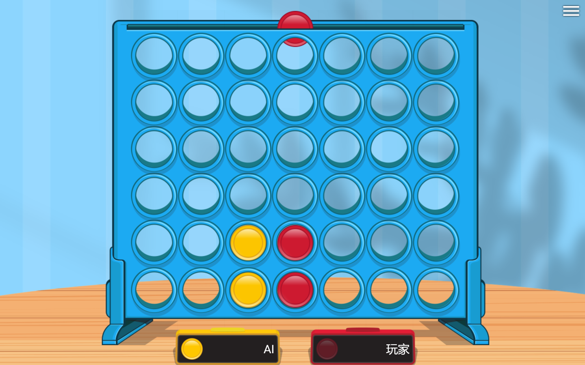

# Drop 4 / 四子连线 游戏规格说明书

格式版本：V5.1

仅记录有依据的实现层事实；内容字段非必填，未知留空，不代表不存在或已经验证。

## 1. 基础事实

**维度定义**：让读者第一眼知道“这是什么类型、什么操控体验的游戏”，以及它的技术栈。

**内容说明**

Drop 4 / 四子连线，MSN原生身份9nbcsm4zpkh2，Code This Lab公开CreateJS HTML5构建v6；JavaScript/Canvas2D二维重力四连棋。原语言表保留，本轮真实中文界面。远端1440×900桌面视口，原1920画布经设备像素比/响应式缩放为2880×2880像素、CSS1440×1440并垂直裁背景，主要棋盘与按钮完整可见。

## 2. 资源类型

**维度定义**：游戏中游戏内容元素的资源类型是什么——即在哪个引擎运行下的资源格式。

**内容说明**

89运行文件，原CreateJS/Howler/Screenfull、原游戏代码、原本地GUI/语言/Bootstrap/CSS、31个原游戏图像（包括4个真实大尺寸shadow）、8个原MP3和原Roboto/FontAwesome字体/国旗/制作人员SVG。完整原始98文件另存证据ZIP，9项仅在线轮播/多人界面资源不加载；所有实际游戏图片/音频/字体逐SHA保留，没有用占位图替换原shadow_2。

## 3. 核心挑战维度

**维度定义**：游戏核心玩法主要挑战 / 满足人的什么。

**内容说明**

轮流选择7列之一投棋，在6行棋盘中利用重力与阻挡，抢先形成横向、纵向或斜向至少四枚己方圆盘连线，同时防止对方先连成。本地CPU由原CAIController决策，不依赖服务器。区别于翻转夹子的黑白棋、五连平面任意落子的五子棋和完整国际象棋对局。

## 4. 操控方式

**维度定义**：操控本身的复杂度 + 需要玩家判断的时机 / 策略复杂度。

**内容说明**

原鼠标/触摸选列并点击落子，棋子落到该列最低空位。原首页有“本地游戏/在同一设备上”和“训练/与AI对战”，本轮仅选择训练。第4/5步各一次90ms普通按下/释放，坐标(720,135)，没有自动点击、业务函数调用、隐藏棋盘/AI读取、改种子/回合/时间或写存储。语言、音效、全屏、主菜单与重开原UI保留但未操作验证。

## 5. 行为路径

**维度定义**：玩家一局里重复做什么。

**内容说明**

累计5步：第1步v2加载原首页，发现退役菜单残留；v3清理完整菜单片段后第2步重新加载，第3步普通点击原“训练/与AI对战”，第4步点击可见第4列落1枚红棋，原本地AI回应第3列1枚黄棋；第5步再次点击第4列，红棋按重力堆到上一行，AI同样在第3列回应。最终棋盘2红2黄，顶部浮动红棋为下次落子预览，不计为已落棋子。两个版本合计5个输入，未重置预算；实际玩法3次点击全部在交付v3。

## 6. 游戏路径（关键节点 + 流失风险）

**维度定义**：从开始到结束的流程 + 每个关键节点的潜在流失风险点。

**内容说明**

原加载动画→原Drop4首页→选择同机双人或训练→原7×6棋盘、玩家颜色与当前棋子预览→普通投棋、原本地AI/另一玩家应对→原四连/满盘结算与重赛/返回入口。实际完成训练前两轮投棋和AI应对；完整胜负/重赛仅源码依据，不写为已实测。

## 7. 成长路径

**维度定义**：玩家如何推进变强。

**内容说明**

本款为每局重新布棋的四连棋，没有据此编造剧情关卡、长期人物等级或币商城。本轮棋盘由0枚→1红1黄→2红2黄，红方为玩家、黄色标注AI。未触发终局或累计纪录，也没有验证刷新后对局恢复。

## 8. 核心闭环（目标-规则-反馈-激励）

**维度定义**：游戏是否具备“明确目标 → 明确规则 → 达成反馈 → 奖励激励 → 下一目标”的完整闭环。

**内容说明**

目标：己方先连四并阻挡对方。规则：选择列、重力落入最低空行、红黄交替、原四方向胜负/满盘检查。反馈：原圆盘下降、底部颜色/玩家AI标签及下一手预览；本轮同列两枚红棋正确堆叠，AI两枚黄棋构成另一列堆叠。激励为连线胜利、原结束分数与再战；未声称实测赢局。

## 9. 玩法规则

**维度定义**：核心循环、玩法规则、目标与进度。

**内容说明**

原CBoard、CDisc、CAIController、CInfoTurn、CThinking、CMsgBox六整函数字节保持；25个CGameBase/CGameSingle方法中22个AST完全相同，其余3个只退役服务通知/普通场间接续。12个重点落子、换手、胜负检查、时间与更新方法完全相同。未降低AI、改棋盘、加提示、替换规则或对手；实际AI回复来自原本地搜索。

## 10. 数值配置

**维度定义**：影响玩法的关键数值。

**内容说明**

原ROWS=6、COLS=7，目标四枚连线。实测两次玩家落子和两次AI回应，共2红2黄；当前棋盘预览不算第5枚。原POINTS_FOR_WIN=1000、TIME_FOR_BONUS_SCORE=40000ms保留，仅源码常量，未实测赢局得分/时间奖励，也不把40000ms误写成每步倒计时。

## 11. 关卡配置

**维度定义**：关卡结构、递进规律、难度曲线。

**内容说明**

原固定7×6棋盘与每局起手、重力、满列/连线/满盘处理；训练与同机双人是两种本地对局模式，不是两个剧情关卡。原本地AI搜索/同分分支与起手规则保留，未设固定随机种子。实际只进入训练一次并投两手，无完整胜负或全部局面覆盖。

## 12. 系统设计

**维度定义**：功能系统清单、UI 流程。

**内容说明**

实际移除PlayerIO传输/序列化、在线房间/邀请/匹配/网络对局及模拟在线bot实现、账号/排行榜/统计/支付/外链/广告提供方和消费入口；原本地CPU和同机双人代码保留。普通非奖励场间继续沿原零参数本地动作直接执行，不发送ad_complete、SDK ready、身份或奖励回调，不构造服务替身。v3完整移除残留报告错误/购买去广告/恢复购买/更多游戏菜单片段及标签刷新，原语言/音效/全屏/主菜单/重开/制作人员本地UI保留。原CreateJS在HTTP部署时本就短路不执行file协议XHR测试；仅选择其原HTTP能力检测分支并移除未使用的WebAudioPluginTest.fail本地文件探针，不补造文件或成功结果。 原Canvas/CreateJS帧循环、CBoard/CDisc、CAIController、CGameBase/CGameSingle、声音/字体、GUI事件与语言系统保留。交付v3实测67请求/67同源200，累计含v2首屏134请求/134同源200，0外联/失败/控制台error；保留累计3条原浏览器音频手势/Canvas2D性能warning。只在HTTP(S)部署，不宣称直接file打开。

## 13. 主题化包装

**维度定义**：游戏的题材 / 世界观包装。

**内容说明**

原木桌、模糊室内背景、蓝色立式镂空棋盘、红黄圆盘、原Drop4标志、原按钮/字体/语言及Code This Lab署名SVG保留。原本地GUI只退役服务入口，不重新绘制皮肤；本轮中文“训练/与AI对战”“玩家/AI”与原棋盘清晰显示。

## 14. 养成系统 + 经济系统

**维度定义**：玩家如何成长、经济如何循环。

**内容说明**

没有实证需要货币/充值的原四连棋经济；服务账号/排行榜/支付/去广告购买已移除。保持原本地胜负/得分与时间规则，不授予金币、账号、积分或购买权益。本轮尚未结算，因此原1000胜利分仅列常量不列实际所得。

## 15. 角色 / 单位设定

**维度定义**：有哪些角色/单位、各自定位（玩法层面）。

**内容说明**

玩家操控红色圆盘，本轮原本地AI用黄色圆盘，棋盘底部有相应标签。CDisc为原棋子渲染/落子单位，CInfoTurn和顶部预览为原回合反馈；无人物NPC或联机对手。原同机双人保留但未测试，不能把本地AI说成真实在线玩家。

## 16. 商业化

**维度定义**：靠什么变现。

**内容说明**

实际移除PlayerIO传输/序列化、在线房间/邀请/匹配/网络对局及模拟在线bot实现、账号/排行榜/统计/支付/外链/广告提供方和消费入口；原本地CPU和同机双人代码保留。普通非奖励场间继续沿原零参数本地动作直接执行，不发送ad_complete、SDK ready、身份或奖励回调，不构造服务替身。v3完整移除残留报告错误/购买去广告/恢复购买/更多游戏菜单片段及标签刷新，原语言/音效/全屏/主菜单/重开/制作人员本地UI保留。原CreateJS在HTTP部署时本就短路不执行file协议XHR测试；仅选择其原HTTP能力检测分支并移除未使用的WebAudioPluginTest.fail本地文件探针，不补造文件或成功结果。 本单机不加载实际广告/身份/服务端协议，不提供广告奖励、在线匹配、账号充值/排行榜或外部供货。原署名保留为本地制作人员内容。只验证原菜单进入、两次普通重力落子和两次本地AI回应/换手。未验证四子连线胜负、平局、满列、完整对局、重赛、同机双人、设置点击、刷新进度或移动端。第2步是对未开局首页的重新加载，不是对局存档恢复验证。未读隐藏棋盘/AI搜索结果或调用业务方法；两次都点击同一可见列，不声称最优走法。

图 1：交付v3原菜单，在线入口已退役

图 2：普通第1次投棋后，红棋和原AI黄棋各1枚

图 3：普通第2次同列投棋后，2红2黄按原重力堆叠
