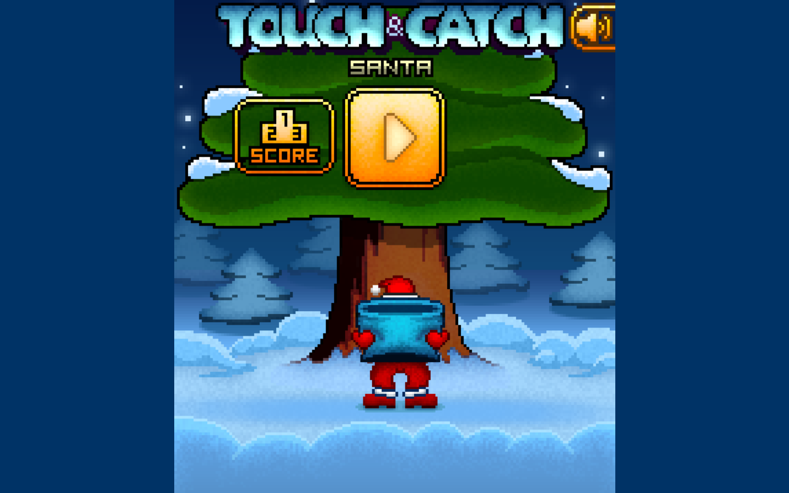
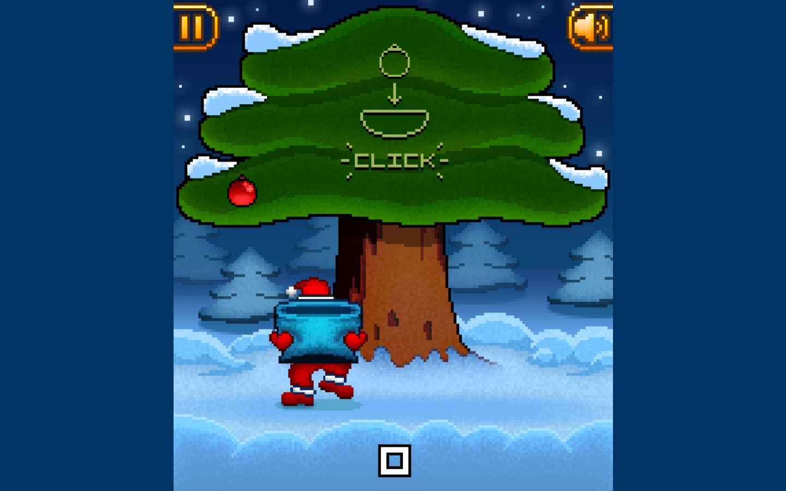
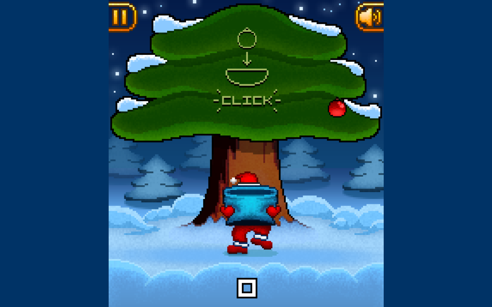
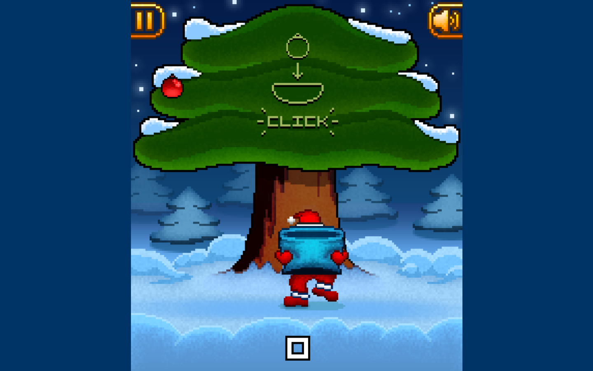
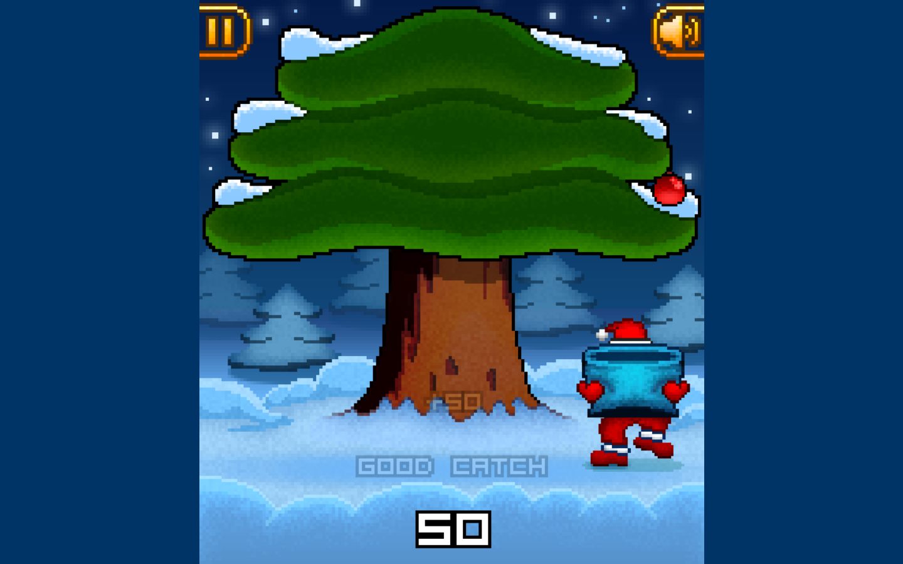

# Touch And Catch: Santa / 圣诞接果 游戏规格说明书

格式版本：V5.1

仅记录有依据的实现层事实；内容字段非必填，未知留空，不代表不存在或已经验证。

## 1. 基础事实

**维度定义**：让读者第一眼知道“这是什么类型、什么操控体验的游戏”，以及它的技术栈。

**内容说明**

Touch And Catch: Santa / 圣诞接果；MSN原生9mzf20tzqxx7、Softgames公开v6。HTML/JavaScript，原CreateJS/EaselJS/PreloadJS/SoundJS/TweenJS与BitmapFont；引擎具体小版本未核实。2D Canvas像素风；本轮1440×900远端桌面Chrome，原画布640×716。

## 2. 资源类型

**维度定义**：游戏中游戏内容元素的资源类型是什么——即在哪个引擎运行下的资源格式。

**内容说明**

43份公开原文件、44运行文件，其中41原字节保留。原7个OGG、公共图集和10语言图集、主背景/作者标志、启动/旋屏JPG、4对数字字体XML/PNG齐备。XML部分page名为旧导出名，原createFonts直接传预加载的*_0.png Image，不按XML文件名发请求；原元数据保持。原图标上游404保留失败，不补占位；最终HTML不再引用图标和manifest。

## 3. 核心挑战维度

**维度定义**：游戏核心玩法主要挑战 / 满足人的什么。

**内容说明**

选择点击时机让树上的当前果实落下，圣诞老人沿原正弦路线自行左右移动，落果到篮口时横向对齐才能接住。还需辨别原腐烂果实，避免负分；本轮只接住一枚原红果。

## 4. 操控方式

**维度定义**：操控本身的复杂度 + 需要玩家判断的时机 / 策略复杂度。

**内容说明**

鼠标点击原PLAY进入；游戏区域鼠标按下触发原DROP_STUFF，触摸入口保留但未实测。暂停、声音、成绩和普通重试原控件保留。实际三次落果，未直调drop/catch/计分方法；后两次仅依据可见篮子位置观察选择鼠标点击时机。

## 5. 行为路径

**维度定义**：玩家一局里重复做什么。

**内容说明**

累计5次真实玩家输入：原入口→原PLAY→三次鼠标落果。前两次漏接仍0分，第三次接住原红果，原生分数50、成功数1、GOOD CATCH、教程退出，原新果实继续生成。没有第六次输入。

## 6. 游戏路径（关键节点 + 流失风险）

**维度定义**：从开始到结束的流程 + 每个关键节点的潜在流失风险点。

**内容说明**

原标题菜单→PLAY→首果/CLICK教程与自行移动角色→落果→漏接则0分重发，接住则原计分/反馈/新果→正分后漏接进入原gameOver逻辑。实际验证至50分新果，后续结算未验证。

## 7. 成长路径

**维度定义**：玩家如何推进变强。

**内容说明**

本作是连续接物分数挑战，不是经验证的关卡解锁游戏。源码保留成功果数驱动初期易果/后续随机果序和perfect-chain；最高分、累计分与局数在原reviseBest结算时保存。原getTotalSessions读取totalScore键的既有问题原样保留并记录，没有静默更改经济或会话数。

## 8. 核心闭环（目标-规则-反馈-激励）

**维度定义**：游戏是否具备“明确目标 → 明确规则 → 达成反馈 → 奖励激励 → 下一目标”的完整闭环。

**内容说明**

观察当前果实与移动篮子→普通按下落果→原重力与篮口范围检测→原接住/侧弹/漏接判断→原分数、GOOD CATCH/连击或失误反馈→下一果/原失败结算→普通重玩。实际验证接住红果、加50分、教程退出及下一果出现。

## 9. 玩法规则

**维度定义**：核心循环、玩法规则、目标与进度。

**内容说明**

AppleModel、AppleServeModel、CatcherModel、GameModel、GameTimer、StatsModel六个核心类规范AST完全相同，另有16个完整类保持。所有变动有逐字节区间清单。原随机洗牌、果实生成/位置、重力/横移/碰撞/分值/连击/结算均保留；不注入分数、存档、种子、道具或时间。

## 10. 数值配置

**维度定义**：影响玩法的关键数值。

**内容说明**

原篮子周期2400ms，画布宽640；catch范围宽96、bounce宽152；果实重力加速度0.005、初速度Y=-0.5。红/绿/黄基础50/75/100，腐烂褐/蓝/紫-35/-45/-55，果实高度倍率1/1.2/1.4；perfect起10并逐次加5，漏接/侧弹会中断。实测只普通红果50分，成功果1、最高0、存储空。

## 11. 关卡配置

**维度定义**：关卡结构、递进规律、难度曲线。

**内容说明**

没有独立关卡文件。原AppleServeModel维护23项果型循环、3×3腐烂果循环、按高度分组位置及原随机洗牌，初期前两次成功前优先easy果。数字23是果型序列配置长度，不当作23关。原_gameDuration=31536e6是连续计时上限，不声称有该时长玩法覆盖。

## 12. 系统设计

**维度定义**：功能系统清单、UI 流程。

**内容说明**

原Canvas舞台/事件、Ticker/缓动、果实池、字体与图集、音效管理、原浏览器blur暂停保留。原文件协议专用WebAudioPluginTest.fail探针及file:门禁移除，HTTP下仍执行真实AudioContext能力检测；不伪造音频就绪。预加载语言路径改为原十语言显式静态表，选择不变。真实SG/SG_Hooks宿主加载器、启动/关卡/结束上报、平台暂停注册和社交跳转及其按钮/handler已退役。原资源complete事件后直接启动原MainController；语言来自真实navigator且限原十语言；实际分数/声音存储消费者改为本地localStorage，不创建SDK替身、身份、成功回包或奖励。保留原blur暂停和普通原生控件。

## 13. 主题化包装

**维度定义**：游戏的题材 / 世界观包装。

**内容说明**

原白雪森林、圣诞树、红衣圣诞老人、蓝篮、彩色/腐烂果、像素数字和GOOD CATCH反馈、PLAY/成绩/暂停/声音按钮保留。英语本轮实际渲染；其余9语言原图集保留但未点击切换或逐语言试玩。

## 14. 养成系统 + 经济系统

**维度定义**：玩家如何成长、经济如何循环。

**内容说明**

原分数、最高分、累计分和局数，不含可购买/刷取货币；原连击加成和腐烂扣分保留。本轮50分未结算，不触发最高/累计保存；声音布尔值持久化代码保留、未切换实测。

## 15. 角色 / 单位设定

**维度定义**：有哪些角色/单位、各自定位（玩法层面）。

**内容说明**

原单人圣诞老人/篮子沿正弦路径自主移动；当前果实/腐烂果和树/雪景。原Sprite腿部切帧、篮子摆动、果实掉落/侧弹/出屏与反馈动画保留，实际看到移动、落果、接住和新果。无远端玩家、匹配或房间。

## 16. 商业化

**维度定义**：靠什么变现。

**内容说明**

真实SG/SG_Hooks宿主加载器、启动/关卡/结束上报、平台暂停注册和社交跳转及其按钮/handler已退役。原资源complete事件后直接启动原MainController；语言来自真实navigator且限原十语言；实际分数/声音存储消费者改为本地localStorage，不创建SDK替身、身份、成功回包或奖励。保留原blur暂停和普通原生控件。 无新增广告、充值、联网榜或支付。本轮未进行整局失败结算、重试、声音切换或刷新，未触发原reviseBest结算保存，因此最高分仍0、实际存储为空；不能宣称存档恢复、整局通关、全果型/全部语言/手机验证。只读观察字段apple.position因原字段为_position而为空，果实位置依据真实可见Sprite和截图，不编造模型字段。

图 1：原菜单、播放/成绩与声音控件、原雪景/圣诞老人

图 2：原PLAY后首果与CLICK教程、自动左右移动

图 3：第一次真实落果未接住，原0分重发果实

图 4：第二次真实落果仍未接住，原0分第三果

图 5：第三次真实落果接住，原50分/GOOD CATCH、教程自然退出
