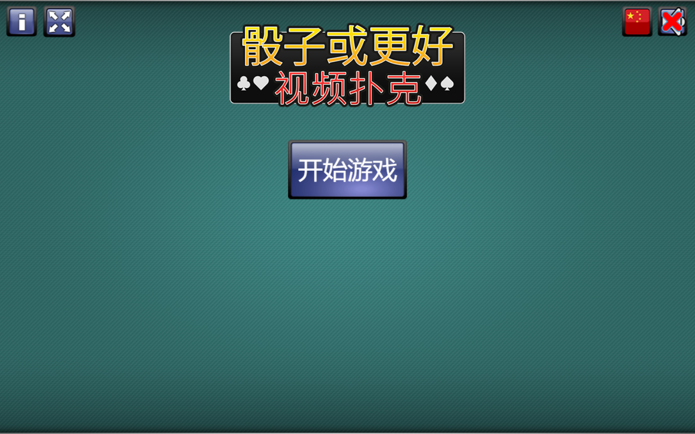
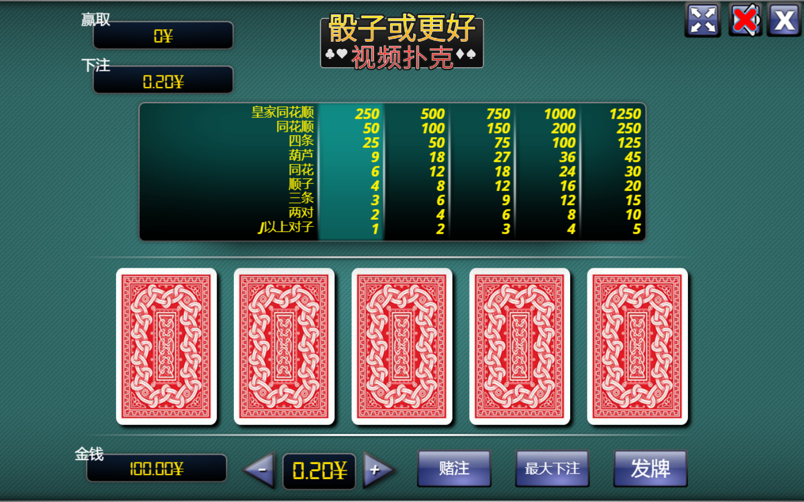
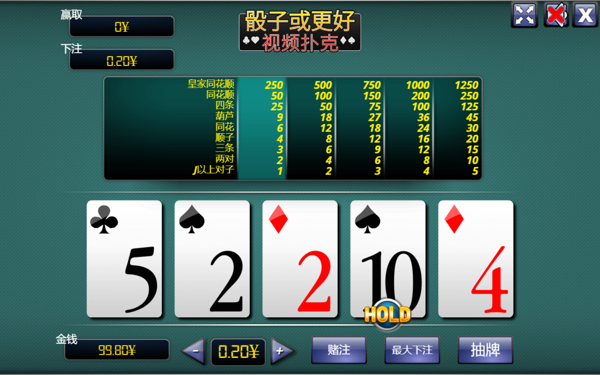
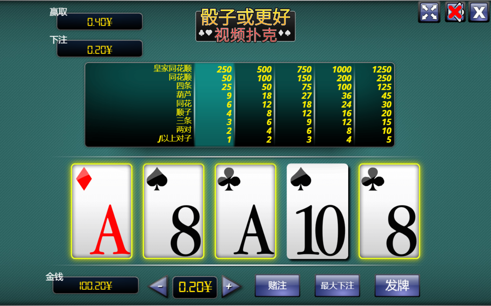

# Jacks or Better / 视频扑克 游戏规格说明书

格式版本：V5.1

仅记录有依据的实现层事实；内容字段非必填，未知留空，不代表不存在或已经验证。

## 1. 基础事实

**维度定义**：让读者第一眼知道“这是什么类型、什么操控体验的游戏”，以及它的技术栈。

**内容说明**

Jacks or Better – Video Poker（视频扑克），MSN原生9p5vlrc06krk，CodeThisLab公开v6。原中文logo写“骰子或更好”，保留该原图，不据此改成掷骰玩法。HTML/JavaScript/CSS、原CreateJS/EaselJS/TweenJS/Howler，逻辑1920×768，实际远端视口1440×900。

## 2. 资源类型

**维度定义**：游戏中游戏内容元素的资源类型是什么——即在哪个引擎运行下的资源格式。

**内容说明**

66份原上游文件；去除安装清单后65运行文件，62原文件字节一致。限定改动入口、主脚本服务消费者及未用SoundJS模块。原牌面/牌背、HOLD与高亮、牌桌/赔付表、数字显示/按钮、13语logo、3个未用引流图标原归档、6原MP3及OpenSans/Digital-7字体保持。

## 3. 核心挑战维度

**维度定义**：游戏核心玩法主要挑战 / 满足人的什么。

**内容说明**

独立五张牌视频扑克：下注发5张，选择保留，再换掉未保留牌，按最终牌型和原赔付表结算。没有德州扑克公共牌或与庄家比较21点；本轮真实保留黑桃10，换牌得到A和8两对并结算。

## 4. 操控方式

**维度定义**：操控本身的复杂度 + 需要玩家判断的时机 / 策略复杂度。

**内容说明**

鼠标/触摸点开始、发牌、点单张牌切换HOLD、抽牌，原左右面额、赌注和最大下注按钮保留。此次只用默认0.20和1档列，点一次HOLD与一次抽牌，不程序调用toggleHold/dealCards/drawCards。

## 5. 行为路径

**维度定义**：玩家一局里重复做什么。

**内容说明**

累计5次真实输入：精确离线入口→原开始游戏→原默认0.20下注发牌→点第4张黑桃10保留→原抽牌。初手为梅花5/黑桃2/方块2/黑桃10/方块4；原HOLD徽章出现，换牌后第4张黑桃10保持，其余四张变为方块A/黑桃8/梅花A/梅花8，原两对高亮、赢取0.40，余额100→99.80→100.20，jacks_or_better_user_money实际保存100.2，原按钮回到发牌。未写牌序、RNG、钱包或调用处理函数。未发第6次输入；其他牌型、下注档、原本地补充100、刷新读回、其他语言/手机/音频听感未实测。

## 6. 游戏路径（关键节点 + 流失风险）

**维度定义**：从开始到结束的流程 + 每个关键节点的潜在流失风险点。

**内容说明**

原菜单→开始→原5张背牌与赔付表→默认下注发5张→真实点第4张出现HOLD→原抽牌替换其余4张→原牌型识别/中奖牌高亮/余额和本地保存→原发牌按钮返回。实际完整走完一手，未追加第二手输入。

## 7. 成长路径

**维度定义**：玩家如何推进变强。

**内容说明**

单桌连续手牌，没有地图关卡或角色等级。原jacks_or_better_user_money保存余额，实际从99.8更新100.2；没有第6次刷新，不称重新打开后的读档已验证。各下注档/语言及原本地不足筹码补充仅源码保留。

## 8. 核心闭环（目标-规则-反馈-激励）

**维度定义**：游戏是否具备“明确目标 → 明确规则 → 达成反馈 → 奖励激励 → 下一目标”的完整闭环。

**内容说明**

原下注→原发牌→选保留牌→换未保留牌→原CHandEvaluator评估/CPayTable结算→保存余额→下一手发牌。本轮两对得到0.40是原牌型支付，不是广告奖励或强行调整钱包。

## 9. 玩法规则

**维度定义**：核心循环、玩法规则、目标与进度。

**内容说明**

186原生方法AST一致、20核心方法逐项一致，原CGameSettings/CCard/CHandEvaluator/CPayTableSettings/CPayTable和随机shuffle等55整函数字节保持。原WIN_OCCURRENCE35及原按该值选手牌的逻辑保持，不声称公平随机，也未改胜率或替换牌堆算法。

## 10. 数值配置

**维度定义**：影响玩法的关键数值。

**内容说明**

原初始100虚拟筹码；7面额[0.2,0.3,0.5,1,2,3,5]、5下注列；9类中奖组合原基础表[250,50,25,9,6,4,3,2,1]。5张牌/HOLD/替换，原牌面52+牌背1帧。实际0.20下注、两对原倍数2→0.40，最终100.20。界面¥为虚拟标记，无真实交易。

## 11. 关卡配置

**维度定义**：关卡结构、递进规律、难度曲线。

**内容说明**

原单桌视频扑克，无关卡制；按面额和下注列计算原赔付表。13语言logo素材保留；本轮中文/默认0.2面额、1列，一手自然结果，不伪称全牌型/所有下注配置已验证。

## 12. 系统设计

**维度定义**：功能系统清单、UI 流程。

**内容说明**

原CreateJS渲染/Tween、Howler、牌堆/52牌及HOLD/替换、原9牌型评估、赔付表高亮、本地钱包、声音/语言/全屏和原不足筹码本地补充。实际外部SDK/广告通知/上传/更多游戏UI和切游戏provider、SW及广告200奖励消费者退役。

## 13. 主题化包装

**维度定义**：游戏的题材 / 世界观包装。

**内容说明**

原青绿色纹理牌桌，黑色数字显示、中文赔付表与13语logo，5张大牌、金色HOLD徽章/中奖牌黄框、底部原下注与发牌/抽牌控件。5张实际截图均已打开检查，保留原中文图面，不替图冒充试玩。

## 14. 养成系统 + 经济系统

**维度定义**：玩家如何成长、经济如何循环。

**内容说明**

虚拟筹码用于单手下注，中奖依据原9牌型支付并本地保存；原最高列皇家同花顺1250为原表数值，不按其他扑克规则改成4000。原CGameOver._onRecharge中AUTOMATIC_RECHARGE && s_oGame.recharge(TOTAL_MONEY)纯本地100补充及原按钮保持、AST精确一致；原HTML广告成功后额外200的回调和广告事件消费者已物理退役，不伪造成功、不发放该广告奖励。原100补充未实测触发，不能混称广告免费发200。

## 15. 角色 / 单位设定

**维度定义**：有哪些角色/单位、各自定位（玩法层面）。

**内容说明**

原52张牌与牌背、HOLD与中奖高亮、赔付表9行/5列、筹码显示、面额左右切换、下注/最大下注/发牌抽牌/退出/语言/全屏/信息。无在线玩家或服务器对手，原动画与本地评估执行。

## 16. 商业化

**维度定义**：靠什么变现。

**内容说明**

原CGameOver._onRecharge中AUTOMATIC_RECHARGE && s_oGame.recharge(TOTAL_MONEY)纯本地100补充及原按钮保持、AST精确一致；原HTML广告成功后额外200的回调和广告事件消费者已物理退役，不伪造成功、不发放该广告奖励。原100补充未实测触发，不能混称广告免费发200。远端52实际Chromium运行；58请求/58响应均精确同源HTTP200，无外联、失败请求或脚本异常。保留1条启动前AudioContext限制和1条Canvas2D读回性能warning，不称零warning。浏览器58759实际BROWSER_EXIT0。开发环境没有执行原游戏或SDK。

图 1：原中文视频扑克菜单

图 2：原赔付表/默认0.20下注/100余额

图 3：原发5张，余额99.80

图 4：真实点黑桃10出现HOLD

图 5：原替换其余4张、A和8两对赢0.40，余额100.20
