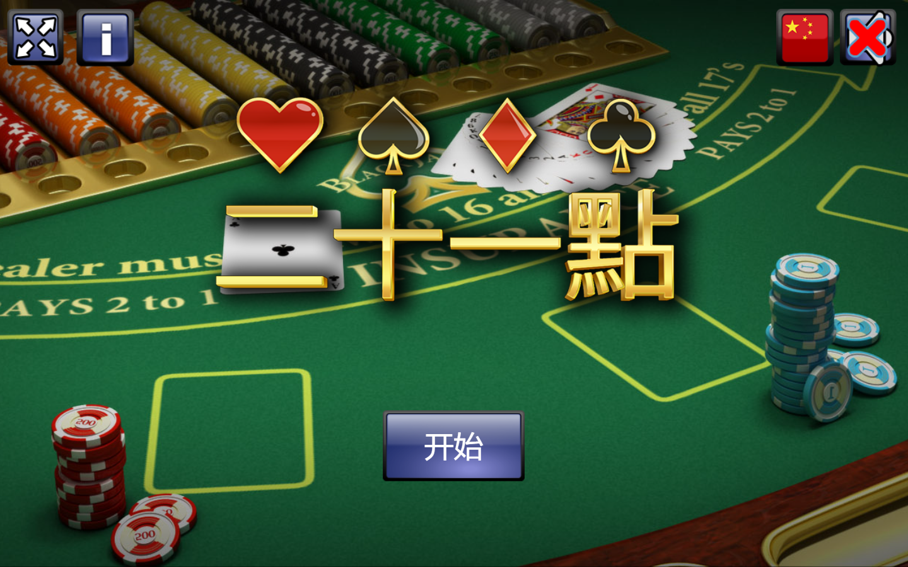
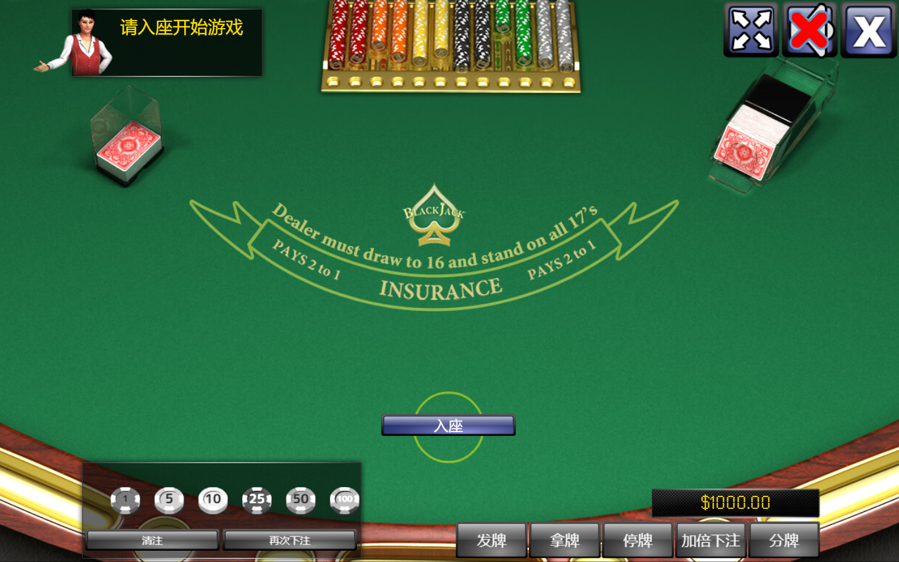
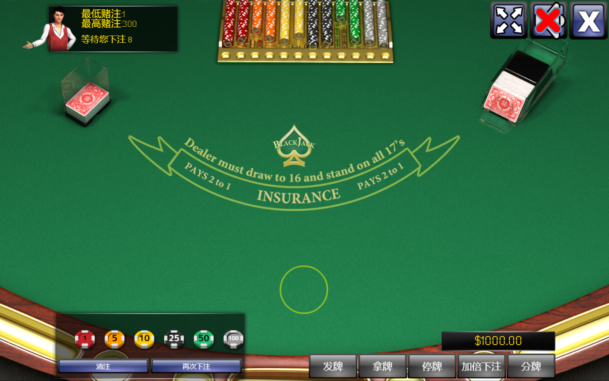
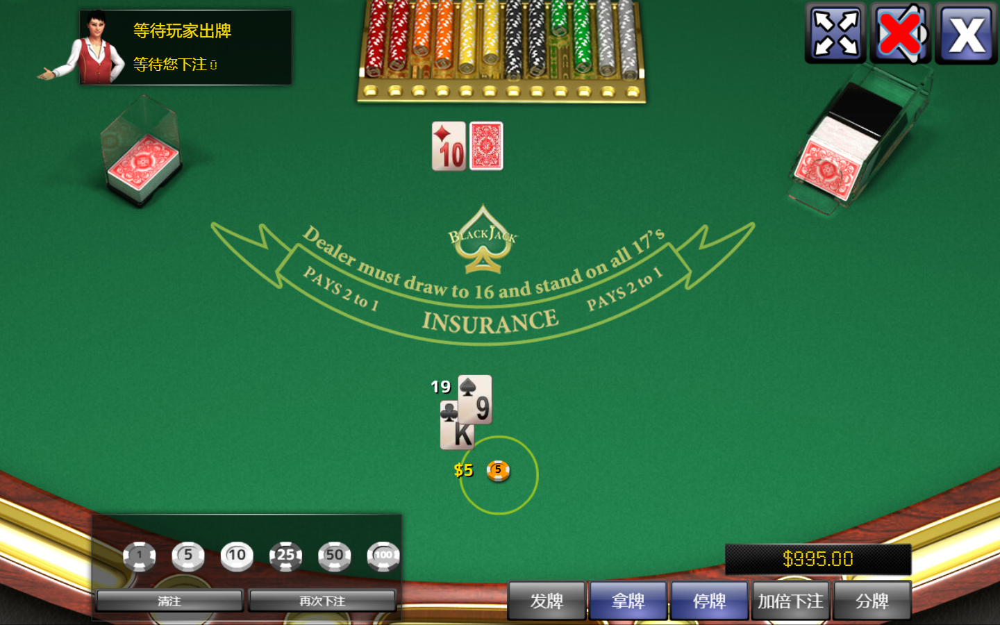
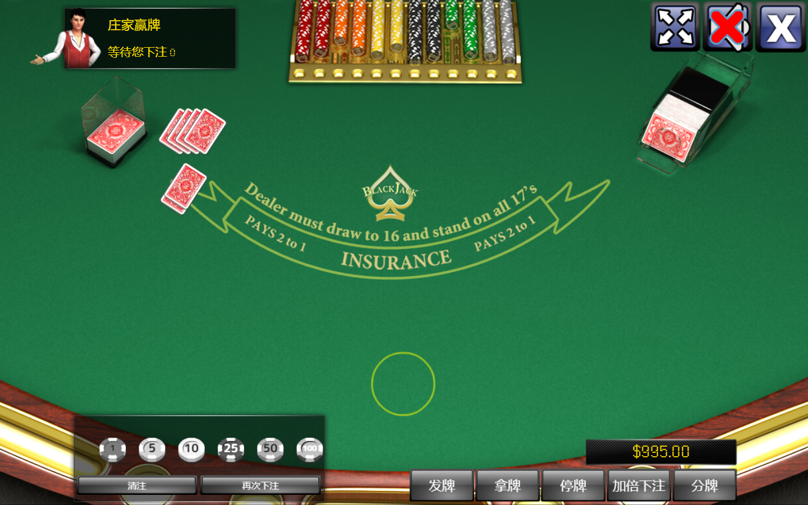

# Blackjack / 二十一点 游戏规格说明书

格式版本：V5.1

仅记录有依据的实现层事实；内容字段非必填，未知留空，不代表不存在或已经验证。

## 1. 基础事实

**维度定义**：让读者第一眼知道“这是什么类型、什么操控体验的游戏”，以及它的技术栈。

**内容说明**

Blackjack / 二十一点，MSN原生9mt4hk2d6rcn，CodeThisLab公开v2构建。HTML/JavaScript/CSS，原CreateJS/EaselJS/TweenJS与Howler。逻辑画布1700×768，远端实际视口1440×900，按原布局居中裁切；2D素材表现牌桌纵深。

## 2. 资源类型

**维度定义**：游戏中游戏内容元素的资源类型是什么——即在哪个引擎运行下的资源格式。

**内容说明**

59份上游原文件，去除安装清单后58份运行文件，其中55份原文件字节一致；仅入口、主脚本服务消费者和未用SoundJS探测模块作限定退役。原牌面图集、牌背、筹码/牌桌/荷官、座位/按钮、13语标题、4份字体及6份MP3保持。

## 3. 核心挑战维度

**维度定义**：游戏核心玩法主要挑战 / 满足人的什么。

**内容说明**

与本地庄家比较牌点，在不超过21点的前提下选择拿牌或停牌；筹码下注后依原规则结算输赢。此次实际19点停牌后庄家赢，本地余额995并开始下一注等待；不把输局改成赢局。

## 4. 操控方式

**维度定义**：操控本身的复杂度 + 需要玩家判断的时机 / 策略复杂度。

**内容说明**

原鼠标/触摸界面：开始、入座、选择1/5/10/25/50/100筹码，原发牌/拿牌/停牌/加倍/分牌等按钮按局面启用。此次实际点击5筹码和停牌；自动发牌来自原10秒计时，不调用发牌函数。

## 5. 行为路径

**维度定义**：玩家一局里重复做什么。

**内容说明**

累计5次真实输入：离线精确入口→原开始→原入座→点原5筹码→等待原10秒倒计时自动发牌后点击停牌。实际玩家K与9共19点、余额1000→995，原庄家处理后显示“庄家赢牌”，blackjack_user_money实际保存995。一次零输入被动观察确认原清牌并回到等待下一注，余额仍995。未操纵牌序/RNG/计时/余额，未发第6次输入。拿牌、加倍、分牌、保险、玩家赢局、原200筹码补充、刷新读回和听感未实测。

## 6. 游戏路径（关键节点 + 流失风险）

**维度定义**：从开始到结束的流程 + 每个关键节点的潜在流失风险点。

**内容说明**

中文原菜单→开始→原牌桌→入座→筹码下注→原倒计时自动发牌→玩家决策→原庄家回合→原输赢文字与筹码结算→原收牌动画→下一注等待。实际首局完整走到庄家赢和回到下注。

## 7. 成长路径

**维度定义**：玩家如何推进变强。

**内容说明**

原单桌连续牌局，没有关卡地图。原本地键blackjack_user_money保存虚拟筹码，真实观察首局结算995；未做第6次刷新，不能称刷新读回已验证。13语言与换桌背景仅源码确认保留。

## 8. 核心闭环（目标-规则-反馈-激励）

**维度定义**：游戏是否具备“明确目标 → 明确规则 → 达成反馈 → 奖励激励 → 下一目标”的完整闭环。

**内容说明**

下本地虚拟筹码→原随机牌序发牌→拿牌/停牌等决策→庄家补牌/比较牌点→筹码结算与本地保存→清牌重开下注。本轮真实执行一个停牌输局，未注入手牌或修改原胜率设置。

## 9. 玩法规则

**维度定义**：核心循环、玩法规则、目标与进度。

**内容说明**

329个原生方法AST一致；发牌/加倍/自动计时3个方法仅移除bet_placed空服务事件，其余逻辑对照一致；13个核心方法原样。原CHandController/CCard/CGameSettings和随机shuffle全函数字节保持。原WIN_OCCURRENCE=35保留，不声称公平随机或改写庄家策略。

## 10. 数值配置

**维度定义**：影响玩法的关键数值。

**内容说明**

原初始虚拟筹码1000，最小注1、最大注300，下注计时10000毫秒，Blackjack赔付参数1.5，原WIN_OCCURRENCE35。实际点5筹码，玩家19点，原结果庄家赢，余额995。原本地不足筹码补充量200，未实测触发；所有金额为游戏虚拟筹码。

## 11. 关卡配置

**维度定义**：关卡结构、递进规律、难度曲线。

**内容说明**

无关卡制，同一二十一点循环；原从4张牌桌背景中选择，牌面/筹码与13语言标题素材全部保留。本轮只测一次自然随机手牌，不伪造其他关卡或承诺全部牌型覆盖。

## 12. 系统设计

**维度定义**：功能系统清单、UI 流程。

**内容说明**

原CreateJS渲染/Tween、Howler声音、牌堆/手牌计算、下注/筹码动画、庄家/玩家、分牌/加倍/保险分支、本地钱包、语言/全屏/暂停。外部SDK/通知/广告/分数上传/SW安装及相应调用退役，保留原真实浏览器语言和连通状态读取。

## 13. 主题化包装

**维度定义**：游戏的题材 / 世界观包装。

**内容说明**

原绿毡牌桌、顶部筹码架、左右牌靴/弃牌、中文女荷官提示、原K/9牌面、原虚拟余额及底部中文操作按钮。5张真实输入截图和1张被动下一局截图已打开检查，没有换图伪装操作。

## 14. 养成系统 + 经济系统

**维度定义**：玩家如何成长、经济如何循环。

**内容说明**

原筹码用于下注和输赢结算，保留原本地钱包；没有真实购买、联网商城或新增道具系统。原入口recharge回调直接在本地调用setMoney(200)，没有广告、支付或服务器前提，原按钮和回调逐AST保持；这不是新增免费奖励或支付成功替身。仅退役实际MSN、广告/更多游戏/通知、上传和SW及其消费者。

## 15. 角色 / 单位设定

**维度定义**：有哪些角色/单位、各自定位（玩法层面）。

**内容说明**

原玩家座位、本地庄家、52牌面图集/牌背、牌靴/筹码、荷官提示、语言/全屏/退出和下注/牌局按钮。牌型/保险/加倍分牌均为原源码，未声明全部实测。

## 16. 商业化

**维度定义**：靠什么变现。

**内容说明**

原入口recharge回调直接在本地调用setMoney(200)，没有广告、支付或服务器前提，原按钮和回调逐AST保持；这不是新增免费奖励或支付成功替身。仅退役实际MSN、广告/更多游戏/通知、上传和SW及其消费者。远端52实际Chromium运行；56请求/56响应全为精确同源HTTP200，无外联、失败请求或脚本异常。14条原Canvas2D getImageData性能warning保留，不宣称零warning；浏览器8636实际BROWSER_EXIT0。开发环境仅静态分析和打包，没有运行游戏或SDK。

图 1：原中文二十一点菜单

图 2：原牌桌等待入座，1000筹码

图 3：已入座，原下注倒计时

图 4：原5筹码下注自动发牌，玩家19点

图 5：原庄家赢牌，本地995筹码
