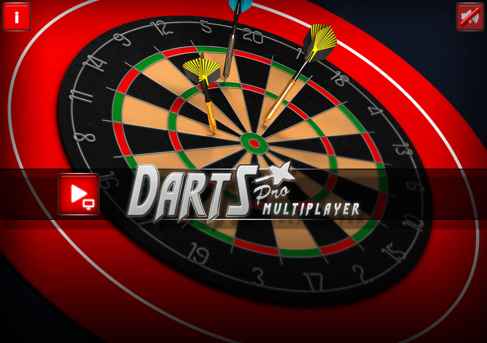
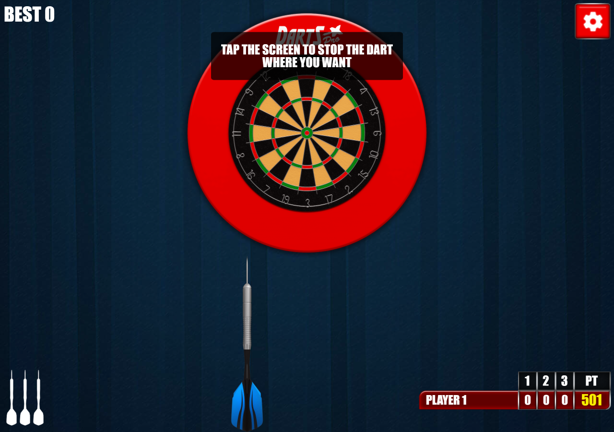
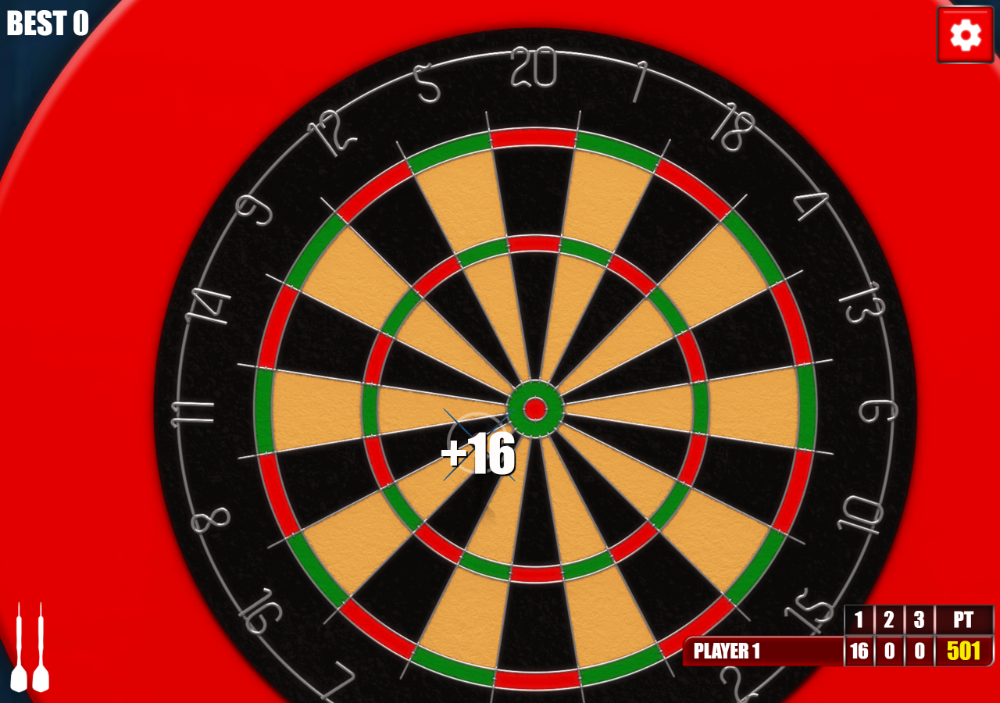

# Darts Pro 游戏规格说明书

格式版本：V5.1

仅记录有依据的实现层事实；内容字段非必填，未知留空，不代表不存在或已经验证。

## 1. 基础事实

**维度定义**：让读者第一眼知道“这是什么类型、什么操控体验的游戏”，以及它的技术栈。

**内容说明**

格式版本：V5.1。Darts Pro，二维飞镖，JavaScript/HTML、CreateJS Canvas、Howler。MSN 9n3n198l6zpj，原站身份及SHA保留。远端52独立Playwright浏览器真实5步：首页→本地→单人→点屏停住飞镖→原生按住拖拽释放。原靶面命中16分、剩余飞镖3变2。未追加点击、刷新、第二次投掷、CPU关卡或整局通关；声音初始静音未测试。

## 2. 资源类型

**维度定义**：游戏中游戏内容元素的资源类型是什么——即在哪个引擎运行下的资源格式。

**内容说明**

原PNG/JPG、Impact字体与MP3；108项动态资源逐项原站SHA一致，99张图片解码结构检查通过。来源：darts-source-asset-closure.json、darts-runtime-closure.json。

## 3. 核心挑战维度

**维度定义**：游戏核心玩法主要挑战 / 满足人的什么。

**内容说明**

原代码使用移动中的飞镖、按压与滑动输入，计算方向/力度后按原靶面位置计分。实际操控手感尚未试玩。

## 4. 操控方式

**维度定义**：操控本身的复杂度 + 需要玩家判断的时机 / 策略复杂度。

**内容说明**

原先点屏固定移动中的飞镖，再按住向下拖拽设定力度并释放。远端52独立Playwright浏览器真实5步：首页→本地→单人→点屏停住飞镖→原生按住拖拽释放。原靶面命中16分、剩余飞镖3变2。未追加点击、刷新、第二次投掷、CPU关卡或整局通关；声音初始静音未测试。

## 5. 行为路径

**维度定义**：玩家一局里重复做什么。

**内容说明**

远端52独立Playwright浏览器真实5步：首页→本地→单人→点屏停住飞镖→原生按住拖拽释放。原靶面命中16分、剩余飞镖3变2。未追加点击、刷新、第二次投掷、CPU关卡或整局通关；声音初始静音未测试。

## 6. 游戏路径（关键节点 + 流失风险）

**维度定义**：从开始到结束的流程 + 每个关键节点的潜在流失风险点。

**内容说明**

本轮实际：首页→本地模式→单人局→两段原教程→一次投掷反馈。CPU8关、同机双人、设置及结算保留原代码但未验证。

## 7. 成长路径

**维度定义**：玩家如何推进变强。

**内容说明**

CPU模式原NUM_LEVELS=8；localStorage使用原darts_pro_前缀。源码保留，本轮未验证解锁或刷新。

## 8. 核心闭环（目标-规则-反馈-激励）

**维度定义**：游戏是否具备“明确目标 → 明确规则 → 达成反馈 → 奖励激励 → 下一目标”的完整闭环。

**内容说明**

原501点靶面计分循环，实际第一支16分命中与消耗1支飞镖；未完成一轮3支或整局，画面PT仍501不冒充整轮扣分已验。

## 9. 玩法规则

**维度定义**：核心循环、玩法规则、目标与进度。

**内容说明**

原STARTING_SCORE=501、NUM_THROW_PER_TURN=3、POINTS_DARTBOARD_CENTER=[50,25]、20区靶面、双倍/三倍区域配置保留；不修改原碰撞或输赢判定。

## 10. 数值配置

**维度定义**：影响玩法的关键数值。

**内容说明**

原配置：MAX_NUM_THROW=99、MAX_SWIPE_TIME=250、MIN_DIST_SWIPE=100、FORCE_MULTIPLIER=7.2、NUM_SPRITE_DART=26、NUM_SPRITE_HITAREA=51；这些是源码数值，不是实测时长或完成数量。

## 11. 关卡配置

**维度定义**：关卡结构、递进规律、难度曲线。

**内容说明**

原CPU关卡8；原AI_ACCURACY数组[1,0.9,0.8,0.7,0.6,0.5,0.4,0.3,0.2]完整保留，未宣称全部索引均使用。 远端52独立Playwright浏览器真实5步：首页→本地→单人→点屏停住飞镖→原生按住拖拽释放。原靶面命中16分、剩余飞镖3变2。未追加点击、刷新、第二次投掷、CPU关卡或整局通关；声音初始静音未测试。

## 12. 系统设计

**维度定义**：功能系统清单、UI 流程。

**内容说明**

保留本地模式选择、靶面、力度与飞镖动画、计分、原本地成绩、帮助、音量控件。删除联网入口、房间UI、邀请登录、PlayerIO客户端、广告/成绩上传/分享事件。音频失败输出真实错误，不模拟加载成功。 完整108请求/108响应，均本地127.0.0.1且状态200；无外联请求、请求失败或脚本错误。保留1条Canvas getImageData性能警告，未隐藏。没有注入游戏状态、解锁、分数或服务端/广告返回值。

## 13. 主题化包装

**维度定义**：游戏的题材 / 世界观包装。

**内容说明**

原飞镖靶、两种飞镖外观、体育计分界面。

## 14. 养成系统 + 经济系统

**维度定义**：玩家如何成长、经济如何循环。

**内容说明**

原本地最高分与关卡得分存储函数保留；没有新增虚构货币、免费广告奖励或云端存档。

## 15. 角色 / 单位设定

**维度定义**：有哪些角色/单位、各自定位（玩法层面）。

**内容说明**

原两种飞镖外观各5张图组成26帧动画；保留原CPU算法，不改造成服务端玩家。

## 16. 商业化

**维度定义**：靠什么变现。

**内容说明**

广告、推荐跳转、联网身份/匹配与上传退役。无SDK成功替身；支付能力未见于保留的原本地玩法，本轮本地单人路径未见上述服务调用；未遍历全部界面。

图 1：原首页；原图中的MULTIPLAYER属于源标识，联网按钮及服务已删除

图 2：原单人局起始501、3支飞镖

图 3：原第一次命中16分，余2支；未完成一轮扣总分
