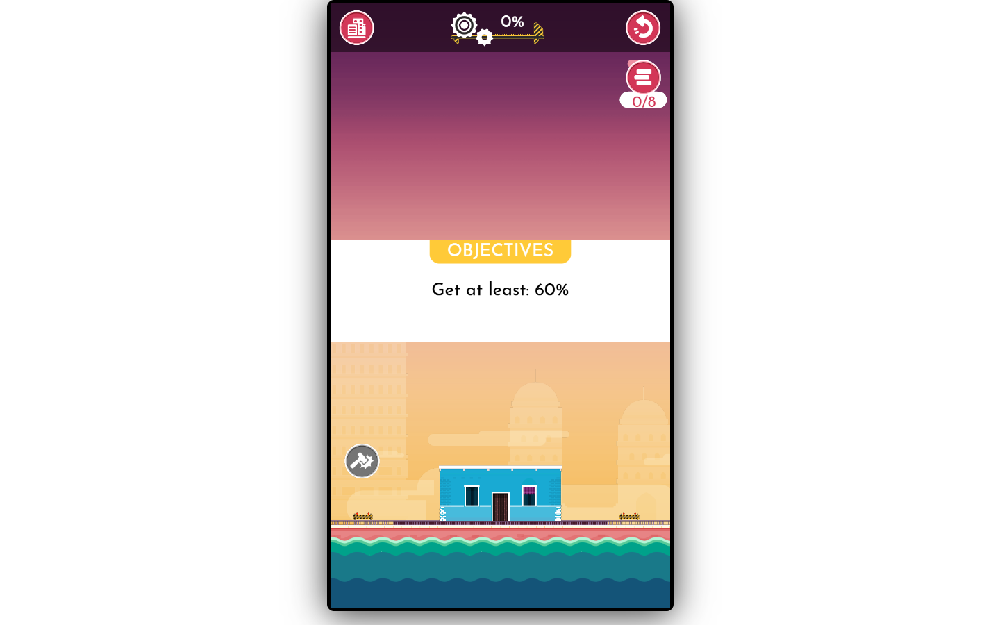
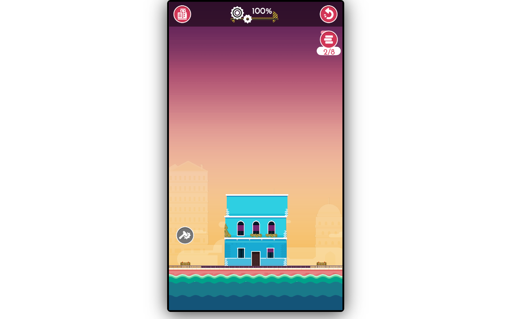

# Urban Stack / 城市叠楼 游戏规格说明书

格式版本：V5.1

仅记录有依据的实现层事实；内容字段非必填，未知留空，不代表不存在或已经验证。

## 1. 基础事实

**维度定义**：让读者第一眼知道“这是什么类型、什么操控体验的游戏”，以及它的技术栈。

**内容说明**

Urban Stack / 城市叠楼，MSN原生9p18nfng0wzt，Gameloft/Ludigames公开原Cocos Creator1.9.0发布物。原2D城市场景与楼层叠建，JavaScript/WebGL，52远端1440×900中原489×870纵向画布。

## 2. 资源类型

**维度定义**：游戏中游戏内容元素的资源类型是什么——即在哪个引擎运行下的资源格式。

**内容说明**

87项运行文件，原引擎/47模块项目脚本、5个序列化资源包、21张纹理/图集、23个MP3、原Spriter SCML/SCON和脚本、2份内嵌粒子图的PLIST、原JosefinSans-Regular字体/字体JSON、13语言脚本、加载图及图标。94项取得的原文件另ZIP和SHA保留；不把未捕获广告SDK当作原包完整。

## 3. 核心挑战维度

**维度定义**：游戏核心玩法主要挑战 / 满足人的什么。

**内容说明**

观察横向移动的悬置楼层与下方已建部分，选择放下时机，提高对齐率，达到楼配置要求并积累人口解锁城市。首次原生教学会将第一活动层移动到中心，本次100%出现在该教学阶段，不能当作自由难度精确操作证明。

## 4. 操控方式

**维度定义**：操控本身的复杂度 + 需要玩家判断的时机 / 策略复杂度。

**内容说明**

原鼠标/触摸一次按下放楼；本次只实际鼠标普通Play、首楼和一次放层。首次与修复后加载各1步，累计5。未操纵坐标、随机数、原处理器、时钟或本地存档。

## 5. 行为路径

**维度定义**：玩家一局里重复做什么。

**内容说明**

累计5步：v1加载发现原内建字体JSON缺失；补齐原字体JSON和TTF后，第2步加载v3，第3步原Play，第4步原城市首座楼，第5步普通点击放下一块楼层。实拍首楼目标至少60%、楼层0/8→1/8→2/8、第一次教学落层后原对齐100%、花窗/墙体与下一块楼层，未调用业务处理器或写进度。

## 6. 游戏路径（关键节点 + 流失风险）

**维度定义**：从开始到结束的流程 + 每个关键节点的潜在流失风险点。

**内容说明**

原菜单→城市地图→首楼目标至少60%→底层自动落地→原教学提示越准确人口越多→普通一次落层和100%/2/8。5步累计额度已满。未完成8层整楼、人口收益、城市解锁、后续20项楼配置、失误/重试/撤销、设置、存档刷新或触屏/听音验证。68请求/68同源200，0外联/失败/脚本error；保留原document.write异步警告和AudioContext手势前警告。

## 7. 成长路径

**维度定义**：玩家如何推进变强。

**内容说明**

原Global读取本地教程/人口/建筑状态与城市解锁，原i18n存语言。直接入口使用原代码默认urbanStack存储命名空间，不填造玩家身份/奖励。首次放层按原代码持久化教程结束，本轮没有刷新实证恢复。

## 8. 核心闭环（目标-规则-反馈-激励）

**维度定义**：游戏是否具备“明确目标 → 明确规则 → 达成反馈 → 奖励激励 → 下一目标”的完整闭环。

**内容说明**

选择可用建筑→读该楼对齐/时限目标→观察原横向楼层→一次按下落层→原碰撞/对齐/人口评估→后续楼层/结算→城市与建筑解锁。本轮只证实一次教学放层，后续完整闭环仅保留原代码。

## 9. 玩法规则

**维度定义**：核心循环、玩法规则、目标与进度。

**内容说明**

原Tower与Global整模块未改；楼层原触摸只在moveState1时开始落下，停止横移并保留原碰撞/目标判定。原percentToPerfect90、losePercent50、numPerfectToUndo5等定义保持，实际场景序列化值优先。首楼HUD目标60%、8层；本次2/8未达整楼目标。

## 10. 数值配置

**维度定义**：影响玩法的关键数值。

**内容说明**

原3个场景Main_Menu/game/TyCoon、5资源包、47项目模块；本次累计5输入，最后68请求/68个200、0外联/失败/error、2条原警告，楼层0/8→1/8→2/8、对齐0%→100%。纯处理/等待/Token/费用未知，不填零。

## 11. 关卡配置

**维度定义**：关卡结构、递进规律、难度曲线。

**内容说明**

原Global序列化levelDesign含20项配置，floorSpeed保留各楼速度序列；3原场景全保留。城市地图本次实见首楼0%及后续锁楼人口12、27；进入首楼目标60%/8层，仅完成一次教学落层。配置数量不是通关数量。

## 12. 系统设计

**维度定义**：功能系统清单、UI 流程。

**内容说明**

去除外层两层广告/宿主iframe和Ludi/MSStart接入；实际移除广告判断、调用/等待和遥测消费者、外部更多游戏导航处理器，原更多游戏节点保持隐藏。广告条件分支取原非广告路径；原楼层倒计时保留非广告计时，不造SDK、广告成功或奖励。Global/Tower/Towers/Interactive/EventManager/SoundManager/i18n整模块字节保持，floor模块只将原enableADS三元式取原非广告分支，其余物理、放层、碰撞、完美判定、重力、难度与教程保持。 原Spriter、图集、粒子、云/背景、城市缩放/滚动、人口/成就、声音、语言、设置和本地存档代码保留；界面未操作的系统不当成运行验证。

## 13. 主题化包装

**维度定义**：游戏的题材 / 世界观包装。

**内容说明**

原粉紫/青绿渐变天空、运河小舟/起重机、复古多彩城楼、白色施工告示牌、黄色警戒条、青色门窗墙体、对齐齿轮条和层数HUD。插图均为本次真实原游戏截图，未换皮或仿造素材。

## 14. 养成系统 + 经济系统

**维度定义**：玩家如何成长、经济如何循环。

**内容说明**

原楼层对齐与完美连击影响人口和城市解锁，原城市人口与成就保留。广告门禁/广告等待退役，不代发货币、人口、皮肤或广告奖励；本次人口初始0，未到结算，不能声称已验证收益。

## 15. 角色 / 单位设定

**维度定义**：有哪些角色/单位、各自定位（玩法层面）。

**内容说明**

原城楼/底层/活动楼层、门窗装饰、吊台与起重机、云和城市背景、居民头像和成就图。实测底层自动放置、一次活动层落下、完工装饰出现和下一活动层；未检验全部楼形/全部动画。

## 16. 商业化

**维度定义**：靠什么变现。

**内容说明**

单机交付无广告、线上身份、支付、服务器排行榜或联机；原消费端实际移除，不使用SDK占位、假广告回调、伪付款或服务端响应。原本地人口/成就/建筑进度逻辑保持。

图 1：原首楼目标至少60%/8层

图 2：原教学普通放层后100%和2/8
