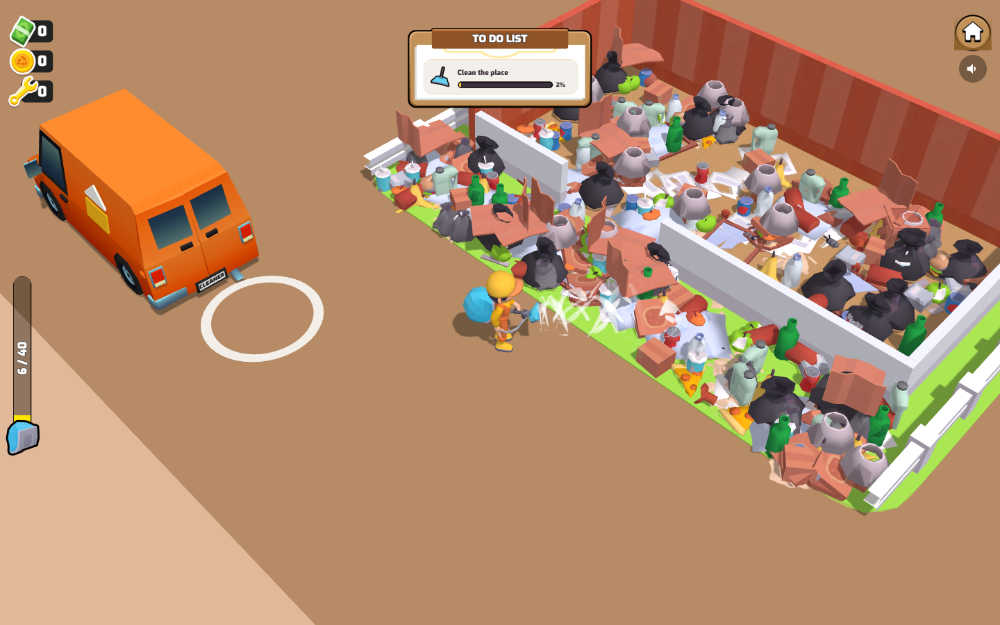
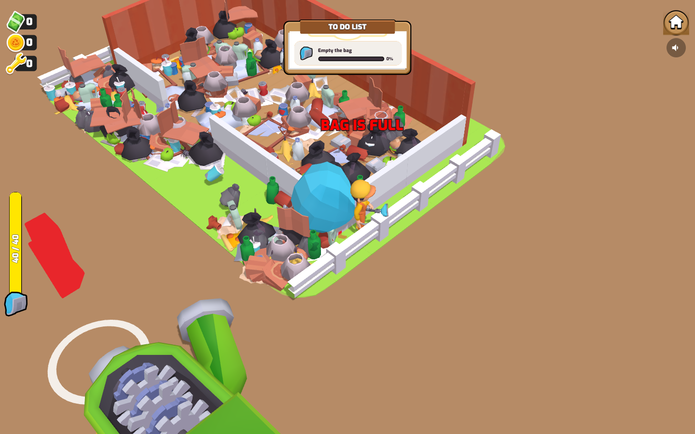

# Clean House / 清洁房屋 游戏规格说明书

格式版本：V5.1

仅记录有依据的实现层事实；内容字段非必填，未知留空，不代表不存在或已经验证。

## 1. 基础事实

**维度定义**：让读者第一眼知道“这是什么类型、什么操控体验的游戏”，以及它的技术栈。

**内容说明**

Clean House / 清洁房屋，MSN原生9p30f5xv9vf2，公开v23入口，原构建0.2.7/38 tornado-fix。JavaScript ES模块、Three.js/WebGL斜俯视3D，角色跟随相机。本次52远端1440×900单画布。

## 2. 资源类型

**维度定义**：游戏中游戏内容元素的资源类型是什么——即在哪个引擎运行下的资源格式。

**内容说明**

522项运行文件，含209个GLB、原材质与关卡/预制件/UI JSON、WebP贴图和界面图、17段MP3、Exo-Black.ttf、CSS、ES模块和SVG图标。GLB清单49项外置纹理均齐备，200处原内嵌图片提取为1个同源PNG。524项取得的原始文件与SHA单独ZIP保留，不包含未下载的外部SDK实现。

## 3. 核心挑战维度

**维度定义**：游戏核心玩法主要挑战 / 满足人的什么。

**内容说明**

移动吸尘角色清理场地，在垃圾袋容量、重物等级和地形约束下选择路线；原流程要求清洁、清空垃圾、拾取收入、升级和放置家具，推进下个房间/场景。实测到40/40满袋与清洁13%，后续回收和布置仅代码确认。

## 4. 操控方式

**维度定义**：操控本身的复杂度 + 需要玩家判断的时机 / 策略复杂度。

**内容说明**

原WASD/方向键与拖拽摇杆；只真实使用Right2500ms、Left1300ms、Right5000ms三次连续按键。两次加载均计入5步。没有调用原业务方法、设坐标/财富、修改时间/随机数或读取隐藏状态来选路。

## 5. 行为路径

**维度定义**：玩家一局里重复做什么。

**内容说明**

累计5步：第1步加载v1，真实发现GLTF内嵌图片被预览响应安全策略拦截；保留失败证据后，将原图片逐字节提取为同源文件。第2步加载v2，第3步普通Right保持2500ms，第4步Left保持1300ms，第5步Right保持5000ms。原角色和相机移动、吸尘效果、垃圾消失、垃圾袋0→6→9→40/40、清洁进度0→2→3→13%、原BAG IS FULL和Empty the bag任务均已查看截图。货币三项仍为0，未伪造收益。

## 6. 游戏路径（关键节点 + 流失风险）

**维度定义**：从开始到结束的流程 + 每个关键节点的潜在流失风险点。

**内容说明**

原启动/加载→本地文档→初始清洁场景与按键提示→真实移动/吸尘→容量上限和清空袋子任务；后续原回收机、现金、升级、家具箱/房间与过关路径代码保留。5步累计额度已满，不再追加输入。未完成回收、货币到账、升级、家具布置、首关通关、全部关卡、刷新恢复、移动端或听音验证。最终原浏览器379请求/379个200响应、0外联和0脚本error，但有19条同源GLB请求ERR_ABORTED；19个精确URL已独立HTTP200读回且SHA一致，中止原因未归类，原始失败事件未删除，不能称零网络失败或全模型动作均已验证。

## 7. 成长路径

**维度定义**：玩家如何推进变强。

**内容说明**

原upgrades、levelState/levelStep、collectedList、皮肤选择、地图进度和设置结构保留。原Ii.save在未完成教程时只持久化设置，此行为保持，不声称本次13%进度已可刷新恢复。

## 8. 核心闭环（目标-规则-反馈-激励）

**维度定义**：游戏是否具备“明确目标 → 明确规则 → 达成反馈 → 奖励激励 → 下一目标”的完整闭环。

**内容说明**

观察可清理垃圾→角色移动使原吸尘范围命中→原垃圾回收/堆叠与袋子增长→满袋提示引导清空→原回收处理/金币与升级→家具布置/下关。真实验证到满袋反馈；后半闭环未在5步内执行。

## 9. 玩法规则

**维度定义**：核心循环、玩法规则、目标与进度。

**内容说明**

原Yi玩家/吸尘、Pi碰撞、Li输入、Pa任务和Ue关卡全部方法规范AST保持。原maxStack100、minimumRoomClean0.97、vacuumSpeed6，角色基础Speed6、清洁移动2.5；Capacity初值40且本次40/40真实停止继续吸取。未改碰撞、吸尘阈值、垃圾价值、随机生成或过关条件。

## 10. 数值配置

**维度定义**：影响玩法的关键数值。

**内容说明**

累计5输入，交付v2四输入；本次容量0/40→6/40→9/40→40/40，清洁0%→2%→3%→13%，三种HUD货币均0。最终379请求/379个200响应、19 ERR_ABORTED原样记录、0外联/脚本error、3条原Three.js弃用/阴影降级warning。19个中止模型精确HTTP读回均与运行清单SHA一致。

## 11. 关卡配置

**维度定义**：关卡结构、递进规律、难度曲线。

**内容说明**

原data.json声明L00至L08共9个关卡配置；4种城市biome按原levelCountPerBiome3切换，级别索引按原逻辑循环。209个模型清单全量GLB2结构通过，非URI JSON值和BIN块不变。本次只进入L00并清洁13%，不将9份配置或4城市当作已通关。

## 12. 系统设计

**维度定义**：功能系统清单、UI 流程。

**内容说明**

物理移除OneSDK查找/生命周期/身份与遥测、平台购买/存储接入、奖励券账本、广告服务对象、视频与假广告倍奖回调/按钮绑定和广告专属弹窗；禁用广告专属boost拾取，不替用户发免费收益。原存档文档v/data/parts及迁移逻辑改为真实localStorage，浏览器原设备探测和页面可见性暂停保留。普通回收/现金拾取、正常升级扣款和付费皮肤的本地货币交易逻辑保留。189个GLB仅将200处内嵌PNG URI改为同源哈希文件，所有其余JSON值和二进制块一致；200处为同一张原PNG，不造替代贴图，不修改全局安全策略。 原固定步长1/60、帧增量上限0.1、动态渲染/阴影降级、WebGL模型/骨骼、原HUD/任务/满袋箭头/文字和相机跟随保留。输入、存档和资源的静态检查不能替代全部游戏行为验收。

## 13. 主题化包装

**维度定义**：游戏的题材 / 世界观包装。

**内容说明**

原橙色清洁工、蓝色垃圾袋/吸尘器、橙色面包车、彩色房屋/矮墙/草地、瓶罐纸箱和垃圾袋、绿色回收机、白色吸尘线与满袋红字/箭头，原HUD与图片字体。所有插图为本包真实运行截图；未换皮或替换资源风格。

## 14. 养成系统 + 经济系统

**维度定义**：玩家如何成长、经济如何循环。

**内容说明**

原Recycled/Soft/SpecialObject/Hard本地货币结构。Capacity/Range/Speed首次价格10且使用Recycled，Power使用SpecialObject且首价1；Capacity/Power最大19级、Range/Speed最大9级。普通本地货币扣款/升级和皮肤购买保留，广告奖励及模拟广告首次免费倍奖移除。本次未产生收入或购买，不宣称经济闭环实测通过。

## 15. 角色 / 单位设定

**维度定义**：有哪些角色/单位、各自定位（玩法层面）。

**内容说明**

原玩家角色及多个角色/吸尘器皮肤、轻/重垃圾、家具箱、回收与升级交互物。玩家移动和吸尘、袋子膨胀实测；其余角色皮肤、回收动画和家具过程未在本次操作。

## 16. 商业化

**维度定义**：靠什么变现。

**内容说明**

交付单机版不接广告、充值、平台支付、身份、线上排行或联机；原正常本地货币皮肤/能力购买保持。没有伪造SDK、广告播放成功、付款成功、云存档身份或赠送替身奖励。

图 1：原生移动吸尘，6/40与清洁2%

图 2：原40/40满袋、13%清洁与清空袋子任务
