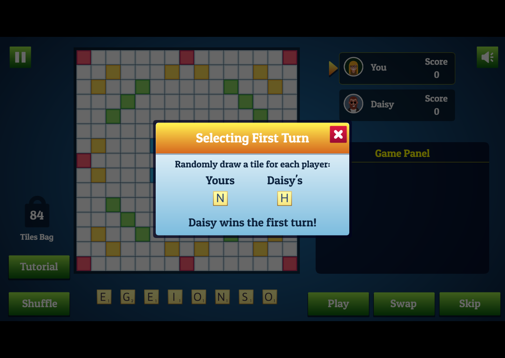
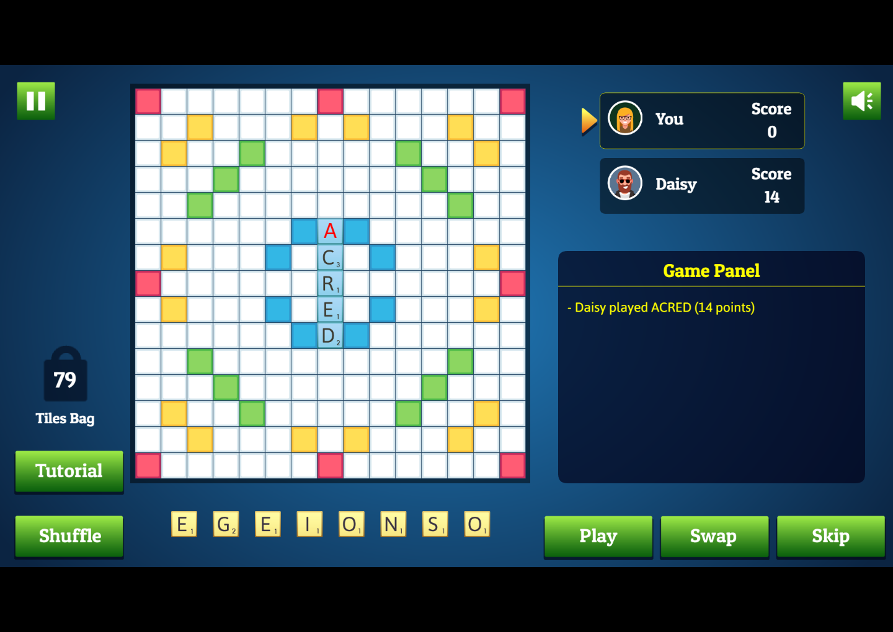
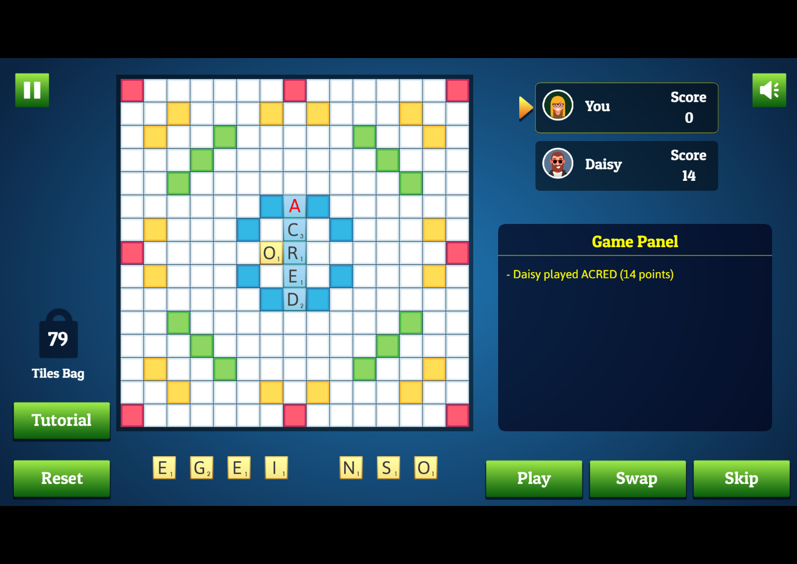
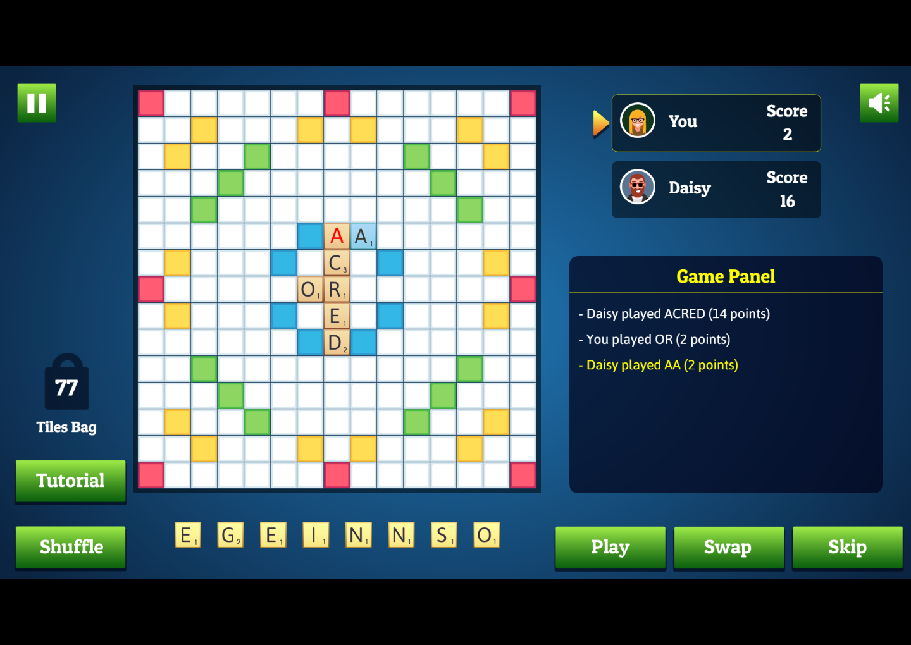

# Wordmeister 游戏规格说明书

格式版本：V5.1

仅记录有依据的实现层事实；内容字段非必填，未知留空，不代表不存在或已经验证。

## 1. 基础事实

**维度定义**：让读者第一眼知道“这是什么类型、什么操控体验的游戏”，以及它的技术栈。

**内容说明**

MSN9n48sfvb0c4f，原Wordmeister v14；ImpactJS/Canvas2D、JavaScript/HTML/CSS，原横向2D棋盘。实测viewport1440×1020，原1920×1080画布显示为1440×810并上下留黑；实体手机未测。

## 2. 资源类型

**维度定义**：游戏中游戏内容元素的资源类型是什么——即在哪个引擎运行下的资源格式。

**内容说明**

保留原2张PNG图集及内嵌JSON的50frame，原牌/棋盘/人物/按钮与背景；3原字体montserrat/patuaone-regular/asap-regular的woff2/woff/ttf，9原MP3音频、2原品牌图、favicon/方向图/封面/CSS/gif。最终30基础运行文件中28依赖/素材保持原字节；JS只按服务范围修订，HTML为离线入口。

## 3. 核心挑战维度

**维度定义**：游戏核心玩法主要挑战 / 满足人的什么。

**内容说明**

在15×15棋盘用自己的可见字母牌组成合法英文词，与本地CPU轮流落字；利用原字母分值和棋盘加成，并通过已有词连接获得分数。

## 4. 操控方式

**维度定义**：操控本身的复杂度 + 需要玩家判断的时机 / 策略复杂度。

**内容说明**

普通点击菜单/默认头像/Play/关闭先手抽签窗，拖拽手牌到棋盘后点Play提交。原Shuffle、Reset、Swap、Skip、Pause、声音和教程入口保留，本轮只操作原设置、一次落牌和提交；未验证其他按钮。

## 5. 行为路径

**维度定义**：玩家一局里重复做什么。

**内容说明**

原菜单→Play→选择默认头像→教程页普通Play跳过→随机先手→关闭抽签窗→原本地CPU出词→拖手牌O至已有R左侧→Play提交→计分/补牌/CPU续走。所有节点来自原按钮和正常输入。

## 6. 游戏路径（关键节点 + 流失风险）

**维度定义**：从开始到结束的流程 + 每个关键节点的潜在流失风险点。

**内容说明**

原抽签N对H，Daisy先手；CPU正常ACRED获14分→玩家OR获2分→CPU正常AA获2分、累计16→原黄色指示回到玩家。没有强制人类先手、替换抽牌或伪造对手。

## 7. 成长路径

**维度定义**：玩家如何推进变强。

**内容说明**

原单局围绕剩余字母袋、双方分数与既有词继续进行，原结束/排名规则保留。本轮字母袋显示84→79→77，未耗尽牌袋或触发结束，不提供通关关数。

## 8. 核心闭环（目标-规则-反馈-激励）

**维度定义**：游戏是否具备“明确目标 → 明确规则 → 达成反馈 → 奖励激励 → 下一目标”的完整闭环。

**内容说明**

观察手牌与现有词→拖牌形成相连合法词→普通提交→原词库/空间/连接判定→原加成计分与补牌→原CPU本地搜索并落字→回到玩家继续。本轮实际OR2分并补牌、CPU再走AA。

## 9. 玩法规则

**维度定义**：核心循环、玩法规则、目标与进度。

**内容说明**

沿用原15×15棋盘、8张人类手牌、原字母分值/格加成，词库按词长索引在包内。原EntityLetter负责拖放/边界/占格，EntityPlayBtn负责方向/连接/词有效性及得分，原CPU使用同一词库运算。普通换牌继续消耗原回合，广告奖励5次免费换牌的提供者/按钮/回调已删除，不授予免费次数。

## 10. 数值配置

**维度定义**：影响玩法的关键数值。

**内容说明**

代码确认15×15棋盘、8张人类手牌、原字母牌格56×56内部像素。实际抽签N/H；CPU ACRED14，人类O1+已有R1构成OR计2，CPU AA再加2至16；可见占格5→6→7，最终牌袋77。未测高分组合/空白牌/终局。

## 11. 关卡配置

**维度定义**：关卡结构、递进规律、难度曲线。

**内容说明**

原单局棋盘色格/字母袋和本地词库均归一AST相同；原随机抽牌/CPU头像/先手保持。词库模块3,658,407字节的分析文件仅用于追溯，不把文件大小当词数，也不声称所有单词已试玩。

## 12. 系统设计

**维度定义**：功能系统清单、UI 流程。

**内容说明**

原Impact框架/图集Packer/Image与Animation注入器、字母拖放/棋盘/词库/CPU/计分/换牌/本地IO保留。334游戏及FontInfo方法中290归一AST相同、29服务方法删除、15服务范围修改。归一仅去位置/原字面量格式，并按同操作符&&或||保留操作数顺序消除生成器冗余括号差异，不混合运算符或改布尔值。原字典、Packer、棋盘/牌袋数据保持；不造SDK。

## 13. 主题化包装

**维度定义**：游戏的题材 / 世界观包装。

**内容说明**

原深蓝背景、木色字母牌、彩色倍数格、绿色按钮、卡通人物头像、白黄记分与Game Panel出词日志；原2张品牌图保留。实际棋盘与OR/ACRED/AA和2/16分显示，未使用占位素材。

## 14. 养成系统 + 经济系统

**维度定义**：玩家如何成长、经济如何循环。

**内容说明**

原单局牌袋/分数和本地声音等IO保留；实际补入新N牌、牌袋变77。未刷新，不能称存档或断线恢复已验证。无新增货币、现金支付、免费换牌或广告权益。

## 15. 角色 / 单位设定

**维度定义**：有哪些角色/单位、各自定位（玩法层面）。

**内容说明**

原本地8个卡通头像与内置Rob/Luke/Eric/Tony/Daisy/Jane/Sarah/Hana名字池，原CPU随机挑选不同索引；Daisy是本地算法角色，不是在线匹配玩家或账号。本轮未读取其暗牌。

## 16. 商业化

**维度定义**：靠什么变现。

**内容说明**

Microsoft/CPMStar/GA/API迁移、广告控制器/激励免费换牌、在线报分、分享/更多游戏/外链提供者及真实调用/按钮退役。普通换牌回合规则保留，未伪造广告成功/奖励。仅静态HTTP，不依赖业务服务器；本轮全请求本地，非全局系统/全部功能覆盖。

图 1：原菜单，修复仅增加原品牌图

图 2：原随机N/H，Daisy获得先手

图 3：本地CPU正常出ACRED，14分

图 4：普通拖O至可见R左侧，未提交

图 5：原OR2分、CPU续AA至16分，回到人类
