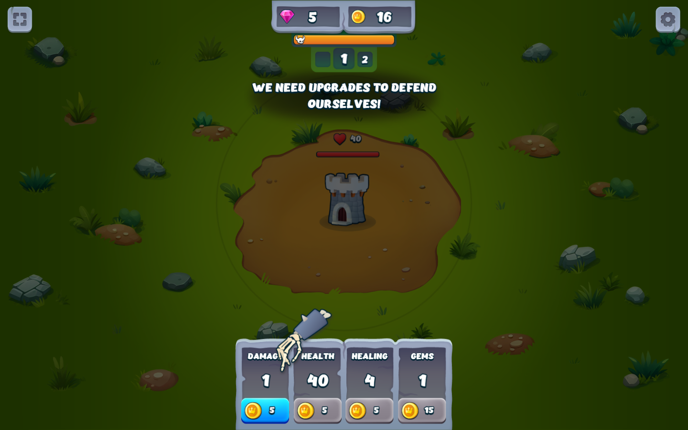
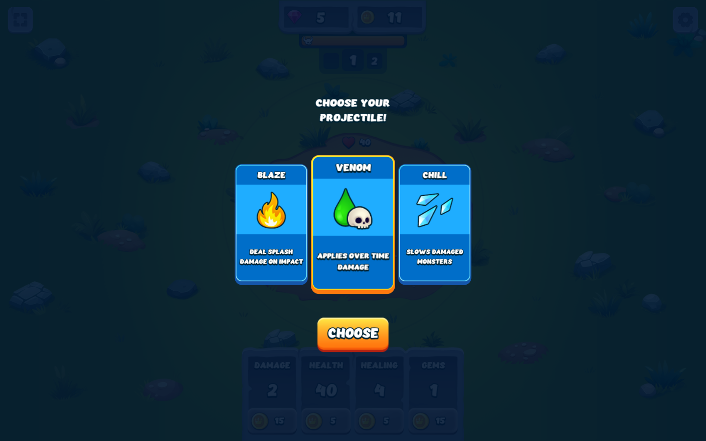
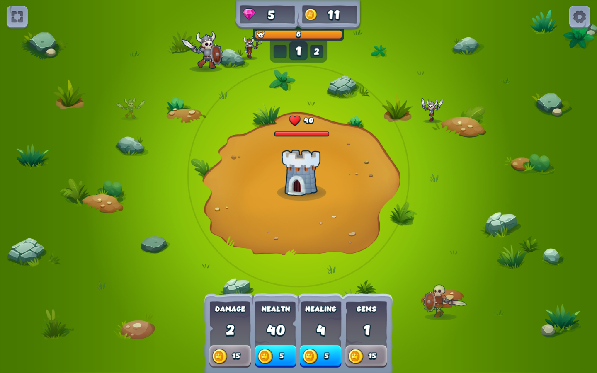
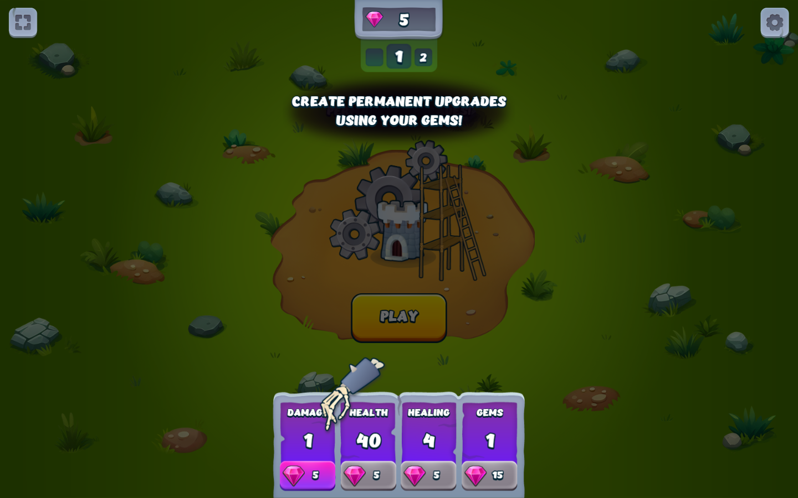

# Tower Defenders / 高塔守卫 游戏规格说明书

格式版本：V5.1

仅记录有依据的实现层事实；内容字段非必填，未知留空，不代表不存在或已经验证。

## 1. 基础事实

**维度定义**：让读者第一眼知道“这是什么类型、什么操控体验的游戏”，以及它的技术栈。

**内容说明**

Tower Defenders / 高塔守卫，MSN原生项目9n8tv164mxzf，Inlogic Games 2024，原BuildVersion1.0.0/17.04.2024 10:00。Phaser JavaScript HTML5 Web游戏，俯视卡通2D单塔防守与成长。公开原发布物v47，实际远端1440×900桌面鼠标试玩。

## 2. 资源类型

**维度定义**：游戏中游戏内容元素的资源类型是什么——即在哪个引擎运行下的资源格式。

**内容说明**

120个运行文件：原Phaser及游戏合并JS、原rex虚拟摇杆插件、HTML、9对PNG/JSON图集、地图/Logo/旋转提示/图标图片、gamefont.ttf、m.isr七语言XML和原OGG/MP3音乐音效。118原始静态资源逐SHA核对；图集按原load.atlas显式PNG路径配对，不按某些旧meta.image文件名误造资源。

## 3. 核心挑战维度

**维度定义**：游戏核心玩法主要挑战 / 满足人的什么。

**内容说明**

保护中央塔，观察四周敌人接近方向和血量，按原指针瞄准补充射击、利用塔的原生自动射击，并以金币升级、弹种与卡牌组合延续生存。挑战兼有操作、升级策略和局内/永久资源分配。本轮普通瞄准按住后教程敌人消失且金币15→16，再原价升级伤害1→2。

## 4. 操控方式

**维度定义**：操控本身的复杂度 + 需要玩家判断的时机 / 策略复杂度。

**内容说明**

原指针按下生成瞄准点并开启额外射击，按住移动调整瞄准位置，释放销毁瞄准点；塔自动射击保持原条件。普通点击升级按钮，卡牌点击选择、CHOOSE确认。首次载入与浏览器刷新各算1步；实际900ms为一次连续按下/释放，没有调用原handler或修改状态/存储。触屏/摇杆代码保留但未实测。

## 5. 行为路径

**维度定义**：玩家一局里重复做什么。

**内容说明**

累计5步：载入原教程→普通鼠标在敌人处按住900ms释放，教程敌人1→0、金币15→16→原伤害升级花费5，金币16→11、伤害1→2→点击原CHOOSE确认默认高亮VENOM，进入正常6敌战斗→浏览器刷新，加载到原永久升级教学。全部5张截图已逐张打开核对，浏览器正常关闭exit0且实际PID不存在。

## 6. 游戏路径（关键节点 + 流失风险）

**维度定义**：从开始到结束的流程 + 每个关键节点的潜在流失风险点。

**内容说明**

首次自动教程介绍→教程单敌瞄准→伤害升级引导→三种弹种选择→正常敌人波次→原波次胜负/局内升级→永久升级/再次开始。实际第5步刷新进入CREATE PERMANENT UPGRADES USING YOUR GEMS界面；没有继续点击永久升级或PLAY，不声称完成全部教程。

## 7. 成长路径

**维度定义**：玩家如何推进变强。

**内容说明**

原波次计数、敌人参数增长、两波间随机卡牌、三种基础弹种、塔经验/级别与永久升级保留。原存档使用真实浏览器localStorage的inl-mini-td，DataVersion1，保存局内/永久参数与教程步骤，加载先原Reset再读原字段；未注入存档或跳教程。刷新进入原步骤8永久升级教学，不当作新开局或原伤害2持久显示。

## 8. 核心闭环（目标-规则-反馈-激励）

**维度定义**：游戏是否具备“明确目标 → 明确规则 → 达成反馈 → 奖励激励 → 下一目标”的完整闭环。

**内容说明**

目标：在敌人接触中央塔造成伤害前清除敌人并继续成长。行动：按原规则瞄准射击、支付金币升级、选择弹种/卡牌。反馈：教程敌人消失、金币增加、升级扣费与伤害2、VENOM/BLAZE/CHILL卡片、6名不同敌人从周边出现。下一目标为正常波次生存和后续卡牌/永久升级；实际未验证全部后续流程。

## 9. 玩法规则

**维度定义**：核心循环、玩法规则、目标与进度。

**内容说明**

保留原射速冷却、射程、弹丸碰撞、敌人生成/移动/类型/血量/接触伤害、金币收集、宝石随机掉落、选卡限制和升级价格。第一次教程敌人为0.5生命，实际升级后HUD伤害2；选择中间默认VENOM后正常波次启动。广告奖励路径已移除，普通击杀/掉落与花费不改，未免费给币或宝石。

## 10. 数值配置

**维度定义**：影响玩法的关键数值。

**内容说明**

原初始金币15、宝石5、塔生命40、伤害1、治疗4；伤害首次5金币，升级后伤害2、下次价格15。原波次1-4敌人6/7/8/9，后续min(ceil(10+(wave-1)*0.5),50)；普通生成随机0至0.5秒。实际教程1敌→0、金币15→16→11，确认弹种后观察6敌，刷新显示5宝石和永久基础伤害1。

## 11. 关卡配置

**维度定义**：关卡结构、递进规律、难度曲线。

**内容说明**

原非固定关卡清单式波次，保留波次敌人数、类型概率、基础数值成长、Boss与普通/攻击/快速敌人的参数、原塔/地图/图集动画和卡牌配置。教程最初单敌与正常第1波6敌均保留。完整原配置交付不等于逐波通过，全部后期波次/卡牌效果与终局未实测。

## 12. 系统设计

**维度定义**：功能系统清单、UI 流程。

**内容说明**

物理移除InLogic广告/奖励广告/统计身份提供方、MSStart SDK及广告横幅/插屏/奖励回调、PWA服务工作者和广告弹窗轮询。原奖励广告按钮/构造/更新/显示和金币奖励回调完全退役，不伪造SDK成功或发奖。普通startWave只从原非奖励广告生命周期提取原this._startWave()继续执行。原320个Phaser类方法保留313个，其中299个AST完全一致，7个移除方法均为广告奖励；另14个方法仅去服务消费者或保留普通继续逻辑。原Phaser引擎字节前缀、教程、经济、随机、保存与战斗规则保持。 原ScenePreload、SceneMenu、Tower/Zombie、箭矢/金币/宝石、升级/卡牌、音频/全屏/语言和localStorage保存均按原逻辑。CSP限制同源静态加载；实际159请求均同源200，0外部/失败/脚本错误。

## 13. 主题化包装

**维度定义**：游戏的题材 / 世界观包装。

**内容说明**

原卡通绿色草地/中央石塔/骷髅维京敌人、弓箭/毒火冰弹种、金币/宝石、卡牌和教程手势；不替换原美术/音乐/字体，不生成简化替代游戏。三种弹种分别为BLAZE范围伤害、VENOM持续伤害、CHILL减速，后两种效果未分别实玩对照。

## 14. 养成系统 + 经济系统

**维度定义**：玩家如何成长、经济如何循环。

**内容说明**

局内金币用于伤害/生命/治疗/宝石相关原升级；宝石用于原永久升级。原花费/价格增长/保存与失败结算保留。实际先击杀赚1，再花5买伤害，未改资源数。刷新显示原永久升级费用5/5/5/15宝石；未购买，不能宣称支付或效果已验证。所有看广告领奖入口退役，无广告补偿。

## 15. 角色 / 单位设定

**维度定义**：有哪些角色/单位、各自定位（玩法层面）。

**内容说明**

原中央塔、原骷髅维京普通/攻击/快速/Boss类型和对应图集、箭矢/火毒冰弹种、金币/宝石和原升级卡。实际画面有剑盾骷髅及不同体型敌人，6敌正常波次出现；Boss及全部卡牌/技能保留源码与资源但未逐个实测。没有新增虚构角色或调整原掉落。

## 16. 商业化

**维度定义**：靠什么变现。

**内容说明**

物理移除InLogic广告/奖励广告/统计身份提供方、MSStart SDK及广告横幅/插屏/奖励回调、PWA服务工作者和广告弹窗轮询。原奖励广告按钮/构造/更新/显示和金币奖励回调完全退役，不伪造SDK成功或发奖。普通startWave只从原非奖励广告生命周期提取原this._startWave()继续执行。原320个Phaser类方法保留313个，其中299个AST完全一致，7个移除方法均为广告奖励；另14个方法仅去服务消费者或保留普通继续逻辑。原Phaser引擎字节前缀、教程、经济、随机、保存与战斗规则保持。 不依赖登录、云存档、支付、排名或多人服务器；原单人战斗及真实本地存档保留。保留16条Canvas读回性能/首次手势前音频限制警告，未做人工听音证明。仅证明教程敌人击倒、原价伤害升级、弹种选择/正常波次启动和刷新加载。第四步后至刷新间原游戏继续自然运行，未拍完整胜负过程；不宣称打通第1波、所有波次、永久升级购买、技能、暂停设置、触屏或全部教程完成。刷新画面显示永久升级基础伤害1，不宣称局内伤害2仍显示或22.25金币可见；22.25只为只读内部Money值，画面此时仅显示5宝石。

图 1：普通射击后教程敌人消失、金币16

图 2：花5金币后伤害2及原弹种选择

图 3：确认弹种后正常6敌波次

图 4：第5步刷新后永久升级教学
