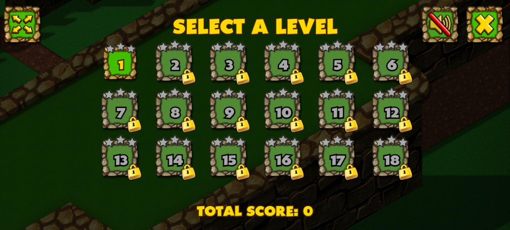
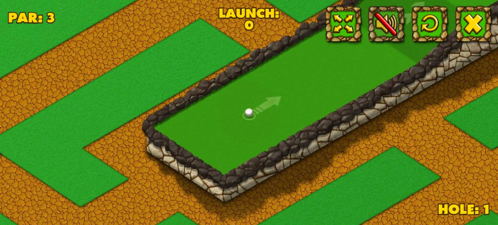
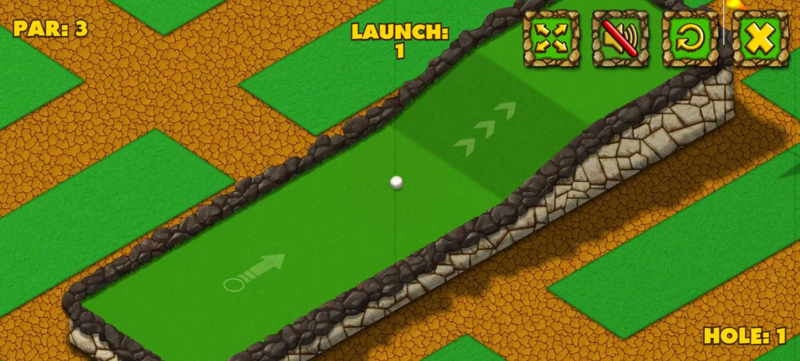

# Minigolf World 游戏规格说明书

格式版本：V5.1

仅记录有依据的实现层事实；字段非必填。空白表示代码未披露或未登记，不代表不存在、不可玩或验收通过。

## 1. 基础事实

**维度定义**：游戏类型、操控体验和技术栈。

**内容说明**

- 游戏名称：Minigolf World

**玩法类型**

体育 / 迷你高尔夫

**操作方式**

本轮鼠标点击、单次按住球拖拽并释放；原教程还有拖拽平移视野。触摸实现保留但未测试。

**视角与布局**

等距球场与跟球镜头

**画面维度**

2.5D

**引擎**

原CreateJS Canvas、THREE FBX解析、CANNON刚体和Howler；发布JavaScript。

**程序语言**

JavaScript、HTML、CSS

## 2. 资源类型

**维度定义**：内容元素类别及其引擎资源格式。

**内容说明**

**内容元素资源类型**

PNG/JPG、原字体、MP3、18份原FBX文本模型和324块球场背景切片。

## 3. 核心挑战维度

**维度定义**：核心玩法所涉及的挑战类型及主次。

**内容说明**

## 4. 操控方式

**维度定义**：输入方式、输入元素和操控构成。

**内容说明**

**操作方式**

本轮鼠标点击、单次按住球拖拽并释放；原教程还有拖拽平移视野。触摸实现保留但未测试。

## 5. 行为路径

**维度定义**：玩家在一次核心循环中重复执行的动作顺序。

**内容说明**

**核心玩法**

点击球并拖拽设定方向与力度，释放后依原刚体物理在球场运动；尽少击球让球入洞。

**结论字段**

- `core_loop` = 观察球洞和障碍→原方向/力度拖拽→球运动与镜头跟随→击球数反馈→再次击球直至入洞。仅一次击球实际验证。

## 6. 游戏路径（关键节点 + 流失风险）

**维度定义**：从启动到结束的流程节点及已披露的风险。

**内容说明**

**游戏流程**

首页→18洞选择（初始仅第1洞解锁）→原两段教程→击球与HUD；后续按原存档解锁，不注入解锁。

## 7. 成长路径

**维度定义**：玩家推进和变强的途径。

**内容说明**

## 8. 核心闭环（目标-规则-反馈-激励）

**维度定义**：目标、规则、反馈、激励和下一目标。

**内容说明**

**目标规则反馈激励闭环**

目标入洞；原碰撞、沙/水/球洞传感器及判定保留。实际原LAUNCH从0增至1、球离开初始标记、镜头跟随，未观察进洞或胜利。

## 9. 玩法规则

**维度定义**：核心循环、操作、胜负和结算规则。

**内容说明**

**目标、规则与结算数值**

原每洞PAR为[3,3,4,5,4,5,5,5,6,5,5,6,7,8,6,10,7,7]；PAR基分5000、每杆差值1000、最大击球力度152均沿用原入口配置；公式及判定源码保留，未逐洞结算测试。

**已验证流程与未覆盖范围**

按预先计划完成5个有界验证检查点：首页并单击播放→第1洞→关闭击球教程→一次瞄准拖拽→关闭平移教程并观察原生击球。LAUNCH由0变1，球沿原场景运动、镜头跟随。未验证进洞、关卡结算、后17洞、再次击球、重开与刷新存档。 首页记录329条完整CDP事件；球场后台预取全部18洞时缓冲区截断，保留该窗口最后1000条，不能声称启动全过程网络记录完整。后续教程、瞄准、击球窗口记录完整且无新增请求或异常；所有保留事件无外联/HTTP失败，控制台错误/警告为空。另由全量源码静态审查和384项实际原站资源SHA闭包佐证单机依赖，不将截断窗口当完整网络证明。 代码可修改规则/物理参数并拆解球、场景和存档模块；FBX旧解析器存在未运行的旧格式分支引用，现用18模型为7400/7500，首洞实际解析成功，不声称所有分支可复用。

## 10. 数值配置

**维度定义**：影响玩法的生命、概率、时长、速度和经济等数值。

**内容说明**

**结论字段**

- `key_numbers` = 18洞；每洞18块背景图，共324块；18个实际原FBX文本模型；第1洞PAR3，本轮LAUNCH0→1。

## 11. 关卡配置

**维度定义**：关卡布局、目标、数量、递进和难度参数。

**内容说明**

**内容规模**

完整18洞原场景资源与模型已本地化，384项动态资源闭包全部原站获取并SHA归档。源码资源齐全不代表18洞通关。

**场景、关卡与难度设计**

保留原18洞形状、CANNON边界/沙地/水区/洞传感器和原PAR顺序；未调物理、难度或计分。

## 12. 系统设计

**维度定义**：功能系统及界面流程。

**内容说明**

**玩法系统与相互作用**

原选关、本地成绩/解锁、球物理、方向力度、镜头平移、教程、重开、静音/全屏控件保留；广告、推荐、通知、线上分数退役。

**界面流程与反馈**

原草地/石墙首页→18洞网格→击球和平移教程→PAR/LAUNCH/HOLE HUD。界面图片与原按钮保留；无新增替代游戏界面。

**存档方式**

沿用原CLocalStorage(minigolf_world)本地解锁和各洞成绩。未验证刷新恢复；无平台云存档或服务端成绩调用。

## 13. 主题化包装

**维度定义**：文字、叙事、命名及美术内容。

**内容说明**

**文字与美术内容**

草地、石墙、泥地、洞旗及白色高尔夫球；原等距球场贴图与字体。

### 实际运行图解

图 1：原18洞选择，仅第1洞初始解锁

图 2：原第1洞PAR3与初始球位

图 3：一次原生击球后LAUNCH1与球位/镜头变化

## 14. 养成系统 + 经济系统

**维度定义**：成长要素和资源产出、消耗、回收机制。

**内容说明**

## 15. 角色 / 单位设定

**维度定义**：角色单位的数量、属性、能力、定位和关系。

**内容说明**

## 16. 商业化

**维度定义**：已实现的广告、内购、订阅、买断和付费点。

**内容说明**

**结论字段**

- `monetization` = 单机版移除广告、引流、通知及成绩上传，无真实支付或在线身份；不伪造SDK或奖励结果。
