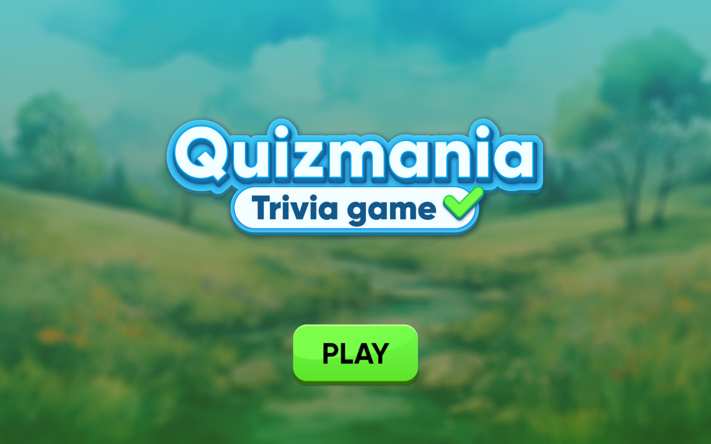
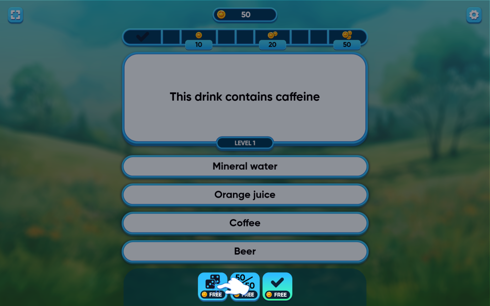
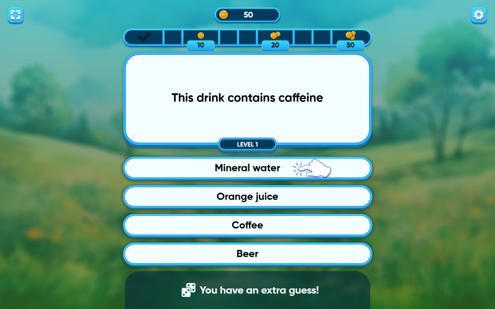
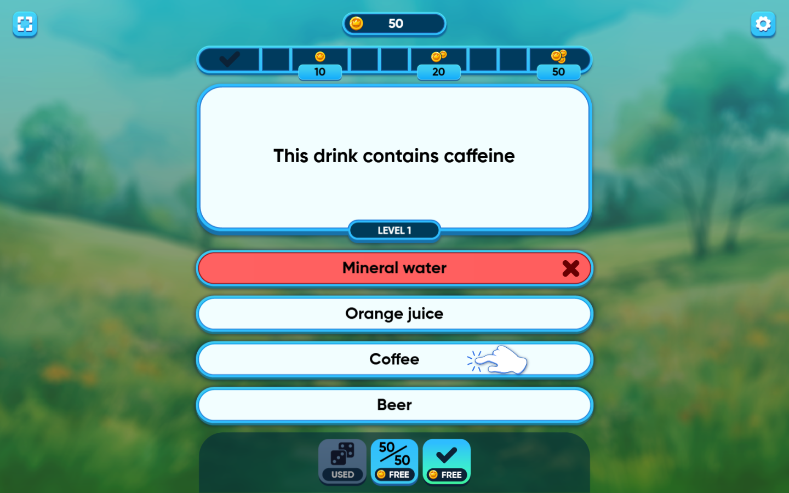
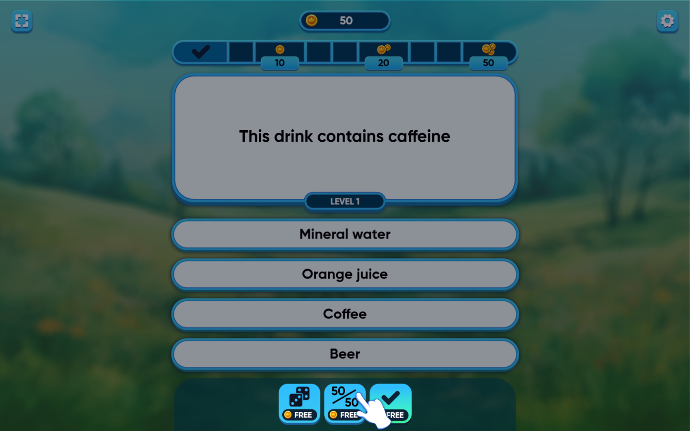

# Quizmania: Trivia Game 游戏规格说明书

格式版本：V5.1

仅记录有依据的实现层事实；内容字段非必填，未知留空，不代表不存在或已经验证。

## 1. 基础事实

**维度定义**：让读者第一眼知道“这是什么类型、什么操控体验的游戏”，以及它的技术栈。

**内容说明**

Quizmania: Trivia Game，MSN原生项目9n3186dfz4hj，Inlogic公开v23入口，GameData.BuildVersion1.0.0/Inlogic Games2024。原Phaser3及RexUI插件、JavaScript/HTML/PNG图集/TTF/JSON/XML/音频。实际同步环境远端52、1440×900 Chromium；开发环境仅静态分析与打包。

## 2. 资源类型

**维度定义**：游戏中游戏内容元素的资源类型是什么——即在哪个引擎运行下的资源格式。

**内容说明**

共47份上游原文件，另有2份本地采集元数据，不冒充上游。移除一份跨站存档迁移脚本后46份运行文件，44份原资源字节完全保留，入口和主脚本作范围明确的退役。完整2,422行题库、每行七语题目/正确答案/四选项保持，七语为EN/DE/ES/FR/IT/BR/RU；另有四组PNG/JSON图集、背景、标题/脑图标、原Gilroy-Bold字体及八组MP3/OGG音频。

## 3. 核心挑战维度

**维度定义**：游戏核心玩法主要挑战 / 满足人的什么。

**内容说明**

阅读常识问题，在四个完整答案中选择正确项，通过连续正确回答推进奖励条；加猜、排除错误项与跳题等原道具影响尝试。此次实际完成首题加猜、错误判断、纠正和进度1；不同于补全字母组合的拼读教学、路径回溯或街景定位。

## 4. 操控方式

**维度定义**：操控本身的复杂度 + 需要玩家判断的时机 / 策略复杂度。

**内容说明**

原鼠标PLAY按抬起进入；道具及答案使用原pointerdown监听。此次正常点击原骰子加猜按钮，再按教学手势点Mineral water、Coffee。未调用submitAnswer/extraGuess等业务方法，也未写存档、修改随机数/时间或跳过原教学。触屏与键盘未实测。

## 5. 行为路径

**维度定义**：玩家一局里重复做什么。

**内容说明**

原标题/PLAY→咖啡因四选一题（Mineral water/Orange juice/Coffee/Beer）→原免费加猜启用、显示You have an extra guess!→矿泉水变红叉且禁用→咖啡正确、奖励条进度1→手势移向50/50教学；金币50保持。

## 6. 游戏路径（关键节点 + 流失风险）

**维度定义**：从开始到结束的流程 + 每个关键节点的潜在流失风险点。

**内容说明**

累计5次真实输入：独立离线入口→原PLAY→原新手免费“再猜一次”→按原手势选择Mineral water，红色错误/叉号且该项禁用，加猜被消耗→选择Coffee，原gameProgress0→1、进入50/50教学。金币始终原始50，currentLevel仍0（原完整教学尚未结束）。未追加第6步；50/50/跳题教学、普通后续题、完整教学/奖励结算、付费道具、刷新恢复、其他语言、手机与音频听感未验证。

## 7. 成长路径

**维度定义**：玩家如何推进变强。

**内容说明**

原GameData.Reset/Load/Save的AST保持，真实localStorage键inl-qzmntrvgm。原保存含Coins、CurrentLevel、GameProgress、ProgressBarLevel、剩余题目数组、语言与道具状态；实际GameProgress1/Coins50/CurrentLevel0及2422剩余索引写入保存。原Load在CurrentLevel0时重置新手流程；中途保存不是已验证可恢复到当前教学步骤，刷新恢复未实测。

## 8. 核心闭环（目标-规则-反馈-激励）

**维度定义**：游戏是否具备“明确目标 → 明确规则 → 达成反馈 → 奖励激励 → 下一目标”的完整闭环。

**内容说明**

读取本地题目与四答案→选择/使用原道具→正确推进与里程碑金币、错误按原无广告分支退回最近三格→原下一题与循环。普通题结束由原removeLevel/随机选择规则维护剩余题目；此次只完成第一段教学判断，未完成普通题循环或三题里程碑。

## 9. 玩法规则

**维度定义**：核心循环、玩法规则、目标与进度。

**内容说明**

正确答案由原题库与原resetOptions/submitAnswer判断；有加猜时首次错误只消耗机会并记录已错选项，否则失败；原失败进度取floor(gameProgress-gameProgress%3)。原正确答题、奖励、下一题和三段教学函数保持，313个原生函数AST未变、23个关键方法逐项一致。广告判定分支物理裁掉后选择原无广告/原金币条件，未赠送替代奖励或更改题目/答案/随机数。

## 10. 数值配置

**维度定义**：影响玩法的关键数值。

**内容说明**

2,422道基础题、7语言、每题4答案；原初始金币50、currentLevel0、gameProgress0。加猜50金币、50/50为100金币、无广告跳题为250金币；新手与各首次免费规则保持。奖励条在3/6/9格，初档10/20/50金币，随后15/30/75、20/40/100、更后档25/50/125。实际仅gameProgress1/金币50，未领取这些里程碑奖励。

## 11. 关卡配置

**维度定义**：关卡结构、递进规律、难度曲线。

**内容说明**

完整本地questions.json与lang.isr保持，不截成样例题。原getLevel、randomLevel、pushLevelBack/removeLevel与原currentLevel条件选择顺序，初始剩余索引2422；未改变原题目内容、选项、答案、关号阈值或Math.random。七语数据闭包检查不是逐题试玩或知识准确性审查。

## 12. 系统设计

**维度定义**：功能系统清单、UI 流程。

**内容说明**

实际删除MSN SDK脚本标签、原广告/奖励广告/Adsense/事件追踪提供类及调用者、watch-ad保进度弹窗、跨站迁移iframe/通信脚本和ServiceWorker注册。真实原本地GameData与原本地InlogicHelper.game/设置保留，没有$msstart/RewardAds/广告slot替身或伪造准备/完成回执。普通PLAY保留原本地继续动作一次调用，原金币道具条件不变。Phaser仅一处new Function全局查找替换真实globalThis，其他引擎/插件前缀字节保持。

## 13. 主题化包装

**维度定义**：游戏的题材 / 世界观包装。

**内容说明**

原蓝绿模糊山林背景、蓝边题目/答案卡片、绿色PLAY、金币栏、三段奖励条、红叉/对勾与手势指针。五张实际截图均已打开检查；错答红色反馈和手势目标迁移已见，答对瞬间颜色未单独捕获。

## 14. 养成系统 + 经济系统

**维度定义**：玩家如何成长、经济如何循环。

**内容说明**

保留原50初始金币、连续正确里程碑奖励及50/100/250金币道具价格。加猜/50-50首次免费与教学跳题免费来自原代码，非广告代偿。此次加猜后金币仍50，错答消耗机会、纠正推进1；未领取金币或购买道具。保进度广告被删除后采用原无广告失败重置，余额不足不伪造广告奖励。

## 15. 角色 / 单位设定

**维度定义**：有哪些角色/单位、各自定位（玩法层面）。

**内容说明**

原题目/四选项卡、金币、奖励栏、加猜骰子、50/50、跳题、设置/全屏按钮与手势指针。原常识答题没有可操控角色、对手AI或NPC；脑图标属于原标题素材，不额外制造角色系统。

## 16. 商业化

**维度定义**：靠什么变现。

**内容说明**

广告、奖励广告、Adsense/统计和MSN提供者及消费者已源码退役，Watch Ad保进度表面删除；原无真实充值/在线房间/排行榜业务，仅本地金币成长。跨站存档迁移不再加载。最终38请求全部同源，拦截器仅用于观察，未用其替代源码退役。

图 1：原Quizmania标题与PLAY

图 2：原咖啡因四选一与教学指引

图 3：原免费加猜已启用

图 4：矿泉水错误红叉，原加猜消耗

图 5：咖啡纠正后进度1，进入50/50教学
