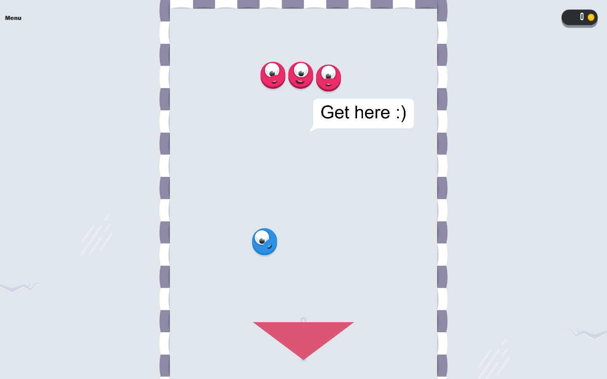
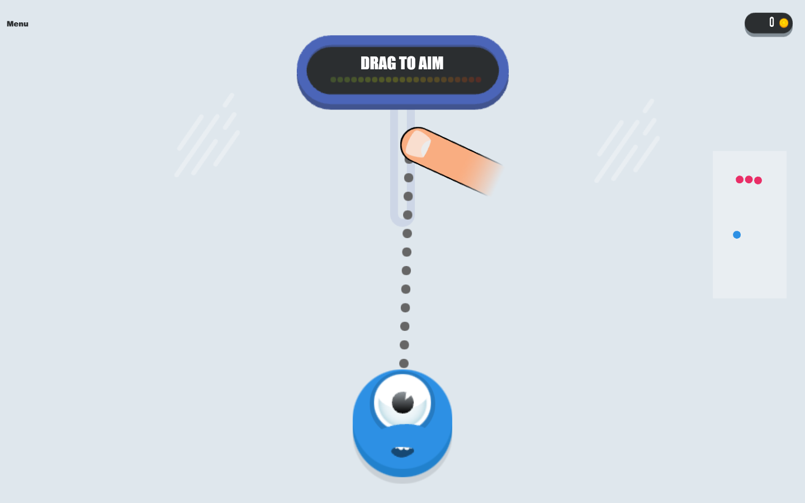
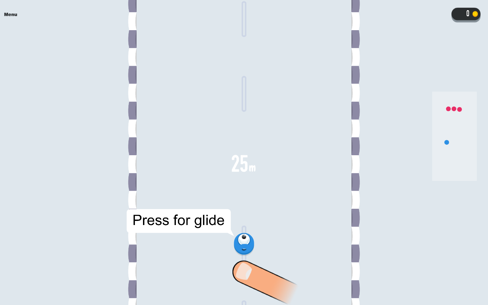

# Curling FRVR 游戏规格说明书

格式版本：V5.1

仅记录有依据的实现层事实；内容字段非必填，未知留空，不代表不存在或已经验证。

## 1. 基础事实

**维度定义**：让读者第一眼知道“这是什么类型、什么操控体验的游戏”，以及它的技术栈。

**内容说明**

Curling FRVR，MSN项目9pnd72dr9mqt；原站声明curling.frvr.com，官方门户公开iframe原包。原版本2.0.6/build261019290，JavaScript自有XS Canvas/WebGL引擎。实测远端52的1440×900 Chromium；未在开发机执行游戏或SDK。

## 2. 资源类型

**维度定义**：游戏中游戏内容元素的资源类型是什么——即在哪个引擎运行下的资源格式。

**内容说明**

共78份上游文件逐项核对SHA；剔除实际FRVR SDK与channel-web两文件，保留76份运行文件，其中74份原字节不变，入口和bootstrapper按明确退役范围修改。主脚本嵌入89份原SVG逐份哈希一致，66个MP3引用及原音频字节保留，另有7个原站图标和ms-manifest静态元数据。采集回执是本地证据，不冒充上游运行资源。

## 3. 核心挑战维度

**维度定义**：游戏核心玩法主要挑战 / 满足人的什么。

**内容说明**

以拖拽方向和力度投出冰壶，利用摩擦、扫冰与侧向旋转接近靶心并避让原场景石子。已真实观察一次力度投掷和原扫冰教学提示；扫冰、旋转和终局本轮未操作。

## 4. 操控方式

**维度定义**：操控本身的复杂度 + 需要玩家判断的时机 / 策略复杂度。

**内容说明**

鼠标点击场景下方箭头查看投掷石，按住原蓝色石子向上拖拽并释放。原源码要求按下超过1秒且力度足够才发射。原滑行阶段按压/移动扫冰和快速横划旋转交互保留；未调用引擎业务方法、注入存档、修改RNG或时间。

## 5. 行为路径

**维度定义**：玩家一局里重复做什么。

**内容说明**

最终入口→原靶区与“Get here :)”提示→点击下方箭头→原“DRAG TO AIM”力度条→真实拖拽释放→石子沿冰道滑行、镜头跟随→25m及“Press for glide”。原菜单、商店和地图代码保留，但本轮未点击它们。

## 6. 游戏路径（关键节点 + 流失风险）

**维度定义**：从开始到结束的流程 + 每个关键节点的潜在流失风险点。

**内容说明**

累计5次真实输入：v1入口因URL闭包漏带失败（原错误保留）；v2入口原场景在平台加载遮罩后就绪；v3入口移除原SDK加载遮罩，显示原靶区/石子；点击下方箭头切回投掷石；由(720,760)经(720,520)拖到(720,260)真实按下/移动/抬起，原力度/摄像机/石子运动启动，进入25m处“Press for glide”原扫冰教程提示。另一次只读观察仍为5次输入。未执行扫冰/旋转教程、完整关卡结算、金币购买、刷新恢复、其他关卡或手机；不得宣称这些已通过。

## 7. 成长路径

**维度定义**：玩家如何推进变强。

**内容说明**

原本地levels/money/accessories/selectedAccessory状态和关卡地图保留，实际新档levels空、金币0、仅原基础配饰已拥有。使用真正浏览器localStorage键curling.save，不提供云准备完成、账号或服务器结果。刷新恢复未实测。

## 8. 核心闭环（目标-规则-反馈-激励）

**维度定义**：游戏是否具备“明确目标 → 明确规则 → 达成反馈 → 奖励激励 → 下一目标”的完整闭环。

**内容说明**

查看靶区→瞄准与力度→释放投掷→原摩擦/碰撞/扫冰/旋转→原距离和收集结算→原重试/继续及地图。此次实测到首次投掷后扫冰教程提示，未完成该循环终局。

## 9. 玩法规则

**维度定义**：核心循环、玩法规则、目标与进度。

**内容说明**

原物理及教程配置AST一致，387个原生玩法函数AST未变，原关卡种子/随机算法/目标/石子和金币规则保留。7档配饰价格不变；余额不足沿原cantAfford分支，未将广告或内购替换为免费金币/解锁。普通关后继续保留一次性调用语义，广告奖励弹窗及实际回调移除。

## 10. 数值配置

**维度定义**：影响玩法的关键数值。

**内容说明**

源码：冰道trackLength45000、石半径145、trackWidth2200、靶圈半径1829/1219/610/152、idealPower225、范围10、slowDownCorrection0.99985；配饰价格0/10/20/50/100/200/500。实际金币0、仅基础配饰1；这些源码常量不表示已验证所有关卡或平衡。

## 11. 关卡配置

**维度定义**：关卡结构、递进规律、难度曲线。

**内容说明**

原A.data含指定石子/金币配置与关卡种子；未配置索引仍按原P/E生成函数和原关号种子生成，奖励关分支保留其原本地收集规则。没有擅自截成固定关数或改写种子；本轮只进入原level0教程。

## 12. 系统设计

**维度定义**：功能系统清单、UI 流程。

**内容说明**

实际移除两个SDK文件、广告/内购/社交/身份/排行榜上传/远程数据提供者及调用者。真实浏览器localStorage承接本地存档和原音量设置，保留原异步读取顺序；不构造FRVR、OSDK、Monetization或LegacySave替身。原renderer/素材打包/碰撞/物理/教程/商店和地图仍在。

## 13. 主题化包装

**维度定义**：游戏的题材 / 世界观包装。

**内容说明**

原淡蓝冰道、可爱蓝石和粉石、条纹场边、教学手指、力度条、缩略图、计米标记、金币显示与原SVG均保留。截图已实际打开核对，不用接口或脚本断言替代画面。

## 14. 养成系统 + 经济系统

**维度定义**：玩家如何成长、经济如何循环。

**内容说明**

原金币收集和7档配饰商店保留，金币来源/配饰价格/锁定条件不变。本轮实际金币0，未购买、领奖或验证关后入账。广告Get Coins按钮和付费/广告金币对话框已物理退役；不赠送金币或伪造支付/奖励结果。

## 15. 角色 / 单位设定

**维度定义**：有哪些角色/单位、各自定位（玩法层面）。

**内容说明**

原蓝色玩家石、粉色场景/对手石、金币、靶区、冰道、扫帚轨迹、旋转反馈、地图与配饰保留；原单机玩法没有新增网络对手、房间或账号。

## 16. 商业化

**维度定义**：靠什么变现。

**内容说明**

广告、付费/内购金币、线上分数上传、社交登录/分享及云存档全部源码退役；本地存档是真正localStorage写入。静态GET仅用于原本地SVG/图标/音频和JSON加载。最终实际71个请求均同源，不把观察拦截器当作退役证明。

图 1：原靶区与蓝色/粉色石

图 2：原投掷石与DRAG TO AIM力度提示

图 3：真实拖拽发射后的原25m扫冰提示
