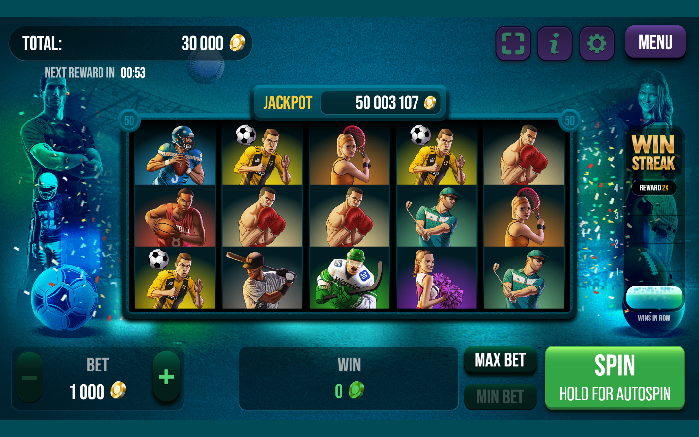
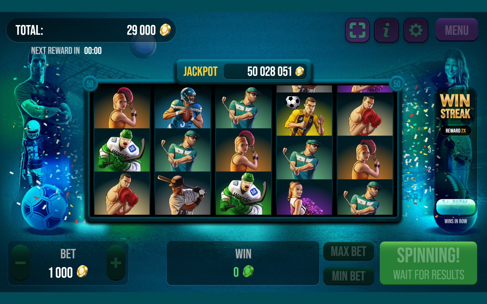
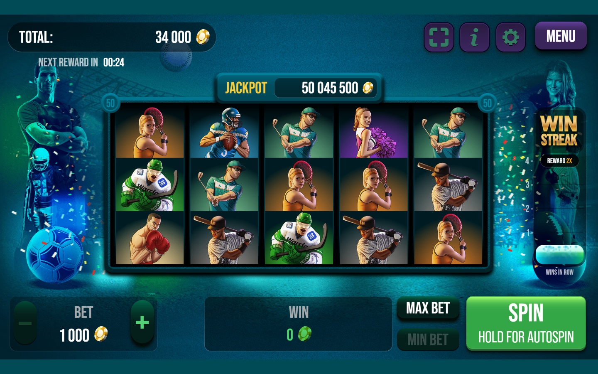
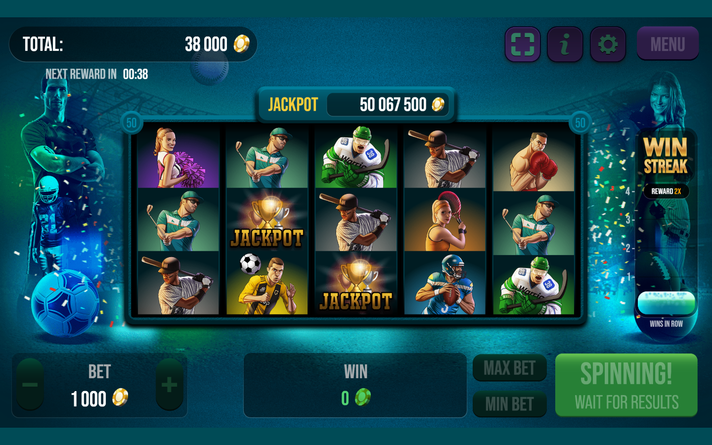
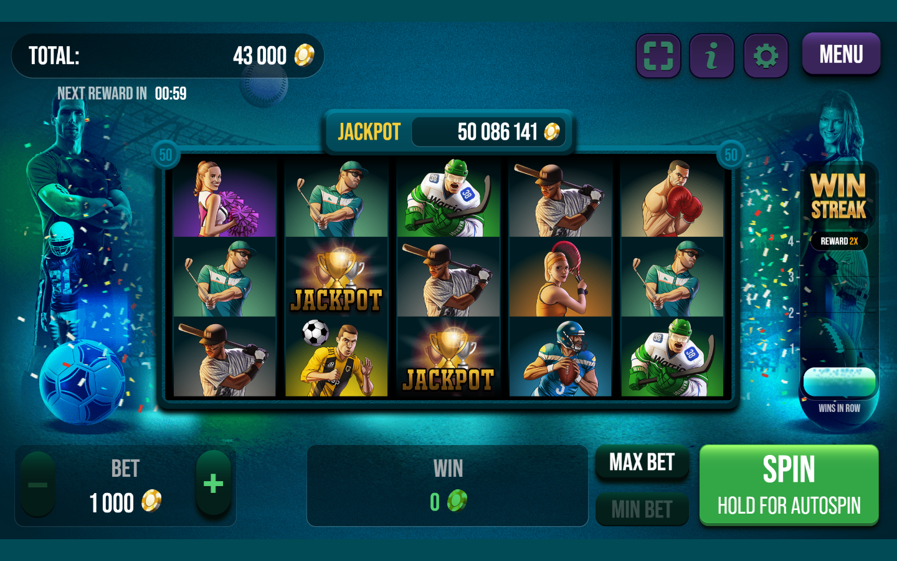
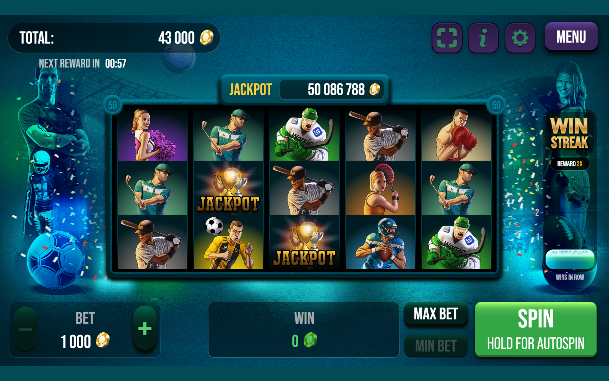

# Grand Slots Casino / 大转轮 游戏规格说明书

格式版本：V5.1

仅记录有依据的实现层事实；内容字段非必填，未知留空，不代表不存在或已经验证。

## 1. 基础事实

**维度定义**：让读者第一眼知道“这是什么类型、什么操控体验的游戏”，以及它的技术栈。

**内容说明**

Grand Slots Casino / 大转轮；MSN原生9ncv1p6743ns，Inlogic公开v13。原内部名称Lucky Vegas Slots1.0.1，2024-01-24构建。HTML/JavaScript、原Phaser3及Spine2D，1250×720逻辑画布，实测1440×900视口；画面为2D骨骼与图集，不称3D引擎。

## 2. 资源类型

**维度定义**：游戏中游戏内容元素的资源类型是什么——即在哪个引擎运行下的资源格式。

**内容说明**

405原上游文件，404运行文件，402原文件字节保持。94个真实Spine图集页面引用全量闭包核对无缺失，保留6主题转轮符号/JSON/atlas/PNG、6背景、50赔线、界面图集、原OTF字体、MP3/OGG和Rex插件。只适配入口及game.js服务边界；加载器原6背景/50赔线路径展开为逐项等价的静态数组，原循环次序/键/路径不变。

## 3. 核心挑战维度

**维度定义**：游戏核心玩法主要挑战 / 满足人的什么。

**内容说明**

在五列三行的原转轮上以虚拟筹码下注，停轮后由原50有效赔线、符号倍率与特殊符号规则结算；保留原连胜、免费转轮和奖池系统。本轮两局自然输局WIN0，未人为控制概率或结果。区别于21点、视频扑克、轮盘和方块合并。

## 4. 操控方式

**维度定义**：操控本身的复杂度 + 需要玩家判断的时机 / 策略复杂度。

**内容说明**

鼠标/触屏点原SPIN开始单次转轮；原长按自动转、加减下注/MAX BET/MIN BET、菜单换主题、说明/设置/全屏保留。实际只普通点SPIN两次与最后刷新，未长按、自动转、改变下注或额外打开菜单。

## 5. 行为路径

**维度定义**：玩家一局里重复做什么。

**内容说明**

累计5次真实玩家输入：第1次旧v1首载发现原sport/9.png缺失；原图补齐并冻结v2后，第2次新版本首载→第3次原SPIN→第4次原SPIN→第5次实际刷新。两次SPIN均观察原转轮运动、自然停轮和WIN0输局，按原下注各扣1,000；被动等待和截图不增加输入，无第6次输入。原程序每60秒自动补5,000本地虚拟币，本次观察3次，故30,000−2×1,000+3×5,000=43,000，不能称转轮赢得13,000。刷新原程序读取余额43,000、下注1,000和第二轮转轮位置。未写RNG、结果、筹码、时间或调用业务方法。

## 6. 游戏路径（关键节点 + 流失风险）

**维度定义**：从开始到结束的流程 + 每个关键节点的潜在流失风险点。

**内容说明**

原资源加载→直接SceneGame体育主题桌→初始30,000、BET1,000、SPIN可用→第1次真实SPIN转轮运动→自然停轮WIN0/SPIN恢复→第2次真实SPIN运动→自然停轮WIN0/SPIN恢复→刷新后原存档恢复43,000及第二轮位置。六张最终版实拍均已打开检查，含两张被动停轮观察。

## 7. 成长路径

**维度定义**：玩家如何推进变强。

**内容说明**

没有编号闯关地图。6套原主题共用转轮循环；原本地inl_lucky_vegas_slots保存Money、Bet、SlotsID、SlotsStartPos、WinStreak、FreeSpins、音频及奖励计时。本次实际证明体育主题的余额/下注/第二轮位置刷新恢复，其余主题和全部特殊局未额外试玩。

## 8. 核心闭环（目标-规则-反馈-激励）

**维度定义**：游戏是否具备“明确目标 → 明确规则 → 达成反馈 → 奖励激励 → 下一目标”的完整闭环。

**内容说明**

原下注额显示→普通SPIN扣虚拟余额并锁定按钮→原spinDrums/rotateDrum/stopDrum/checkDrums/checkPayline→原结算/动画/余额存档→SPIN恢复可用。两次都从真实输入到自然输局闭环；每60秒原独立本地补币，不属于转轮赔付。

## 9. 玩法规则

**维度定义**：核心循环、玩法规则、目标与进度。

**内容说明**

151原生方法规范AST保持，46个ContainerGame/ContainerWinStreak/GameData核心方法逐项一致；原Phaser/Spine前缀除唯一globalThis全局查找等价替换外字节保持。原Math.random、赔表、5列3行停位、连胜/奖池/免费转触发与存档保持。不据源码随机函数声称公平概率或所有赔率实测。

## 10. 数值配置

**维度定义**：影响玩法的关键数值。

**内容说明**

初始30,000虚拟币；本次下注1,000/轮，原允许最小1,000、最大1,000,000并受余额约束。五列三行、50条有效赔线（原数组另有首个哨兵项）、6主题；原3/4/5相同符号倍率表保留，wild原表50/500/2,000。原本地计时60秒补5,000，本次3次补币加两局输1,000，最终43,000。广告专属30,000补充已移除，原初始30,000不变；均为本地虚拟单位。

## 11. 关卡配置

**维度定义**：关卡结构、递进规律、难度曲线。

**内容说明**

6原主题：Cars World、Sport World、Army World、Mythology、Wild West、Animals。原10种常规符号加wild/bonus/jackpot素材与Spine动画保留，主题与停位数据使用原SlotsID/SlotsStartPos。原BONUS免费转10/20/30的说明和规则保持，但此次未命中验证，不为了覆盖而刷出特殊结果。

## 12. 系统设计

**维度定义**：功能系统清单、UI 流程。

**内容说明**

原Phaser3生命周期/场景/输入/定时与补间，原Spine骨骼渲染及Rex文字/形状/抖动插件；ScenePreload→SceneGame、原各Container分工。原GameData读写JSON存档，最终同源静态文件运行；6主题全资源随包，无外部API/账号/广告/房间。运行时动态路径另通过真实图集闭包和网络记录证明。

## 13. 主题化包装

**维度定义**：游戏的题材 / 世界观包装。

**内容说明**

原体育主题、蓝绿运动人物背景与五列运动员转轮，金色JACKPOT、右侧WINS IN ROW、底部BET/WIN和绿色SPIN。原人物/球员/手臂等Spine素材、背景、发光和按钮都保留，未换占位画布。当前2D桌面1250×720按原逻辑缩放。

## 14. 养成系统 + 经济系统

**维度定义**：玩家如何成长、经济如何循环。

**内容说明**

虚拟下注余额、原赔表/连胜/免费转与奖池循环；本轮两次输局，各扣1,000，期间原本地计时共补15,000，最后43,000。不是广告奖励或新增离线赠送逻辑。没有人民币、实际充值、提现或真钱交易。真实Inlogic/MSStart/Adinplay广告SDK、初始化、上报、广告覆盖层及消费者物理退役；广告补30,000专用按钮/回调/写币方法移除，不伪造广告成功。原非广告分支每60秒本地补5,000完整保留，原SPIN通过准确的普通开始回调体直接进入原转轮，不保留广告应答接口。

## 15. 角色 / 单位设定

**维度定义**：有哪些角色/单位、各自定位（玩法层面）。

**内容说明**

五个原转轮、每列三行符号、运动员与其他五主题人物/物件、wild、BONUS、JACKPOT、赔线、虚拟币、SPIN与本地连胜条。本次体育主题原人物正常可见，94图集页面闭包齐备；不宣称六主题逐一点击或全部骨骼动作均已试玩。

## 16. 商业化

**维度定义**：靠什么变现。

**内容说明**

真实Inlogic/MSStart/Adinplay广告SDK、初始化、上报、广告覆盖层及消费者物理退役；广告补30,000专用按钮/回调/写币方法移除，不伪造广告成功。原非广告分支每60秒本地补5,000完整保留，原SPIN通过准确的普通开始回调体直接进入原转轮，不保留广告应答接口。远端52真实Chromium，最终v2 785请求/785响应全部同源HTTP200，无外联、失败请求或脚本异常；保留6条原音频自动播放及Canvas2D性能warning。原v1的1条404和全部旧控制台记录另存，不能称全历史零错误。两个游戏浏览器98826/52816均实际BROWSER_EXIT0；开发环境没有执行原游戏或SDK。

图 1：修正版原生转轮桌，初始30,000/下注1,000

图 2：第一轮SPIN真实转轮运动；截图29,000，原定时补币随后发生

图 3：第一轮自然输局，WIN0；原定时补币后34,000

图 4：第二轮SPIN真实运动，WIN0/等待结算

图 5：第二轮自然输局，WIN0；原定时补币后43,000

图 6：实际刷新，原程序读回43,000/下注1,000/原转轮位置
