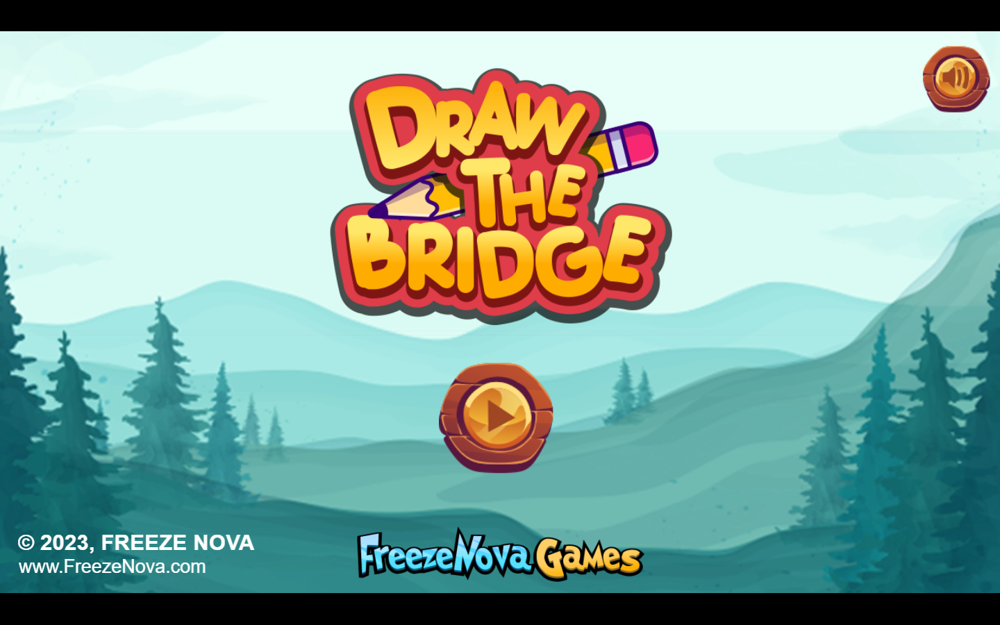
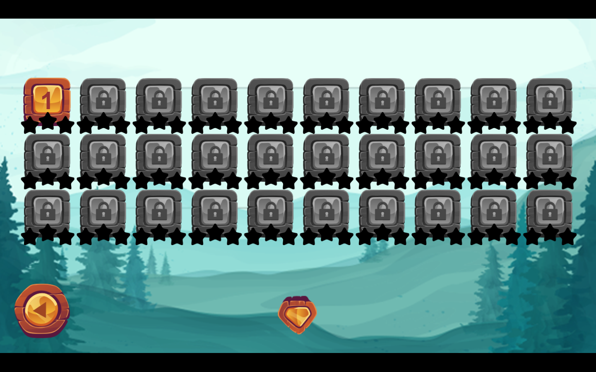
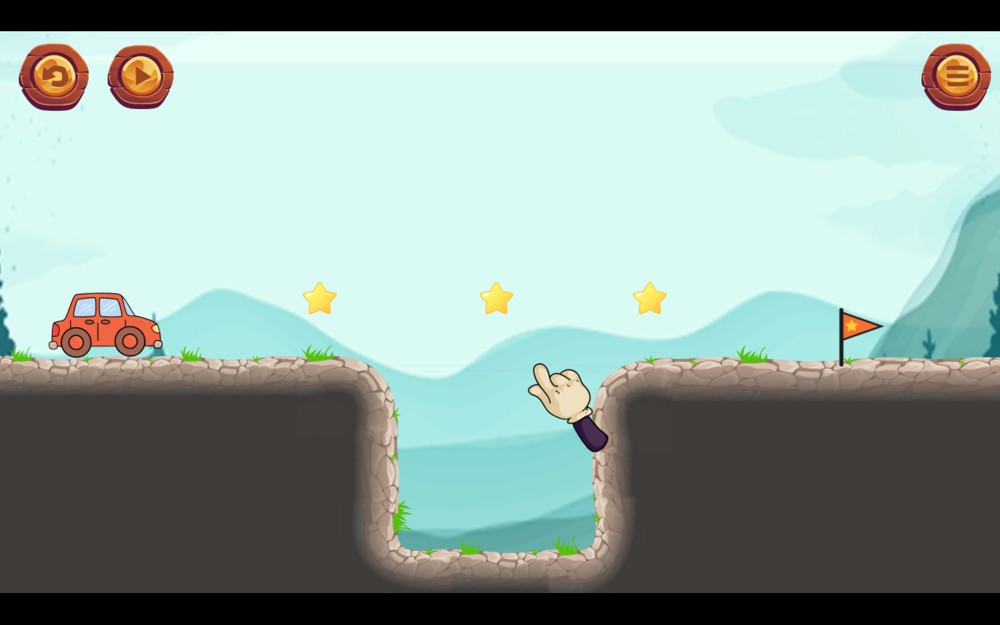
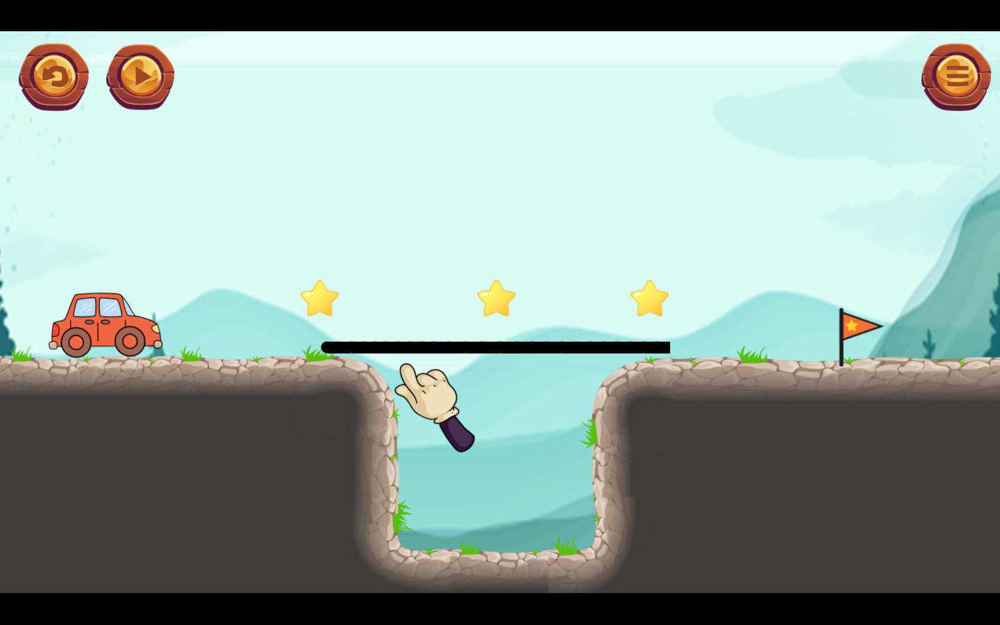
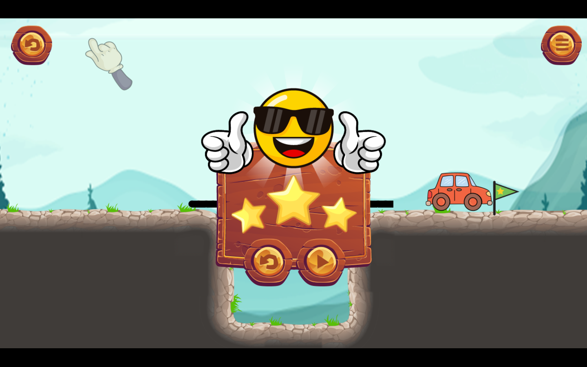

# Draw the Bridge / 画线搭桥 游戏规格说明书

格式版本：V5.1

仅记录有依据的实现层事实；内容字段非必填，未知留空，不代表不存在或已经验证。

## 1. 基础事实

**维度定义**：让读者第一眼知道“这是什么类型、什么操控体验的游戏”，以及它的技术栈。

**内容说明**

Draw the Bridge / 画线搭桥；MSN原生9nvq40981t9r，FreezeNova公开v2，项目com.freezenova.drawthebridge。Construct导出HTML/JavaScript/JSON、Box2D WASM，2D侧视单人绘桥物理益智。原视口854×480；52机器1440×900实测，实际画布1440×809。

## 2. 资源类型

**维度定义**：游戏中游戏内容元素的资源类型是什么——即在哪个引擎运行下的资源格式。

**内容说明**

38运行文件，其中34原字节相同。原11种图片引用闭包、7个WebM音频、图集和Box2D WASM齐全；原offline.json声明文件均已取得。全部原始文件和SHA在证据ZIP保留；两处上游非运行依赖404及其原因保留，不造占位素材。

## 3. 核心挑战维度

**维度定义**：游戏核心玩法主要挑战 / 满足人的什么。

**内容说明**

用鼠标连续画出实体桥面，使动力车辆能越过沟槽、收集星星并到达终点旗帜；桥面形状和落点影响原刚体运动。实际首关画出近水平桥，车辆成功通过并三星结算。

## 4. 操控方式

**维度定义**：操控本身的复杂度 + 需要玩家判断的时机 / 策略复杂度。

**内容说明**

鼠标点击菜单、关卡和原播放按钮；按下、移动并松开形成连续线段。第4步是一次连续6点轨迹470,500→970,500；第5步点击原播放201,111。未点击下一关或修改绘线规则。

## 5. 行为路径

**维度定义**：玩家一局里重复做什么。

**内容说明**

累计5次真实输入：载入原菜单、点击原Play、选择原第一关、一次连续拖线、点击关内原播放。原线条生成桥面，原车辆/轮胎越过沟槽，到达旗帜，实际截图出现原三星结算。无业务handler调用、SDK响应、状态/随机数/计时/分数注入。

## 6. 游戏路径（关键节点 + 流失风险）

**维度定义**：从开始到结束的流程 + 每个关键节点的潜在流失风险点。

**内容说明**

原菜单→关卡选择→原第一关→绘线规划桥面→点击原播放→车辆行驶/星星接触→旗帜成功或原失败→普通继续/重试。实测到原三星结算，未操作结算后的继续或重试。

## 7. 成长路径

**维度定义**：玩家如何推进变强。

**内容说明**

原90个编号关卡和Store/Menu/LevelSelect共93布局保留。关卡选择初始只第一关可用，未改原锁定；原通关/星数/本地解锁事件保持。解锁后的继续与刷新恢复未实测。

## 8. 核心闭环（目标-规则-反馈-激励）

**维度定义**：游戏是否具备“明确目标 → 明确规则 → 达成反馈 → 奖励激励 → 下一目标”的完整闭环。

**内容说明**

观察地形、星星和终点→画实体路面→启动原动力车辆→观察桥面/轮胎/车辆与原地形的物理交互→原星数结算→选择普通继续或重试。首关完整循环至三星结果已实际发生。

## 9. 玩法规则

**维度定义**：核心循环、玩法规则、目标与进度。

**内容说明**

原93布局中只去掉广告/外链实例；其余初始实例、刚体和所有非事件项目字段深比较一致。原Box2D绑定与二进制相同；C3引擎除10个退役脚本引用槽外所有字节保持，正常HTML5分支原字节保持。没有放宽碰撞、通关条件或画线约束。

## 10. 数值配置

**维度定义**：影响玩法的关键数值。

**内容说明**

源码90个编号关卡、原视口854×480、93布局。实际第一关3颗星且结算3星；原源记录共46文件（含2份采集元数据），运行38文件/34原字节。31次请求和31次响应均同源200，0外联/缺失/错误/警告。其余数值不推定。

## 11. 关卡配置

**维度定义**：关卡结构、递进规律、难度曲线。

**内容说明**

完整原1至90编号布局、场景实例、车辆/轮胎/实体线/旗帜、星星、地面、尖刺、锯和障碍物配置保留。只实际运行第一关；其他关卡机关和难度属于源码保留，不能称全关已过。

## 12. 系统设计

**维度定义**：功能系统清单、UI 流程。

**内容说明**

Construct原事件系统、WebGL2渲染、DOM输入、Box2D物理、声效和LocalStorage保存保持。实际广告跳关/奖励事件和消费者、93个广告或外链UI实例、Ads事件页、13个广告暂停导航条件、10个广告/宿主脚本引用及其加载项移除；引用槽为空而非可调用SDK替身。正常菜单、绘线、物理、普通胜负、关卡解锁与localStorage路径保留。 原预览专用Worker上游404；本包原导出类型html5且主Worker开关false，保留原HTML5分支、移除发布包未提供的编辑器预览分支，没有占位Worker。

## 13. 主题化包装

**维度定义**：游戏的题材 / 世界观包装。

**内容说明**

保留原森林山地、卡通橙色车辆、沟槽/草地、星星/旗帜、木质按钮和原手势引导、美术图集、声音与版权标识。原原型工程未恢复，没有替换原美术或另写仿制关卡。

## 14. 养成系统 + 经济系统

**维度定义**：玩家如何成长、经济如何循环。

**内容说明**

原关卡星星、进度、车辆/Store界面及本地记录保持。实际三星结果不代表已验证商店、消费价格、其他车辆、跨会话解锁或完整经济；这些未实测。没有新增金币、钻石或付费成功回包。

## 15. 角色 / 单位设定

**维度定义**：有哪些角色/单位、各自定位（玩法层面）。

**内容说明**

原车辆Vehicle/轮胎Btire以及Car家族绑定保留；第一关实际为橙色小车。其他车辆/皮肤来源于原配置，未逐项试玩。没有替代角色、注入AI或自动通关。

## 16. 商业化

**维度定义**：靠什么变现。

**内容说明**

实际广告跳关/奖励事件和消费者、93个广告或外链UI实例、Ads事件页、13个广告暂停导航条件、10个广告/宿主脚本引用及其加载项移除；引用槽为空而非可调用SDK替身。正常菜单、绘线、物理、普通胜负、关卡解锁与localStorage路径保留。 原跳关脚本含直接置adReward的回调，整条消费链已移除，不沿用为离线奖励。原包没有真实支付/联网房间/排名插件或业务请求；没有添加这些功能。只实际完成第一关。未点击继续、重试、其他车辆或商店；刷新/存档恢复、第二至第90关、随机关卡与移动端未实测。没有第六次输入。

图 1：原菜单、原画面与普通播放入口

图 2：原关卡选择：第一关可用、其他原锁定保持

图 3：原第一关：车辆、沟槽、三颗星和终点旗帜

图 4：连续普通拖线生成实体桥面，尚未发车

图 5：原播放后车辆抵达终点、原三星结算；未点击继续
