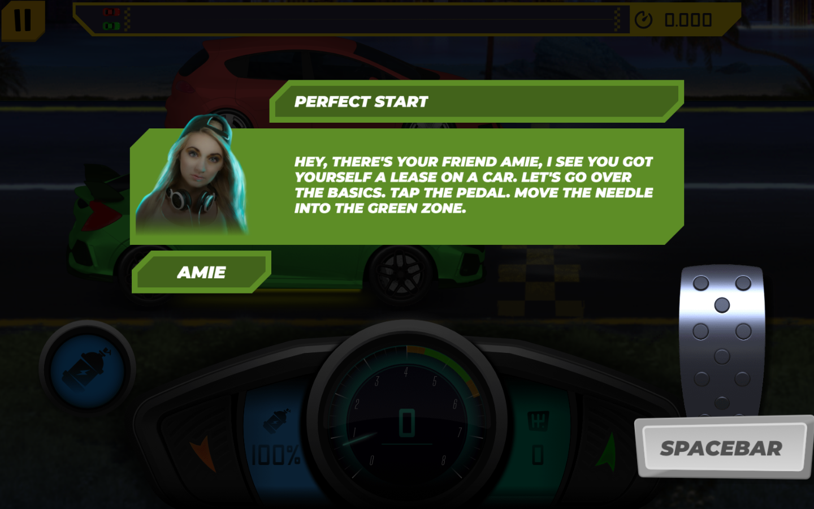
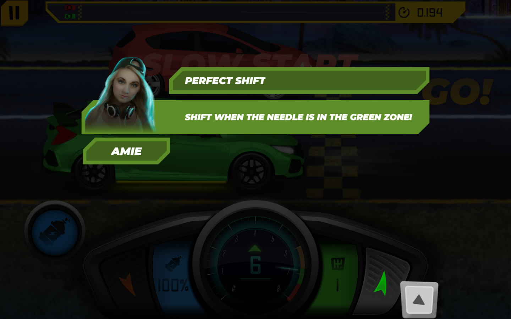
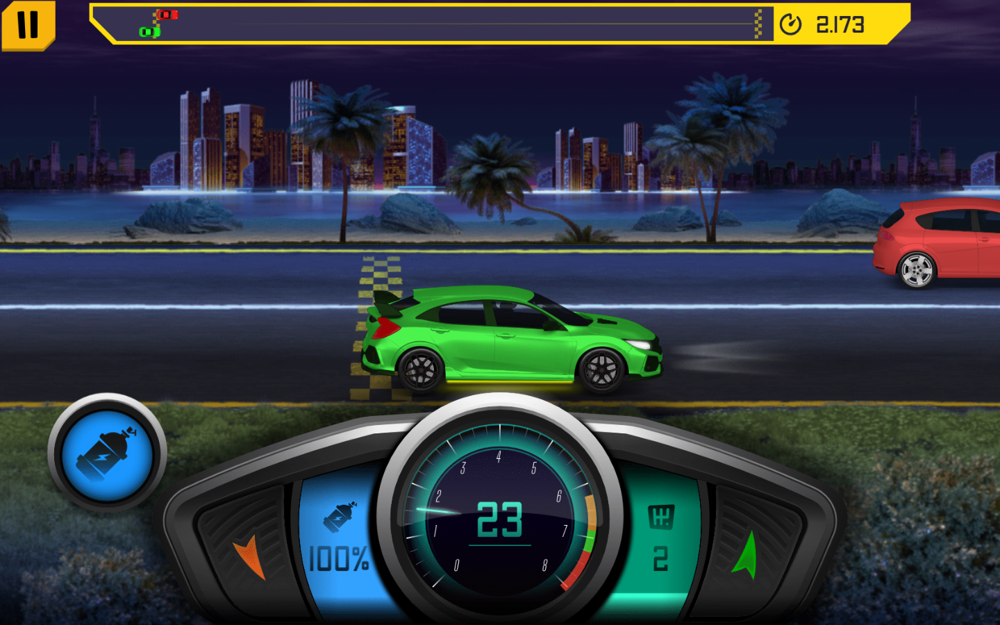

# Drag Racing City / 直线竞速城市 游戏规格说明书

格式版本：V5.1

仅记录有依据的实现层事实；内容字段非必填，未知留空，不代表不存在或已经验证。

## 1. 基础事实

**维度定义**：让读者第一眼知道“这是什么类型、什么操控体验的游戏”，以及它的技术栈。

**内容说明**

Drag Racing City / 直线竞速城市；MSN原生9nkxlf5z9lkd/InLogic公开v13，源码标识1.0.4。Phaser3、HTML/JavaScript/JSON，2D侧视单人对本地AI。实测52机器1440×900视口、原画布1680×1050缩放显示。

## 2. 资源类型

**维度定义**：游戏中游戏内容元素的资源类型是什么——即在哪个引擎运行下的资源格式。

**内容说明**

161运行文件、159文件与原字节相同；163份原文件（含2份来源元数据）完整保留。原32车辆图集、4组环境图集、车库/车商/地图/仪表盘/故事/按钮、两字体、全部原声明OGG/MP3备选音频齐全；151条原资源引用及动态4×8车辆范围核对。

## 3. 核心挑战维度

**维度定义**：游戏核心玩法主要挑战 / 满足人的什么。

**内容说明**

在原发动机转速区间控制起跑和换挡，让车辆沿直线与本地AI竞速；时机、齿比、升级和氮气影响原速度曲线。实测油门起跑和首次升挡，非转向绕圈或坡地驾驶。

## 4. 操控方式

**维度定义**：操控本身的复杂度 + 需要玩家判断的时机 / 策略复杂度。

**内容说明**

鼠标点击原CONTINUE/踏板/升降挡/氮气和菜单；原Space油门、上/下键换挡、N氮气。实测仅原CONTINUE、Space与ArrowUp，未实测N、降挡或触屏。没有直接调用原业务handler。

## 5. 行为路径

**维度定义**：玩家一局里重复做什么。

**内容说明**

累计5次真实输入：v1入口（只有仪表盘，未通过）、v2入口、原CONTINUE、Space按住4000ms后松开、ArrowUp按住90ms后松开。v2原起跑和升挡真实响应：第4张1挡/速度6/计时0.194，第5张2挡/速度23/计时2.173，原双车、道路镜头与赛程条位置变化。两次额外静态截图只观察，不是玩家输入。

## 6. 游戏路径（关键节点 + 流失风险）

**维度定义**：从开始到结束的流程 + 每个关键节点的潜在流失风险点。

**内容说明**

原资源加载→首次入门赛→原是否全屏提示（选择CONTINUE）→原完美起跑引导→倒计时/油门→原完美换挡引导→第一次升挡后继续直线行驶→后续氮气教程与赛程/胜负。实测止于第一次升挡后的行驶。

## 7. 成长路径

**维度定义**：玩家如何推进变强。

**内容说明**

原4赛区、32车辆、剧情/对手赛、排名赛、快赛与车手挑战配置保持。RankedBeaten、RivalsBeaten和解锁条件属于原本地进度；不是网络排行榜或服务器排名。未实测跨区与完整解锁。

## 8. 核心闭环（目标-规则-反馈-激励）

**维度定义**：游戏是否具备“明确目标 → 明确规则 → 达成反馈 → 奖励激励 → 下一目标”的完整闭环。

**内容说明**

控制起跑转速→油门加速→在转速窗口升挡→管理氮气与原车辆性能→到达原距离终点并与本地对手比较时间→普通奖金/车库升级→下一场。已实测到油门加速与第一次升挡，尚未完成整场或验证奖金结算。

## 9. 玩法规则

**维度定义**：核心循环、玩法规则、目标与进度。

**内容说明**

原车型质量、驱动、扭矩/转速、齿比、升降挡和加速/氮气计算、AI及胜负/普通奖金公式保留。7484个未涉及服务的函数原字节保持。源代码处于首次入门流程，未改存档、教程标志、计时、随机数或奖励。

## 10. 数值配置

**维度定义**：影响玩法的关键数值。

**内容说明**

源码32车型及4赛区；5类部件：发动机、变速箱、氮气、轮胎、车重。实际起跑1挡/速度6/计时0.194，升挡后2挡/速度23/计时2.173。144请求与144响应均同源200；0外联、缺失和异常；222条原浏览器/引擎警告原样归档。

## 11. 关卡配置

**维度定义**：关卡结构、递进规律、难度曲线。

**内容说明**

原4×8车型图集全部取得，四组环境及地图/车库/车商/比赛类型、赛距和难度参数完整。原QuickRaceLength初值0.25，首次入门赛独立使用FirstRace配置。源码存在连续/生成赛制，不杜撰固定总关数或全关通关结论。

## 12. 系统设计

**维度定义**：功能系统清单、UI 流程。

**内容说明**

原Phaser场景Preload/Menu/Game、车身分层/车轮/材质/道路镜头、车辆物理、原本地AI、转速表/挡位/赛程、原故事教程、音效和localStorage存档保持。移除MSStart广告、AdSense、AdinPlay及Inlogic事件上报的实际提供者、初始化/监听/触发和奖励加钱回调，移除结果广告按钮所有创建/引用/入口。原_OnStart广告包装在调用点接回原__OnStart本地开赛；不模拟广告完成、不创建SDK/身份/支付/奖励响应。原游戏本地车库、发动机/齿比/油门/升挡/氮气算法、对手AI、经济和localStorage保持。

## 13. 主题化包装

**维度定义**：游戏的题材 / 世界观包装。

**内容说明**

保留原夜景城市/海湾公路、绿色玩家车和红色对手车、原车库与人物Amie引导、仪表盘和黄绿UI、美术/声音。仅修正原key_up.png初始图集map→实际存在的pak；没有替代美术或自造关卡。

## 14. 养成系统 + 经济系统

**维度定义**：玩家如何成长、经济如何循环。

**内容说明**

原Money、车辆/涂装/轮毂/部件、本地赛区解锁及普通赛后奖金保留。额外看广告双倍加钱回调整体退役，不转成自动奖励。具体购买/收益与跨会话恢复未实测，未知不填数值。

## 15. 角色 / 单位设定

**维度定义**：有哪些角色/单位、各自定位（玩法层面）。

**内容说明**

32种原车辆定义与图集，代码车型名称/质量/驱动和分层绑定可读；首次入门的绿玩家车和红AI车实际出现。未逐车测试性能/升级/涂装，未宣称原作者完整Phaser编辑工程。

## 16. 商业化

**维度定义**：靠什么变现。

**内容说明**

移除MSStart广告、AdSense、AdinPlay及Inlogic事件上报的实际提供者、初始化/监听/触发和奖励加钱回调，移除结果广告按钮所有创建/引用/入口。原_OnStart广告包装在调用点接回原__OnStart本地开赛；不模拟广告完成、不创建SDK/身份/支付/奖励响应。原游戏本地车库、发动机/齿比/油门/升挡/氮气算法、对手AI、经济和localStorage保持。 原生单人对本地AI，不包含真实登录/房间/支付服务。原Ranked为本地赛事进度而非远端leaderboard。只验证原入门赛的起跑、油门和第一次升挡。未验证氮气、完成比赛/胜负与结算、后续赛区/其他车辆/部件购买、刷新存档和移动端；不把素材完整称为全关已过。没有第6次输入。

图 1：原首次赛完美起跑引导

图 2：原起跑后1挡/速度6，提示第一次换挡

图 3：原普通上键后2挡/速度23，车辆位置与计时变化
