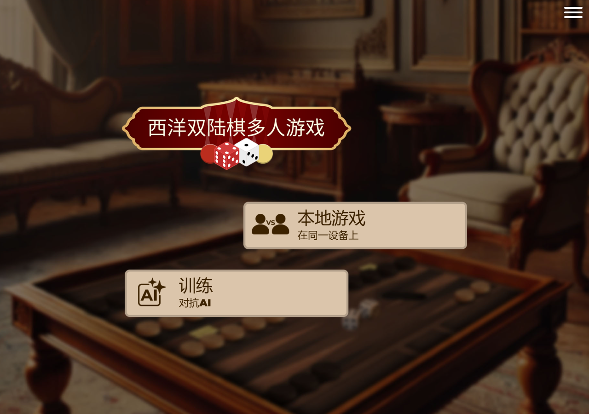
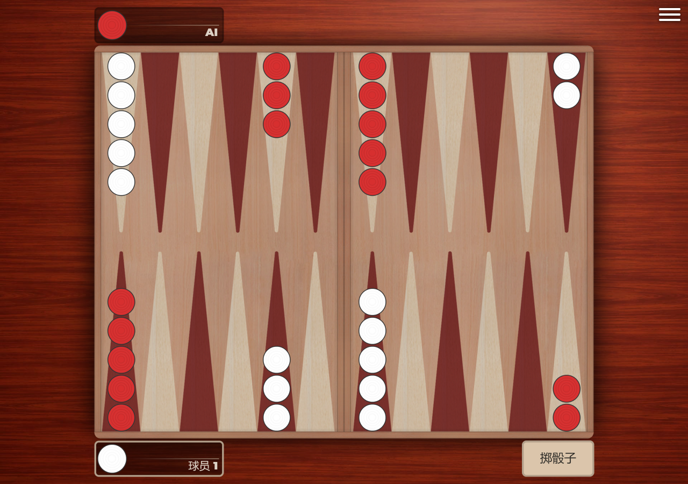
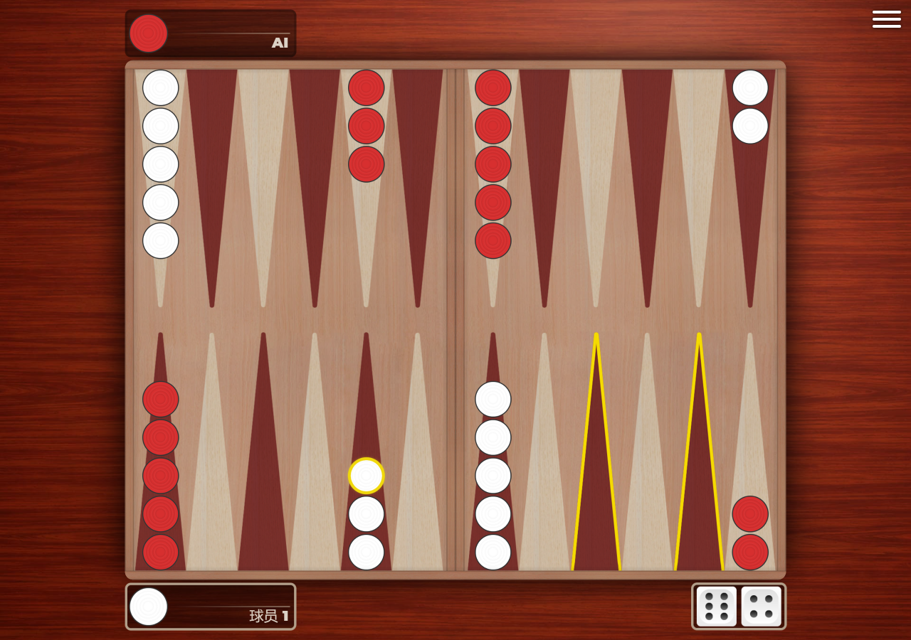
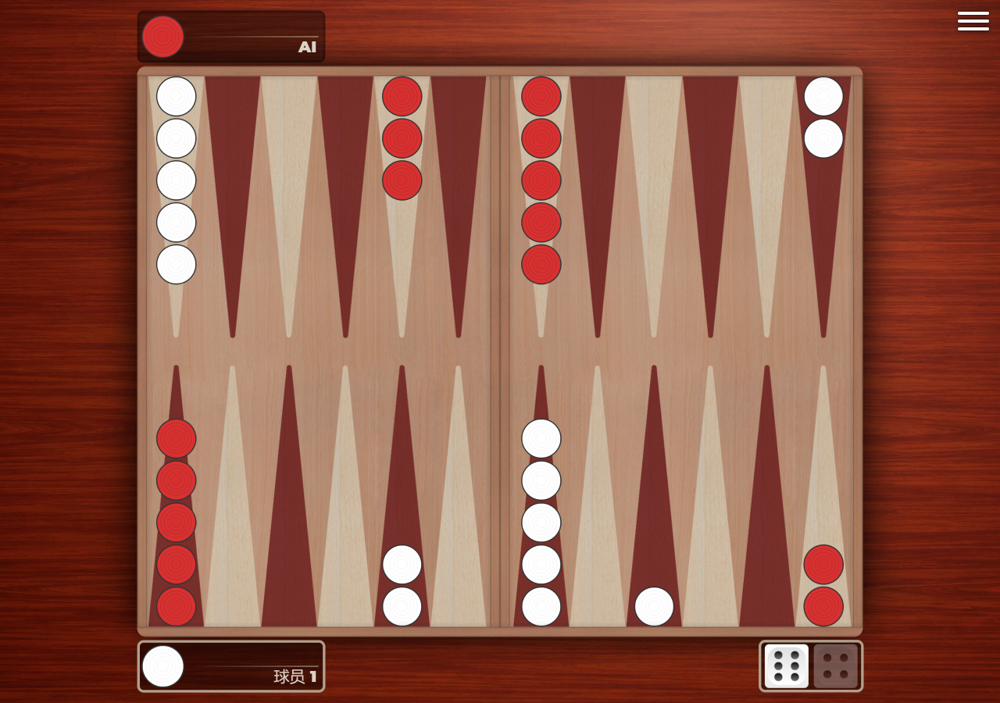

# Backgammon Multiplayer 游戏规格说明书

格式版本：V5.1

仅记录有依据的实现层事实；内容字段非必填，未知留空，不代表不存在或已经验证。

## 1. 基础事实

**维度定义**：让读者第一眼知道“这是什么类型、什么操控体验的游戏”，以及它的技术栈。

**内容说明**

Backgammon Multiplayer / 西洋双陆棋。MSN原生身份9pp66hv970nq，Code This Lab公开构建v15，单机修订backgammon-offline-v2。JavaScript/HTML/CSS，CreateJS Canvas2D、Howler及原Bootstrap本地侧栏；原SCREEN_MODE_SQUARE布局。

## 2. 资源类型

**维度定义**：游戏中游戏内容元素的资源类型是什么——即在哪个引擎运行下的资源格式。

**内容说明**

原棋盘与白/红棋子、骰子帧图、三角落点、木纹背景、菜单图标、MP3音效、Montserrat-Black和原Google声明的3个字体字重、FontAwesome及语言旗帜。250项静态配方、两套皮肤和2幅根背景保留，240图片解码通过；运行基础292文件有SHA。

## 3. 核心挑战维度

**维度定义**：游戏核心玩法主要挑战 / 满足人的什么。

**内容说明**

按原骰子点数选择合法棋子与落点，把己方15枚棋子沿原方向推进并最终移出棋盘。实际掷出6、4后完成白棋第16点到第20点的一次4步移动；未完成整回合或对局。

## 4. 操控方式

**维度定义**：操控本身的复杂度 + 需要玩家判断的时机 / 策略复杂度。

**内容说明**

本轮真实鼠标点击训练/AI入口、掷骰子、白棋(514,669)和黄色合法目的地(838,650)。原棋子选择与可走三角点高亮生效；未拖拽、改骰子或调用走棋函数。

## 5. 行为路径

**维度定义**：玩家一局里重复做什么。

**内容说明**

原中文菜单→训练/CPU→原30枚棋子自然布阵→白方原掷骰→自然骰子动画显示6与4→选白棋→两个合法落点高亮→点击4点目的地→原移动动画及骰子置灰。

## 6. 游戏路径（关键节点 + 流失风险）

**维度定义**：从开始到结束的流程 + 每个关键节点的潜在流失风险点。

**内容说明**

原菜单、同设备双人入口与训练入口、原木质棋盘、玩家1/AI信息、掷骰子按钮、骰子动画、棋子高亮和走棋反馈实际可见。本轮只进入训练，未打开侧栏或同设备双人。

## 7. 成长路径

**维度定义**：玩家如何推进变强。

**内容说明**

原棋盘对局，没有固定关卡表。原皮肤配置original/flat、本地设置与计分代码保留；本轮未修改皮肤、完成结算或验证保存。

## 8. 核心闭环（目标-规则-反馈-激励）

**维度定义**：游戏是否具备“明确目标 → 明确规则 → 达成反馈 → 奖励激励 → 下一目标”的完整闭环。

**内容说明**

观察：白方与AI各15枚，原初始布阵。输入：掷骰6/4，选择白棋和4点合法目的地。反馈：第16点白棋3→2、第20点0→1、4点骰子置灰；剩余6点仍可用。后续目标为继续本回合及出界收子，未追加操作。

## 9. 玩法规则

**维度定义**：核心循环、玩法规则、目标与进度。

**内容说明**

CBackgammonRules、CBoard、CAI、CDice、CPiece及CGameBase/Single原方法保留。171个原生方法中167个规范AST完全一致；4个差异为启动遥测删除、两处重开/回菜单原继续路径去广告门、以及棋子动画两分支同为700ms的旧身份读取移除。不是修改落点、点数、吃子、返场、骰子或胜负规则。

## 10. 数值配置

**维度定义**：影响玩法的关键数值。

**内容说明**

原棋盘24点、白/黑两色各15枚；原初始aPoints=[2,0,0,0,0,-5,0,-3,0,0,0,5,-5,0,0,0,3,0,5,0,0,0,0,-2]，bar/off均[0,0]。本轮骰子6和4，16→20消耗4；原棋子移动动画700ms保留。源码MULTIPLIER_SCORE100；未产生结算分数。

## 11. 关卡配置

**维度定义**：关卡结构、递进规律、难度曲线。

**内容说明**

没有固定关卡；CBoard原初始位置数组与CBackgammonRules完整保留。本地同设备双人及原CPU训练仍有原入口；本轮随机首手为白方，不固定或重抽首手、不安排骰子。

## 12. 系统设计

**维度定义**：功能系统清单、UI 流程。

**内容说明**

保留实际原侧栏事件/弹窗、语言、声音、皮肤选择、重开与菜单控制代码，以及原棋盘规则和CPU。移除PlayerIO、登录/房间/邀请/观战、联网匹配及假在线机器人、在线排行/档案、购买去广告/恢复购买、外部跳转、通知及遥测；无SDK、身份、服务端或广告奖励替身。

## 13. 主题化包装

**维度定义**：游戏的题材 / 世界观包装。

**内容说明**

原中文菜单、木纹棋盘、白与红棋子、原骰子和黄色落点高亮；原标题图仍含多人字样，联网入口已移除，只保留同设备本地双人和训练功能。没有新画素材或替换棋盘皮肤。

## 14. 养成系统 + 经济系统

**维度定义**：玩家如何成长、经济如何循环。

**内容说明**

保留原本地设置与皮肤记录，无新增货币、奖励或解锁。本轮没有取胜或计分，没有实测刷新保存；购买/去广告及在线等级入口已退役，不发放免费权益。

## 15. 角色 / 单位设定

**维度定义**：有哪些角色/单位、各自定位（玩法层面）。

**内容说明**

原玩家1操作白棋，AI席位为原CAI控制的对方；本轮尚未结束玩家第一回合，因此未实测AI出手。两种棋子各15枚；同设备双人代码保留但未试玩。

## 16. 商业化

**维度定义**：靠什么变现。

**内容说明**

删除平台登录、排行、购买去广告、恢复购买、推荐/外跳、广告派发与通知。重开和回菜单只保留原继续动作，不触发广告成功或奖励；实际运行没有外部请求，尚未实测重开动作。

图 1：原中文菜单，联网入口已移除

图 2：原训练棋盘、玩家1与AI席位，双方各15枚

图 3：掷6/4后原黄色合法点位与棋子高亮

图 4：白棋16→20，4点骰子置灰，尚未结束回合
