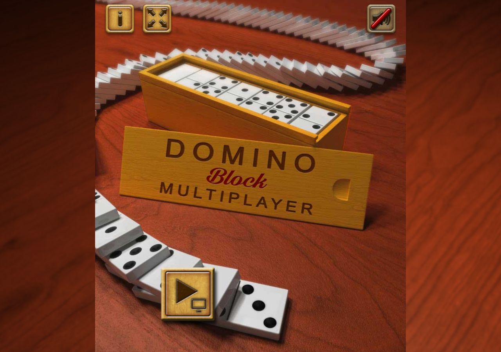
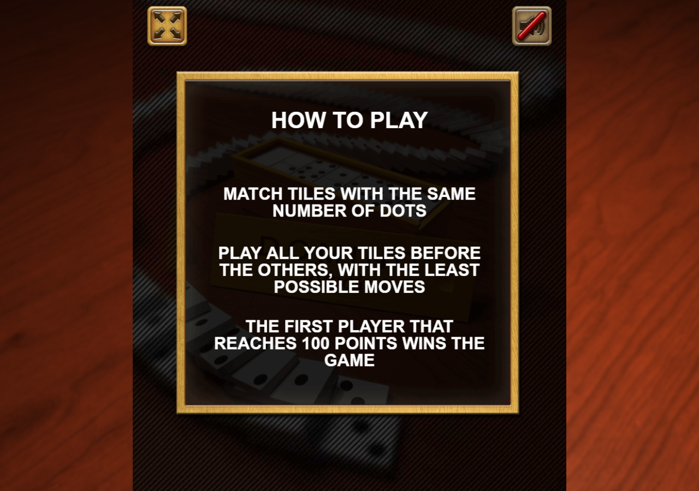
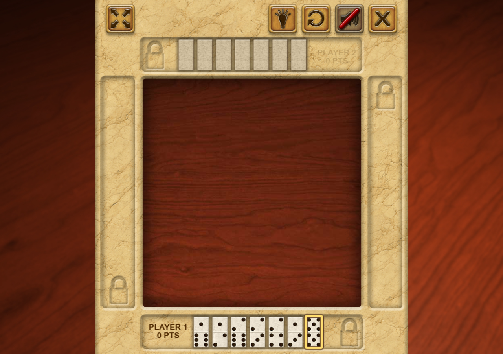
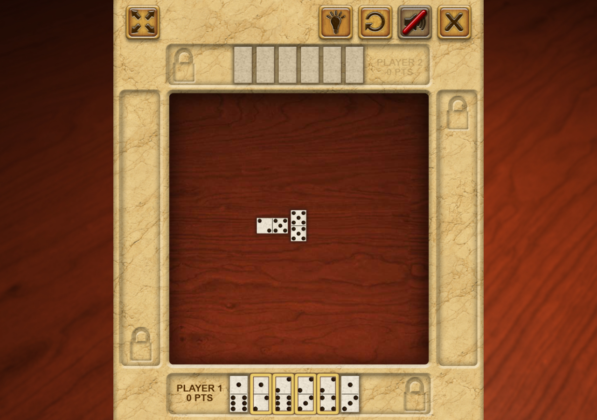

# Domino Block 游戏规格说明书

格式版本：V5.1

仅记录有依据的实现层事实；内容字段非必填，未知留空，不代表不存在或已经验证。

## 1. 基础事实

**维度定义**：让读者第一眼知道“这是什么类型、什么操控体验的游戏”，以及它的技术栈。

**内容说明**

Domino Block / 多米诺骨牌。MSN原生身份9n6ghtwjh637，Code This Lab公开构建v2；本次单机修订domino-offline-v2。JavaScript/HTML/CSS，CreateJS Canvas2D、Howler；原纵向768×1400布局。

## 2. 资源类型

**维度定义**：游戏中游戏内容元素的资源类型是什么——即在哪个引擎运行下的资源格式。

**内容说明**

原PNG/JPG木牌、点数、按钮、牌盒、桌面背景、MP3音效、Arial Bold WOFF/WOFF2字体及原JavaScript逻辑。48项源码配方和3项字体/桌面背景保留原URL及SHA，38图片解码通过。

## 3. 核心挑战维度

**维度定义**：游戏核心玩法主要挑战 / 满足人的什么。

**内容说明**

观察牌链端点，选择手中点数匹配的牌接入，争取先出完手牌；无合法牌时沿原锁定与轮转规则处理。实测首手5/5及CPU接2/5，未验证整局胜负。

## 4. 操控方式

**维度定义**：操控本身的复杂度 + 需要玩家判断的时机 / 策略复杂度。

**内容说明**

本轮使用真实鼠标点击原本地入口、2席、100分、帮助和高亮5/5首牌。原双端可接牌时有左右箭头选择，源码保留但本轮首牌不需要选择；未调用原游戏方法或写入进度。

## 5. 行为路径

**维度定义**：玩家一局里重复做什么。

**内容说明**

本地入口→原人数选择2席→原目标100分→原帮助→自然牌盒/发牌动画→玩家点击高亮首牌→CPU自然接牌→回到玩家回合。

## 6. 游戏路径（关键节点 + 流失风险）

**维度定义**：从开始到结束的流程 + 每个关键节点的潜在流失风险点。

**内容说明**

实测原首页、本地配置、英文帮助、发牌动画、双人桌面、玩家手牌、原CPU回复和合法牌高亮。未测试换目标、重开、完整牌局或刷新恢复。

## 7. 成长路径

**维度定义**：玩家如何推进变强。

**内容说明**

原2/3/4席与100/150/200分目标保留，原每局累积分与best score使用本地存储。本轮只选择2席100分且尚未结算，不宣称目标已达成。

## 8. 核心闭环（目标-规则-反馈-激励）

**维度定义**：游戏是否具备“明确目标 → 明确规则 → 达成反馈 → 奖励激励 → 下一目标”的完整闭环。

**内容说明**

观察：牌链初始空，双方7张。输入：点击原高亮5/5。反馈：首牌入桌，CPU接出2/5，牌桌2张、双方6张，玩家合法牌继续高亮。下一目标：继续匹配端点并争取原设定100分；本轮未追加出牌。

## 9. 玩法规则

**维度定义**：核心循环、玩法规则、目标与进度。

**内容说明**

原双六骨牌28张、每席初始7张；checkFirstTile按最高双牌优先，无双牌再比较总点数。原端点匹配、双向选择、CPU可接牌筛选与点数排序、无牌锁定、轮转、Domino/死局及胜分计算均保留。62个原生基类/单机方法逐项核对：57个规范AST完全一致，5个仅删除原联网遥测事件。

## 10. 数值配置

**维度定义**：影响玩法的关键数值。

**内容说明**

源码：TILES_NUMBER28、INITIAL_TILES7，TILE_VALUES覆盖0至6组合，WIN_SCORE[100,150,200]，FPS30、DOMINO_TIMER500、MATCHOVER_TIMER1000、TIME_LOOP_WAIT1000。实测牌桌0→2张、两人手牌各7→6、比分仍0/0；未将计时常量冒充处理耗时。

## 11. 关卡配置

**维度定义**：关卡结构、递进规律、难度曲线。

**内容说明**

本游戏为原洗牌生成的骨牌对局，无固定关卡表。保留28张牌数组、2/3/4席和100/150/200分目标；本轮仅实际选择2席100分。未修改洗牌、种子或发牌来安排结果。

## 12. 系统设计

**维度定义**：功能系统清单、UI 流程。

**内容说明**

保留原本地人数/目标配置、发牌与牌盒动画、玩家手牌、端点匹配、CPU、锁定/轮转、累计分、帮助、音量、全屏及本地成绩。删除PlayerIO客户端、联网房间/登录/邀请、在线匹配及假在线机器人分支、广告/外部成绩事件和外跳。无SDK、身份或服务端回复替身。

## 13. 主题化包装

**维度定义**：游戏的题材 / 世界观包装。

**内容说明**

保留原木质桌面、骨牌点数、金色面板和原英文帮助。首页原图片中仍含MULTIPLAYER字样，是原背景图文字；联网按钮、房间和连接代码已移除，实际只提供本地人机玩法。

## 14. 养成系统 + 经济系统

**维度定义**：玩家如何成长、经济如何循环。

**内容说明**

原classicdomino_best_score与classicdomino_scores2/3/4本地记录保留，源码有按人数保存累计成绩及清空逻辑。本轮未结算或刷新；无新增金币、购买、体力或免费广告奖励。

## 15. 角色 / 单位设定

**维度定义**：有哪些角色/单位、各自定位（玩法层面）。

**内容说明**

原PLAYER1为玩家，PLAYER2为原CPU；源码也保留3/4席配置。操作单位是28张双六骨牌，非角色成长；本轮CPU真实按原端点规则接牌，没有伪造联网玩家。

## 16. 商业化

**维度定义**：靠什么变现。

**内容说明**

单机修订删除外部平台启动/通知/推荐/广告、联网登录房间与成绩上传，移除制作方标志的外跳点击。未发现保留的支付流程，不发放广告成功或奖励；原资源、原计分和CPU保持。

图 1：原菜单，本地入口；联网按钮已移除

图 2：原帮助与100分目标

图 3：自然发牌后双方7张，高亮5/5首牌

图 4：玩家5/5与CPU2/5，双方各6张，比分0/0；未完成整局
