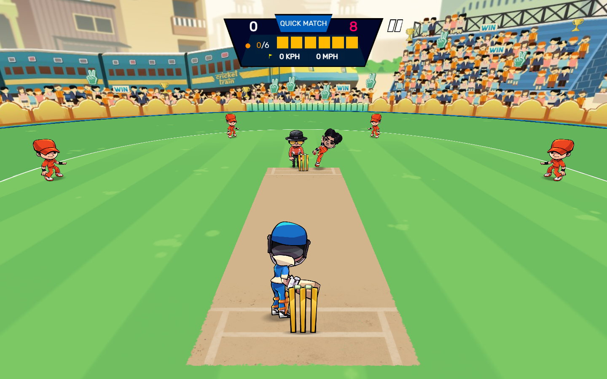
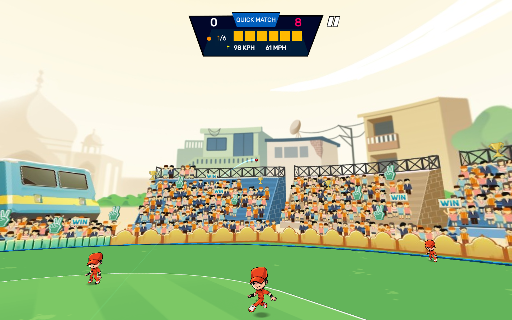
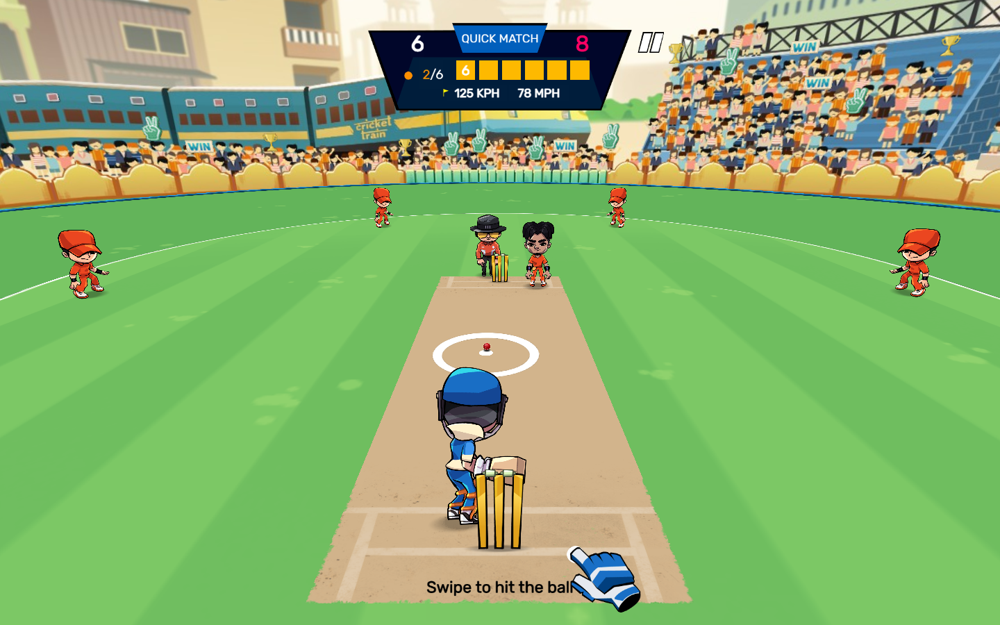

# Cricket Legends / 板球传奇 游戏规格说明书

格式版本：V5.1

仅记录有依据的实现层事实；内容字段非必填，未知留空，不代表不存在或已经验证。

## 1. 基础事实

**维度定义**：让读者第一眼知道“这是什么类型、什么操控体验的游戏”，以及它的技术栈。

**内容说明**

Cricket Legends / 板球传奇；MSN原生9p9nt6t0v98f，Gameloft/Ludigames公开原包。Cocos Creator2.3.0，JavaScript发布代码，2D骨骼角色与带纵深投影的球场。以击球手后方视角进行单人板球击球。原鼠标/触摸输入，本次仅远端桌面鼠标实际验证。

## 2. 资源类型

**维度定义**：游戏中游戏内容元素的资源类型是什么——即在哪个引擎运行下的资源格式。

**内容说明**

131运行文件，包含原Cocos引擎/物理库、原项目与设置JS、HTML/CSS、原text-res.zip和images1/images2图集数据、PNG/JPG/WebP纹理、MP3音效/音乐、Spine二进制skel与Rubik-Regular.ttf字体。419个原序列化资产条目、64个嵌入纹理引用已静态分析，遗漏的41个外置依赖按原路径抓取并保留SHA。没有替换人物、场景或原音乐。

## 3. 核心挑战维度

**维度定义**：游戏核心玩法主要挑战 / 满足人的什么。

**内容说明**

在原投球时机与球路下滑动击球，原挥棒时机/球物理/接球与边界判定决定得分，有限投球内追赶目标分数。原教程使用原投球冻结提示，本次一次滑动真实打出6分并进入下一投球；没有修改时钟、球速、RNG、教程、分数或碰撞。

## 4. 操控方式

**维度定义**：操控本身的复杂度 + 需要玩家判断的时机 / 策略复杂度。

**内容说明**

普通点击原Touch the screen与Quick Match；比赛中按下、向上连续拖动、释放完成一次挥棒。此次1440×900窗口从850,760到790,475，坐标仅是实际轨迹记录。原Canvas的TOUCH_START/TOUCH_END计算起止位置、距离、时间与挥棒；原Tap-to-run分支保留但未操作。

## 5. 行为路径

**维度定义**：玩家一局里重复做什么。

**内容说明**

原封面触屏提示→主菜单Quick Match→投手/击球手/守场员进入比赛→原Swipe to hit the ball教程→连续滑动→原球飞出、守场员追逐→原第一球计6分→下一投球。首版资源缺失故障和修复记录在验证附件，不作为玩法步骤。

## 6. 游戏路径（关键节点 + 流失风险）

**维度定义**：从开始到结束的流程 + 每个关键节点的潜在流失风险点。

**内容说明**

原封面→主菜单→快速比赛或Career职业入口→原比赛及目标分数/投球计数→原结算/后续比赛。实测快速比赛首击及下一投球，Career和整场结算仅源码确认，未实玩；没有跳过原教程或解锁门槛。

## 7. 成长路径

**维度定义**：玩家如何推进变强。

**内容说明**

原QuickMatchPlayed驱动初期目标/投球配置；原职业联赛1/2/3保留报名费、赛程、排名、冠军与每场奖励。原角色库存/购买/升级与技能冷却保留。原SaveGameManager用productKey cricketSmash加键名并Base64编码存入localStorage；未刷新验证持久化。

## 8. 核心闭环（目标-规则-反馈-激励）

**维度定义**：游戏是否具备“明确目标 → 明确规则 → 达成反馈 → 奖励激励 → 下一目标”的完整闭环。

**内容说明**

目标：在有限球数内达到原目标分数。规则：原AI投球、真实普通滑动、原挥棒时机/碰撞、边界或接球/跑分决定得分与失误。反馈：原挥棒/球轨迹/球场镜头/追球动画、得分与每球分值更新。激励与下一目标：原下一投球继续追赶目标、整场奖励与联赛推进；实际仅0→6分并进入2/6，未宣称整场获胜。

## 9. 玩法规则

**维度定义**：核心循环、玩法规则、目标与进度。

**内容说明**

原MatchManager/球/球棒/角色/裁判/守场员规则完整保留。实测首场目标8分、6球，首击6分，仍差2分；第二投球教程原样出现。普通比赛原失误、接杀、跑分与终局分支保留，未量化验证全部判定。离线改编只移除平台统计/插屏消费者。

## 10. 数值配置

**维度定义**：影响玩法的关键数值。

**内容说明**

源码：初期球数[6,6,8,8,10]，目标[8,10,12,14,15]；默认硬币25，快速比赛固定奖励10；职业比赛12球。三联赛场数5/7/9，报名50/100/150，每场奖励20/30/50，冠军200/300/500。实测主菜单25硬币、首场目标8分、第一球6分和2/6；其余数值为源码确认，未实际获奖/扣费。

## 11. 关卡配置

**维度定义**：关卡结构、递进规律、难度曲线。

**内容说明**

非固定关卡地图闯关；保留原快速比赛动态目标、三档职业联赛配置和赛程生成、Train/Beach/Eden三环境资源路径及原角色/球场配置。419原序列化资产和全部131运行文件已保留并核对；三联赛场数属于配置，不当作已完成21关。

## 12. 系统设计

**维度定义**：功能系统清单、UI 流程。

**内容说明**

保留66个原模块；64个模块逐字节一致，只在GameManager/MatchManager共6处删除统计初始化/回访跟踪/事件上报和插屏广告消费者，原比赛切换、计分、硬币、回合计数保持。没有新增SDK替身、奖励成功回调或账号/服务器协议。v2只增加41份实际原资源，原v1的90文件全部字节不变。 原Cocos渲染/物理、Spine角色/观众/裁判、投球/击球/追球/跑分、镜头、联赛赛程/本地排名、角色库存、技能、音效、设置/多语言与本地存档保留。原联赛排名是本地球队比赛统计，不伪造在线排行榜服务。

## 13. 主题化包装

**维度定义**：游戏的题材 / 世界观包装。

**内容说明**

原板球体育卡通包装：印度蓝衣击球手、橙衣投手/守场员、火车背景、观众看台、木球棒、红球、球门柱及原Quick Match记分牌。实际截图显示原投球/击球飞行/追球、得分与第二次教程手势，没有生成替代场景。

## 14. 养成系统 + 经济系统

**维度定义**：玩家如何成长、经济如何循环。

**内容说明**

原25起始硬币、比赛奖励与联赛报名、角色购买升级保留；五原角色关联POWER_SHOT、FORTUNE_BATSMAN、DOUBLE_RUN、SECOND_CHANCE、BOUNDARY_STRIKE。没有赠币、免费解锁、免费复活或奖励回调，当前未实际验证购买/升级/技能/获奖。

## 15. 角色 / 单位设定

**维度定义**：有哪些角色/单位、各自定位（玩法层面）。

**内容说明**

原五角色资源Virat/Sakib/David/Babar/Sachin及India/Bangladesh/Australia/Pakistan/Legend皮肤配置；实际蓝衣击球手、橙衣投手/守场员、裁判和观众可见，原挥棒/飞球/追球镜头运行。完整原角色资源保留，未逐角色试玩或验证各技能。

## 16. 商业化

**维度定义**：靠什么变现。

**内容说明**

保留66个原模块；64个模块逐字节一致，只在GameManager/MatchManager共6处删除统计初始化/回访跟踪/事件上报和插屏广告消费者，原比赛切换、计分、硬币、回合计数保持。没有新增SDK替身、奖励成功回调或账号/服务器协议。v2只增加41份实际原资源，原v1的90文件全部字节不变。 当前修正版123个请求/123个响应均同源200，0外部请求、0失败、0脚本错误。首版缺失资源失败另行完整保留；不把修正版清洁网络结果冒充累计所有运行无错。仅实际验证原快速比赛教程首击6分及下一投球；未完成整场、第二次教程操作、跑分、输赢结算、职业联赛、角色购买升级、设置、触屏或跨刷新存档恢复。完整原代码/场景/配置/资源保留不等于全部实玩。

图 1：原Quick Match比赛，0分/目标8/6球

图 2：一次普通滑动后的原飞球及守场员追球

图 3：原第一球6分，随后2/6投球教程
