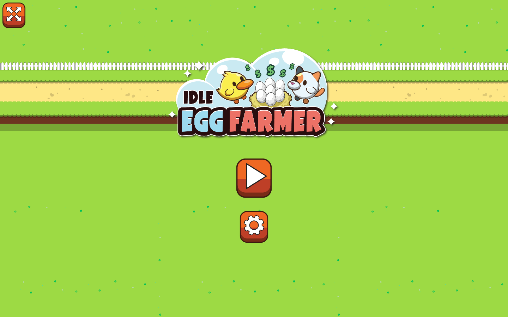
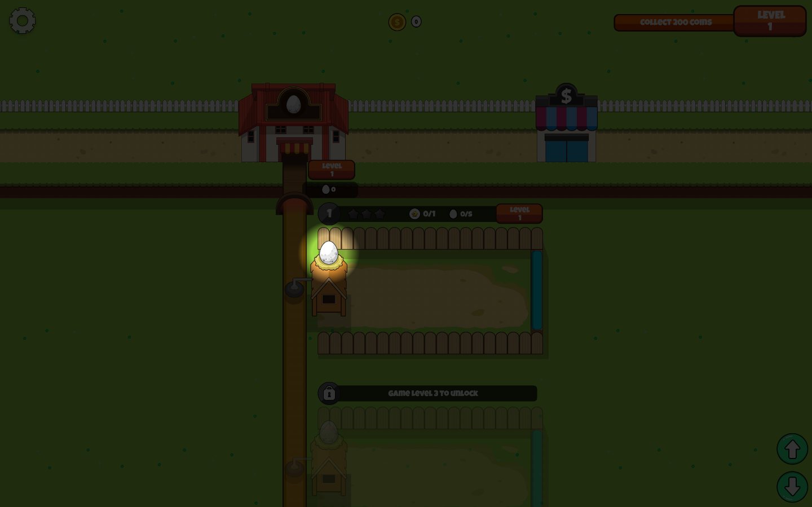
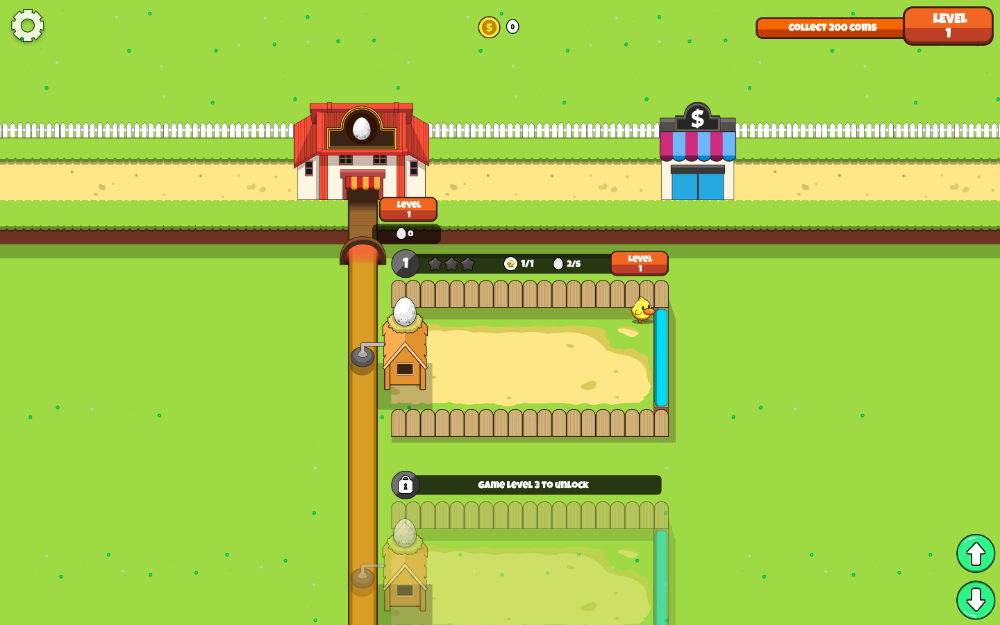
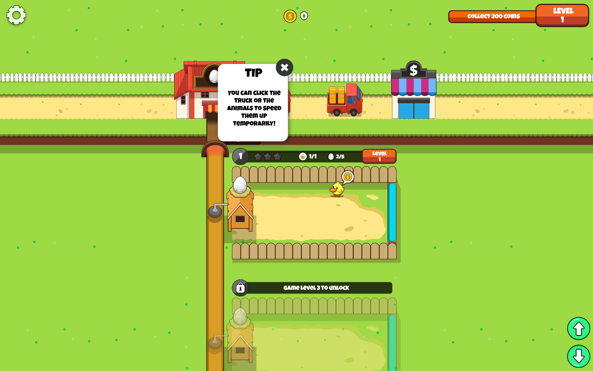
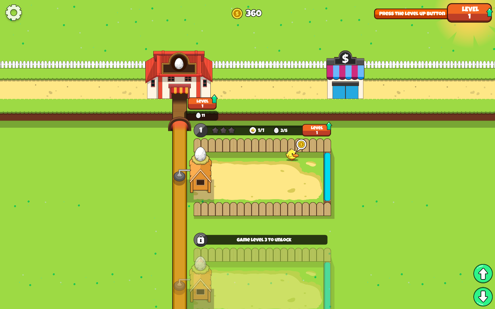
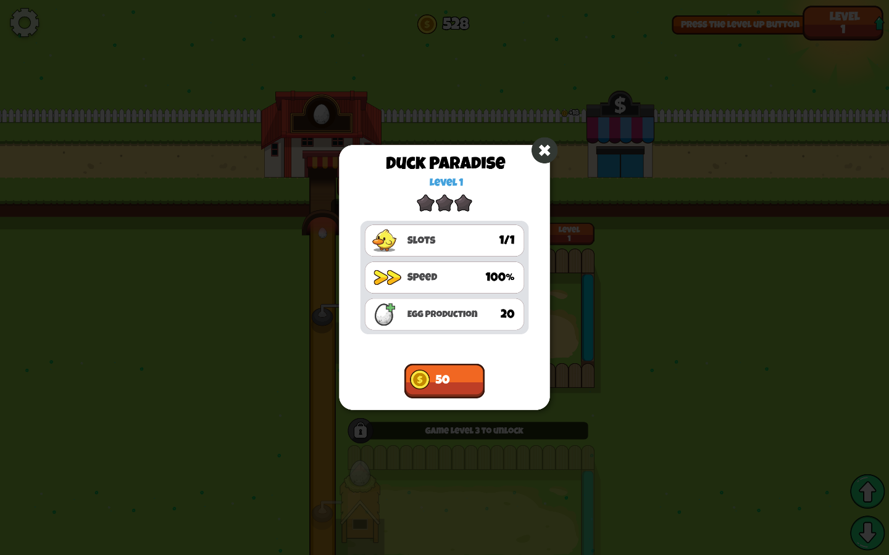

# Idle Egg Farmer / 放置蛋农 游戏规格说明书

格式版本：V5.1

仅记录有依据的实现层事实；内容字段非必填，未知留空，不代表不存在或已经验证。

## 1. 基础事实

**维度定义**：让读者第一眼知道“这是什么类型、什么操控体验的游戏”，以及它的技术栈。

**内容说明**

Idle Egg Farmer / 放置蛋农；MSN原生9nz2qk71khpd、MarketJS公开v13。原MyGame版本1.0.0/framework2.0.2，ImpactJS与原生JavaScript/HTML/CSS，2D Canvas。远端桌面1440×900，原画布3072×1920；手机未实测。

## 2. 资源类型

**维度定义**：游戏中游戏内容元素的资源类型是什么——即在哪个引擎运行下的资源格式。

**内容说明**

124原文件/124运行文件，除game.js和index.html外122文件原字节保留。101PNG、11MP3、1GIF、2套字体各EOT/TTF/WOFF/WOFF2、CSS/JS/HTML齐备；原菜单/场地/8种动物/蛋/传送带/仓库/市场/卡车/按钮与弹窗图片保留。

## 3. 核心挑战维度

**维度定义**：游戏核心玩法主要挑战 / 满足人的什么。

**内容说明**

通过普通孵化扩大原动物生产，商品沿传送带进入仓库，再由卡车运到市场换取金币，按原成本选择畜栏和仓库升级、达到游戏等级条件后逐步解锁畜栏。原动物与卡车点击可暂时加速。

## 4. 操控方式

**维度定义**：操控本身的复杂度 + 需要玩家判断的时机 / 策略复杂度。

**内容说明**

鼠标或触摸原Play/蛋/升级/设置/箭头。动物、卡车、金币气泡和滚动操作使用原控件，原提示说明点击动物或卡车临时加速。本轮只点击Play、孵化蛋、提示关闭与畜栏升级入口。没有调用原released/spawn/addMoney/升级业务方法验证。

## 5. 行为路径

**维度定义**：玩家一局里重复做什么。

**内容说明**

累计5次真实输入：原入口→Play→点高亮蛋孵化一只鸭→关闭原加速提示→打开Duck Paradise普通升级面板。另一次18秒被动观察不产生输入。1/1、2/s，原自动生产/传送带/仓库/卡车运销后金币0→360；最后只读原余额540。

## 6. 游戏路径（关键节点 + 流失风险）

**维度定义**：从开始到结束的流程 + 每个关键节点的潜在流失风险点。

**内容说明**

原菜单→Play→首栏高亮孵化蛋教学→动物来回运动并产生商品→传送带收货/仓库/卡车自动运销→金币与升级提示→普通升级面板。实际看到这一链路及价格50；没有购买，后续扩栏仅源码确认。

## 7. 成长路径

**维度定义**：玩家如何推进变强。

**内容说明**

原八个畜栏按游戏等级和金币解锁；每栏原等级/动物槽位/速度/产量及星级逻辑保留；仓库升级影响成本、货物收益、卡车速度与容量。广告专属prestige重置退役，不以免费奖励替代。

## 8. 核心闭环（目标-规则-反馈-激励）

**维度定义**：游戏是否具备“明确目标 → 明确规则 → 达成反馈 → 奖励激励 → 下一目标”的完整闭环。

**内容说明**

点蛋孵化→动物来回生产→商品沿原传送带进入仓库→原卡车装货运到市场→增加金币和等级进度→按原成本升级/解锁→继续生产。实际一只鸭1/1、2/s、0→360金币，普通升级面板显示价格50。

## 9. 玩法规则

**维度定义**：核心循环、玩法规则、目标与进度。

**内容说明**

14个原核心模块函数体保持逐字节：idle/field/conveyor/business/livestock控制器、shed/livestock/product/truck/market/warehouse、field-upgrade/warehouse-upgrade和游戏关卡。68处精确编辑限服务退役/其界面消费与客户端分发钩子；原生产、碰撞、商品数量、售价、普通升级、真实时间和随机数保持，不注入余额/种子/存档/时间。

## 10. 数值配置

**维度定义**：影响玩法的关键数值。

**内容说明**

源码：初金币0，游戏等级1、首目标200、首等级奖励80；首栏等级1/槽位1/速度100%/每次产量20，场景显示2/s；首栏普通升级50，仓库初升级120，原仓库单件收益9、容量9。每栏最多15只，游戏等级目标系数2，奖励系数1.8，原离线收益上限28800秒、弹窗阈值20。只实测首栏与0→360收益；最终余额只读540，原升级未购。

## 11. 关卡配置

**维度定义**：关卡结构、递进规律、难度曲线。

**内容说明**

8栏静态配置：Duck Paradise、Rabbit Hole、Porky Prairie、Meow Meadow、Grizzly Glade、Raccoon Refuge、Parrot Perch、Beaver Brook。解锁游戏等级1/3/10/15/21/28/36/45，等待0/5/60/90/120/150/180/210秒。不是8个已试玩关卡；只验证首栏。全部原配置及资源保留。

## 12. 系统设计

**维度定义**：功能系统清单、UI 流程。

**内容说明**

原Impact模块/实体/碰撞/补间/定时器/字体/资源预载；原畜栏、动物、商品池、传送带、仓库、卡车、市场、通知和弹窗保持。原IoManager/StorageManager本地存储及beforeunload保存保留，未植入云响应或SDK替身。真实MSStart/ApiHandler/CPMStar/GA、广告控制器/成功奖励回调、分享/更多游戏/外站点击层、宿主迁移脚本物理退役；普通领取原分支和普通2倍fever保留，广告加倍/利润倍增/立即解锁/广告专属prestige入口删除。原计时解锁仍按真实时间完成；原等级30处仅显示LEVEL MAX且不授予prestige或改等级。只退役已下载单机副本的客户端域名空白跳转，不更改上游域名/登录/授权。

## 13. 主题化包装

**维度定义**：游戏的题材 / 世界观包装。

**内容说明**

原绿色卡通农场、横向道路/栅栏/水槽、鸭/兔/猪/猫/熊/浣熊/鹦鹉/海狸、孵化蛋、运货卡车与市场。字体luckiestguy-regular和montserrat原资源保持；英语界面本轮实际渲染。

## 14. 养成系统 + 经济系统

**维度定义**：玩家如何成长、经济如何循环。

**内容说明**

金币由原自动运销或普通金币气泡产生，原价格/扣款/等级目标/普通奖励和离线收益代码保持；广告加倍和广告赠送不提供。畜栏与仓库采用原成长公式；本轮金币实际增长但没有购买/领奖。原存档保留但未刷新复验。

## 15. 角色 / 单位设定

**维度定义**：有哪些角色/单位、各自定位（玩法层面）。

**内容说明**

原8种畜栏动物；首栏孵化鸭后在原场地内往返生产，商品、原卡车、仓库和市场形成运销链。原动物/卡车普通临时加速保留未点击。没有远端玩家或远程AI服务。

## 16. 商业化

**维度定义**：靠什么变现。

**内容说明**

真实MSStart/ApiHandler/CPMStar/GA、广告控制器/成功奖励回调、分享/更多游戏/外站点击层、宿主迁移脚本物理退役；普通领取原分支和普通2倍fever保留，广告加倍/利润倍增/立即解锁/广告专属prestige入口删除。原计时解锁仍按真实时间完成；原等级30处仅显示LEVEL MAX且不授予prestige或改等级。只退役已下载单机副本的客户端域名空白跳转，不更改上游域名/登录/授权。 无新增充值、真实支付、联网榜或远程业务。未点击50金币升级、关卡升级奖励、金币气泡、普通fever、其他畜栏、声音或刷新，没有第六次操作。不能宣称升级成交、全区域或存档刷新恢复已实测。最终截图金币528为原动画中间帧，随后同一观察读取真实余额540；不以两者拼造精确出售瞬间。

图 1：原菜单与Play、设置和全屏控件

图 2：原农场、0金币与孵化高亮教学

图 3：普通点击孵化一只鸭、1/1、原2/s产量，教程退出

图 4：无新增输入：原卡车运输与原加速提示

图 5：普通关闭提示，原运输出售后HUD360金币和升级提示

图 6：普通打开Duck Paradise面板，1/1、100%、产量20、原50金币升级按钮；未购买
