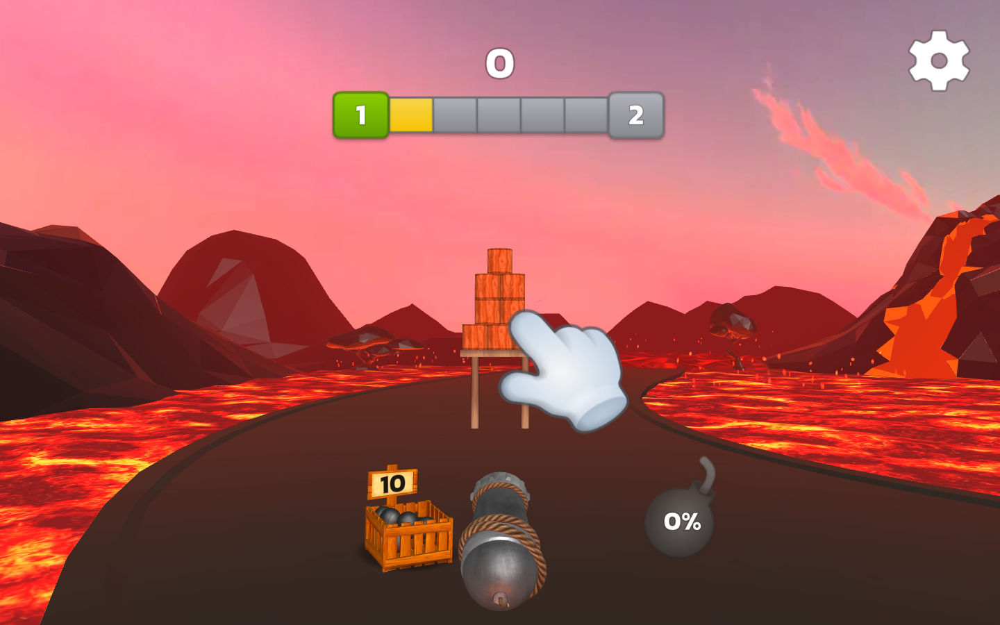
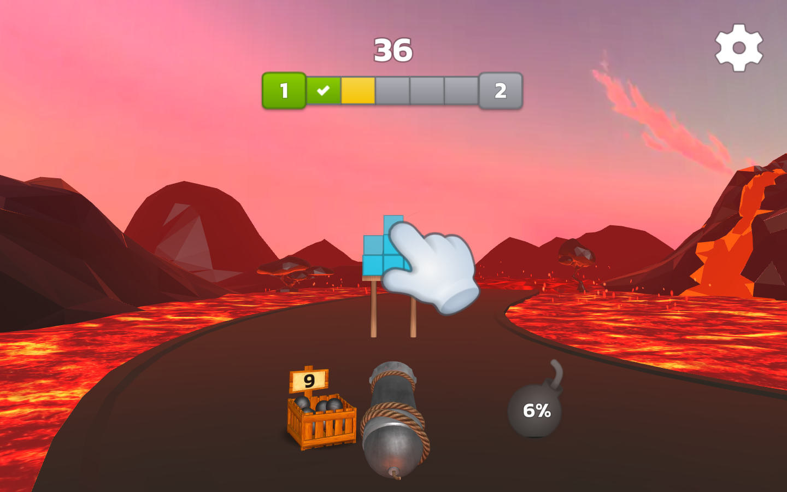
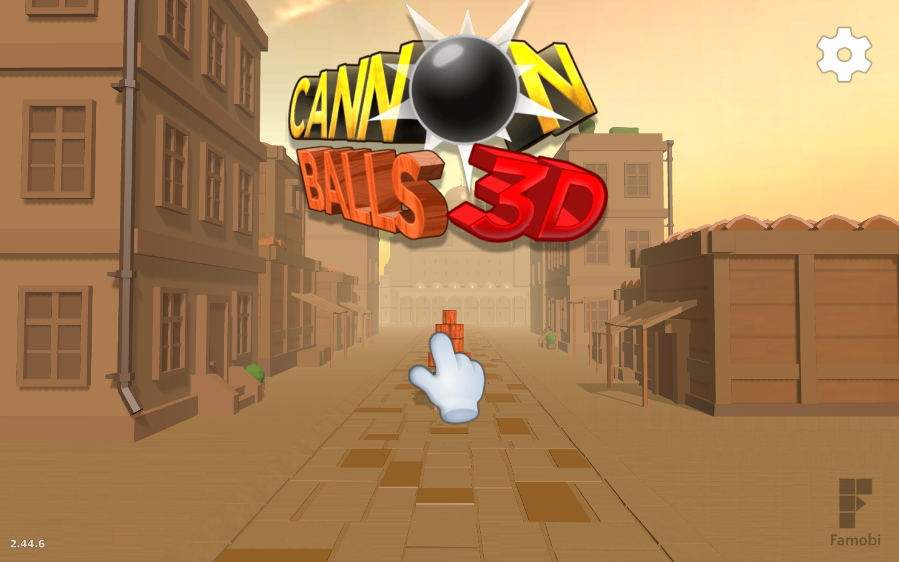

# Cannon Balls 3D / 炮弹3D 游戏规格说明书

格式版本：V5.1

仅记录有依据的实现层事实；内容字段非必填，未知留空，不代表不存在或已经验证。

## 1. 基础事实

**维度定义**：让读者第一眼知道“这是什么类型、什么操控体验的游戏”，以及它的技术栈。

**内容说明**

Cannon Balls 3D / 炮弹3D，MSN原生9mvgbr9fjlm5，Famobi公开原PlayCanvas发布物，版本2.44.6。JavaScript，3D固定炮台后方视角的有限弹药物理击倒游戏。原鼠标/触摸输入，本次仅远端桌面1440×900鼠标。

## 2. 资源类型

**维度定义**：游戏中游戏内容元素的资源类型是什么——即在哪个引擎运行下的资源格式。

**内容说明**

266运行文件；原PlayCanvas引擎、Ammo/Draco WASM与胶水、pako和原压缩配置加载器、原游戏脚本/场景JSON、PNG纹理与多页字体图集、音效MP3、容器/模型与模板。原配置1248资产条目含568模板、562场景实体；修订只移除服务脚本资产/组件，所有非服务材质/几何/刚体/关卡数据保持。原Lalezar第二页字体已补齐；原作者Famobi版权图片保留。

## 3. 核心挑战维度

**维度定义**：游戏核心玩法主要挑战 / 满足人的什么。

**内容说明**

观察三维堆叠支撑关系，用有限炮弹瞄准结构薄弱处击倒所有目标，越少弹药越能保留后续阶段的机会。物理碰撞、材质/目标受击与关卡清除规则决定结果。实测1发炮弹使首组木块清除，阶段1→2，未修改碰撞、时间、RNG、关卡或得分。

## 4. 操控方式

**维度定义**：操控本身的复杂度 + 需要玩家判断的时机 / 策略复杂度。

**内容说明**

原鼠标移动瞄准，普通指针按下/释放发射；原触摸分支保留未测试。实际第4步在713,477按住900ms并释放，只消耗1弹，不把长按描述为自动连续射击。首页第3步点击原手势区启动，刷新算第5步。

## 5. 行为路径

**维度定义**：玩家一局里重复做什么。

**内容说明**

原压缩配置/Ammo/Draco与场景加载→原Cannon Balls 3D首页和手势→点击手势区→第1关木块靶→普通射击→木块清除、弹药10变9、原UI36分→第2阶段蓝色靶及进度首格勾选→刷新原首页。首版99%故障与修复证据另保留。

## 6. 游戏路径（关键节点 + 流失风险）

**维度定义**：从开始到结束的流程 + 每个关键节点的潜在流失风险点。

**内容说明**

原首页→当前关卡→逐阶段击倒结构→原整关成功/失败窗口→下一关或重试。首关有5阶段，实际只完成第1阶段。付费商店、广告复活和看广告充能入口已物理移除，普通关卡、原失败重试/下一关、本地设置和正常挣得炸弹路径保留。

## 7. 成长路径

**维度定义**：玩家如何推进变强。

**内容说明**

原LevelManager按关卡模板与阶段配置组织普通/首领内容，原LevelController/GameplayController处理阶段清除和整关推进。原存档键CannonBalls3D_加GAME_VERSION，_levels旧兼容与_levelScores正常分数表保留；没有注入任何通关/存档数据。刷新只证明原首页与第1关正常初始化，不代表未完成阶段能持久化。

## 8. 核心闭环（目标-规则-反馈-激励）

**维度定义**：游戏是否具备“明确目标 → 明确规则 → 达成反馈 → 奖励激励 → 下一目标”的完整闭环。

**内容说明**

目标：有限炮弹击倒当前结构并继续后续阶段。规则：原屏幕射线瞄准、炮弹发射/刚体碰撞与物体清除判定、原弹药消耗和阶段门槛。反馈：原木块消失、36分、弹药9、进度勾选、蓝色下阶段靶与炸弹6%。下一目标：继续完成第2阶段，累计完成本关全部5阶段；未宣称本关获胜。

## 9. 玩法规则

**维度定义**：核心循环、玩法规则、目标与进度。

**内容说明**

原Cannon/InputController/Ball/Item/LevelBuilder、Ammo刚体/碰撞约束、ScoreManager与关卡规则保留。实测10发初始弹药，1次合法射击后9发；原首关第1阶段木块清除后自动切换第2阶段。普通失败按原proceedToDefeat分支处理，广告/内购复活选择退役，无免费复活。

## 10. 数值配置

**维度定义**：影响玩法的关键数值。

**内容说明**

静态资源：原1248资产、568模板、562场景实体、266运行文件；保留635个AST一致的原生方法。实际首关5阶段、弹药10→9、画面得分0→36、炸弹充能0%→6%、阶段1→2。原旧GameplayController.currentScores字段0不是记分牌真实得分；未宣称更多关卡/首领奖励。

## 11. 关卡配置

**维度定义**：关卡结构、递进规律、难度曲线。

**内容说明**

完整保留原LevelsPrefabs、普通/首领模板、场景/世界配置、目标材质、相机与炮台参数、Ammo/Draco几何和约束；568为原模板总数，含UI/道具，不能当作568关。本次只证首关第1阶段可正常完成，第2阶段实际出现；全部关卡保留不等于全部逐关实玩。

## 12. 系统设计

**维度定义**：功能系统清单、UI 流程。

**内容说明**

完整移除原GameInterface/APIMediator提供方、13个广告/内购/GDPR/外部暂停模块及实际遥测、广告、购买、云存储消费者；保留原普通胜败/阶段切换与本地物理规则。635个保留的原生方法AST完全一致，46处原场景/模板服务组件退役，Root普通系统保持。原存储schema/键保持，绑定真实浏览器localStorage；没有SDK替身、身份、广告成功回调、赠送奖励或全解锁。缺失Preloader.js原404、非preload且无引用，保留证据后只删除其未用元数据；第二页字体和版权图按原路径补齐。 原渲染、音效/音乐、本地语言、视口安全区、炮台瞄准、物理击倒、计分、普通炸弹充能、关卡和本地保存保留。静态AST严格拒绝丢失非服务基线方法，修复了首次退役规则误删声音/关卡消费者的问题。

## 13. 主题化包装

**维度定义**：游戏的题材 / 世界观包装。

**内容说明**

保留原3D卡通炮台、木箱/蓝色目标块、桌架、弹药箱、炸弹、教程手势与原Logo；实测岩浆火山世界与刷新后西部城镇世界。世界变化沿原选择逻辑发生，没有写RNG或替换场景。原Famobi署名在右下角。

## 14. 养成系统 + 经济系统

**维度定义**：玩家如何成长、经济如何循环。

**内容说明**

原每关炮弹预算、计分/最高分、阶段推进和正常炸弹充能保持，实测1发后炸弹6%。原premiumBalls初始0，未赠球/炸弹/金币/广告奖励。内购、广告赠球/复活/充能、去广告促销窗口和支付回调已移除，普通玩法不依赖这些服务。

## 15. 角色 / 单位设定

**维度定义**：有哪些角色/单位、各自定位（玩法层面）。

**内容说明**

原玩法对象为炮台、弹丸、可击倒结构、不同材质目标、障碍/约束与世界装饰，不以人物角色为核心。实测原木块、蓝色块、炮台/炮弹箱和手势动画；其余原物件/模板全部保留但未逐个测试。没有生成替代角色或删改原关卡物件。

## 16. 商业化

**维度定义**：靠什么变现。

**内容说明**

完整移除原GameInterface/APIMediator提供方、13个广告/内购/GDPR/外部暂停模块及实际遥测、广告、购买、云存储消费者；保留原普通胜败/阶段切换与本地物理规则。635个保留的原生方法AST完全一致，46处原场景/模板服务组件退役，Root普通系统保持。原存储schema/键保持，绑定真实浏览器localStorage；没有SDK替身、身份、广告成功回调、赠送奖励或全解锁。缺失Preloader.js原404、非preload且无引用，保留证据后只删除其未用元数据；第二页字体和版权图按原路径补齐。 最终v4两次加载累计442个请求/442个同源200响应，0外部请求、0失败、0脚本错误；保留3条浏览器音频自动播放限制警告，不冒充音频人工听测。首版脚本错误另存，不将修订清洁结果写成历史从未失败。仅实玩第1关首阶段通关并自动进入第2阶段；未完成该关全部5阶段、整关结算、全部关卡、设置/暂停、炸弹或移动端。刷新回到原第1关首页，不宣称跨刷新保存阶段2或36分。只读旧GameplayController.currentScores字段为0，不用作真实得分依据；原计分由ScoreManager.instance.currentScores驱动，截图004的原UI实际显示36。

图 1：原首关木块靶、10发、0分

图 2：1发后阶段2、36分、9发和6%正常炸弹充能

图 3：第5步刷新后的原西部世界首页
