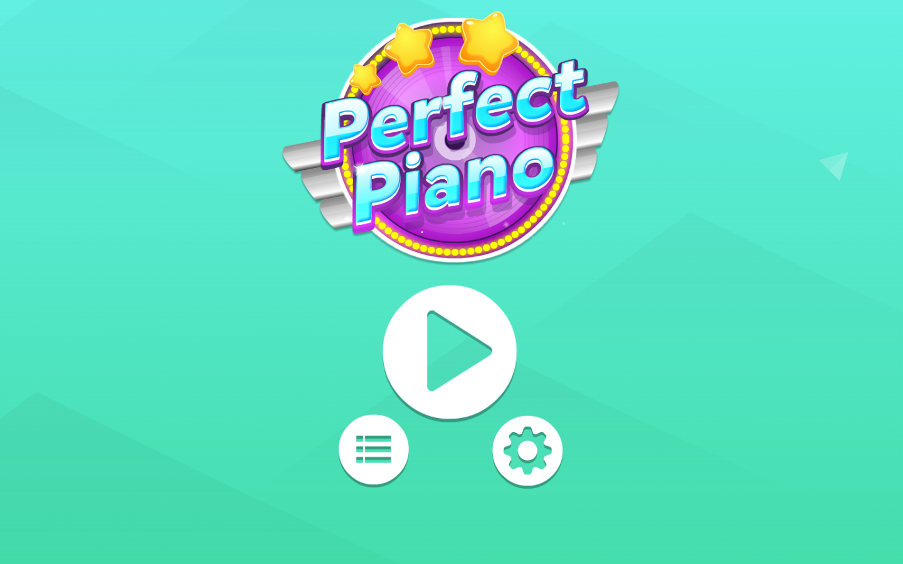
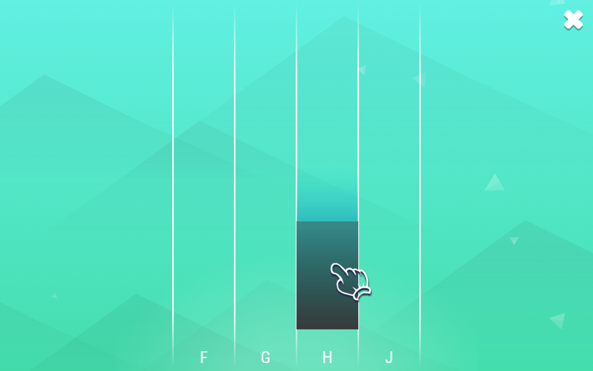
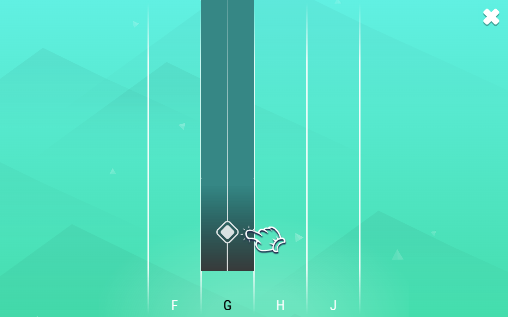

# Perfect Piano 游戏规格说明书

格式版本：V5.1

仅记录有依据的实现层事实；内容字段非必填，未知留空，不代表不存在或已经验证。

## 1. 基础事实

**维度定义**：让读者第一眼知道“这是什么类型、什么操控体验的游戏”，以及它的技术栈。

**内容说明**

MSN9nprcsghz6j6/v9，Perfect Piano，原perfect-piano。Phaser2.10.5/PIXI/Canvas、MIDI.js、JavaScript/HTML/CSS。原基准640×960，实际1440×900全画布，四道居中；手机未测。

## 2. 资源类型

**维度定义**：游戏中游戏内容元素的资源类型是什么——即在哪个引擎运行下的资源格式。

**内容说明**

7个原入口/脚本/CSS与50个源码声明静态资源实际取得。最终运行基础57文件，54个文件保持原字节；原游戏JS退役发行集成，原HTML改直载，原Phaser仅11个窗口几何别名改真实window。50项含3图集PNG/JSON、位图字体PNG/XML、5格式CSS字体、谱面/专辑JSON、11音效×MP3/M4A/OGG及1个原钢琴音色JS，88个内嵌音频采样。

## 3. 核心挑战维度

**维度定义**：游戏核心玩法主要挑战 / 满足人的什么。

**内容说明**

跟随四道下落音符及时点击短音符和按住长音符，依据原时机和谱面获得计分/星级，再解锁歌曲和专辑。实际仅完成原教程前两个短音符，正式曲目计分未验证。

## 4. 操控方式

**维度定义**：操控本身的复杂度 + 需要玩家判断的时机 / 策略复杂度。

**内容说明**

原教程画面提示F/G/H/J或点击四道音符。实测鼠标按提示分别点第一道和第三道短音符，原指导继续下一项；长按、键盘和手机触摸未追加验证。点击均是真实mouse move/down/up，累计输入含旧启动失败共5次。

## 5. 行为路径

**维度定义**：玩家一局里重复做什么。

**内容说明**

旧v2黑屏取证→精确窗口读取修正→v3原Perfect Piano菜单→原Play→第一道短音符和手势→真实点击后第三道短音符和手势→再次真实点击后第二道长按音符和手势。保留强制首教程，不写已完成标记或伪造存档。

## 6. 游戏路径（关键节点 + 流失风险）

**维度定义**：从开始到结束的流程 + 每个关键节点的潜在流失风险点。

**内容说明**

累计5输入，未重置：1旧v2打开黑屏并报fenster未定义（保留失败图/控制台）；2修复v3打开原菜单；3原Play进入原必经教程；4按可见手势点第一道短音符495,700，原教程推进第二个短音符（第3道H）；5点第3道短音符795,700，原长按G音符示意出现。只按可见界面输入，没有读取隐藏谱面用于点按、调用游戏处理器或改状态。原音频上下文suspended→running、88个原采样已解码；未声称听感。正式曲目尚未进入，分数仍0、教程仍未完成；完整曲目/正式计分/长按/结算/星级解锁/刷新存储/全部曲目和手机均未验证。

## 7. 成长路径

**维度定义**：玩家如何推进变强。

**内容说明**

原谱面、歌曲本地分数、星级门槛、专辑及教程完成存储保持。原localStorage键perfect_piano_1.0出现，教程完成仍false、分数0；没有把存储键存在冒充完成教程/恢复存档/解锁新歌。

## 8. 核心闭环（目标-规则-反馈-激励）

**维度定义**：游戏是否具备“明确目标 → 明确规则 → 达成反馈 → 奖励激励 → 下一目标”的完整闭环。

**内容说明**

观察原下落音符与指引→短按或长按→原音符反馈与MIDI播放→继续后续音符→原曲目分数/星级结算→按原星级要求解锁后续歌曲。本轮只核对原教程两个短按到长按示意的推进，未跑完整正式闭环。

## 9. 玩法规则

**维度定义**：核心循环、玩法规则、目标与进度。

**内容说明**

781个原类方法中717个AST相同；162个重点落块/按键触摸/谱面/速度/心形/音符/歌曲存储方法中159个AST相同，另外3个仅发行日志改console，规则体相同。44项原设置逐项一致，AUTOPLAY/GOD_MODE保持false；没有改谱面、速度、判定、生命、随机、分数和解锁。

## 10. 数值配置

**维度定义**：影响玩法的关键数值。

**内容说明**

原4道，基准640×960、音符基准高度280，星级里程碑0.39/0.74/0.89。原108首谱面、7个专辑、108个专辑歌曲引用，88个钢琴内嵌采样。实测只点2个教程短音符，正式分数0/教程完成false。数值来自源码和JSON，非全曲实玩。

## 11. 关卡配置

**维度定义**：关卡结构、递进规律、难度曲线。

**内容说明**

108个原谱面及7个专辑星数门槛保留，教程包括短按和长按。实际只进入教程并完成前两个短按；未完整教程/选择歌曲/逐首实玩，不能把配置数量当成全部曲目验收。

## 12. 系统设计

**维度定义**：功能系统清单、UI 流程。

**内容说明**

100处主脚本精确范围改动，物理退役发行SDK/广告/统计/更多游戏/平台暂停音量回调和存储命名空间。普通非奖励广告继续直连同一原无参继续函数；保留浏览器原生可见性、音量、本地存储。MIDI.loadPlugin显式选原库自带webaudio分支，原MP3音色与MIDI算法不变；Phaser11处fenster.innerWidth/Height改真实window读取，精确反向编辑可恢复原引擎。无SDK替身。

## 13. 主题化包装

**维度定义**：游戏的题材 / 世界观包装。

**内容说明**

原青绿菱形背景、紫金Perfect Piano标题、白色播放/曲单/设置、四道渐变音符、F/G/H/J按键标签、原指导手和长按菱形标记均来自原素材。截图001是实际v3菜单（累计输入2），旧黑屏图仅在历史证据中。

## 14. 养成系统 + 经济系统

**维度定义**：玩家如何成长、经济如何循环。

**内容说明**

原歌曲得分、专辑星数门槛、本地保存与本局原心形机制保留，未改奖励或免费解锁。正式分数和成长未实玩；没有新增金币/后台经济/付费。

## 15. 角色 / 单位设定

**维度定义**：有哪些角色/单位、各自定位（玩法层面）。

**内容说明**

原四道短/长音符、原音符尾迹/背景/指导手/按键和各类本地菜单；原无叙事角色。实际屏幕只核对菜单、两个教程短音符和下一长按示意。

## 16. 商业化

**维度定义**：靠什么变现。

**内容说明**

发行广告、统计上报、品牌更多游戏及平台账号/存储接口物理退役，普通本机音符玩法保留。无联机/服务端替代或广告完成伪造。源码内保留的MIDI通用本地音色读取/本地文件导入功能不访问业务服务器，最终实际请求均同源。

图 1：原菜单，实际累计输入2；旧黑屏失败另存

图 2：原必经教程第一短音符

图 3：点按后推进第三道第二短音符

图 4：再次点按后原长按示意，未操作长按
