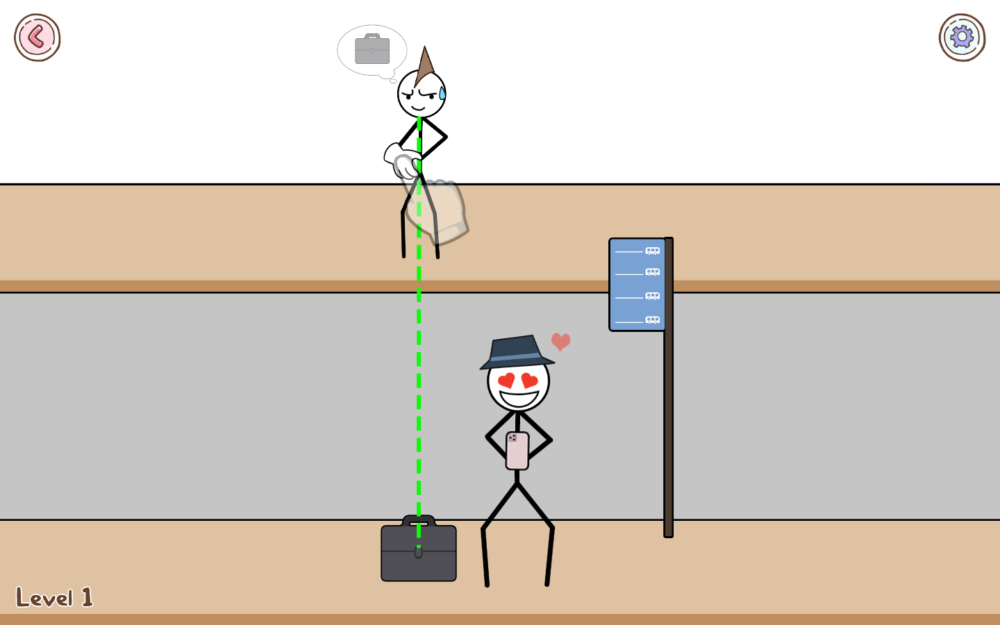
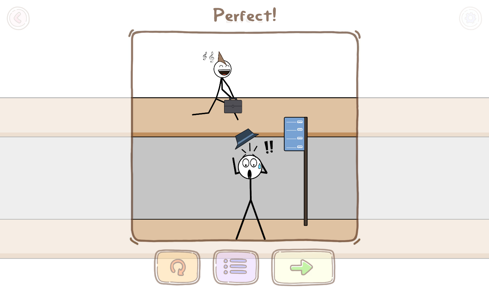
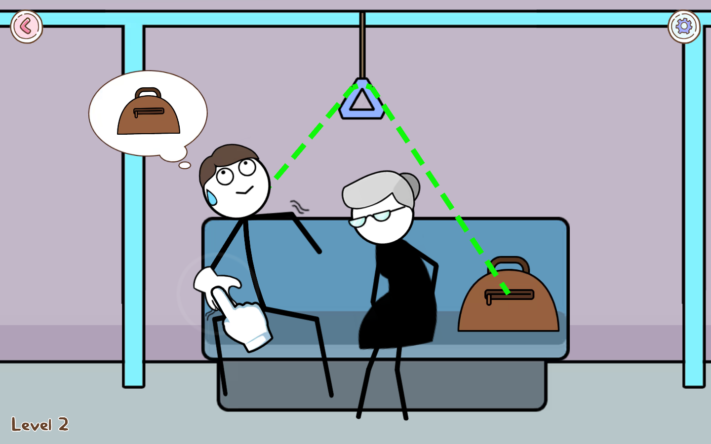

# Thief Puzzle / 神偷谜题 游戏规格说明书

格式版本：V5.1

仅记录有依据的实现层事实；内容字段非必填，未知留空，不代表不存在或已经验证。

## 1. 基础事实

**维度定义**：让读者第一眼知道“这是什么类型、什么操控体验的游戏”，以及它的技术栈。

**内容说明**

Thief Puzzle / 神偷谜题；MSN原生9njb654d39wx，Famobi v13。原Haxe4.3.4生成JavaScript，原polygonal1.4.21运行结构，2D横版场景。保留完整原发布脚本和原资源；没有恢复作者Haxe工程。远端52机器1440×900实际浏览器验证。

## 2. 资源类型

**维度定义**：游戏中游戏内容元素的资源类型是什么——即在哪个引擎运行下的资源格式。

**内容说明**

450运行文件：HTML、原生改编JS、48原基础资源及400原压缩关卡dat。基础资源包括PNG/AVIF、JSON/ATLAS、文字、FNT位图字体和AAC/OGG；关卡dat原样保留，字节级zlib/容器解析确认每关场景XML与原图片/Spine/音频等子文件。四种原语言en/ja/ko/ru资源均保留，不强制替换格式。

## 3. 核心挑战维度

**维度定义**：游戏核心玩法主要挑战 / 满足人的什么。

**内容说明**

依据场景目标引导原小偷手部伸展路径，绕过人物/障碍接触目标物并收回；路径与原碰撞/目标判定保持。实测第1关一次连续拖拽取回公文包并Perfect!成功；第2关原画面提示绕公交扶手取得手提包，但未操作该解法。

## 4. 操控方式

**维度定义**：操控本身的复杂度 + 需要玩家判断的时机 / 策略复杂度。

**内容说明**

原鼠标/触摸指针驱动手部伸展与路径；本轮普通Play、一次按下/连续移动/释放、普通Next。手部起点约585,238，目标603,790是本轮1440×900可见坐标，不作为固定玩法参数。未触发游戏处理函数或写入状态。

## 5. 行为路径

**维度定义**：玩家一局里重复做什么。

**内容说明**

累计5次真实输入：第1次入口主调用早于body而失败，完整保留；仅移动HTML调用位置后，第2次载入原菜单，第3次普通Play进入Level1，第4次从原手部到公文包的一次连续拖拽，出现原Perfect!成功画面、角色拿回包，第5次普通Next进入原Level2公交车场景。没有第6次输入。

## 6. 游戏路径（关键节点 + 流失风险）

**维度定义**：从开始到结束的流程 + 每个关键节点的潜在流失风险点。

**内容说明**

原菜单→Play→Level1公交站公文包场景→原伸手/目标取得/回收及Perfect!→普通Next→Level2公交车座位/扶手/手提包。保留原失败、重试、选关与后续关卡流程；本轮未实际验证这些额外路径。

## 7. 成长路径

**维度定义**：玩家如何推进变强。

**内容说明**

原ea保存已达关卡level、首次启动first及音乐/音效偏好；原Z.Mg递增关卡，选关原上限400。实测Next到Level2，未重载证明持久化。没有新增货币、免费解锁或伪造完成档。

## 8. 核心闭环（目标-规则-反馈-激励）

**维度定义**：游戏是否具备“明确目标 → 明确规则 → 达成反馈 → 奖励激励 → 下一目标”的完整闭环。

**内容说明**

目标：取回场景规定物件。规则：原指针路径、手臂/环境碰撞和目标命中/回收逻辑。反馈：原伸手/取包角色动作、Perfect!结算、下一关新场景。激励与下一目标：原关卡推进到下一件目标物，本轮从公文包进入公交车手提包场景；没有广告奖励或外部服务确认。

## 9. 玩法规则

**维度定义**：核心循环、玩法规则、目标与进度。

**内容说明**

全部原场景和421原保留类逻辑不变，既有本地db基类提供原玩法，平台派生层被物理移除。第1关成功是实际拖拽触达目标并正常回收；完整原碰撞和后续机关保留，未逐项量化所有危险类型、容错半径或失败条件。

## 10. 数值配置

**维度定义**：影响玩法的关键数值。

**内容说明**

原选关器暴露1至400，共400份完整原dat；基础manifest列48资源。原发布版本1.4.21，Haxe4.3.4。每款累计5次真实输入含首轮启动失败；保留421类完全一致和1个入口构造器选择差异。伤害/计分/时间参数未确认，不填推测数。

## 11. 关卡配置

**维度定义**：关卡结构、递进规律、难度曲线。

**内容说明**

400份原res/levels/lv1.dat至lv400.dat全量保留；每份字节SHA及全部内部子文件名/字节数/SHA已解析，没有重做或复制关卡充数。原res/levels.json保留。实际第1关完成，第2关已进入；其他398关未试玩，不将完整材料等同全关卡验收。

## 12. 系统设计

**维度定义**：功能系统清单、UI 流程。

**内容说明**

完整移除7个GameInterface专用扩展类Y/Ze/R/We/nc/qc/ub及其元数据，原yi.VC只把应用构造器由Y选为原包自带db。421个其他保留类AST完全一致；原db/Uc/tb/vb/Ta/Oe/ea的引擎、菜单、碰撞、图形、400关、音频与localStorage进度实现保留。原Ta.Hg始终false，不提供广告跳关或奖励替身。HTML移除原外部平台入口/manifest/favicon并在body存在后调用原ThiefPuzzle.main。 原本地存储类Oe/gi、语言选择、音频、画布、图片/Spine/原压缩容器解码和手臂/场景对象系统保留；没有引入GameInterface、身份、奖励、服务器协议或假成功回调。

## 13. 主题化包装

**维度定义**：游戏的题材 / 世界观包装。

**内容说明**

原手绘火柴人神偷、伸长手臂、目标思考气泡、公文包、公交站牌和恋爱路人；第2关原公交车座椅、扶手、乘客/手提包。使用真实原PNG/AVIF/Spine和位图字体，规格配图来自本版远端实际截图。

## 14. 养成系统 + 经济系统

**维度定义**：玩家如何成长、经济如何循环。

**内容说明**

原关卡解锁进度与音量偏好写入本地存储；未见需要新建的货币经济。原本地基类不开放奖励跳关，未赠送资源或变更解锁条件。

## 15. 角色 / 单位设定

**维度定义**：有哪些角色/单位、各自定位（玩法层面）。

**内容说明**

原玩家手臂/手部与小偷、原关卡人物及物件；实测第1关路人受惊、玩家拿回公文包的原动画/结算，第2关乘客和手提包可见。400关其他角色配置保留而未逐个试玩。

## 16. 商业化

**维度定义**：靠什么变现。

**内容说明**

完整移除7个GameInterface专用扩展类Y/Ze/R/We/nc/qc/ub及其元数据，原yi.VC只把应用构造器由Y选为原包自带db。421个其他保留类AST完全一致；原db/Uc/tb/vb/Ta/Oe/ea的引擎、菜单、碰撞、图形、400关、音频与localStorage进度实现保留。原Ta.Hg始终false，不提供广告跳关或奖励替身。HTML移除原外部平台入口/manifest/favicon并在body存在后调用原ThiefPuzzle.main。 修正版31请求/31响应均为同源200，0外部请求、0请求失败、0脚本错误。首版body时序失败单独归档，不混称累计5步全无错误。实际完成第1关并进入第2关；400份原关卡均已下载、解压容器和哈希核对，但没有逐关试玩。未验证第2关解法、失败/重试、设置、跨刷新进度恢复、触屏或可听音效。

图 1：原Level1手部与公文包目标

图 2：一次连续拖拽后的原Perfect!成功与取回包

图 3：普通Next进入原Level2，未验证此关解法
