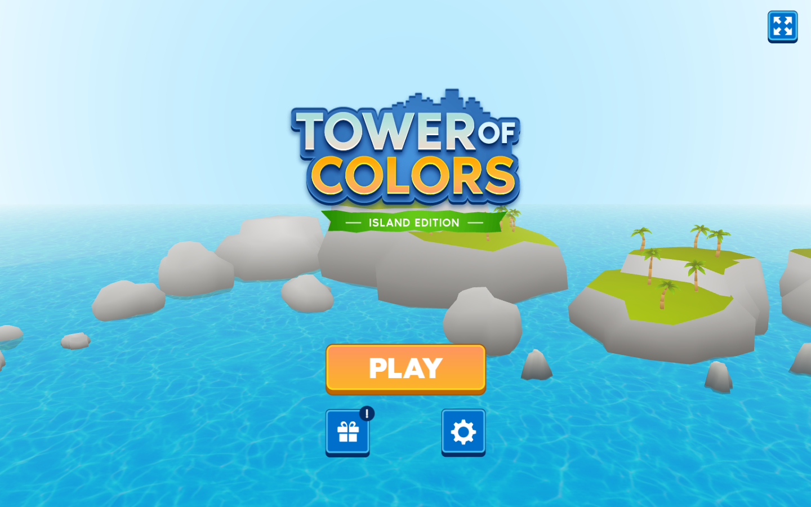
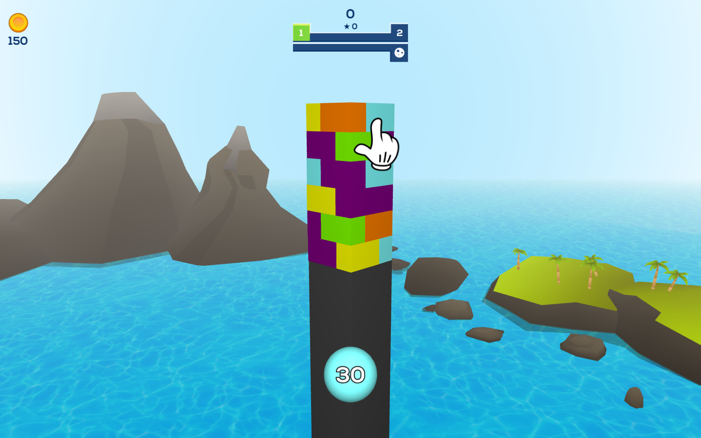
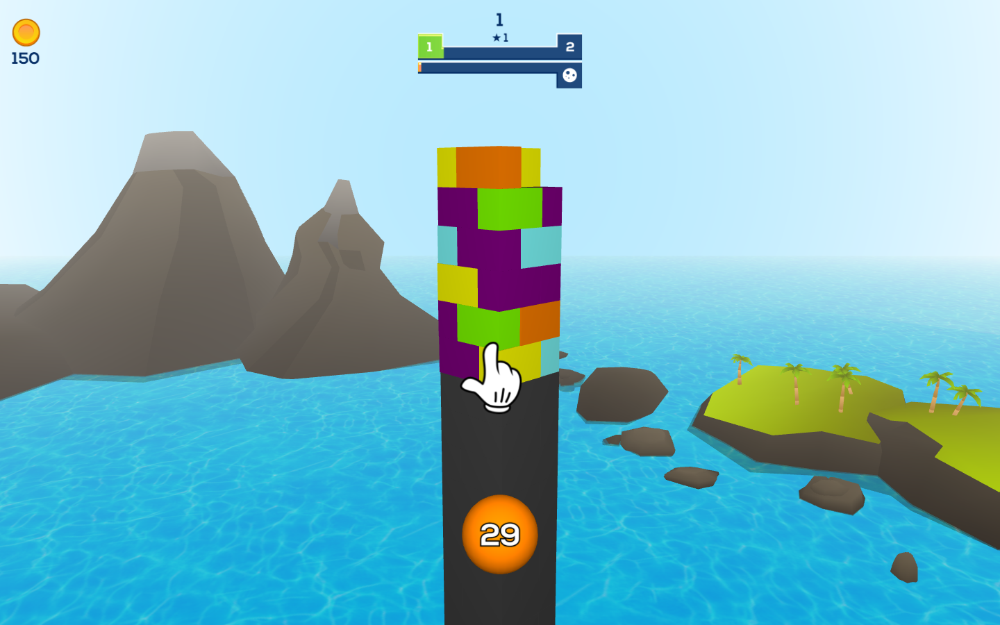
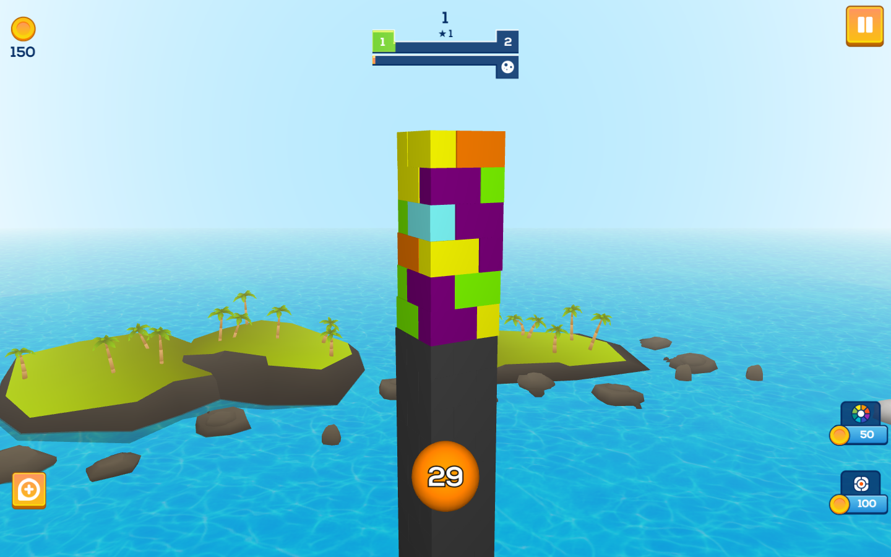
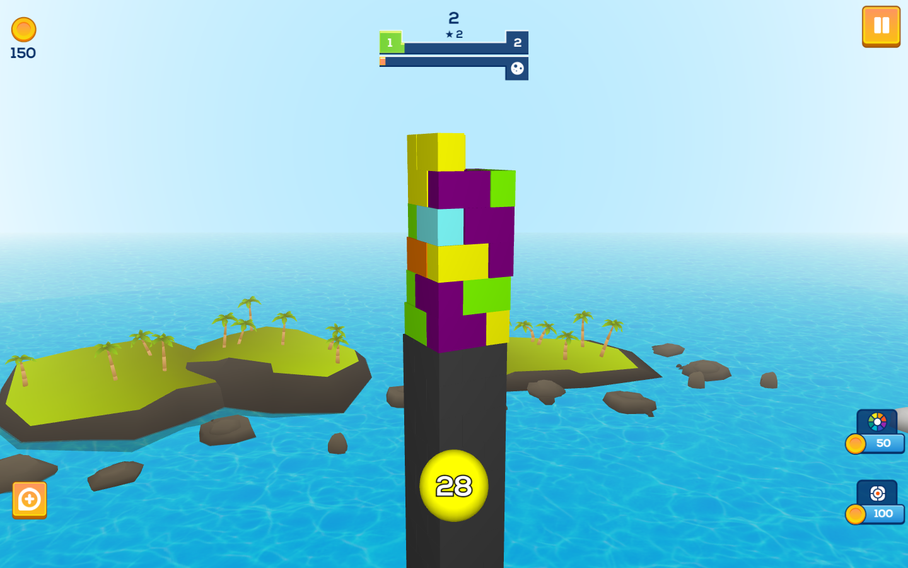

# Tower of Colors 游戏规格说明书

格式版本：V5.1

仅记录有依据的实现层事实；内容字段非必填，未知留空，不代表不存在或已经验证。

## 1. 基础事实

**维度定义**：让读者第一眼知道“这是什么类型、什么操控体验的游戏”，以及它的技术栈。

**内容说明**

MSN9mvrrp2z8ks8，原Tower of Colors v4/Island Edition，内部mjs-tower-of-colors-island-edition。JavaScript/HTML/CSS，Impact二维HUD与原custom Babylon/Ammo WebGL三维场景。实际桌面1440×900、内部HUD1536×960；实体手机未测。

## 2. 资源类型

**维度定义**：游戏中游戏内容元素的资源类型是什么——即在哪个引擎运行下的资源格式。

**内容说明**

62原依赖逐文件SHA和字节一致，含原Ammo WebAssembly、原Babylon场景（28mesh/5material、内嵌几何）、5张材质贴图及水面图、原Packer图集61帧、原字体/音效、CSS和favicon。保留真实塔块、海岛、水面、山石、棕榈、球与HUD；没有占位贴图或重画原资源。

## 3. 核心挑战维度

**维度定义**：游戏核心玩法主要挑战 / 满足人的什么。

**内容说明**

旋转三维彩色塔，观察当前球颜色，点击可见同色塔块以触发原球命中及相邻同色移除，在有限弹药内使塔坍塌清除；本轮两次合法命中及转动真实通过，整关目标尚未完成。

## 4. 操控方式

**维度定义**：操控本身的复杂度 + 需要玩家判断的时机 / 策略复杂度。

**内容说明**

原Play进入；点击塔块由原窗口输入/Babylon拾取/原球发射处理；鼠标按住拖动调整绕塔角度。实际3次普通点击均move→100ms→down→80ms→up；旋转一次为12段move的真实拖拽。原暂停、缩放与50/100金币道具按钮在教程结束后保留，本轮没有点这些按钮。

## 5. 行为路径

**维度定义**：玩家一局里重复做什么。

**内容说明**

原菜单海岛/标题→点击Play→原开场摄像机由塔底移到上层→按原青色教程手点击→显示1分/29弹药→普通拖动旋转→滑动手消失、普通控制显示→橙色命中→2分/28弹药、下一黄色球。没有额外开局或重放。

## 6. 游戏路径（关键节点 + 流失风险）

**维度定义**：从开始到结束的流程 + 每个关键节点的潜在流失风险点。

**内容说明**

本轮在原关1、关2目标刻度前完成2次原色球命中；青色/橙色相应块消失，塔上剩余原彩色块与底部支撑可见，视角随拖动改变。首次分数0、最高0、弹药30、金币150；末次2/2/28/150。不是首关通关、全流程或道具领奖验证。

## 7. 成长路径

**维度定义**：玩家如何推进变强。

**内容说明**

原本地level/score/highscore/coin、首次点击与滑动教程标志、关卡切换、难度递增和正常存储路径保留。实际在关1，教程步骤自然前进与当前最高分2可见；没有刷新持久化、后续关卡或结算实测。

## 8. 核心闭环（目标-规则-反馈-激励）

**维度定义**：游戏是否具备“明确目标 → 明确规则 → 达成反馈 → 奖励激励 → 下一目标”的完整闭环。

**内容说明**

观察球色及可见塔块→点击原目标→原Ammo/Babylon物理及同色邻接遍历移除→累计破坏块分数/能量→必要时旋转找同色→弹药耗尽失败或塔清除进入下一关。原玩法循环保留，本轮仅覆盖两击、加分、减弹药、换球和转视角。

## 9. 玩法规则

**维度定义**：核心循环、玩法规则、目标与进度。

**内容说明**

原LevelManager pickBlock仅处理未冻结/有物理体且高于底部的块；原Ball颜色判定与相邻同色遍历、块破坏/坍塌、分数和弹药不改。每破坏块通过原tallyDestroyedBlock计分；原combo换金币及能量炮阈值机制仅源码保留，本轮没有触发奖励或免费道具。

## 10. 数值配置

**维度定义**：影响玩法的关键数值。

**内容说明**

源码：15种原塔布局循环；难度d对应高度20+floor(2.5d)、上限150，颜色5+d上限9，弹药30+5d上限255；具体运行布局由原规则/随机数产生，不强行固定。实际原关1弹药30→29→28，分数/最高0→1→2，金币150不变；原wildshot价格50、laser100实显但未购买。

## 11. 关卡配置

**维度定义**：关卡结构、递进规律、难度曲线。

**内容说明**

原LevelDesign全部15种搭建函数、LevelManager全部原生成/颜色/邻接/坍塌规则保留，后续按原level循环布局及原难度推进，不以15模板误称只有15关。首关两次点击验证，完整首关、后续布局和全组合未验证。

## 12. 系统设计

**维度定义**：功能系统清单、UI 流程。

**内容说明**

358游戏/字体/3D方法中328归一AST一致、15平台/广告/外链方法退役、15方法仅服务调用/控件范围修改。31个原3D/物理/关卡/普通每日奖励/Packer及vendor节点经修改前结构AST相同后采用原字节保全，共3407682字节；完整Babylon/Ammo vendor和41数据/模块指纹保持。失败v1生成器补括号及v2过宽visitor触及vendor证据保留；v3将vendor从退役visitor排除，不以放宽哈希掩盖修改。

## 13. 主题化包装

**维度定义**：游戏的题材 / 世界观包装。

**内容说明**

原低多边形海岛/蓝色水面/山石棕榈、圆柱彩色块塔、球与原白边手势教程、分数星号、橙色暂停和蓝色道具按钮。实际海岛菜单、首塔、破坏后缺口、旋转朝向均见原渲染截图。

## 14. 养成系统 + 经济系统

**维度定义**：玩家如何成长、经济如何循环。

**内容说明**

保留原本地金币起点150、普通付金币wildshot50/laser100、原combo结算金币及原plugins.dailyreward真实日历/领取规则；可选广告型retention每日/抽奖/免费金币链路退役。没有伪造广告完成或跳过付费条件，实际金币150未变。领取、购买、后续局存档均未实测。

## 15. 角色 / 单位设定

**维度定义**：有哪些角色/单位、各自定位（玩法层面）。

**内容说明**

没有可操控人物/联网玩家；主要对象为原彩色塔块、底部支撑、原球、炮能量、海岛环境、物理碎片和教程手。28原场景mesh为源JSON结构核对，不等于逐一交互验证。

## 16. 商业化

**维度定义**：靠什么变现。

**内容说明**

平台Microsoft/API、外链分享/更多游戏、广告与广告免费金币UI/提供者/成功回调退役，35可选retention模块删除；6个原普通插屏成功/失败相同的流程回调直接恢复原普通转场。没有SDK替身、登录假身份、广告成功/支付成功或免费奖励。原本地金币道具和真正普通每日机制保留，只需本地静态HTTP。

图 1：原海岛菜单

图 2：开场动画完成，原青色教程

图 3：真实青色命中：1分/29弹药

图 4：原旋转拖动与教程结束

图 5：真实橙色命中：2分/28弹药
