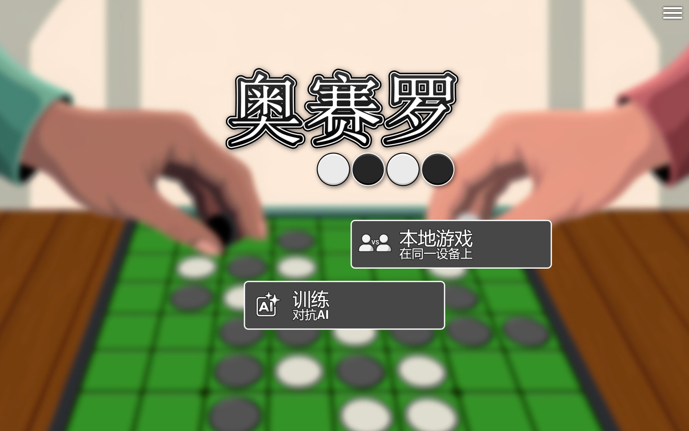
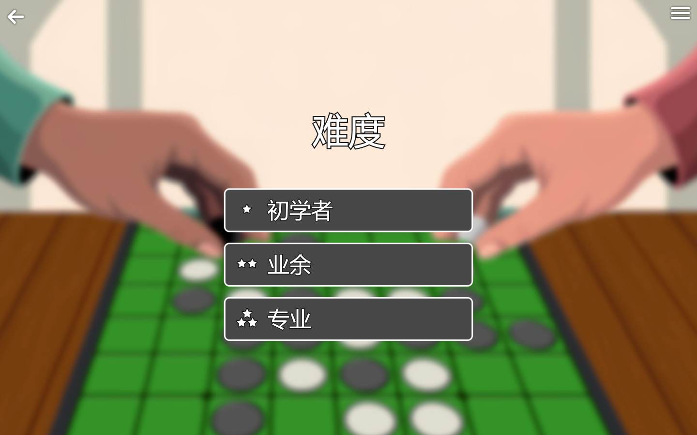
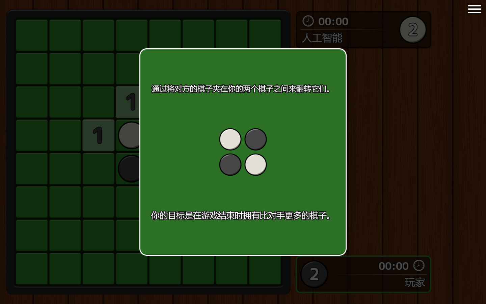
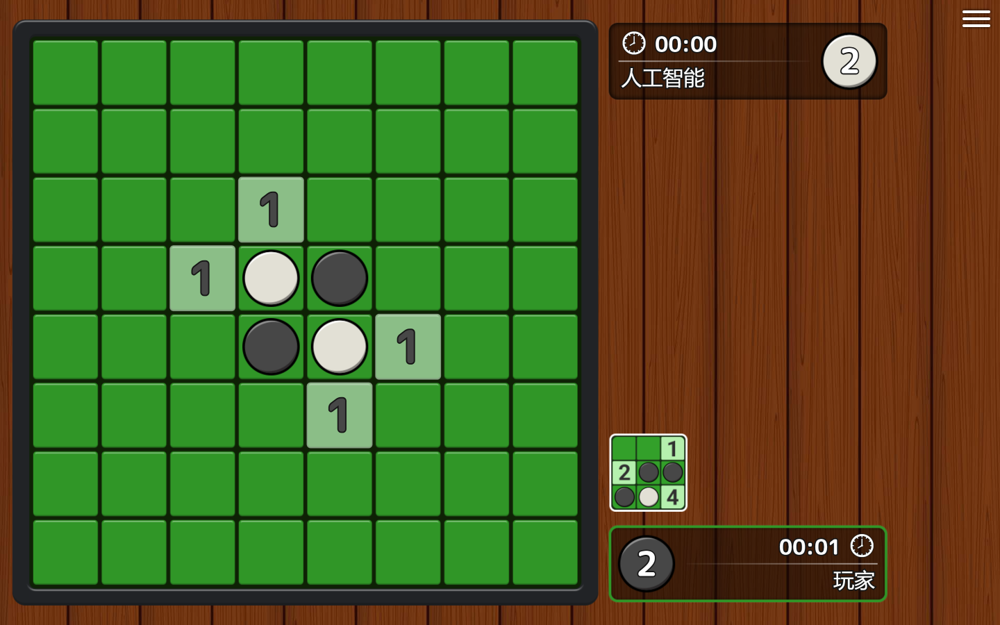
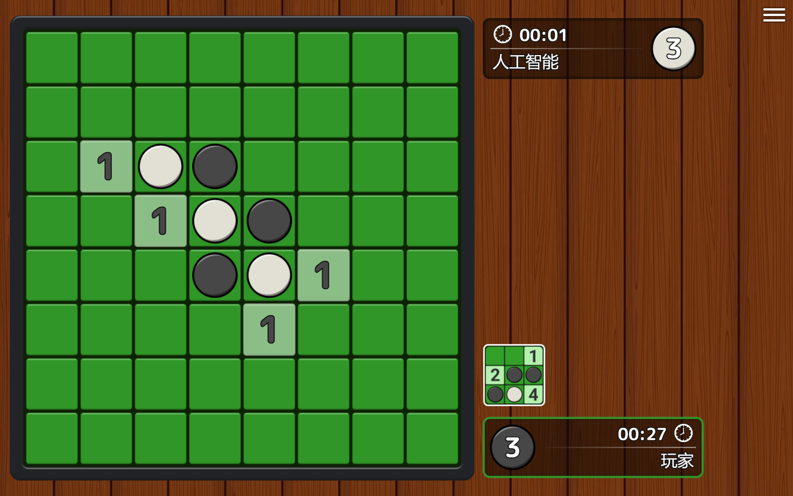

# Reversi 游戏规格说明书

格式版本：V5.1

仅记录有依据的实现层事实；内容字段非必填，未知留空，不代表不存在或已经验证。

## 1. 基础事实

**维度定义**：让读者第一眼知道“这是什么类型、什么操控体验的游戏”，以及它的技术栈。

**内容说明**

MSN9n3s2qsvv0vn/v5，Reversi；原界面中文奥赛罗。CodeThisLab CreateJS/Canvas与Howler，JavaScript/HTML/CSS。实际1440×900桌面视口，原1920×1920画布按原逻辑缩放裁背景；手机未测。

## 2. 资源类型

**维度定义**：游戏中游戏内容元素的资源类型是什么——即在哪个引擎运行下的资源格式。

**内容说明**

原静态文件95项取得并保留来源与SHA。运行修订初始86文件，移除仅在线/更多游戏使用的9项；74个非脚本/HTML资源原字节核对一致，包括原棋盘、黑白棋子、按钮/难度、帮助、8个MP3及本地字体。已退役轮播的owl.video.play.png原404保留证据，不伪造替图。

## 3. 核心挑战维度

**维度定义**：游戏核心玩法主要挑战 / 满足人的什么。

**内容说明**

在8×8棋盘空格落子，用己方两端夹住连续对方棋子并翻色，争取终局占子更多。单机CPU依据原搜索/评价方法回应；这轮实际完成玩家落子和CPU回应。

## 4. 操控方式

**维度定义**：操控本身的复杂度 + 需要玩家判断的时机 / 策略复杂度。

**内容说明**

鼠标点原训练/对抗AI→初学者→规则帮助任意处退出→点击有1枚可翻提示的高亮格。四次click各为一次move/down/up，另一次为首次导航，合计5输入。没有脚本调用游戏业务处理器。

## 5. 行为路径

**维度定义**：玩家一局里重复做什么。

**内容说明**

原木纹菜单奥赛罗→训练难度初学者/业余/专业→初学者规则帮助→原8×8初始4子与合法格提示→玩家落子/翻转→CPU自动落子/翻转→原双方计数3:3，轮回玩家。

## 6. 游戏路径（关键节点 + 流失风险）

**维度定义**：从开始到结束的流程 + 每个关键节点的潜在流失风险点。

**内容说明**

累计5次真实输入：进入原入口、训练/对抗AI、初学者、关闭原规则帮助、点击可见高亮合法格（屏幕390,300）。实际初始黑2/白2/占4格，玩家黑棋落至第3行第4列，原CPU白棋回应第3行第3列，最终黑3/白3/占6格。原规则夹吃翻转和CPU回应在真实画面出现，截图001至005已查看。只读getType读取可见棋子用于记录，不调用落子/AI方法、不读隐藏解题答案、不改棋盘或时间。未完成整局、胜负结算、刷新存档、另外两档难度、本地双人或手机验证。

## 7. 成长路径

**维度定义**：玩家如何推进变强。

**内容说明**

原本地对局、重开和返回菜单逻辑保留；本轮没有存储键出现，未宣称跨刷新存档或关卡成长。原在线账号、房间、匹配、平台排行和消费进度已退役。

## 8. 核心闭环（目标-规则-反馈-激励）

**维度定义**：游戏是否具备“明确目标 → 明确规则 → 达成反馈 → 奖励激励 → 下一目标”的完整闭环。

**内容说明**

观察棋盘与合法格提示→选择夹吃落点→原cellFlips翻色→原countPawn更新双方计数→原CPU评价/搜索选择并落子→交替直至原终局判定。实测仅首个玩家/CPU往返，终局源码保留而未试玩。

## 9. 玩法规则

**维度定义**：核心循环、玩法规则、目标与进度。

**内容说明**

10个重点方法AST精确一致：开局布子、cellClicked、numFlips、cellFlips、calcFlipCounts、countPawn、rate、othelloAI及单机_startGame/changeTurn。31个原核心方法中28个AST一致，3个只退役发行集成；CCell整个原函数字节一致。原合法性、翻转、换手、跳过/终局算法保持。

## 10. 数值配置

**维度定义**：影响玩法的关键数值。

**内容说明**

原8×8共64格，初始4子（黑2/白2）。实际一次玩家落子加一次CPU回应后占6格（黑3/白3）。原配置TIME_PER_MOVE30000ms、MAX_AI_THINKING1500ms、预载最短3500ms；这些常量来自源码，不代表实测所有超时分支。

## 11. 关卡配置

**维度定义**：关卡结构、递进规律、难度曲线。

**内容说明**

原无关卡序列；本地双人、单机CPU和初学者/业余/专业3档保留。只实际选择初学者，另两档与同设备双人未运行。

## 12. 系统设计

**维度定义**：功能系统清单、UI 流程。

**内容说明**

138处main精确范围改动，移除64个仅服务端GUI方法。完整物理退役PlayerIO、网络序列化、在线房间/匹配/在线bot、平台协议/账号/内购、排行/广告/发行外链及其调用。保留原独立浏览器工具，JSON使用真实浏览器内置，语言取navigator原生属性与原支持表，不提供SDK替身。

## 13. 主题化包装

**维度定义**：游戏的题材 / 世界观包装。

**内容说明**

原木纹背景、绿色棋盘、高亮合法格翻子数量、黑白圆棋子、双方面板、中文帮助与菜单保留。原帮助示意棋盘/静态署名保留，外链信用按钮改为纯本地显示，不假冒原平台版本。

## 14. 养成系统 + 经济系统

**维度定义**：玩家如何成长、经济如何循环。

**内容说明**

原普通棋盘占子计数是胜负依据，不新增金币、奖励或成长。广告奖励、内购、在线身份及其面板移除；没有伪造奖励/免费解锁。

## 15. 角色 / 单位设定

**维度定义**：有哪些角色/单位、各自定位（玩法层面）。

**内容说明**

原玩家黑棋与CPU白棋、8×8格子、合法格翻子数字、规则帮助、原双方面板及菜单。无叙事角色或新增替代素材。

## 16. 商业化

**维度定义**：靠什么变现。

**内容说明**

原平台SDK/PlayerIO账号房间、广告、排行报分、内购和更多游戏/反馈/隐私外链与调用物理退役。同设备双人与本机CPU保留原规则，本轮观察无服务端或外部访问。

图 1：原奥赛罗菜单，在线入口退役

图 2：原CPU三档难度

图 3：原规则帮助，未开始计时

图 4：原初始黑2白2与合法格提示

图 5：实际玩家及CPU落子后黑3白3
