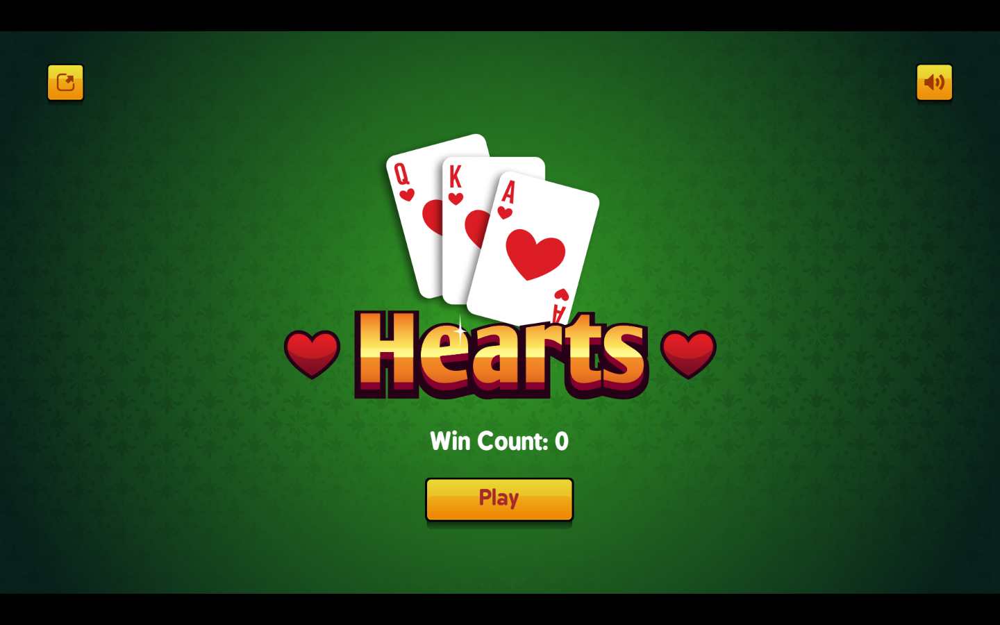
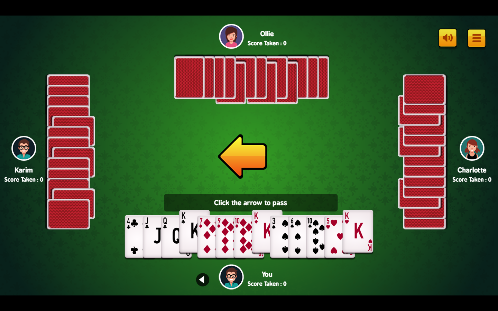
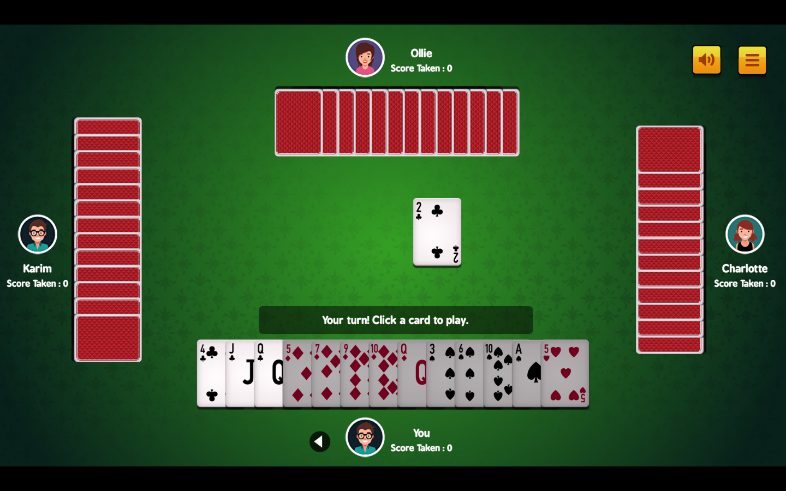
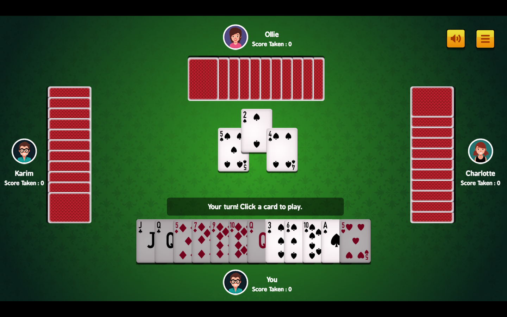

# Hearts 游戏规格说明书

格式版本：V5.1

仅记录有依据的实现层事实；内容字段非必填，未知留空，不代表不存在或已经验证。

## 1. 基础事实

**维度定义**：让读者第一眼知道“这是什么类型、什么操控体验的游戏”，以及它的技术栈。

**内容说明**

MSN9mzhg3kjmmk4，原Hearts v9、内部microsoft-hearts；ImpactJS/Canvas2D、JavaScript/HTML/CSS，2D牌桌。实际1440×900视口，内部1920×1080画布显示1440×810，纵向上下留黑。实体手机未测。

## 2. 资源类型

**维度定义**：游戏中游戏内容元素的资源类型是什么——即在哪个引擎运行下的资源格式。

**内容说明**

原5张PNG图集/40frame、原卡牌/人物/按钮/桌面、原品牌图2张；montserrat与bpreplay两字体各woff2/woff/ttf，原13MP3。32基础依赖保持源字节，另含离线HTML和按范围修订的JS；原文件与源SHA归档。

## 3. 核心挑战维度

**维度定义**：游戏核心玩法主要挑战 / 满足人的什么。

**内容说明**

四人红心避分牌戏，一名人类与三名原本地CPU轮流出牌。根据自己的可见手牌换出三张牌、跟随首出花色，减少吃到带罚分的红心与黑桃Q。罚分规则为代码确认，本轮实际罚分全部0。

## 4. 操控方式

**维度定义**：操控本身的复杂度 + 需要玩家判断的时机 / 策略复杂度。

**内容说明**

原Play开始；点击三张不同的自己可见手牌后点原换牌箭头；轮到自己时点击合法手牌出牌。原菜单/声音/普通新局和下一手入口保留，其余入口本轮未操作。

## 5. 行为路径

**维度定义**：玩家一局里重复做什么。

**内容说明**

原菜单→Play→原随机发13张牌→分别选三张→原箭头交换→原梅花2首出→玩家点击自有梅花4→CPU跟进完成首墩→第二墩三CPU出牌→回到玩家。

## 6. 游戏路径（关键节点 + 流失风险）

**维度定义**：从开始到结束的流程 + 每个关键节点的潜在流失风险点。

**内容说明**

本轮换出K红心/K方块/K梅花给原Karim，收到方块5/方块Q/黑桃A。Charlotte首出梅花2，玩家合法梅花4；首墩后Karim作为第二墩首家出黑桃5，Ollie出2、Charlotte出4，人类继续选择，未额外出第二张。

## 7. 成长路径

**维度定义**：玩家如何推进变强。

**内容说明**

原52张牌四人各13张，按墩消耗手牌，原结算/下一手逻辑保留；换牌方向按原passTarget及roundNumber周期，第四轮不换。静态周期存在不代表已实测四轮。本轮仅首墩与第二墩轮到人类。

## 8. 核心闭环（目标-规则-反馈-激励）

**维度定义**：游戏是否具备“明确目标 → 明确规则 → 达成反馈 → 奖励激励 → 下一目标”的完整闭环。

**内容说明**

观察自己的手牌与公开首出→按原跟花/破心限制选牌→普通点击出牌→原本地CPU跟牌→原判墩与罚分累计→下一墩。目标是减少罚分；实际只确认一次合法人类跟牌和原CPU下一墩，未观察非零罚分。

## 9. 玩法规则

**维度定义**：核心循环、玩法规则、目标与进度。

**内容说明**

源码确认首墩由梅花2开始，能跟花时必须跟随；红心每张1罚分，黑桃Q13罚分，破心限制和原本地CPU规则保留。原卡牌/玩家/计分管理/场景模块归一AST一致；不同于已有Spades的搭档叫牌/Nil/将牌玩法。未把复用的旧Spades类名当成当前规则。

## 10. 数值配置

**维度定义**：影响玩法的关键数值。

**内容说明**

源码确认52张/四人/各13张，换3张；红心1/黑桃Q13为源码值。实际己方手牌13→12、三张选择计数1→2→3，currentRound1→2；所有公开ScoreTaken0，未用未更新的旧trickTaken字段证明计墩。

## 11. 关卡配置

**维度定义**：关卡结构、递进规律、难度曲线。

**内容说明**

原标准牌组、花色/点数、原passTarget三方向及第四轮无换牌；原随机顺序与CPU决策保留。没有人为指定手牌、强制CPU行为、解锁奖励或改结束阈值；关卡/长局完成未测。

## 12. 系统设计

**维度定义**：功能系统清单、UI 流程。

**内容说明**

保留Impact/图集加载器、Card/Player/ScoreManager、发牌/换牌/跟花/判墩、CPU和本地IO。250个原游戏及FontInfo方法中215归一AST相同，28服务方法退役，7方法仅退役服务调用或控件。归一只去位置/字面量格式并按同操作符&&/||保留求值顺序消除冗余结合括号。

## 13. 主题化包装

**维度定义**：游戏的题材 / 世界观包装。

**内容说明**

原绿色花纹牌桌、红色牌背、白底黑红卡面、原卡通头像、ScoreTaken与回合提示、黄色声音和菜单按钮。实际截图呈现三CPU黑桃5/2/4及剩余12张人类手牌，不用占位素材。

## 14. 养成系统 + 经济系统

**维度定义**：玩家如何成长、经济如何循环。

**内容说明**

原本地回合/罚分记录与声音IO保留。无新增货币、内购、广告奖励、免费减分或额外轮次。未刷新页面，存档恢复未验证。

## 15. 角色 / 单位设定

**维度定义**：有哪些角色/单位、各自定位（玩法层面）。

**内容说明**

一名人类You，三个原内置本地算法对手Karim/Ollie/Charlotte；名字与头像取自原包，不是在线玩家或假账号。证据只读取自己的牌、公开出的牌、公开分数和对手剩余张数。

## 16. 商业化

**维度定义**：靠什么变现。

**内容说明**

Microsoft/API/广告控制器、分享/更多游戏外链及激励额外轮次/减分按钮和奖励回调物理退役。普通新局/下一手/正常罚分保留，不用SDK替身或奖励成功回调。只需本地静态HTTP，无原业务服务器，实测请求同源；未覆盖全部功能。

图 1：原Hearts菜单

图 2：原生选择三张待换手牌

图 3：正常交换后原梅花2首出，玩家回合

图 4：玩家正常出梅花4，进入下一墩并轮回人类
